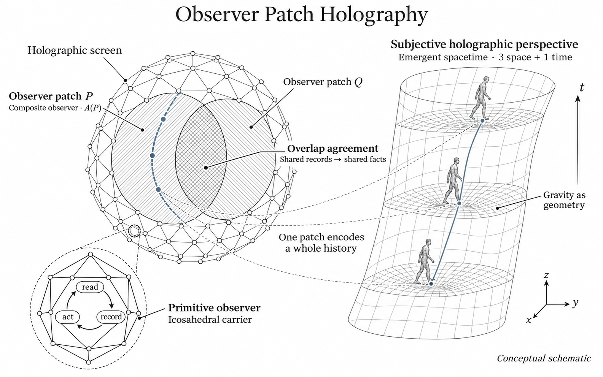

# Observer Patch Holography

**OPH proposes that the Universe is what its observers agree on, and builds that idea as a program you can run.**

<p align="center">
  
</p>
<p align="center"><b><a href="https://philpapers.org/rec/MUEFOC">Synthesis paper</a> · <a href="https://oph-book.floatingpragma.ai/">Book</a> · <a href="https://floatingpragma.ai/faq/">Reality FAQ</a> · <a href="https://notebook.google.com/notebook/d5249760-6ce8-44a0-927b-ccf90402711a">Notebook</a> · <a href="https://particles.floatingpragma.ai/">Simulation</a></b></p>

[](https://github.com/FloatingPragma/observer-patch-holography/actions/workflows/mandatory-suite.yml)
[](https://github.com/FloatingPragma/observer-patch-holography/actions/workflows/lean-ci.yml)
[](https://github.com/FloatingPragma/observer-patch-holography/actions/workflows/observer-model.yml)

## The idea

Small observers keep local records, compare them with their neighbours and
repair every disagreement with one local rule. Whatever survives every
comparison is public fact. OPH asks whether such a process, fully specified
and executed, produces observers whose shared records look like our world:
three-dimensional space, quantum measurement, the Standard Model's forces and
particles, and gravity.

The Universe reads itself into existence. Observers recover the rules behind
their records and build the process that realizes that same history, so
nothing lies outside the loop. The [basis](docs/BASIS.md) states this closure
hypothesis in full.

## What comes out

One declared observer architecture, a network of twelve-port carriers with a
single repair and memory law, yields:

- **Spacetime and fields as effective descriptions.** Coarse-grained, the
  observers' shared records are described by relativistic field theories in
  three space dimensions and one time, together with gravity. The carrier's
  slow response is exactly three-dimensional, and a Lorentzian (1+3)-dimensional
  field theory reproduces the observers' joint readouts.
- **The rules of quantum measurement.** Completed records obey the Born rule,
  repeatable measurement and the Tsirelson bound on Bell correlations.
- **The Standard Model's forces.** Under stated premises the gauge structure
  is that of the Standard Model.
- **Quarks and leptons.** Each generation of matter comes out with exactly the
  observed charges: three colours of up and down quarks, the electron and its
  neutrino. A generation register gives the charged-lepton mass ratios
  206.770316 and 3477.4728, within 0.001 and 0.003 per cent of measurement, so
  the muon and tau masses follow from the electron's. The Koide relation
  follows from the carrier's face symmetry.
- **The early-universe transitions.** Lattice runs of the same model reproduce
  the electroweak crossover near 161 GeV and colour deconfinement.
- **Gravity.** A realized balance of records gives the Einstein equation.

Each result keeps its calibrated inputs and the conditions of its physical
identification. The [matches page](https://particles.floatingpragma.ai/?page=matches)
lists every comparison with nature, partial matches and open items included.

## How it works

The concrete bet is a program: one local repair law on a network of
twelve-port carriers. The [executable hypothesis](docs/OPH_EXECUTABLE_HYPOTHESIS.md)
says what counts as success, and the [completion program](docs/COMPLETION_PROGRAM.md)
splits the remaining work into gates with stopping rules. The design choices
may be reverse-engineered; the test is that one fully specified program runs
and reproduces what observers measure.

## Mathematics you can check

The [Lean library](Lean/) holds more than 12900 public theorems and lemmas
with no admitted proofs, covering consensus, quantum records, the gauge
structure, thermodynamics and the Koide identity. Every computational result
ships with a receipt that binds its inputs and replays.

## Tests fixed in advance

Predictions and their rejection rules are frozen before the data, with
OpenTimestamps proofs anchored in Bitcoin, in the
[frozen-prediction ladder](docs/FROZEN_PREDICTION_LADDER.md). The
[postdiction ledger](docs/POSTDICTION_LEDGER.md) and the
[falsification programme](docs/OPH_FALSIFICATION_PROGRAM.md) state how the
construction can fail.

## Run the observer

From the repository root, with Python 3.11 or newer:

```sh
python3 -m model.observer run --trials 10000 --seed 42
```

This runs the minimal record-and-feedback experiment and prints forecast
scores and a result hash. The [model guide](model/README.md) covers the rest.

## Papers

- **[Observers Who Read Their Universe into Existence](flagship/from_observer_consensus_to_standard_physics.pdf)**
  is the main paper. Cite its released version, the
  [PhilPapers record](https://philpapers.org/rec/MUEFOC).
- **[An Executable Observer](paper/executable_observer_construction.pdf)**
  specifies the program and its executed components.
- **The theorem library** holds the long proofs:
  [consensus](paper/reality_as_consensus_protocol.pdf),
  [observers and records](paper/observers_are_all_you_need.pdf),
  [spacetime and Einstein dynamics](paper/recovering_observer_spacetime_and_einstein_dynamics_from_overlap_consistency.pdf),
  [gauge structure](paper/deriving_standard_model_gauge_structure_from_observer_overlap_consistency.pdf)
  and [particles](paper/deriving_the_particle_zoo_from_observer_consistency.pdf).
  The [paper index](paper/README.md) lists every paper.

## Where things are

| Path | What it holds |
| --- | --- |
| [model/](model/README.md) | The executable observer: implementation, tests and receipts |
| [flagship/](flagship/) | The main paper |
| [paper/](paper/README.md) | The construction paper and the theorem library |
| [extra/](extra/README.md), [cosmology/](cosmology/) | Companion papers |
| [Lean/](Lean/) | The machine-checked library |
| [code/](code/README.md) | Exact calculations and verifiers behind the papers |
| [evidence/](evidence/README.md) | Retained evidence packets |
| [claims/](claims/README.md) | Claims and their dependencies |
| [tracking/](tracking/) | Premise, observation, prediction and instrument registers |
| [docs/](docs/README.md) | The basis, working terms, policies and ledgers |
| [book/](book/) | The book |

## Reproduce and verify

The [reproduction guide](REPRODUCE.md) runs the full verification suite from
a clean clone:

```sh
python -m pip install -r model/requirements.txt
python -m model.verify
python -m pytest -q -W error model
```

The [book](book/), the textbooks at [learn.floatingpragma.ai](https://learn.floatingpragma.ai/)
and the [interactive simulation](https://simulation.floatingpragma.io/) are
the gentlest introductions.

## Contributing

Contributions should connect one more piece of observed physics to the
running observer, or expose a failure in it. The
[construction guide](model/CONSTRUCTION.md), the
[repair-law guide](model/CANDIDATES.md) and the
[research issues](https://github.com/FloatingPragma/observer-patch-holography/issues?q=is%3Aissue+is%3Aopen+label%3Aprogram%3Aphysics)
set out the work. Main-branch PDFs are source previews; deposited releases
keep their original bytes.

Ce README existe aussi [en français](README_FR.md).

## License

Software, including Lean and the model code, uses [Apache-2.0](code/LICENSE).
Papers, documentation, figures, data and ledgers use [CC BY-NC-SA 4.0](LICENSE),
with upstream Particle Data Group terms for the packaged particle values.
The [license map](LICENSE) gives the directory-specific terms.

<details>
<summary>Related projects and funding</summary>

[Cadence](https://github.com/muellerberndt/cadence) is the related learning-machine
project. Its capability evidence is separate from OPH's physics evidence.
[Pragma Research](https://floatingpragma.ai/) brings the projects together.

OPH's official TEO (Theory Of Everything) memecoin was deployed by the Base
community and lives on Base at
`0xd2a7055317D0c7b316319cDadaE592D0644A0b07`
([chart](https://dexscreener.com/base/0xba55cdae026b9dd63fcb50e82094d61472948e44527ca4791033497469228049)).
Its trading fees are routed to Bernhard Mueller to fund the project.
The token has no role in the theory. Other tokens using the OPH or TEO name
are unrelated. Nothing here is financial advice.

</details>

<!-- PUBLIC-QUANTITATIVE-CLAIMS:BEGIN -->
<!-- Quantitative table suppressed while physical_establishment count is zero. -->
<!-- PUBLIC-QUANTITATIVE-CLAIMS:END -->
