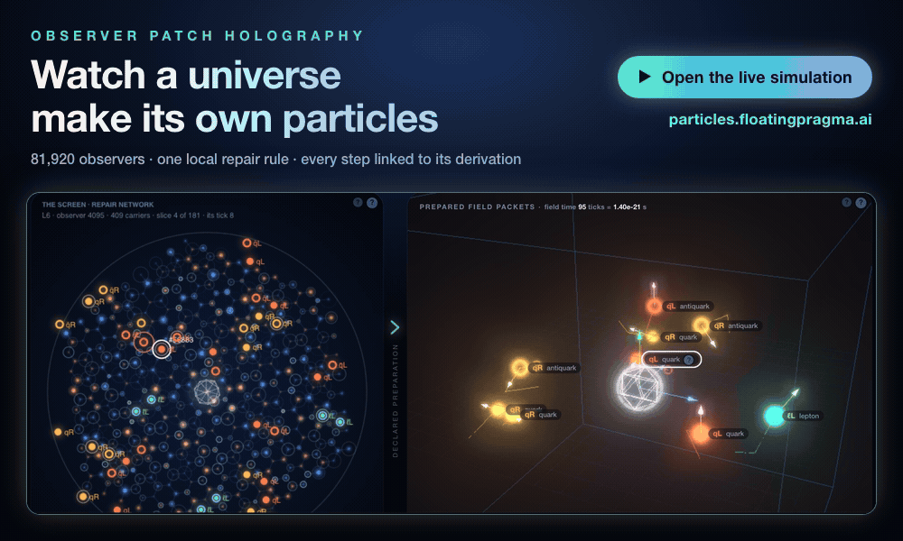

# Holographie des parcelles d’observateur

**OPH développe une théorie exécutable d’un univers autoréférentiel d’observateurs, associant des constructions finies démontrées à des tests quantitatifs de leur interprétation physique.**

<p align="center">
  <a href="https://particles.floatingpragma.ai/"></a>
</p>
<p align="center"><b>▶ <a href="https://particles.floatingpragma.ai/">Ouvrir la simulation en direct</a></b> · <a href="https://particles.floatingpragma.ai/?page=journey">Des observateurs aux particules</a></p>

[**Simulation en direct**](https://particles.floatingpragma.ai/) · [Article principal](https://philpapers.org/rec/MUEFOC) · [Livre](https://oph-book.floatingpragma.ai/) · [FAQ sur la réalité (en anglais)](https://floatingpragma.ai/faq/) · [Carnet](https://notebook.google.com/notebook/d5249760-6ce8-44a0-927b-ccf90402711a) · [Bibliothèque Lean](Lean/) · [Reproduire](REPRODUCE.md) · [Pragma Research](https://floatingpragma.ai/) · [English](README.md)

[](https://github.com/FloatingPragma/observer-patch-holography/actions/workflows/ci.yml)
[](https://github.com/FloatingPragma/observer-patch-holography/actions/workflows/lean.yml)

## Mission

La mission de l’Holographie des parcelles d’observateur (OPH) est de
construire un processus exécutable dont les observateurs natifs vivent des
expériences physiquement indiscernables de celles des observateurs de notre
Univers : les mêmes champs continus effectifs en trois dimensions, la même
gravité, les mêmes particules, masses au repos et autres phénomènes observables.
Les observateurs retrouvent et réalisent le matériel et le logiciel de cette
même histoire autoréférentielle. Il n’existe ni espace-temps de fond indépendant
ni horloge globale extérieure. Les événements de calcul sont partiellement
ordonnés ; l’espace-temps et les horloges locales mutuellement étalonnées sont
des descriptions effectives des registres compatibles des observateurs.

Le matériel et le logiciel peuvent être reconstruits par rétro-ingénierie.
Leur unicité et une dérivation a priori de leurs choix de conception ne sont
pas exigées. Des réalisations différentes pourraient produire le même univers
observable. Le test est qu’une réalisation entièrement spécifiée fonctionne et
reproduise toutes ces observations, avec cohérence mathématique et une origine
explicite de ses paramètres. Cette théorie doit remplir quatre conditions.

1. **Cohérente.** La boucle se referme. Son point fixe existe, construit
   explicitement et vérifié par machine, et une théorie qui possède un modèle
   ne contient aucune contradiction.
2. **Déterminée.** Une fois la construction exécutable fixée, sa dynamique
   et ses lectures natives déterminent chaque observable sans dimension
   revendiqué. Les choix de conception issus de la rétro-ingénierie sont
   permis. L’étalonnage empirique est distingué des prédictions indépendantes ;
   une valeur mesurée commune peut fixer les unités.
3. **Complète**, au sens
   qu’[Einstein, Podolsky et Rosen](https://doi.org/10.1103/PhysRev.47.777)
   ont donné à ce mot en 1935. Chaque élément de la réalité physique a une
   contrepartie dans la théorie, et chaque grandeur mesurée est dérivée.
4. **Correcte.** Les valeurs dérivées concordent avec la mesure, et les
   nouvelles prédictions sont figées avant d’être testées.

OPH ne prétend pas être la seule théorie dotée de ces propriétés.

## L’idée

OPH propose que la physique est
ce que des observateurs bornés peuvent établir ensemble. Des observateurs
finis comparent leurs registres sur des frontières partagées, réparent leurs
désaccords et tiennent pour réel ce qui résiste à toutes les comparaisons.
Trois problèmes qui résistent à une description classique motivent le
programme : la mesure quantique, les corrélations qu’aucun modèle classique
local ne reproduit et l’origine d’un espace-temps apparent. OPH cherche une
explication commune des trois dans la cohérence des registres et des
opérations des observateurs, et la poursuit sous la forme d’un observateur
exécutable, de mathématiques vérifiées par machine et de prédictions fixées à
l’avance.

**L’Univers se lit lui-même jusqu’à l’existence.** OPH a une seule
hypothèse, l’hypothèse de clôture : l’Univers est une structure intemporelle
et autoréférentielle dont les observateurs retrouvent la spécification de
leur propre monde à partir de leurs registres et construisent un matériel qui
réalise cette même histoire, y compris ses constructeurs. Rien ne se trouve
hors de cette boucle ; la spécification retrouvée n’a donc besoin d’aucune
autre justification. Elle doit fonctionner et reproduire ce que mesurent les
observateurs. L’espace, le temps et la matière sont des descriptions
effectives des registres, et « notre Univers » est le registre public, ce qui
résiste à toute comparaison entre observateurs. La [base](docs/BASIS.md)
énonce l’hypothèse, la règle de l’absence d’extérieur, la condition d’accord
et la spécification exécutable ; le
[guide des termes](docs/INTERPRETATION_AND_TERMS.md) explique la vision
intemporelle et les horloges qu’elle contient.

## L’hypothèse exécutable

Le [modèle exécutable officiel](model/SPEC.md) réunit la matière native
complète, le transport des leptons chargés et neutres, les courants faibles,
les champs électriques et magnétiques et une réponse locale à l’énergie
totale. Chaque sommet possède ses propres registres de volume, de capacité
et de mémoire ; les composantes déconnectées évoluent indépendamment. La loi, les paramètres et la préparation sont fixés avant
l’évolution. Les vérifications exactes portent sur les polynômes et des
colonnes natives complètes ; les petites évolutions numériques ont leurs
propres supports explicitement déclarés. Elles ne constituent pas une
propagation arbitraire de l’état natif complet. Les preuves conditionnelles
sur d’autres sources gardent leurs hypothèses, et leur transfert exige une
identification démontrée. Le continuum commun et l’interprétation physique
des particules et de la gravitation exigent les tests correspondants.

L’[hypothèse](docs/OPH_EXECUTABLE_HYPOTHESIS.md) dit ce qui
compterait comme un succès, et le [programme d’achèvement](docs/COMPLETION_PROGRAM.md)
découpe le travail en étapes avec des règles d’arrêt : soit les pièces se
rejoignent sur un même processus, soit une preuve montre que toute la classe
de lois échoue.

## Axe de recherche

Nous avons construit un [modèle exécutable](model/README.md) d’OPH. Un
Hamiltonien fixe couple la matière, les champs électriques et magnétiques et
des registres de réponse locaux sur un support fini, et des détecteurs
complets conservent chaque résultat. La théorie qui l’entoure est achevée :
le principe de clôture, la bibliothèque de théorèmes et les constructions
finies sont en place.

La pièce manquante est la bonne loi de réparation native, la loi simple qui
gouverne les interactions des observateurs dans l’Univers primitif. La loi
qu’exécute le modèle aujourd’hui est un test intermédiaire calibré.
L’identification de la bonne loi fait l’objet d’une recherche intense en
cours. Les tests physiques des articles, du spectre des particules à la
gravitation, sont ce que cette loi doit réussir sur un même processus.

## Points forts

Les résultats ci-dessous portent sur les sources et les préparations
explicitement déclarées dans leurs preuves. Leur transfert au modèle
commun exige une identification démontrée ; ils ne sont pas tous des
conséquences de son Hamiltonien.

- **Des registres exacts de nombres quantiques.** Une construction fermionique
  déclarée réalise les quinze poids internes d’une génération du Modèle
  standard. Ses six classes de flux correspondent à l’hypercharge modulo
  le centre. Des lectures complètes calibrées conservent charge, couleur,
  hélicité, impulsion et énergie, avec les références quantiques qui
  compensent la charge. Le lien avec les particules observées exige leur
  source physique et leur dynamique.
  [Article sur les particules](paper/deriving_the_particle_zoo_from_observer_consistency.pdf).
- **Le groupe de jauge et les courants natifs.** Sous les prémisses de
  courant complet, le support orienté admet (SU(3)×SU(2)×U(1))/Z6 et une
  représentation de matière sans anomalies. Les instruments natifs de
  charge, spin et Gauss conservent toutes leurs issues. Les couplages
  physiques et un continuum chiral en interaction exigent leur raccordement
  à la même source.
  [Article sur la jauge](paper/deriving_standard_model_gauge_structure_from_observer_overlap_consistency.pdf).
- **Un observateur qui fonctionne.** Un observateur à douze ports conserve ses
  registres et s’en sert pour choisir sa prochaine réparation. Des observateurs
  qui se chevauchent lisent une référence commune et son horloge, un processus
  quantique fini réunit flux électrique, matière chargée et champ scalaire, et
  les écrans raffinés donnent des limites de champ gaussiennes et des ondes de
  vitesse finie.
- **Un champ scalaire lorentzien à partir des registres.** Sur une extension
  radiale déclarée de l’écran raffiné, une seule action fixe corrélations,
  réponse et horloge modulaire, et une théorie lisse de champ scalaire en
  dimension (1+3) reproduit tout ensemble fini de lectures conjointes. La direction radiale et les unités physiques sont des entrées.
  [Construction scalaire conditionnelle](model/relative_observer_geometry/README.md#lorentzian-density-of-the-product-wave).
- **La physique standard à partir d’un accord fini.** Sous des prémisses
  énoncées, des théorèmes finis donnent à la spécification des structures
  familières : des registres publics indépendants de l’ordre des réparations ;
  la règle de Born et la borne de Tsirelson sur les registres achevés ; un
  support tridimensionnel dans sa réponse lente ; l’algèbre de Lie de jauge du
  Modèle standard et une représentation de matière sans anomalies
  conditionnelle ; un ordre causal de dimension (1+3) et des horloges locales déclarées ; et l’équation d’Einstein à partir d’un bilan nul.
- **Émission et horloges natives.** Les calculs complets certifient un
  contraste de parité d’impulsion bêta et une fenêtre finie d’émission
  mésonique. Deux facteurs d’horloge de la source native à huit niveaux
  ont une limite commune de sonde faible. Les échecs, le travail et la
  rétroaction sont conservés ; ces registres finis ne déterminent ni les
  durées de vie physiques ni le temps propre d’Einstein.
  [Courant sortant](model/openwave_beta_outgoing/PROOF.md),
  [Horloges natives](model/openwave_joint_native_clocks/PROOF.md).
- **Les champs libres et le côté matière de la gravitation.** Une action originale sur le cube possède un fondamental sur réseau infini à énergie d’excitation positive et un champ de spin continu à propagation finie. Son continuum chargé est démontrablement libre pour
  `U=o(c^(2/7))`, avec des énergies de Weyl sans masse dans les huit vallées, et à
  couplage nul les variations d’entropie régionale convergent vers la réponse de
  contrainte qu’utilise la dérivation d’Einstein.
  [Construction du continuum](model/completion/CONTINUUM_FIELD_AND_ENTROPY.md).
- **Des mathématiques vérifiables.** La [bibliothèque Lean](Lean/) contient
  plus de 12900 théorèmes et lemmes publics sans preuve admise, et chaque reçu
  de calcul conservé est rejoué en intégration continue.
- **Des tests fixés à l’avance.** Les prédictions et leurs règles de rejet
  entrent dans l’[échelle des prédictions gelées](docs/FROZEN_PREDICTION_LADDER.md)
  avant les données de comparaison admissibles, avec des preuves OpenTimestamps,
  pour la plupart ancrées dans Bitcoin ; la prédiction de dispersion pour l’orbite des ports
  primitifs en fait partie. Le [registre des postdictions](docs/POSTDICTION_LEDGER.md), le [programme de falsification](docs/OPH_FALSIFICATION_PROGRAM.md)
  et l’[audit inter-échelles](docs/EMPIRICAL_STATUS.md) séparent les comparaisons
  avec des mesures des tests des mathématiques.

**L’accord avec l’ensemble des statistiques de mesure observées n’est pas
établi.** Les théorèmes valent sous des prémisses énoncées, et l’observateur
exécutable est un candidat jugé selon des critères d’acceptation déclarés.

## Lancer l’observateur

Depuis la racine du dépôt, avec Python 3.11 ou plus récent :

```sh
python3 -m model
```

Cette commande vérifie la source commune et ses expériences finies
complètes. Le [guide du modèle](model/README.md) indique la reproduction
intégrale de la source et les preuves des composants indépendants.

## Fondements mathématiques

- **L’accord et les registres stables.** Sous des conditions explicites de
  terminaison et de cohérence, les réparations locales atteignent un même
  résultat public quel que soit leur ordre.
  [Article sur le consensus](paper/reality_as_consensus_protocol.pdf).
- **Les observations quantiques.** Dans l’algèbre quantique finie énoncée, des
  résultats vérifiés couvrent les mesures répétables, les registres classiques
  que les opérations ultérieures ne peuvent perturber, l’incertitude et la
  borne de corrélation de Bell, avec un état qui l’atteint. Les histoires de
  réparation natives reconstruisent une fonctionnelle positive sur toute
  l’algèbre de matrices à 66 états, où vaut la règle de trace de Born ; l’évolution native ne prépare pas cet état.
  [Algèbres finies d’événements quantiques](extra/machine_checked_finite_event_algebras.pdf),
  [reconstruction native](model/native_quantum_reconstruction/PROOF.md).
- **Trois directions spatiales.** La lecture optimale d’une réponse
  tridimensionnelle fournie sélectionne l’incidence à douze ports, et la règle de
  réparation moyenne du support donne une réponse lente exactement tridimensionnelle
  de géométrie euclidienne, que retrouvent les registres de courant d’un observateur.
  [Construction du support](code/a5_closure/README.md).
- **La symétrie de jauge.** Sous des prémisses énoncées de réponse réversible
  complète et de transport entre observateurs, l’algèbre de réponse à douze
  ports a le type de Lie de jauge du Modèle standard, et une représentation de
  matière spécifiée donne une génération sans anomalies. Des phases sur les
  ports réalisent le groupe global, et six de ses éléments centraux forment
  l’alphabet de flux des défauts de particules.
  [Dérivation de jauge](paper/deriving_standard_model_gauge_structure_from_observer_overlap_consistency.pdf).
- **La thermodynamique.** Des théorèmes finis de réparation donnent une
  inégalité de Clausius, des relations de fluctuation et une inégalité de
  Landauer informationnelle sous une référence et une calibration de l’énergie
  énoncées. La réparation de couture à pièce équilibrée est un rééchantillonnage
  conditionnel exact : l’entropie ne décroît jamais sur les populations binaires,
  et la bande complète garde chaque bit. Un rafraîchissement natif de la mémoire
  réalise le noyau fini des quatre lois, vérifié par machine, en unités de coût
  internes.
  [Exposé thermodynamique](paper/observers_are_all_you_need.pdf).
- **La capacité d’information.** Des résultats exacts comptent les registres
  qui restent distinguables après les opérations permises, bornent ce nombre
  par le support disponible et le suivent lors du raffinement.
  [Capacité des registres](code/capacity_readback/README.md).
- **Le candidat de couplage par paires intriquées.**
  [Alex Wissner-Gross](https://alexwg.org/publications/ChainTheoryAlpha.pdf)
  dérive une expression spectrale finie d’inverse `137.035999189566`. La
  [reconstruction OPH indépendante](model/observer_particles/README.md) lui
  attribue cette construction et teste ses hypothèses de résultats complets et
  de normalisation. Son identification avec le couplage
  électromagnétique physique et son rattachement à l’équation du grain d’écran
  sont conditionnels.
- **La matière et les champs.** Une action fournie de scalaire chargé et de
  Maxwell, avec sa géométrie et sa quantification, donne un hamiltonien en
  interaction après réduction de jauge, et un raffinement scalaire contrôlé
  relie les lectures classiques d’un détecteur à une équation de champ non
  linéaire. L’invariance de jauge, la localité par faces et les rotations du
  support sélectionnent l’action de Maxwell sur les coutures. Un dictionnaire métrique commun est construit.
  [Continuum de matière](paper/observers_are_all_you_need.pdf).

Ce sont des résultats mathématiques conditionnels. Faire tenir leurs prémisses
pour les observations d’un même modèle commun est le problème central de la
construction. La [carte des prémisses](model/PREMISES.md) indique quelles
prémisses la spécification exécutable fournit et lesquelles elle prend comme
entrées.

## Articles

- **[Observers Who Read Their Universe into Existence](flagship/from_observer_consensus_to_standard_physics.pdf)**
  est la synthèse principale : l’hypothèse de clôture, l’hypothèse du modèle
  exécutable et la tour des résultats. Citez sa version publiée, la
  [fiche PhilPapers](https://philpapers.org/rec/MUEFOC).
- **[An Executable Observer for Observer Patch Holography](paper/executable_observer_construction.pdf)**
  énonce la spécification, les composants exécutés et les jonctions
  ordonnées qui restent à construire.
- **La bibliothèque de théorèmes** contient les preuves longues, du
  [consensus](paper/reality_as_consensus_protocol.pdf) et des
  [observateurs et registres](paper/observers_are_all_you_need.pdf) jusqu’à
  l’[espace-temps et la dynamique d’Einstein](paper/recovering_observer_spacetime_and_einstein_dynamics_from_overlap_consistency.pdf)
  et aux [particules](paper/deriving_the_particle_zoo_from_observer_consistency.pdf).
  L’[index des articles](paper/README.md) et l’[ensemble des articles](docs/PAPER_SET.md)
  donnent chaque article et son rôle.
- **Les articles compagnons** portent des résultats ciblés. Le programme de capacité demande si la capacité
  publique attribuée à l’Univers s’accorde avec celle reconstruite depuis
  l’intérieur. Ces calculs de constantes, comme celui de la structure fine,
  ont un statut diagnostique.

## Où se trouvent les choses

| Chemin | Contenu |
| --- | --- |
| [model/](model/README.md) | L’observateur exécutable : implémentation, tests, reçus conservés et enregistrements de protocole |
| [flagship/](flagship/) | L’article de synthèse |
| [paper/](paper/README.md) | L’article de construction et la bibliothèque de théorèmes, avec les articles archivés sous [paper/archive/](paper/archive/README.md) |
| [extra/](extra/README.md), [cosmology/](cosmology/) | Les articles compagnons |
| [Lean/](Lean/) | La bibliothèque vérifiée par machine |
| [code/](code/README.md) | Les calculs exacts, les vérificateurs et les reçus derrière les articles |
| [evidence/](evidence/README.md) | Les paquets de preuves conservés et les enregistrements de garde |
| [claims/](claims/README.md) | Les énoncés établis et leurs dépendances |
| [tracking/](tracking/) | Les registres des prémisses, observations, prédictions et instruments |
| [docs/](docs/README.md) | La base, le guide des termes, les politiques et les registres |
| [book/](book/) | Le livre |

## Reproduire et vérifier

Le [guide de reproduction](REPRODUCE.md) lance la suite de vérification depuis
un clone propre. Le vérificateur du modèle contrôle la source commune et ses résultats ;
la suite de régression vérifie aussi des cas adverses :

```sh
python -m pip install -r model/requirements.txt
python -m model
python -m pytest -q -W error model
```

Le guide donne aussi les contrôles autonomes des particules et des champs
sources utilisés par le [workflow de l’observateur](.github/workflows/observer-model.yml).

La [bibliothèque Lean](Lean/) se compile avec Lake, l’[index de la documentation](docs/README.md)
donne les registres et les politiques, et le [livre](book/) offre un chemin
d’accès plus long. Les manuels sur [learn.floatingpragma.ai](https://learn.floatingpragma.ai/)
et la simulation interactive sur
[simulation.floatingpragma.io](https://simulation.floatingpragma.io/) sont
les introductions les plus accessibles.

## Contribuer

La tâche consiste à faire que le même Hamiltonien et ses instruments
fournissent la physique effective : l’horloge de l’observateur, son interprétation
spatiale et ses mesures de champ sur les mêmes histoires, comparées à des
observations indépendantes. Les
contributions doivent résoudre une connexion nommée ou révéler un défaut du
modèle commun ; le [guide de construction](model/CONSTRUCTION.md), la
[spécification du modèle](model/SPEC.md) et les
[tâches de recherche](https://github.com/FloatingPragma/observer-patch-holography/issues?q=is%3Aissue+is%3Aopen+label%3Aprogram%3Aphysics)
décrivent ce travail. Les publications d’articles suivent le
[guide des articles](paper/README.md#reproducibility) ;
les PDF de la branche principale sont des aperçus des sources, et les versions
déposées conservent leurs octets d’origine.

## Licence

Le logiciel, y compris Lean et le code du modèle, est publié sous
[Apache-2.0](code/LICENSE). Les articles, la documentation, les figures, les
données et les registres sont publiés sous [CC BY-NC-SA 4.0](LICENSE), avec les
conditions amont du Particle Data Group pour les valeurs de particules
empaquetées. La [carte des licences](LICENSE) donne les conditions par
répertoire.

<details>
<summary>Projets associés et financement</summary>

[Cadence](https://github.com/muellerberndt/cadence) est le projet associé de
machines apprenantes. Ses éléments de preuve sur les capacités sont distincts
des éléments de preuve physiques d’OPH.
[Pragma Research](https://floatingpragma.ai/) réunit les projets.

Le memecoin officiel TEO (Theory Of Everything) d’OPH a été déployé par la
communauté Base et se trouve sur Base à l’adresse
`0xd2a7055317D0c7b316319cDadaE592D0644A0b07`
([graphique](https://dexscreener.com/base/0xba55cdae026b9dd63fcb50e82094d61472948e44527ca4791033497469228049)).
Ses frais de transaction sont versés à Bernhard Mueller pour financer le
projet. Le jeton n’a aucun rôle dans la théorie. Les autres jetons qui
utilisent le nom OPH ou TEO n’ont aucun lien avec le projet. Rien ici ne
constitue un conseil financier.

</details>

<!-- PUBLIC-QUANTITATIVE-CLAIMS:BEGIN -->
<!-- Quantitative table suppressed while physical_establishment count is zero. -->
<!-- PUBLIC-QUANTITATIVE-CLAIMS:END -->
