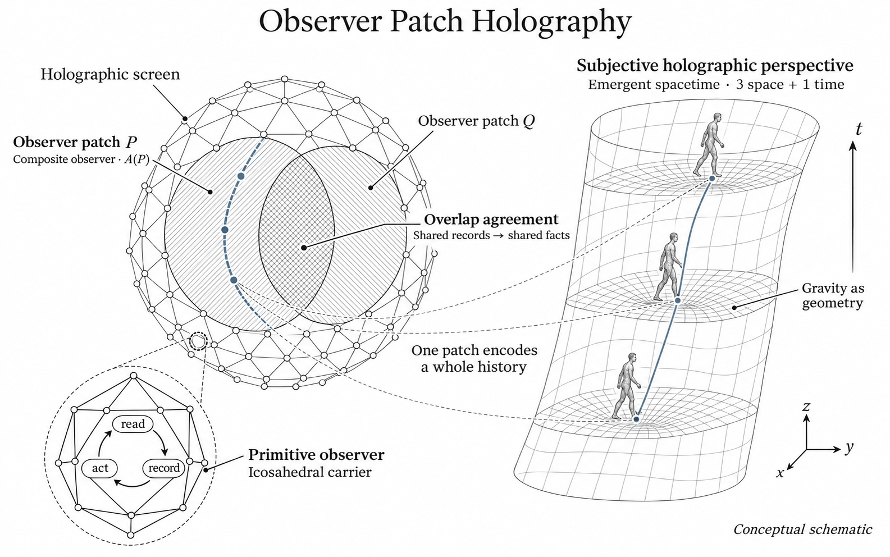

# Holographie des parcelles d’observateur

**OPH propose que l’Univers soit ce sur quoi ses observateurs s’accordent, et construit cette idée comme un programme que l’on peut exécuter.**

<p align="center">
  
</p>
<p align="center"><b><a href="https://philpapers.org/rec/MUEFOC">Article de synthèse</a> · <a href="https://oph-book.floatingpragma.ai/">Livre</a> · <a href="https://floatingpragma.ai/faq/">FAQ sur la réalité (en anglais)</a> · <a href="https://notebook.google.com/notebook/d5249760-6ce8-44a0-927b-ccf90402711a">Carnet</a> · <a href="https://particles.floatingpragma.ai/">Simulation</a> · <a href="Lean/">Bibliothèque Lean</a> · <a href="REPRODUCE.md">Reproduire</a></b></p>

<p align="center">
<a href="https://github.com/FloatingPragma/observer-patch-holography/actions/workflows/ci.yml"></a>
<a href="https://github.com/FloatingPragma/observer-patch-holography/actions/workflows/lean.yml"></a>
</p>

## L’idée

OPH propose que la physique est
ce que des observateurs bornés peuvent établir ensemble. Des observateurs
finis comparent leurs registres sur des frontières partagées, réparent leurs
désaccords et tiennent pour réel ce qui résiste à toutes les comparaisons.
L’Univers évolue par une dynamique locale de désaccord et de réparation.
Trois problèmes qui résistent à une description classique motivent le
programme : la mesure quantique, les corrélations qu’aucun modèle classique
local ne reproduit et l’origine d’un espace-temps apparent. OPH cherche une
explication commune des trois dans la cohérence des registres et des
opérations des observateurs, et la poursuit sous la forme d’un observateur
exécutable, de mathématiques vérifiées par machine et de prédictions fixées à
l’avance.

**L’Univers se lit lui-même jusqu’à l’existence.** OPH a une seule
hypothèse, l’hypothèse de clôture : l’Univers est une structure intemporelle
et autoréférentielle dont les observateurs retrouvent la spécification de
leur propre monde à partir de leurs registres et construisent un matériel qui
réalise cette même histoire, y compris ses constructeurs. Rien ne se trouve
hors de cette boucle ; la spécification retrouvée n’a donc besoin d’aucune
autre justification. L’événement où les observateurs ont rétro-conçu et construit
ce processus est un point fixe mathématiquement garanti de l’histoire, et il
existe dans notre futur subjectif comme notre passé existe. Elle doit fonctionner et reproduire ce que mesurent les
observateurs. L’espace, le temps et la matière sont des descriptions
effectives des registres, et « notre Univers » est le registre public, ce qui
résiste à toute comparaison entre observateurs. La [base](docs/BASIS.md)
énonce l’hypothèse, la règle de l’absence d’extérieur, la condition d’accord
et la spécification exécutable ; le
[guide des termes](docs/INTERPRETATION_AND_TERMS.md) explique la vision
intemporelle et les horloges qu’elle contient.

## La loi

Chaque observateur suit une seule règle locale lorsqu’il compare ses registres
avec un voisin : la loi OPH. Sous les prémisses de la bibliothèque de
théorèmes, les observateurs qui la suivent décrivent leurs registres convenus
comme un espace-temps relativiste à trois dimensions d’espace et une de temps,
avec la mesure quantique, les forces du Modèle standard et la gravitation.

La loi déplace chaque constituant par routage réfléchi : à chaque adresse,
elle réfléchit la part commune de huit amplitudes et envoie chaque créneau
d’un pas le long de son axe. Deux constituants qui se rencontrent dans des
créneaux appariés avancent ensemble comme une paire, et la phase relative des
deux rails d’un constituant est l’horloge de la paire. Une rencontre frontale
forme une telle paire par une capture réversible qui envoie un marqueur sur le
fil propre de la jonction, et la paire nouvelle ouvre son mouvement sur 128
mises à jour. La réparation décide de ce qui devient un fait partagé, et la
mémoire décide de ce qu’une réparation laisse derrière elle : le marqueur
enregistre où et quand une paire est née, et l’âge que porte la paire fixe sa
manière de voyager.

Sous cette loi, le champ d’un seul constituant obéit à l’équation de
Klein–Gordon à trois dimensions d’espace avec une seule vitesse de signal, les
horloges en mouvement gardent le temps propre, deux constituants forment une
paire qui tient ensemble, et cette matière obéit à la relation d’onde
relativiste ω² = m² + c²k². La page de la [loi](model/README.md) (en
anglais) l’énonce avec ce qui est démontré, et le
[simulateur](simulator/README.md) l’exécute et rejoue chaque expérience. La
charge, le spectre des particules et la gravitation sur le même processus
sont en cours.

## Ce qui en sort

Sous des prémisses énoncées, la bibliothèque de théorèmes et les constructions
finies donnent :

- **L’espace-temps et les champs comme descriptions effectives.** À grande
  échelle, les registres partagés des observateurs sont décrits par des
  théories des champs relativistes à trois dimensions d’espace et une de temps,
  avec la gravitation. La réponse lente du support est exactement
  tridimensionnelle, et une théorie des champs lorentzienne de dimension (1+3)
  reproduit les lectures conjointes des observateurs.
- **Accord et registres stables.** Sous des conditions explicites de
  terminaison et de cohérence, les réparations locales atteignent un même
  résultat public quel que soit leur ordre.
  [Article sur le consensus](paper/reality_as_consensus_protocol.pdf).
- **Les règles de la mesure quantique.** Les registres achevés obéissent à la
  règle de Born, à la mesure répétable et à la borne de Tsirelson sur les
  corrélations de Bell, avec un état qui l’atteint.
  [Algèbres finies d’événements quantiques](extra/machine_checked_finite_event_algebras.pdf).
- **Les forces du Modèle standard.** Sous des prémisses énoncées de réponse
  réversible complète et de transport entre observateurs, l’algèbre de réponse
  à douze ports a le type de Lie de jauge du Modèle standard, et les phases des
  ports réalisent le groupe global.
  [Dérivation de la jauge](paper/deriving_standard_model_gauge_structure_from_observer_overlap_consistency.pdf).
- **Quarks et leptons.** Les défauts que laisse la réparation portent
  exactement les six classes de centre des particules du Modèle standard, et
  chaque génération sort avec les charges observées : trois couleurs de quarks
  up et down, l’électron et son neutrino. Une représentation de matière
  spécifiée donne une génération sans anomalie.
- **Thermodynamique.** Des théorèmes finis de réparation donnent une inégalité
  de Clausius, des relations de fluctuation et une inégalité de Landauer
  informationnelle. La réparation de couture à pièce équitable est un
  rééchantillonnage conditionnel exact : l’entropie ne baisse jamais sur les
  populations binaires, tandis que la bande complète garde chaque bit.
  [Récit thermodynamique](paper/observers_are_all_you_need.pdf).
- **Gravitation.** Un bilan réalisé des registres donne l’équation d’Einstein.
  [Espace-temps et dynamique d’Einstein](paper/recovering_observer_spacetime_and_einstein_dynamics_from_overlap_consistency.pdf).

## Comment cela fonctionne

**Les observateurs viennent en premier. Ce qu’OPH compare à la nature est ce
que les observateurs lisent dans leurs propres registres, et ce sur quoi ils
s’accordent là où leurs registres se recouvrent. La mesure, le consensus et la
synchronisation des horloges viennent après les registres. Aucun champ
objectif et aucune horloge globale ne se tiennent derrière eux : les champs,
les particules, l’espace-temps et un temps commun sont des descriptions
effectives que les observateurs conviennent d’employer. L’état du programme et
son paramètre de temps calculent ces lectures. Ils ne forment aucun second
univers à côté d’elles.**

Une loi fixe agit sur les registres d’adresses voisines. La loi OPH réfléchit
et achemine l’amplitude entre elles, lie en une paire deux constituants qui se
rencontrent et enregistre chaque liaison dans un marqueur qui part sur son
propre fil. Les lecteurs conservent chaque résultat, absences comprises.
Chaque observateur compte ses propres événements, et aucune horloge commune
n’est utilisée. Le créateur fournit la loi et la préparation ; les
observateurs simulés n’ont pas à installer leurs propres interactions.
L’[hypothèse exécutable](docs/OPH_EXECUTABLE_HYPOTHESIS.md) énonce le test
physique : une construction entièrement spécifiée doit reproduire ce que
mesurent les observateurs.

## Des mathématiques vérifiables

La [bibliothèque Lean](Lean/) contient plus de 12900 théorèmes et lemmes
publics sans preuve admise, sur le consensus, les registres quantiques, la
structure de jauge, la thermodynamique et l’identité de Koide. Chaque résultat
de calcul est livré avec un reçu qui lie ses entrées et se rejoue.

## Des tests fixés à l’avance

Les prédictions et leurs règles de rejet sont gelées avant les données, avec
des preuves OpenTimestamps ancrées dans Bitcoin, dans
l’[échelle des prédictions gelées](docs/FROZEN_PREDICTION_LADDER.md). Le
[programme de falsification](docs/OPH_FALSIFICATION_PROGRAM.md) dit comment
la construction peut échouer.

## Lancer l’observateur

Depuis la racine du dépôt, avec Python 3.11 ou plus récent :

```sh
python3 -m model                  # contrôles d’exactitude de la loi OPH
python3 -m simulator run all      # chaque expérience, et l’application de relecture hors ligne
```

La première commande vérifie chaque méthode exacte du simulateur contre la
mise à jour littérale. La seconde recalcule chaque expérience sur la loi et
écrit l’application de relecture dans `simulator/runs/site/`, avec une page
par expérience. La page de la [loi](model/README.md) explique les deux.

## Articles

- **[Observers Who Read Their Universe into Existence](flagship/from_observer_consensus_to_standard_physics.pdf)**
  est la synthèse principale : l’hypothèse de clôture, l’hypothèse du modèle
  exécutable et la tour des résultats. Citez sa version publiée, la
  [fiche PhilPapers](https://philpapers.org/rec/MUEFOC).
- **La bibliothèque de théorèmes** contient les preuves longues, du
  [consensus](paper/reality_as_consensus_protocol.pdf) et des
  [observateurs et registres](paper/observers_are_all_you_need.pdf) jusqu’à
  l’[espace-temps et la dynamique d’Einstein](paper/recovering_observer_spacetime_and_einstein_dynamics_from_overlap_consistency.pdf)
  et aux [particules](paper/deriving_the_particle_zoo_from_observer_consistency.pdf).
  L’[index des articles](paper/README.md) et l’[ensemble des articles](docs/PAPER_SET.md)
  donnent chaque article et son rôle.
- **Les articles compagnons** portent des résultats ciblés. Le programme de capacité demande si la capacité
  publique attribuée à l’Univers s’accorde avec celle reconstruite depuis
  l’intérieur. Ces calculs de constantes, comme celui de la structure fine,
  ont un statut diagnostique.

## Où se trouvent les choses

| Chemin | Contenu |
| --- | --- |
| [model/](model/README.md) | La loi OPH et ce qui est démontré à son sujet |
| [simulator/](simulator/README.md) | Le simulateur de la loi OPH et son application de relecture |
| [flagship/](flagship/) | L’article de synthèse |
| [paper/](paper/README.md) | La bibliothèque de théorèmes, avec les articles archivés sous [paper/archive/](paper/archive/README.md) |
| [extra/](extra/README.md), [cosmology/](cosmology/) | Les articles compagnons |
| [Lean/](Lean/) | La bibliothèque vérifiée par machine |
| [code/](code/README.md) | Les calculs exacts, les vérificateurs et les reçus derrière les articles |
| [evidence/](evidence/README.md) | Les paquets de preuves conservés et les enregistrements de garde |
| [claims/](claims/README.md) | Les énoncés établis et leurs dépendances |
| [tracking/](tracking/) | Les registres des prémisses, observations, prédictions et instruments |
| [docs/](docs/README.md) | La base, le guide des termes, les politiques et les registres |
| [book/](book/) | Le livre |

## Reproduire et vérifier

Le [guide de reproduction](REPRODUCE.md) lance la suite de vérification depuis
un clone propre. Le vérificateur du modèle contrôle les méthodes exactes de la
loi OPH ; la suite de régression vérifie aussi des cas adverses :

```sh
python -m pip install -r model/requirements.txt
python -m model
python -m pytest -q -W error simulator model
```

Le guide donne aussi les contrôles autonomes des particules et des champs
sources utilisés par le [workflow d’intégration continue](.github/workflows/ci.yml).

La [bibliothèque Lean](Lean/) se compile avec Lake, l’[index de la documentation](docs/README.md)
donne les registres et les politiques, et le [livre](book/) offre un chemin
d’accès plus long. Les manuels sur [learn.floatingpragma.ai](https://learn.floatingpragma.ai/)
et la simulation interactive sur
[simulation.floatingpragma.io](https://simulation.floatingpragma.io/) sont
les introductions les plus accessibles.

## Contribuer

La tâche consiste à faire que la même loi et ses instruments
fournissent la physique effective : l’horloge de l’observateur, son interprétation
spatiale et ses mesures de champ sur les mêmes histoires, comparées à des
observations indépendantes. Les
contributions doivent résoudre une connexion nommée ou révéler un défaut du
modèle ; la [loi OPH](model/README.md), la
[spécification du simulateur](simulator/SPEC.md) et les
[tâches de recherche](https://github.com/FloatingPragma/observer-patch-holography/issues?q=is%3Aissue+is%3Aopen+label%3Aprogram%3Aphysics)
décrivent ce travail. Les publications d’articles suivent le
[guide des articles](paper/README.md#reproducibility) ;
les PDF de la branche principale sont des aperçus des sources, et les versions
déposées conservent leurs octets d’origine.

## Licence

Le logiciel, y compris Lean et le code du modèle, est publié sous
[Apache-2.0](code/LICENSE). Les articles, la documentation, les figures, les
données et les registres sont publiés sous [CC BY-NC-SA 4.0](LICENSE), avec les
conditions amont du Particle Data Group pour les valeurs de particules
empaquetées. La [carte des licences](LICENSE) donne les conditions par
répertoire.

<details>
<summary>Projets associés et financement</summary>

[Cadence](https://github.com/muellerberndt/cadence) est le projet associé de
machines apprenantes. Ses éléments de preuve sur les capacités sont distincts
des éléments de preuve physiques d’OPH.
[Pragma Research](https://floatingpragma.ai/) réunit les projets.

Le memecoin officiel TEO (Theory Of Everything) d’OPH a été déployé par la
communauté Base et se trouve sur Base à l’adresse
`0xd2a7055317D0c7b316319cDadaE592D0644A0b07`
([graphique](https://dexscreener.com/base/0xba55cdae026b9dd63fcb50e82094d61472948e44527ca4791033497469228049)).
Ses frais de transaction sont versés à Bernhard Mueller pour financer le
projet. Le jeton n’a aucun rôle dans la théorie. Les autres jetons qui
utilisent le nom OPH ou TEO n’ont aucun lien avec le projet. Rien ici ne
constitue un conseil financier.

</details>

<!-- PUBLIC-QUANTITATIVE-CLAIMS:BEGIN -->
<!-- Quantitative table suppressed while physical_establishment count is zero. -->
<!-- PUBLIC-QUANTITATIVE-CLAIMS:END -->
