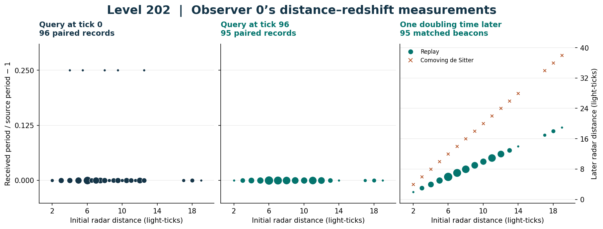

# Observer 0’s distance–redshift relation at level 202

Observer 0 sends a labelled query at local tick $s$. The responding beacon records its arrival at source tick $m$, reflects it, and observer 0 records the echo at $r$. A separate service on the same deterministic history sends two identifiable crests from that beacon at source ticks $m-2,m+2$. The two services use the same material contacts and independent messages. Observer 0 measures radar distance $D=(r-s)/2$ in light-ticks and pulse shift $z=(r_+-r_-)/4-1$. In physical units, $D_{\rm SI}=c\tau D$, where $c=299{,}792{,}458\,\mathrm{m/s}$ defines the ruler once a receiver-tick duration $\tau$ has been calibrated. The source schedule assumes source clocks count the same time unit.

The replay uses strict repairs, wide keys (`oph.strict.wide.v1`), and seed 20261126. The survey enrolls every remote port within twelve initial relay steps of observer 0, port 0. These 274 beacons belong to 28 other observers. Initial connectivity selects the sample. Distances come from the query and echo clocks. The round-trip budget is 48 ticks. A separate 48-tick one-way budget applies to each crest. Every enrolled source has a row in every panel. A missing receipt has the JSON value `null`.

| Query tick | Complete distance and period | $z=0$ | $z=0.25$ | Paired radar distance (light-ticks) |
|---|---:|---:|---:|---:|
| 0 | 96 | 91 | 5 | 2–19 |
| 4 | 95 | 94 | 1 | 2–19 |
| 16 | 95 | 95 | 0 | 2–19 |
| 96 | 95 | 95 | 0 | 2–19 |
| All contacts transmitting, tick 0 | 274 | 274 | 0 | 2–12 |

At tick zero, the same distance carries both observed shifts at $D=4,8,9.5,12.5$. One additional beacon supplies a pulse pair alone, five supply echoes alone, and 172 supply neither. At tick 96 the 95 complete records cover nine remote observers. The time resolution is one tick, corresponding to a redshift increment of $1/4$ for a four-tick period. The clocks measure changes in propagation delays on the material contacts.



Marker area represents the number of beacons with an identical reading. Crosses in the right panel give conditional de Sitter predictions for the same beacons. Each panel uses the radar distance at its first query on the horizontal axis.

## Which shifts can this relay produce?

Fix an emitter, a receiver, and a period $P$ in integer ticks. Write $A(t)$ for the earliest receipt of a pulse emitted at $t$. Every path available to a later pulse is also available to the earlier pulse, shifted earlier by the emission interval. Each transfer takes one tick and contacts only close. Consequently $A(t+P)-A(t)\ge P$ for two received pulses, and $z=[A(t+P)-A(t)-P]/P$ is a nonnegative integer multiple of $1/P$. The same path argument applies to the outward and return legs of an immediate echo. The radar distance to a fixed reachable reflector can only hold steady or increase. These predictions hold for every seed and level with this relay and the stated common clock cadence.

Of the same 95 beacons with both readings at ticks 0 and 96, 60 retained their initial range, 28 increased by 0.5 light-ticks, four by 1 and three by 1.5. One other early beacon lacked a complete late pair. Every one of the 95 gave identical ranges at ticks 16 and 96. Source membership is matched by both remote observer and port.

## Clock and radar predictions from the proposed horizon

The input pixel area is $1.6309682414\,\ell_P^2$. The whole-screen entropy identification gives $S=5(1.6309682414)4^{202}$ nats and $\Lambda\ell_P^2=3\pi/S$. The benchmark used to select level 202 enters this comparison. For a pure expanding de Sitter solution, the dimensionless Hubble rate is $h=H\tau=(\tau/t_P)\sqrt{\pi/S}$. Under the trial calibration $\tau=t_P$, $h=9.65624\times10^{-62}$ per tick. The comparison additionally treats the observer and its beacons as freely comoving clocks in a spatially flat chart and treats the material signal as the null ray seen by both. The radar distance and source periods used to test this identification are independently measured.

Write $x(t)=e^{-ht}$ in tick units and let $k$ be the comoving separation multiplied by $h$, with time and distance expressed at unit light speed. A radial light flight advances from $x$ to $x-k$, so $x(s)-x(m)=x(m)-x(r)=k$. Eliminating $k$ using $D=(r-s)/2$ gives $u=k/x(m)=\tanh(hD)$. For two source pulses of rest period $P=4$ centered on $m$, the expected reading is

$$
z_P=\frac{1}{hP}\log\frac{1-u e^{-hP/2}}{1-u e^{hP/2}}.
$$

For $D=2$ through 19 this gives $1.93\times10^{-61}$ through $1.83\times10^{-60}$. The native period resolution is $0.25$. The four-tick observations alone cannot distinguish such a small positive shift from zero.

## A test with tick-scale sensitivity

The post-settlement comparison holds the beacon positions, loaded ports and surviving relay contacts fixed. A later pulse train therefore reads a time translate of the same path, with unit period ratio. That result tests whether the proposed cosmological interpretation fits this stationary service. Turning on free exchange across unused blank contacts can change settled loads and requires its own propagation experiment. The Planck comparison used to select level 202 also enters its conditional vacuum scale.

The complete initial radius-48 dependency ball contains 4,630 ports. Any outbound path from observer 0 of at most 48 steps stays inside this ball. Any successful 48-step inbound path stays inside it as well, because its remaining suffix bounds the initial distance to observer 0. Each contact either transmits permanently or closes once. The final internal closure in the ball occurs at tick 33. Consequently every successful path and its minimum duration are invariant under translating the clock times of a trial issued at tick 96 or later. The same argument preserves misses within the original budgets. This proves stationarity of the measured service over an arbitrary finite waiting time. Continued operation of the clock and emitter after repair settlement is part of the service definition.

Take the integer $\Delta=\lceil\log(2)/h\rceil\simeq7.17823\times10^{60}$ ticks. At the trial calibration this corresponds to about 12.26 billion years. The printed integer uses the specified pixel input at its stated nominal value. Two sparse replay queries evaluate the service at 96 and $96+\Delta$, without simulating intervening clock cycles. Source-triggered pulses emitted at $m,m+\Delta$ also give the independently observed interval excess $E=r(m+\Delta)-r(m)-\Delta$. Computing this difference uses only a source period and a receiver period.

For comoving de Sitter clocks $g=e^{h\Delta}$, so the expected later radar distance and one-way excess are

$$
D_2=-\frac{\log[1-g(1-e^{-2hD})]}{2h},\qquad
E=\frac{\log[(1-u)/(1-gu)]}{h}.
$$

At the measured small ranges $D_2\simeq2D$ and $E\simeq D$. All 95 replayed sources return exactly $D_2=D$ and $E=0$. The comparison predicts later ranges of 4–38 light-ticks and one-way interval excesses of 2–19 ticks. Seventy-six of the 95 have $D<12$, placing their predicted round-trip times strictly inside the 48-tick budget by whole ticks. At $D=11$, for example, a beacon returns an echo after 22 ticks at both epochs. The comoving comparison gives about 44 ticks for the second round trip and 11 extra ticks between the one-way arrivals. A single tick cannot account for that discrepancy.

The two sets of clock readings exclude the proposed comoving de Sitter interpretation for these persistent fixed-beacon material-radar services at the trial calibration. A physically bound or static collection of beacons can have constant radar distances in an expanding spacetime. A cosmological expansion estimate requires a separately established comoving source population and a propagation channel with the same operational distance and redshift as physical light. The whole-screen entropy identification specifies the horizon scale.

## Does a stationary range fix the vacuum density?

Fix each complete beacon's range from the tick-16 echo. A direct radial light signal between synchronized static clocks then predicts the reflection, return and both pulse arrivals at tick 96. All 95 complete beacons match individually, across ranges of 2–19 light-ticks. Minkowski vacuum gives this result with zero vacuum density. A closed Einstein static universe of radius \(b=100\) light-ticks gives the same radial flight for a beacon at angular separation \(D/b\). Its positive dust mass density obeys \(4\pi G\rho_{\rm dust}=\Lambda c^2\), with \(\Lambda=1/b^2\). Thus the two geometries have different gravitating vacuum densities. With the same placements, both reproduce 60 of the 95 transcripts at query 0 and 62 at query 4. Visibility and the early changes in material flight time are outside this static comparison. [Exact comparison from the timestamps](level202_vacuum_density.json) · [Einstein static solution](https://arxiv.org/abs/gr-qc/0302094)

## Free probes and wall work at the measured boundary

The closest written boundary contact is reached at observer zero's own port 10. A near-side interferometer distinguishes two exchange energies on the archived write. Holding for \(\pi\) admits each sign parity with probability one half. A short exposure gives energies 32.0014 and 32.9946 relative to the balanced contact. The free-flight experiment empties the interior on matched preparations. In the mount with the settled exterior, each of the 17 outside endpoints retains its unit load and the other 16 measured sign parities are fixed. The probability of that particular spectator word is \(2^{-16}\). The archived sharp stock itself permits 53 separate unit perturbations, all stationary under the strict service. [Protocol](LEVEL202_GRAVIMETER.md) · [Clock and detector records](level202_gravimeter.json)

On a blank seam the one-probe generator has exchange amplitude \(-1/2\) and diagonal \(1/2+8q^2\) for load \(q\). A written contact blocks load exchange. With one parked exterior resident, both endpoints have load one when a unit reaches that contact. Its energy falls from \(E=32\) or 33 to zero. A double leaves the contact energy at \(E\). Summing these local terms and the registered degree correction gives the material generator \(L_{\rm blank}/2-8q^2\,\mathrm{diag}(w)+U\) up to a constant, where \(w\) counts incident writes and \(U\) contains the independently measured contact-energy changes. Its unitary evolution determines the terminal records without intermediate observations. A source with its resident removed and a changed written-contact law each give zero exact source contrast on the reference exterior.

| Released pair with settled exterior | Acceleration change from terminal counts | Exact result for the same window |
|---|---:|---:|
| Unit loads | \(+0.01051\pm0.00061\) | \(+0.00995\) |
| Double loads | \(+0.00068\pm0.00113\) | \(0\) |

The difference is odd minus even, in radar-range units per squared exchange time. Each of the three time bins is a multinomial simulation of \(2^{38}\) terminal pairs. The errors are one standard error of the measured contrasts. A derivative at exactly one exchange-time unit gives \(+0.01358\) and zero. The chamber boundary work difference vanishes at three radii, with a loaded-contact control of \(-8.5\) energy units. Three stations have radar distance one from the home reader and two from each other. Unique direct rays in either static comparison geometry would place two of the stations at the same point opposite the third. Their mutual echo distinguishes that interpretation from the material relay. The finite chambers have no proper-volume calibration. In the independent Einstein–scalar test, three proper radar arms and a scalar meter recover the zero and positive input vacuum terms to within 0.00029 in its source units across twelve held appointments.

## Reproduction

From the directory containing the `oph-model-sim` and `reverse-engineering-reality` checkouts, use a Python environment with the simulator dependencies, NumPy and SciPy. Plotting also needs Matplotlib.

```sh
d=reverse-engineering-reality/code/cosmology/screen_coherence
PYTHONPATH=oph-model-sim python3 "$d/level202_distance_redshift.py" --output /tmp/level202_distance_redshift.json
cmp "$d/level202_distance_redshift.json" /tmp/level202_distance_redshift.json
python3 "$d/level202_distance_redshift_figure.py" "$d/level202_distance_redshift.json" /tmp/level202_distance_redshift.png
PYTHONPATH=oph-model-sim python3 -m pytest -q "$d/test_level202_distance_redshift.py"
```

The 110- and 145-decimal-digit carrier geometry runs produce byte-identical JSON. The tests reconstruct the survey readings from individual clocks, match the full late cohort by beacon identity, and verify the comoving formulas against explicit light flights at a numerically resolvable Hubble rate. Wide observer labels and the long interval are decimal strings so JSON clients preserve their exact values.

These commands reproduce the gravimeter from the RER root using one numerical thread.

~~~sh
export OPENBLAS_NUM_THREADS=1 OMP_NUM_THREADS=1 VECLIB_MAXIMUM_THREADS=1 NUMBA_NUM_THREADS=1
export PYTHONPATH=../oph-model-sim:code:.
../oph-model-sim/.venv/bin/python code/cosmology/screen_coherence/level202_gravimeter.py > /tmp/oph-level202-gravimeter.json
../oph-model-sim/.venv/bin/python -m pytest -q code/cosmology/screen_coherence/test_level202_gravimeter.py
~~~
