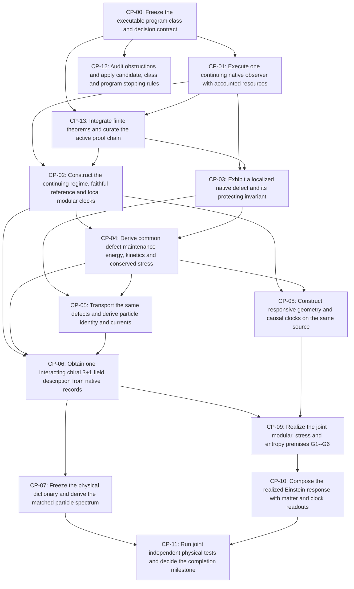

# Executable OPH completion program

Generated by `tools/build_completion_program.py` from [`claims/completion_program.json`](../claims/completion_program.json).

Coordination: [#1134](https://github.com/FloatingPragma/observer-patch-holography/issues/1134). Physical target: [the executable hypothesis](OPH_EXECUTABLE_HYPOTHESIS.md).

**One native repair/memory process must supply the observer clocks, defect/maintenance-energy mechanism, interacting field/particle description and realized Einstein premises together.** Component benchmarks retain their own contracts; they cannot be pooled into that realization.

Program: `OPH-EXECUTABLE-COMPLETION-2026-10-29-v2`. Boundary: `FROZEN`. Decision: `NOT_DECIDED`. No integrated gate is accepted by opening an issue.

## Existing foundations to extend

Physical construction gates remain open, but the program starts from retained positive constructions. The rows below link to existing canonical claims; they are reuse/navigation bindings, not new proof-discharge assertions. Preserve these capabilities while constructing the missing joins.

| Foundation | Achieved component | Remaining join | Builds into |
| --- | --- | --- | --- |
| Native rank-three slow response and intrinsic carrier geometry | The uniform native repair mean selects a normalized rank-three Gram band; exact quotient, proper-action and completion results connect it to the carrier response and signed records. | This is a response/metric result, not a physical position or a complete 3+1 field theory. Finite nonconstant modes remain; the limiting normalization and calibration schedule matter. | CP-03, CP-08, CP-13 |
| Candidate observer clocks with an implemented modular-flow relation | Finite faithful-reference preparation and active modular histories provide continuing clock/readout constructions. Native-return histories reconstruct a reference proportional to exp(-arccos K), with finite-cap errors; complete native quadrature records support operational parameter inference. On the declared Gibbs product branch, modular flow equals the rescaled Hamiltonian flow and clocked field measurements share that reference. | Reference/access choice, compiled controls and branch-specific clock conversion remain explicit. The native-return reconstructed reference is not its coherent preparation, and matching phase magnitudes does not execute every modular intervention. Passive repair, every regional modular flow and physical laboratory duration are not thereby identified. | CP-02, CP-04, CP-09 |
| Common native field generator and conditional 3+1 Lorentzian field readout | The refining native screen has a common positive continuum operator. A declared radial product builds on that response structure and supports one smooth static 1+3 scalar description of finite admissible joint clock, field and response menus at any positive tolerance. | The native screen has spectral dimension two. Rank three of the local slow band alone does not derive three spatial field dimensions; radial interval/filter, encoded fields, action, active controls and units retain their stated inputs. The claim is conditional and does not supply the Standard Model continuum. | CP-06, CP-08, CP-13 |
| Interacting field projections and same-reference modular measurement histories | A finite coupled matter/link/scalar source and a separate same-product quartic projection execute complete quantum records and feedback, with occupation bounds and declared Gibbs/modular readout histories. | The supplied actions, projected spatial modes, coupling, temperature and access services keep their own contracts. These constructions are reusable interaction and observation machinery, not a single source-derived chiral Standard Model. | CP-01, CP-04, CP-06 |
| Finite conditional Einstein tensor-completion kernel | The finite theorem chain composes the stated null-balance and conservation premises into the Einstein tensor relation up to the metric term; source-direction tomography supplies a finite completeness witness on its stated carrier. | One source tower realizing the geometric modular/stress/entropy and scale hypotheses remains required. Proving this implication does not establish physical gravity or a quantum graviton. | CP-09, CP-10, CP-13 |

In particular, retain the modular-clock candidate and the conditional 3+1 field construction based on the native response structure. The slow band's rank three and the native screen's spectral dimension two are distinct facts; the supplied radial extension remains part of that field construction's contract.

## Current bounded investigations

These source-bound component campaigns record actual progress without accepting dependent gates or freezing the larger program. Their exact exclusions do not cover untested histories or refinements.

- [OPH-CE-FINITE-MEMORY-2026-10-28-v1](../model/completion/campaign.json): Frozen finite C/E mixture, positive repair/selection and bounded classical-memory family. The parent refinement and physical-interpretation boundary is not established. Owning gates: CP-00, CP-01, CP-13, CP-02, CP-03.
- [OPH-CLOCK-DEFECT-ENERGY-2026-10-28-v1](../model/clock_defect_energy/campaign.json): Frozen finite component diagnostics on the unchanged C/E family and the pinned pending PR1149 input. Reference transport, clock/wave comparison, adjacent-pair localization and maintenance-energy tests retain separate premises; no integrated gate or physical comparison is accepted. Owning gates: CP-00, CP-01, CP-02, CP-03, CP-04.
- [OPH-FINITE-THEOREM-JOINS-2026-10-28-v1](../model/clock_defect_energy/joins_campaign.json): Frozen finite theorem applications and explicit service extension on the unchanged native C/E law: all-core compiled clock coverage, joint event-clock/field records, native history exchange topology and current/action-mode comparisons. Prior diagnostics and their limited service menu remain retained. Owning gates: CP-00, CP-01, CP-02, CP-03, CP-04, CP-13.
- [OPH-LOCAL-PLACEMENT-FAMILY-2026-10-28-v1](../model/local_repair_family/campaign.json): Bounded endpoint-biased C/E family and conditional product-pair reference. The carrier, physical target and program-wide decision contract are not established. Owning gates: CP-00, CP-02, CP-13.
- [OPH-SOURCE-RAMSEY-JOIN-2026-10-28-v1](../model/clock_defect_energy/ramsey_campaign.json): Source-pulse controlled Ramsey service on the finite density sector, complete C/E joint outputs and counted continuation. Physical duration and full-wave realization are not established. Owning gates: CP-01, CP-02, CP-13.
- [exchange-sector-20261028-v1](../model/exchange_sector/campaign.json): Sharp relational-sector boundaries, odd closed-history rank-one limit and source-executed active code with counted recovery. No localized physical particle or mass is accepted. Owning gates: CP-03, CP-04, CP-13.
- [particle-screening-20261028-v1](../model/particle_screening/campaign.json): Exact sharp-sector cap minimax, optimal one-port screening for an all-seam corrected q=1 qubit, and finite native-edge first exits. Source pulse recovery for the new code and physical particle identity are not established. Owning gates: CP-03, CP-04, CP-13.
- [active-code-energy-20261028-v1](../model/active_code_energy/campaign.json): The canonical screened code has native current rate 1/6 per uniform-seam attempt. Positive conserved-sector reweightings preserve stationary dynamics and leave formal Gibbs energy contrasts free. Prior-code fixed-seam recovery pulses retain their own protocol. Owning gates: CP-04, CP-13.
- [OPH-CLOCK-COUNT-INFERENCE-2026-10-28-v1](../model/clock_defect_energy/clock_count_inference_campaign.json): A complete source clock/field instrument strictly improves inference of its shared native incident count over the clock detector alone. Rational risk bounds, finite preparation and abort accounting retain the dimensionless event-count scope; physical calibration is not established. Owning gates: CP-01, CP-02, CP-13.
- [screened-recovery-20261028-v1](../model/screened_recovery/campaign.json): The canonical screened q=1 encoder and all 208 positive C/E recoveries are source-executed. Exact corrected composition preserves arbitrary logical/reference states with explicit core reset; pulse and archive costs are retained. Autonomous localized matter is not established. Owning gates: CP-01, CP-03, CP-04, CP-13.
- [OPH-SHARED-EVENT-CLOCK-2026-10-28-v1](../model/clock_defect_energy/shared_event_clock/campaign.json): Four source-executed shared checkpoints give strictly ordered conditional ensemble clock and field readouts through three FIFO exports. A raw two-anchor affine fit fails the reserved fourth event with a positive source-error margin; physical time calibration is not supplied. Owning gates: CP-01, CP-02, CP-13.
- [screened-transport-20261028-v1](../model/screened_transport/campaign.json): The same screened code has a positive rank-eleven native current covariance, but complete corrected logical transfer is identity and the core resets each attempt. Logical-state-dependent current/variance ratios prevent transfer of the earlier uniform-source wave rate. No rest gap or particle mass is identified. Owning gates: CP-03, CP-04, CP-13.
- [conserved-sector-action-20261028-v1](../model/conserved_sector_action/campaign.json): A Lean theorem proves stationary reweighting, conditional cancellation and zero sector-potential gradient for every positive conserved-sector factor. Exact checks bind its premises to all 4356 native source/core states; the full native kernel is checked in Python rather than encoded as a Lean value. Owning gates: CP-04, CP-13.
- [OPH-LOCAL-REPAIR-CONTINUING-CLOCK-2026-10-28-v1](../model/local_repair_family/observer_campaign.json): Versioned finite continuation and coherent-service composition on the bounded endpoint-biased family. Owning gates: CP-00, CP-01, CP-02, CP-13.
- [OPH-RECORD-DERIVED-CONTINUING-CLOCK-v1](../model/local_repair_family/record_clock_campaign.json): Fixed finite native-record acquisition, record-only preparation admission and inferred common modular-clock protocol. No integrated gate or physical comparison is accepted. Owning gates: CP-01, CP-02, CP-13.
- [OPH-DEFECT-ACTION-PARTICLE-FIELD-2026-10-29-v1](../model/completion/four_lane_campaign.json): Four bounded component advances on the pending record-clock baseline: active moving memory, record-inferred interacting kinetic parent, exact particle/family obstructions and a supplied interacting 3D lattice CAR field. Actual joins and scoped failures remain explicit; no integrated gate or physical comparison is accepted. Owning gates: CP-03, CP-04, CP-05, CP-06, CP-13, CP-12.
- [OPH-SAME-ACTION-PARTICLE-PREMISES-2026-10-29-v1](../model/completion/particle_premise_campaign.json): Four selected issues and the common local action, finite interfaces, pending-draft boundaries and complete-criteria closure policy. No integrated gate or physical comparison is accepted. Owning gates: CP-01, CP-02, CP-03, CP-04, CP-05, CP-06, CP-07, CP-08, CP-09, CP-12, CP-13.
- [mobile-screened-memory-20261029-v1](../model/particle_screening/mobile_contract.json): Complete uniform-seam C/E moving-memory operation and optimal core-reset objective, with exact-code domain and coherent services explicit. Owning gates: CP-01, CP-03, CP-05, CP-13.
- [OPH-INTEGRATION-PAIR-CYCLIC-CONTROL-2026-10-29-v1](../model/pair_cyclic_control/campaign.json): Exact seven-state contact-domain reduction and rational pole enclosure; the separate spectral helper sharpens only the full-field rate-error term. Full spatial histories and physical field/reference premises remain. Owning gates: CP-04, CP-06, CP-13.
- [OPH-INTEGRATION-RECOVERY-ELISION-2026-10-29-v1](../model/recovery_elision/campaign.json): Separate exact identity-recovery variant removes3120 redundant words and saves48391.49 supplied pulses per stationary native attempt; original benchmark retained, no physical energy or new protection. Owning gates: CP-01, CP-03, CP-13.
- [OPH-INTEGRATION-BIASED-CODE-UNIVERSALITY-2026-10-29-v1](../model/biased_code_universality/campaign.json): Positive-coin classification transfer proves the fixed biased optimal asymptotic reset rate across arbitrary adaptive exact all-seam sharp-q1 codes. Separate clock-factor composition is operational; finite-horizon biased optimality and particle mass remain unproved. Owning gates: CP-01, CP-03, CP-13.
- [OPH-COMMON-FIELD-INTERFACES-v1](../model/completion/component_interfaces.json): Complete native-history evaluation, common-reference observations and conservation bounds, full-Fock interacting lattice dynamics, and same-pair gauge/current/residue attachment. Physical action, clock, vacuum and chiral-continuum joins remain explicit. Original-complex exchange certificates, both-character GNS bounds, local complete-history budgets, rational support chain maps and bounded source-prepared interacting Gibbs references have separate explicit domains. Bounded compiled faithful-reference recovery, complete-field charged response and same-pole contact interactions retain their separate reference and clock domains. Exact finite mass-attachment exclusion and actual-data replay add zero eligible physical comparisons. Owning gates: CP-01, CP-02, CP-03, CP-04, CP-05, CP-06, CP-09, CP-13, CP-08, CP-07, CP-11.
- [native-exchange-statistics-20261029-v1](../model/exchange_sector/statistics_contract.json): The native collision-free two-particle path group is exactly Z/2. Its positive and negative flat lifts have complete C/E quantum instruments, an exact number-conserving CAR correspondence, and source-compiled phase readouts. The coherent controls and sign choice are explicit; physical spin, localized matter, species and mass are not identified. Owning gates: CP-01, CP-03, CP-05, CP-13.
- [charged-action-dynamics-20261031-v1](../model/charged_dynamics/contract.json): Unchanged uniform four-site Weyl/contact action on all 256 Fock states: exact full-path charged-band isolation, residue-derived hopping, physical charge/current, full coupled-ground response and complete T=4 source histories. Polar dressing has small physical charge contrast; native passive/topological protection, a physical clock and electron/positron identity are not established. Owning gates: CP-03, CP-04, CP-05.
- [native-many-particle-statistics-20261031-v1](../model/exchange_sector/many_body_contract.json): The fixed twelve-port binary carrier has a complete integral first-homology and scalar flat-character catalogue over every occupation number zero through twelve. The declared one-particle face fillings and disjoint-move squares give cyclic H1 of order 2(N-1) for N=2 through 10, free rank nineteen at N=11, and trivial H1 at N=0, 1 and 12. Exact integer presentations and every local exchange generator are checked. Requiring local exchange holonomy to survive insertion of fixed spectators leaves exactly two scalar families, with common sign plus or minus, up to vertex gauge. This compatibility is explicit and selects neither sign. Both choices extend the existing complete C/E endpoint law to all 4096 binary occupations with fair coins and every raw, zero and abort slot. The negative choice agrees with even CAR transport; the positive choice is the hard-core occupation control. Restricted spectator insertion intertwines the same native branches on its avoiding subcomplex. Particle-hole complement preserves the movement graph but not the declared face fillings. No nonabelian many-particle classification, continuum equivalence, localized protected core, Lorentz spin, physical species or mass is established. A bounded source observer compiles the same binary endpoint rule on four active native ports and checks all sixteen input columns. A fixed-total-two preparation, complete C/E repair and phase readout distinguish the two supplied coherent lifts; a retained which-path pointer removes that interference in the terminal classical law. Every raw record, terminal address and first failed proper-code export is retained in the fresh execution. The complete source-map amplitude budget, preparation/read pulses, blank work bits and detection addresses are counted. This executes a bounded four-mode observer, not all 4096 source input columns or a calibrated physical apparatus. Owning gates: CP-03, CP-05.
- [charged-particle-transport-20261031-v1](../model/particle_transport/contract.json): The same charged dimer doublets admit source-prepared unknown-state transport, complete exchange reads and number-conserving reservoir spectroscopy with explicit resources. A twelve-dimer isometry intertwines every native negative-lift C/E branch and rotation on its 66-dimensional image. This formal 48-mode dictionary is not a 48-mode source run, native protection or physical electron/positron identification; the failed dispersion benchmark remains. Owning gates: CP-05, CP-13.
- [OPH-FIELD-SYMMETRY-2026-10-31](../model/field_symmetry/contract.json): The unchanged open-box Weyl/contact field is exactly related by an onsite SU(2) frame to real pi-flux Hubbard hopping. Its hidden spin and eta algebras commute; [H,eta_plus]=U*eta_plus and [H-U*N/2,eta_plus]=0. Exact complete-Fock Ward identities and multiplet counts retain every number sector. The eta tower exists on every finite open box. These are internal supplied-action symmetries, not Lorentz spin, native repair protection, localized defects or physical species. A complete 256-state four-site plaquette history prepares a supplied even-charge coherent eta product, evolves it with the existing source words and reads all terminal occupation addresses after decoding. Every first-export failure and preparation/readout cost is retained. The ideal split is exact on this eta preparation; the arbitrary-input splitting bound and numerical primitive admission budget are separate. H rotates the pair phase at frequency U, whereas K=H-U*N/2 holds it fixed. The phase reference, action and Hamiltonian time remain supplied; no physical energy or clock calibration is inferred. Owning gates: CP-03, CP-04, CP-05, CP-06.
- [OPH-FIELD-PARTICLE-PREMISE-CLOSURE-2026-11-01](../model/completion/field_particle_premises_campaign.json): Four scoped constructions advance five owners: actual regional clock comparisons, charged-defect protected-spectrum census, complete two-body lattice scattering with a certified zero threshold, and controlled interacting regional modular generators. Their distinct action/reference/operation domains and failed common-field protection join are retained; no physical gate or new observation is accepted. Owning gates: CP-02, CP-03, CP-06, CP-07, CP-09, CP-13.
- [OPH-COMMON-ACTION-PREMISES-2026-11-01](../model/completion/common_action_campaign.json): Common field/repair spin protection and complete finite spectrum, complete plaquette reference preparation, uniform contact-continuum exclusion and exact coarse energy Ward cells. No physical gate, empirical comparison or whole-program falsification is asserted. Owning gates: CP-02, CP-03, CP-06, CP-07, CP-09, CP-12, CP-13.
- [OPH-SPECTRAL-PRECISION-PREMISES-2026-11-01](../model/completion/spectral_precision_campaign.json): Exact repaired spectral sectors, literal reference precision, all-energy fixed-packet contact exclusion and forced momentum balances; no physical gate accepted. Owning gates: CP-02, CP-03, CP-06, CP-07, CP-09, CP-12, CP-13.
- [OPH-CONTINUING-SPECTRUM-PREMISES-2026-11-01](../model/completion/continuing_spectrum_campaign.json): Native protected spectroscopy, stationary literal-source reference, controlled band-edge scattering and global periodic momentum; no integrated physical gate accepted. Owning gates: CP-02, CP-03, CP-06, CP-07, CP-09, CP-12, CP-13.
- [OPH-THREE-DIMENSIONAL-PREMISES-2026-11-01](../model/completion/three_dimensional_campaign.json): Protected three-dimensional interacting spectrum, balanced adaptive reference, controlled moving bound band and dilute local Ward errors; no integrated physical gate accepted. Owning gates: CP-02, CP-03, CP-06, CP-07, CP-09, CP-12, CP-13.
- [OPH-INTERNAL-OBSERVER-READOUT-2026-11-01](../model/completion/internal_observer_campaign.json): A subsequent seventeen-bit native Ramsey construction attaches the fixed-number protected cube response to complete internal-observer pointer records. It prepares the actual eta reference, controls the local number phase, executes the unchanged full-Fock field word through two segments with complete C/E repairs, and exports both pointer quadratures. Local contraction composes every literal source pulse and retains its first-failure maps; no number or spectral projection is used in the executed field. Exact source-control and all-input Strang estimates bound each pointer probability, independently checked against the original Hamiltonian and the eight-line spectral measure. Seeded simulated counts use the unconditional pointer-zero event, with all other outputs retained in its complement. The second quadrature also separates the interacting response from the matched ideal free-action prediction, whose corresponding probability is exactly one half by bipartite parity. This identifies the source-accessible neutral response within the computed universe, not all protected states or a vacuum particle species. A separate rational Vandermonde certificate makes the eight source-specified weights identifiable from sixteen sufficiently accurate settings, but its long-time sampling and precision schedule is not executed. Absolute energy origin, external units, physical species and the relativistic field limit remain unassigned. Owning gates: CP-03, CP-07, CP-12.
- [OPH-RESOLVED-SPECTRUM-RELATIVISTIC-SECTOR-2026-11-01](../model/completion/resolved_relativistic_campaign.json): Resolve all eight source-accessible cube response weights, construct the original-action eight-valley massless relativistic limit, and attach finite model flavor and energy labels to a compiled momentum/occupation detector. Owning gates: CP-03, CP-06, CP-07, CP-09, CP-12.
- [OPH-INTERACTING-VACUUM-MASS-2026-11-01](../model/completion/interacting_mass_campaign.json): Construct a certified interacting ground reference and charged response on the actual three-dimensional cube, a source-bound one-dimensional charge gap, and controlled relativistic quasiparticle masses along an explicit coupling trajectory through the original chain parameters. Owning gates: CP-06, CP-07, CP-12.
- [OPH-THERMODYNAMIC-GROUND-RESPONSE-2026-11-01](../model/completion/ground_response_campaign.json): Construct an original-action positive-energy ground representation on the infinite three-dimensional lattice, and derive its controlled local response interface and exact finite interacting response inputs for the existing geometry theorem stack. Owning gates: CP-02, CP-06, CP-07, CP-08, CP-09.
- [OPH-NATIVE-GROUND-SPATIAL-RESPONSE-2026-11-01](../model/completion/native_ground_spatial_campaign.json): Prepare the certified finite ground and measure its charged response with complete native records, resolve the full finite matrix response, and construct non-Gaussian real-time and reflection-positive ordered imaginary-time field correlations, nonzero interaction memory and spatially local inverse response on the original infinite-lattice ground. Owning gates: CP-02, CP-03, CP-05, CP-06, CP-07, CP-08, CP-09.
- [OPH-CONTINUUM-FIELD-SPECTRAL-2026-11-01](../model/completion/continuum_field_campaign.json): Construct the full eight-valley continuum field net from the original ground family, constrain its ground and energy moments, resolve all finite ground-spin sectors, and supply a complete positive finite-resolution energy readout. Owning gates: CP-02, CP-03, CP-05, CP-06, CP-07, CP-08, CP-09.
- [OPH-NATIVE-DETECTOR-CENTERED-GROUND-2026-11-01](../model/completion/native_detector_centered_campaign.json): Realize the finite complete native energy detector, resolve the continuum contact channel, derive the same-field CPT constraint and its centered source-reference correction, construct regional modular data on the actual finite particle ground, and decide the centered bounded-coupling continuum through uniform finite-energy escape of the composite force; quantify the finite centered gap and charged response and classify the complete onsite mass and texture family. Owning gates: CP-02, CP-03, CP-04, CP-05, CP-06, CP-07, CP-08, CP-09.
- [OPH-NATIVE-OCCUPATION-PROTECTION-2026-11-01-v1](../model/native_fixed_algebra/occupation_contract.json): Complete C/E binary occupations have fixed algebra C^11 direct_sum M2(empty,full), proved by exact native effects and signed transport for both exchange characters. Faithful references and the fixed-selector limiting channel are explicit. Every proper-port-local fixed observable is scalar. Sixteen complete twelve-occupation-bit source histories verify global memory, local phase/pointer controls and six-occupation dephasing, with all failure outputs and counted resources. The distance-one extremal qubit needs cross-number coherence outside fixed-total V2; primitive pulses need not conserve encoded number. No federation execution, moving-particle exclusion, physical species, calibrated clock, refinement protection or empirical acceptance is claimed. Owning gates: CP-03, CP-05.
- [OPH-SPECTRUM-REFINEMENT-GEOMETRY-2026-11-02](../model/completion/spectrum_refinement_geometry_campaign.json): Resolve the centered charged response, quantify complete-record repair coherence and reference convergence, derive an interacting finite spin limit and the growing-coupling free boundary, and attach the same Weyl vacuum to the existing geometric modular/stress theorem inputs. Owning gates: CP-02, CP-03, CP-06, CP-07, CP-08, CP-09.
- [OPH-NATIVE-NEUTRAL-SPIN-RESPONSE-2026-11-02](../model/completion/native_neutral_spin_response_campaign.json): Close the complete finite neutral gap, execute native centered-ground preparation and charged energy readout, derive repaired interacting spin dynamics in a joint growing-volume limit, and supply nondegenerate finite matter/entropy response directions to the existing Einstein stack. Owning gates: CP-02, CP-03, CP-06, CP-07, CP-08, CP-09.
- [OPH-GAPLESS-NATIVE-SPATIAL-RESPONSE-2026-11-02](../model/completion/gapless_native_spatial_response_campaign.json): Construct an ordered infinite-volume gapless spin sector, scalable native local spin observations, a controlled lattice realization of finite Weyl stress responses, and actual cubic rotation labels for all certified particle lines. Owning gates: CP-02, CP-03, CP-06, CP-07, CP-08, CP-09.
- [OPH-PARTICLE-SCALING-MODULAR-CONSTRUCTION-2026-11-02](../model/completion/particle_scaling_modular_construction_campaign.json): Construct actual regional modular limits, spatially labelled two-channel spectral scaling, and native preparation of selected finite ordered-ground inputs; repair live evidence custody and CI. Owning gates: CP-02, CP-03, CP-06, CP-07, CP-08, CP-09.
- [OPH-CONTINUUM-FIELD-ENTROPY-CONSTRUCTION-2026-11-02](../model/completion/continuum_field_entropy_campaign.json): Construct a regular continuum spin field, strengthen the charged free-boundary theorem, derive an actual finite entropy/stress shrinking limit, and implement complete joint native spin spectroscopy. Owning gates: CP-02, CP-03, CP-06, CP-07, CP-08, CP-09.
- [OPH-LOCAL-EXCHANGE-CHARGE-2026-11-01-v1](../model/local_exchange_charge/results.json): The ordered-cover memory has an exact local qutrit realization with one A and one B, full 132-column raw-branch intertwiners and complete four-bit source dilations. A faithful sector state has a compact nonzero conserved exchange-charge excess and exactly reference-matched exterior; the same charge transports by the native pair kernel with exact regional trace distances, configuration-space flux and equal complete native tape laws after its preparation archive is traced. A three-port complete-source witness moves and terminally reads that charge. Every deterministic core-local preparation with an independent blank obeys the sharp charge ceiling, while every globally sharp exchange sector obeys a universal exterior-distance lower bound. This is a coherent local-qutrit enlargement of the bare binary carrier, not a new admissibility decision. The excess spreads, the reference is tracial with zero modular-energy excess, and readout is terminal demolition. No bound particle, physical charge/spin/species, calibrated clock, refinement protection, canonical premise discharge or physical comparison is claimed. Owning gates: CP-03, CP-05.
- [OPH-REVIEWED-PARTICLE-PRS-2026-11-02](../model/completion/reviewed_particle_prs_campaign.json): Integrate independently reviewed direct finite-ground, onsite-mass and local exchange-charge constructions without overwriting newer source results. Owning gates: CP-03, CP-05, CP-06, CP-07.
- [OPH-FIELD-ENERGY-ENTROPY-2026-11-02](../model/completion/field_energy_entropy_campaign.json): Identify nonzero positive spectral weight of the actual continuum spin fields and the finite-amplitude regional entropy Hessian on the established free source. Owning gates: CP-03, CP-06, CP-07, CP-08, CP-09.
- [OPH-SMALL-BALL-CURRENT-READOUT-2026-11-02](../model/completion/small_ball_current_readout_campaign.json): Close the fixed-amplitude free-sector small-ball entropy remainder, construct complete-output filtered spin-packet readout, and isolate the exact current spectral tail needed for the continuum energy form. Owning gates: CP-02, CP-03, CP-06, CP-07, CP-08, CP-09.
- [OPH-SOURCE-PREMISE-CLOSURE-2026-11-04](../model/completion/source_premise_campaign.json): Construct faithful native feedback preparation, search complete particle sectors, control moving two-body interactions and finite spin dynamics, and close finite gravitational attachment premises. Owning gates: CP-02, CP-03, CP-06, CP-07, CP-09.
- [OPH-DYNAMICS-RESPONSE-CLOSURE-2026-11-04](../model/completion/dynamics_response_campaign.json): Construct continuing positive-rate native repair of interacting spin dynamics, actual source ground and thermal reference limits, complete moving-scattering readout, and same-source finite geometry/energy/entropy response. Owning gates: CP-02, CP-06, CP-07, CP-08, CP-09.
- [OPH-SPECTRUM-EINSTEIN-CLOSURE-2026-11-04](../model/completion/spectrum_einstein_campaign.json): Identify the conditional bulk and defect spectrum, control nonlinear textures of the actual ordered spin ground, and derive quantitative Einstein tensor balance from one matched regional source interface. Owning gates: CP-03, CP-06, CP-07, CP-09, CP-10.
- [OPH-DEFECT-GEOMETRY-CLOSURE-2026-11-04](../model/completion/defect_geometry_campaign.json): Establish observable interacting charged poles, an unmodified finite source core, exact localized lattice defect modes and electric-energy-responsive native geometry while retaining every source and refinement boundary. Owning gates: CP-03, CP-04, CP-06, CP-07, CP-08.
- [OPH-RADIAL-SOURCE-CLOSURE-2026-11-04](../model/completion/radial_source_campaign.json): Join the actual bounded radial kernel, finite interacting charged states, regional entropy and native responsive geometry on one source, with complete records and explicit preparation/control/refinement conditions. Owning gates: CP-03, CP-06, CP-07, CP-08, CP-09.
- [OPH-DEFECT-SELECTION-CONSTRAINTS-2026-11-04](../model/completion/defect_selection_campaign.json): Constrain defect and mass assignments on the full source; close specified finite drift, Majorana-current and Higgs-curvature interfaces without inferring physical selection from them. Owning gates: CP-03, CP-05, CP-06, CP-07, CP-09.
- [OPH-SOURCE-PARTICLE-DERIVATION-2026-11-04](../model/completion/particle_derivation_campaign.json): Certify finite interacting poles and currents, derive native memory flavor spectra, realize the retained P-dependent lepton operator on a chosen memory/carrier design, and constrain unscreened texture energies. The common finite operator construction does not establish physical particle identification or the interacting continuum and Einstein limits. Owning gates: CP-03, CP-04, CP-05, CP-06, CP-07.
- [OPH-PARTICLE-CONSISTENCY-COMPONENTS-2026-11-04](../model/completion/particle_consistency_campaign.json): Close scoped particle consistency premises: certify feedback roots with the same lepton prescription and explicit running census; construct a finite-energy compact defect pair and certify its complete localized band; realize a native-current-invariant quartic interaction, radius-uniform core record limit and same-Hamiltonian Gibbs response. These distinct constructions do not establish a common physical particle map, interacting relativistic continuum or Einstein realization. Owning gates: CP-03, CP-04, CP-06, CP-07, CP-09.
- [OPH-COMPACT-SOURCE-CONSISTENCY-2026-11-04](../model/completion/compact_source_campaign.json): Guarded compact texture transport, a common 180-mode interacting memory core and its hopping-work derivative are proved on declared finite source domains. A separate native 60-state link gives local non-Abelian Gauss constraints. No full physical particle spectrum, interacting chiral continuum or Einstein realization is established. Owning gates: CP-03, CP-04, CP-05, CP-06, CP-09.
- [OPH-FINITE-OBSERVABLE-CLOSURE-2026-11-05](../model/completion/finite_observable_campaign.json): Complete charged composite spectra and source energy moments, exhaustive quadratic conserved currents and finite-amplitude prepared regional entropy bounds. These finite source results do not identify observed species or establish an interacting chiral continuum or common Einstein response. Owning gates: CP-03, CP-04, CP-06, CP-07, CP-09.
- [OPH-NATIVE-OBSERVATION-CLOSURE-2026-11-05](../model/completion/native_observation_campaign.json): Complete composite spatial residues and native filtering, adaptive interventions in the interacting memory limit, and a native prepared-regional modular actuator. These finite source results do not identify observed species or establish an interacting chiral continuum or common Einstein response. Owning gates: CP-02, CP-05, CP-06, CP-07, CP-09.

## Next five parallel workstreams

Assignment: `OPH-COMPLETION-NEXT-WAVE-2026-11-02-v6`. This plans provisional work; it does not select or freeze a successor law, change the retained campaign or accept a gate.

Current-source evidence repair, reference preparation, actual continuum field excitations, the exact supplied mass catalogue, and nonlinear entropy response address the five linked owner issues without promoting physical endpoints.

| Owner | Next concrete result | Why this comes next |
| --- | --- | --- |
| [#1138](https://github.com/FloatingPragma/observer-patch-holography/issues/1138) / CP-02: Join scalable native local observations to a continuing reference | Use explicit spin gates, complete repair and dyadic precision control to realize local histories, then establish stationary reference/scheduler/memory compatibility. | The continuum field algebra and entropy/stress join remove construction gaps; the stronger free boundary directs the interaction search; complete native spectroscopy connects finite source preparation, symmetry labels and energy readout. Evidence custody remains the fifth owner; broad CI is deferred at the user request. |
| [#1139](https://github.com/FloatingPragma/observer-patch-holography/issues/1139) / CP-03: Construct protected local matter beyond the quantified bare-repair lifetime | Supply a local protected field encoding with a boundary invariant and measured operators under the actual repair/refinement. | The continuum field algebra and entropy/stress join remove construction gaps; the stronger free boundary directs the interaction search; complete native spectroscopy connects finite source preparation, symmetry labels and energy readout. Evidence custody remains the fifth owner; broad CI is deferred at the user request. |
| [#1142](https://github.com/FloatingPragma/observer-patch-holography/issues/1142) / CP-06: Control an interacting relativistic limit outside the proved free class | Derive a volume-uniform interacting continuum estimate and the corresponding ground, charged sectors and Lorentz dynamics. | The continuum field algebra and entropy/stress join remove construction gaps; the stronger free boundary directs the interaction search; complete native spectroscopy connects finite source preparation, symmetry labels and energy readout. Evidence custody remains the fifth owner; broad CI is deferred at the user request. |
| [#1143](https://github.com/FloatingPragma/observer-patch-holography/issues/1143) / CP-07: Identify physical species beyond the excluded centered finite-gap dictionary | Construct the same-theory physical charge, spin, dispersion, detector and unit dictionary; compare its massive and massless sectors with observations. | The continuum field algebra and entropy/stress join remove construction gaps; the stronger free boundary directs the interaction search; complete native spectroscopy connects finite source preparation, symmetry labels and energy readout. Evidence custody remains the fifth owner; broad CI is deferred at the user request. |
| [#1145](https://github.com/FloatingPragma/observer-patch-holography/issues/1145) / CP-09: Join the proved Weyl stress/modular sector to responsive geometry | Supply the native geometry identification, edge/area normalization, entropy stationarity and universal calibrated metric response on one refinement family. | The continuum field algebra and entropy/stress join remove construction gaps; the stronger free boundary directs the interaction search; complete native spectroscopy connects finite source preparation, symmetry labels and energy readout. Evidence custody remains the fifth owner; broad CI is deferred at the user request. |

Parallel starting work and the required joins:

- **CP-02 / [#1138](https://github.com/FloatingPragma/observer-patch-holography/issues/1138):** Finite ground preparation is joined to a complete native energy/symmetry instrument; the executed dimer retains every output. An effective thermodynamic preparation modulus and a continuing adaptive observer invariant law remain to be proved. Starting evidence: [adaptive reference](../model/adaptive_reference/results.json), [thermodynamic ground](../model/thermodynamic_ground/results.json), [ground spectral source](../model/ground_spectral_source/results.json), [retarded spatial locality](../model/retarded_spatial_locality/results.json), [spectral readout](../model/spectral_readout/results.json), [continuum field net](../model/continuum_field_net/results.json), [native spectral detector](../model/native_spectral_detector/results.json), [repair coherence lifetime](../model/repair_coherence_lifetime/results.json), [centered particle spectrum](../model/centered_particle_spectrum/results.json), [centered native preparation](../model/centered_native_preparation/results.json), [native spin observer](../model/native_spin_observer/results.json), [native ordered ground](../model/native_ordered_ground/results.json), [native joint spin spectroscopy](../model/native_joint_spin_spectroscopy/results.json).
- **CP-03 / [#1139](https://github.com/FloatingPragma/observer-patch-holography/issues/1139):** Actual Stone fields retain nonzero positive excitation weight at arbitrarily small momentum; local exchange charge is realized with a proved localization limit. A sharp exchange-charge sector changes the exterior on this carrier. Derive a common physical localization and gauge-charge dictionary. Starting evidence: [cube eta protection](../model/cube_eta_protection/results.json), [protected particle readout](../model/protected_particle_readout/results.json), [resolved particle spectrum](../model/resolved_particle_spectrum/results.json), [particle species detector](../model/particle_species_detector/results.json), [ground spectral source](../model/ground_spectral_source/results.json), [spectral readout](../model/spectral_readout/results.json), [native spectral detector](../model/native_spectral_detector/results.json), [native occupation protection](../model/native_fixed_algebra/occupation_results.json), [repair coherence lifetime](../model/repair_coherence_lifetime/results.json), [centered neutral spectrum](../model/centered_neutral_spectrum/results.json), [protected spin limit](../model/protected_spin_limit/results.json), [spin goldstone sector](../model/spin_goldstone_sector/results.json), [native spin observer](../model/native_spin_observer/results.json), [spin particle scaling](../model/spin_particle_scaling/results.json), [native ordered ground](../model/native_ordered_ground/results.json), [spin canonical field](../model/spin_canonical_field/results.json), [native joint spin spectroscopy](../model/native_joint_spin_spectroscopy/results.json), [native mass channels](../model/native_mass_channels/results.json), [local exchange charge](../model/local_exchange_charge/results.json), [spin canonical energy](../model/spin_canonical_energy/results.json).
- **CP-06 / [#1142](https://github.com/FloatingPragma/observer-patch-holography/issues/1142):** The actual spin continuum is nonstatic and gapless. The free charged source admits an exact two-branch supplied onsite mass catalogue. Derive a sharp shell, Lorentz covariance and surviving continuum interaction; select mass coefficients dynamically. Starting evidence: [moving bound pair](../model/moving_bound_pair/results.json), [relativistic sector audit](../model/relativistic_sector_audit/results.json), [particle species detector](../model/particle_species_detector/results.json), [interacting vacuum](../model/interacting_vacuum/results.json), [mass generation audit](../model/mass_generation_audit/results.json), [hubbard relativistic sector](../model/hubbard_relativistic_sector/results.json), [thermodynamic ground](../model/thermodynamic_ground/results.json), [retarded matter response](../model/retarded_matter_response/results.json), [ground spectral source](../model/ground_spectral_source/results.json), [matrix spectral response](../model/matrix_spectral_response/results.json), [retarded spatial locality](../model/retarded_spatial_locality/results.json), [spin resolved spectrum](../model/spin_resolved_spectrum/results.json), [spectral readout](../model/spectral_readout/results.json), [continuum field net](../model/continuum_field_net/results.json), [continuum ground constraints](../model/continuum_ground_constraints/results.json), [native spectral detector](../model/native_spectral_detector/results.json), [continuum cpt constraint](../model/continuum_cpt_constraint/results.json), [continuum composite channel](../model/continuum_composite_channel/results.json), [centered source ground](../model/centered_source_ground/results.json), [continuum free limit](../model/continuum_free_limit/results.json), [strong coupling refinement](../model/strong_coupling_refinement/results.json), [protected spin limit](../model/protected_spin_limit/results.json), [spin goldstone sector](../model/spin_goldstone_sector/results.json), [spin particle scaling](../model/spin_particle_scaling/results.json), [spin shell diagnostic](../model/spin_shell_diagnostic/results.json), [ballistic free boundary](../model/ballistic_free_boundary/results.json), [spin canonical field](../model/spin_canonical_field/results.json), [native mass channels](../model/native_mass_channels/results.json), [spin canonical energy](../model/spin_canonical_energy/results.json).
- **CP-07 / [#1143](https://github.com/FloatingPragma/observer-patch-holography/issues/1143):** A source-bound table separates zero free masses, supplied quadratic mass branches, spin bands and all finite energy readouts. Derive physical species, mass coefficients and independent units. Finite-system energies and unfixed branch formulas are not measured mass predictions. Starting evidence: [cube eta protection](../model/cube_eta_protection/results.json), [particle identification](../model/particle_identification/results.json), [protected particle readout](../model/protected_particle_readout/results.json), [resolved particle spectrum](../model/resolved_particle_spectrum/results.json), [relativistic sector audit](../model/relativistic_sector_audit/results.json), [particle species detector](../model/particle_species_detector/results.json), [interacting vacuum](../model/interacting_vacuum/results.json), [mass generation audit](../model/mass_generation_audit/results.json), [hubbard relativistic sector](../model/hubbard_relativistic_sector/results.json), [thermodynamic ground](../model/thermodynamic_ground/results.json), [retarded matter response](../model/retarded_matter_response/results.json), [ground spectral source](../model/ground_spectral_source/results.json), [matrix spectral response](../model/matrix_spectral_response/results.json), [spin resolved spectrum](../model/spin_resolved_spectrum/results.json), [spectral readout](../model/spectral_readout/results.json), [native spectral detector](../model/native_spectral_detector/results.json), [continuum cpt constraint](../model/continuum_cpt_constraint/results.json), [centered source ground](../model/centered_source_ground/results.json), [continuum free limit](../model/continuum_free_limit/results.json), [centered particle spectrum](../model/centered_particle_spectrum/results.json), [centered neutral spectrum](../model/centered_neutral_spectrum/results.json), [centered native preparation](../model/centered_native_preparation/results.json), [cubic particle channels](../model/cubic_particle_channels/results.json), [spin particle scaling](../model/spin_particle_scaling/results.json), [spin shell diagnostic](../model/spin_shell_diagnostic/results.json), [ballistic free boundary](../model/ballistic_free_boundary/results.json), [spin canonical field](../model/spin_canonical_field/results.json), [native joint spin spectroscopy](../model/native_joint_spin_spectroscopy/results.json), [native mass channels](../model/native_mass_channels/results.json), [spin canonical energy](../model/spin_canonical_energy/results.json), [particle mass table](../model/completion/particle_mass_table.json).
- **CP-09 / [#1145](https://github.com/FloatingPragma/observer-patch-holography/issues/1145):** The same free-source shell states have positive regional entropy Hessians and uniform finite-amplitude lattice limits. Derive responsive area/edge identification, Newton normalization and generalized-entropy stationarity on the same matter/geometry family. Starting evidence: [dilute momentum ward](../model/dilute_momentum_ward/results.json), [relativistic sector audit](../model/relativistic_sector_audit/results.json), [thermodynamic ground](../model/thermodynamic_ground/results.json), [retarded matter response](../model/retarded_matter_response/results.json), [matrix spectral response](../model/matrix_spectral_response/results.json), [retarded spatial locality](../model/retarded_spatial_locality/results.json), [spin resolved spectrum](../model/spin_resolved_spectrum/results.json), [continuum field net](../model/continuum_field_net/results.json), [continuum ground constraints](../model/continuum_ground_constraints/results.json), [continuum composite channel](../model/continuum_composite_channel/results.json), [ground regional modular](../model/ground_regional_modular/results.json), [centered source ground](../model/centered_source_ground/results.json), [continuum free limit](../model/continuum_free_limit/results.json), [weyl geometric modular](../model/weyl_geometric_modular/results.json), [weyl gravity response](../model/weyl_gravity_response/results.json), [lattice weyl response](../model/lattice_weyl_response/results.json), [lattice modular limit](../model/lattice_modular_limit/results.json), [shrinking modular entropy](../model/shrinking_modular_entropy/results.json), [shell entropy response](../model/shell_entropy_response/results.json).

Shared source interface:

- Keep the unchanged C/E campaigns and the separately bounded endpoint-biased law family distinct; no result may swap their reference, scheduler, carrier or service premises without a new contract.
- Retain the full C/E record and abort outputs, untouched references, core/FIFO metadata, source code, coherent controls and all preparation/export costs. A reduced stationary source/core marginal is not stationarity of adaptive full history.
- Use source-bound finite theorem applications only after checking the exact state, algebra, branch, clock and domain hypotheses. The local repair family inherits the full branch algebra, and the odd closed-history limit assumes uninterrupted native records.
- The Ramsey service compiles the density representation with its proven intertwiner; the full binary arc unitary, physical time and storage hardware remain additional obligations.
- A sharp relational sector, active quantum memory, exchange-history parity and positive current form are separate observations. Identify one localized matter state, rest action, kinetic response, common clock and conserved stress before a particle or mass claim.
- Preserve prior failures, empirical exposure, computational budgets and the accepted CP-00 class. A change to that class requires a reviewed successor contract; CP-12 applies its declared stopping rules without promoting component evidence to physical completion.
- The active moving code has explicit opposite-core stops and modular leakage. Retain every stop and its resource cost; no reset or success conditioning may substitute for transport.
- The stochastic-matrix kinetic parent and recovered modular generator are different operators. A shared residual symmetry is not an action/clock identification.
- Exact fixed-source symmetry and finite-record inference have different quantifiers. The current/matter lift and source-triplet family attachment require their stated maps.
- The interacting CAR field has a full-Fock extension and a fixed-spacing thermodynamic local limit under its supplied action. Retain all Weyl tastes; the chiral spatial-continuum and physical state/clock selection remain separate.
- The endpoint-biased native observer, fair-coin active memory and operational triplet attachment have distinct source, reference and service contracts; their maps must be supplied explicitly.
- The bound pair uses the supplied Weyl-contact action throughout transport, spectrum, charge and curvature. Its topology is trivial, its physical species is unassigned, and its coordinate kinetic/rest mass mismatch cannot be removed by one unit conversion.
- The inherited native clock is faithful on the supplied invariant M2corner. Full-band rate transfer is executed under a separately supplied global Gibbs reference; finite independent native reference copies cannot provide the exact same inherited field clock.
- Finite CAR restrictions and energy/entropy identities must not be relabeled physical geometry, Lorentz stress, generalized-entropy stationarity or an interacting chiral continuum.

CP00, CP01 and CP13 retain their independently accepted finite scope. The five selected owners keep their existing unaccepted statuses until their full physical same-process conditions hold. Finite maps, calibrated equal gaps and retrospective comparisons discharge none of the 84 canonical physical premises.

Review stays inside these workstreams:

- CP-00 / [#1135](https://github.com/FloatingPragma/observer-patch-holography/issues/1135): Preserve the independently reviewed V2 class, source membership, fixed retrospective target/error contract and all prior exposure. Any primitive or target change requires a reviewed successor.
- CP-01 / [#1136](https://github.com/FloatingPragma/observer-patch-holography/issues/1136): Preserve the accepted declared-service continuing observer and its complete-source membership/resource proof. Additional particle and field maps need their own same-process construction; physical apparatus is supplied.
- CP-04 / [#1140](https://github.com/FloatingPragma/observer-patch-holography/issues/1140): Retain same-excitation energy/current/dispersion and vacuum-relative mass joins; sign similarity and simulation savings supply no physical energy.
- CP-08 / [#1144](https://github.com/FloatingPragma/observer-patch-holography/issues/1144): Rational chain homotopy is not a deterministic vertex selector, physical metric, quantum channel or exact dynamical intertwiner.
- CP-12 / [#1148](https://github.com/FloatingPragma/observer-patch-holography/issues/1148): Audit each stopped-code, kinetic/reference, anomaly/family and regulator exclusion within its stated class; retain the surviving alternatives and all earlier empirical exposure.
- CP-13 / [#1137](https://github.com/FloatingPragma/observer-patch-holography/issues/1137): Maintain the accepted finite theorem map, including the nonnegative pinching no-cancellation proof and the exact domains of new source/reference/field constructions. Canonical physical premises keep their own discharge requirements.
- CP-05 / [#1141](https://github.com/FloatingPragma/observer-patch-holography/issues/1141): Retain the obligations for attaching charged field excitations to physical particle structure, including physical identity and independent-data comparisons.
- CP-11 / [#1147](https://github.com/FloatingPragma/observer-patch-holography/issues/1147): Retain the test eligible physical attachments against actual observations obligations and their complete physical-identity/independent-data boundaries.

Physical Einstein composition requires the common matter, geometry, null/stress and normalization joins. The active empirical owner may reject bounded attachments or replay known data while its physical-acceptance predecessors remain unaccepted.

## Next work and dependencies

CP-00 has accepted the reviewed executable law/resource/interpretation class. The CP-01 observer and CP-13 theorem map retain their declared finite scope and separate acceptance criteria. Dependent physical gates require their own constructions and predecessor mappings. CP-12 audits every stage within that class; a whole-program exclusion must cover every admitted realization of its mandatory target conjunction.

| Gate | Research task | Work status / acceptance prerequisites | Issue |
| --- | --- | --- | --- |
| CP-00 | Freeze the executable program class and decision contract | ACCEPTED | [#1135](https://github.com/FloatingPragma/observer-patch-holography/issues/1135) |
| CP-01 | Execute one continuing native observer with accounted resources | ACCEPTED | [#1136](https://github.com/FloatingPragma/observer-patch-holography/issues/1136) |
| CP-13 | Integrate finite theorems and curate the active proof chain | ACCEPTED | [#1137](https://github.com/FloatingPragma/observer-patch-holography/issues/1137) |
| CP-02 | Construct the continuing regime, faithful reference and local modular clocks | In progress | [#1138](https://github.com/FloatingPragma/observer-patch-holography/issues/1138) |
| CP-03 | Exhibit a localized native defect and its protecting invariant | In progress | [#1139](https://github.com/FloatingPragma/observer-patch-holography/issues/1139) |
| CP-04 | Derive common defect maintenance energy, kinetics and conserved stress | In progress; acceptance awaiting CP-02, CP-03 | [#1140](https://github.com/FloatingPragma/observer-patch-holography/issues/1140) |
| CP-05 | Transport the same defects and derive particle identity and currents | In progress; acceptance awaiting CP-03, CP-04 | [#1141](https://github.com/FloatingPragma/observer-patch-holography/issues/1141) |
| CP-06 | Obtain one interacting chiral 3+1 field description from native records | In progress; acceptance awaiting CP-02, CP-04, CP-05 | [#1142](https://github.com/FloatingPragma/observer-patch-holography/issues/1142) |
| CP-07 | Freeze the physical dictionary and derive the matched particle spectrum | In progress; acceptance awaiting CP-06 | [#1143](https://github.com/FloatingPragma/observer-patch-holography/issues/1143) |
| CP-08 | Construct responsive geometry and causal clocks on the same source | In progress; acceptance awaiting CP-02, CP-04 | [#1144](https://github.com/FloatingPragma/observer-patch-holography/issues/1144) |
| CP-09 | Realize the joint modular, stress and entropy premises G1--G6 | In progress; acceptance awaiting CP-06, CP-08 | [#1145](https://github.com/FloatingPragma/observer-patch-holography/issues/1145) |
| CP-10 | Compose the realized Einstein response with matter and clock readouts | Awaiting CP-09 | [#1146](https://github.com/FloatingPragma/observer-patch-holography/issues/1146) |
| CP-11 | Run joint independent physical tests and decide the completion milestone | Awaiting CP-07, CP-10 | [#1147](https://github.com/FloatingPragma/observer-patch-holography/issues/1147) |
| CP-12 | Audit obstructions and apply candidate, class and program stopping rules | In progress | [#1148](https://github.com/FloatingPragma/observer-patch-holography/issues/1148) |

The arrows are research acceptance dependencies, not a new theorem entailment graph. The existing [claim graph](../claims/dependency_graph.json) continues to record theorem/claim dependencies.

## Decisions and stopping

| Verdict | Evidence needed | Consequence |
| --- | --- | --- |
| Candidate rejection | A replayable failure of the specified law/state/access/readout contract | Stop that candidate and retain its result |
| Class obstruction | A proof covering every realization in an explicitly quantified subclass | Stop that class; list remaining admitted classes |
| Whole-program falsification | Verified contradiction in indispensable premises, exclusion of every frozen realization of a required join, or an unavoidable independently excluded prediction | Stop the frozen program; any premise/class change starts a new version |
| Inconclusive | Open maps, incomplete coverage or an unsuccessful finite search | No confirmation and no impossibility claim |
| Resource/value stop | A declared budget or return threshold is reached | A research stop, not scientific falsification |

The executable class is **frozen** by the reviewed CP-00 contract. No whole-program exclusion is claimed; it would need a proof covering every admitted realization of the mandatory target conjunction. A changed class requires a successor version with prior evidence preserved.

Every obstruction records target revision, mandatory premises, quantified class, evidence and independent check, coverage, surviving escape routes and the exact consequence. Issue closure alone is not scientific acceptance. The registry validator checks structure and artifact custody, not the truth of a mathematical proof or a physical interpretation.

## Gate contracts

### CP-00: Freeze the executable program class and decision contract

Owner: [#1135](https://github.com/FloatingPragma/observer-patch-holography/issues/1135). Status: `ACCEPTED`. Requires: none. Hypothesis obligations: EMH-1, EMH-2, EMH-3, EMH-4, EMH-5.

A versioned, content-bound class of admissible carrier/refinement, repair and memory laws, record instruments, resources, preparations, clocks and interpretation maps; one target and exposure record fixed before validation.

Acceptance:

- Distinguish fixed C/E law, permitted quantum record implementations and any explicitly bounded alternative-law family; enumerate what may vary and why.
- Declare observable domains, Standard Model/neutrino and gravity targets, allowed calibrations, P/N ancestry, uncertainty, prediction rules, computational budgets and success/stop thresholds.
- Provide the actual source interface and resource boundary; separate the first field/particle/gravity milestone from unfulfilled full-Universe and internal-closure obligations.
- Bind all retained failures and prior empirical exposure. Record a new program version for any later change of mandatory premises or admissible class.

Obstruction/stopping test: If the declared class is empty or jointly inconsistent, prove that exclusion. An unbounded unspecified escape class makes a whole-program no-go unarmed; an unfinished freeze is not confirmation or falsification.

Retained starting evidence:

- [CANDIDATES.md](../model/CANDIDATES.md)
- [CONSTRUCTION.md](../model/CONSTRUCTION.md)
- [INTERPRETATION_AND_TERMS.md](../docs/INTERPRETATION_AND_TERMS.md)
- [README.md](../model/local_repair_family/README.md)
- [program_class_v2.json](../model/completion/program_class_v2.json)
- [program_class_v2_review.json](../model/completion/program_class_v2_review.json)

Reviewed acceptance evidence:

- [program_class_v2.json](../model/completion/program_class_v2.json): Reviewed successor executable class with actual native/program interfaces, resource ceilings, all71retrospective observations, physical targets, calibration/error/exposure and stop/version rules. No physical prediction or class exclusion is claimed.
- [program_class_v2_review.json](../model/completion/program_class_v2_review.json): Independent exact class, actual declared-service observer and complete finite-attachment theorem-map review. Closes no canonical physical premise or downstream particle/field/gravity gate.

Current component progress (not gate acceptance):

- [campaign.json](../model/completion/campaign.json): Frozen finite C/E mixture, positive repair/selection and bounded classical-memory family. The parent refinement and physical-interpretation boundary is not established.
- [campaign.json](../model/clock_defect_energy/campaign.json): Frozen finite component diagnostics on the unchanged C/E family and the pinned pending PR1149 input. Reference transport, clock/wave comparison, adjacent-pair localization and maintenance-energy tests retain separate premises; no integrated gate or physical comparison is accepted.
- [joins_campaign.json](../model/clock_defect_energy/joins_campaign.json): Frozen finite theorem applications and explicit service extension on the unchanged native C/E law: all-core compiled clock coverage, joint event-clock/field records, native history exchange topology and current/action-mode comparisons. Prior diagnostics and their limited service menu remain retained.
- [campaign.json](../model/local_repair_family/campaign.json): Frozen bounded finite alternative-law class; full physical program class remains unfrozen.
- [results.json](../model/local_repair_family/results.json): Exact complete biased C/E instruments preserve a nonuniform faithful product reference and modular covariance; endpoint-only reversibility excludes the old fixed three-charge target, while bare-source branch algebra is unchanged.
- [observer_campaign.json](../model/local_repair_family/observer_campaign.json): Versioned finite continuation and coherent-service composition on the bounded endpoint-biased family.

Earlier related work: [#1076](https://github.com/FloatingPragma/observer-patch-holography/issues/1076), [#1078](https://github.com/FloatingPragma/observer-patch-holography/issues/1078), [#1026](https://github.com/FloatingPragma/observer-patch-holography/issues/1026).

### CP-01: Execute one continuing native observer with accounted resources

Owner: [#1136](https://github.com/FloatingPragma/observer-patch-holography/issues/1136). Status: `ACCEPTED`. Requires: CP-00. Hypothesis obligations: EMH-1, EMH-2.

One replayable native repair/memory process that prepares, acts, reads, retains records and continues on overlapping accessible regions, with every service and failure branch accounted.

Acceptance:

- Use the frozen carrier, complete record instruments and law; specify state, controls, scheduler and memory update before testing.
- Construct or explicitly count coherent resources, ancillas, initialization, read/write, retention, feedback, timeout and recovery services; do not hide supplied fields or clocks.
- Verify complete classical/quantum outputs including untouched references, interventions, failures and continuation; give the declared growth/refinement and resource bounds.
- Prove every theorem premise assigned to this gate on the actual model and retained domain; bind the state, algebra, operations, clock and refinement maps in the existing premise ledger before invoking the conclusion.
- Retain the original #1077 q=3 common-code scalar preparation/history as unexecuted, with its mathematical/resource bounds. Complete it if adopted, or explicitly retire it from the active program through CP-00/CP-13 without relabeling it executed or obstructed.

Obstruction/stopping test: A source-access, coherence, retention or resource impossibility rejects the tested implementation class. Escalate to the whole frozen program only if CP-12 proves that every admitted implementation is covered.

Retained starting evidence:

- [README.md](../model/observer/README.md)
- [DERIVATION.md](../model/common_source/DERIVATION.md)
- [README.md](../model/native_interface/README.md)
- [history_clock_results.json.gz](../model/native_modular_reference/history_clock_results.json.gz)
- [continuation_results.json](../model/clock_defect_energy/continuation_results.json)
- [clock_services_results.json](../model/clock_defect_energy/clock_services_results.json)
- [RAMSEY_SERVICE.md](../model/clock_defect_energy/RAMSEY_SERVICE.md)
- [clock_count_inference_results.json](../model/clock_defect_energy/clock_count_inference_results.json)
- [screened_recovery_results.json](../model/screened_recovery/screened_recovery_results.json)
- [results.json](../model/clock_defect_energy/shared_event_clock/results.json)
- [README.md](../model/local_repair_family/README.md)
- [results.json](../model/particle_clock/results.json)
- [results.json](../model/biased_reset/results.json)
- [results.json](../model/native_program/results.json)
- [program_class_v2_review.json](../model/completion/program_class_v2_review.json)
- [variant.py](../model/recovery_elision/variant.py)
- [universality.py](../model/biased_code_universality/universality.py)
- [compiler.py](../model/compiled_native_history/compiler.py)
- [README.md](../model/compiled_native_history/README.md)
- [STATISTICS.md](../model/exchange_sector/STATISTICS.md)
- [statistics_results.json](../model/exchange_sector/statistics_results.json)
- [README.md](../model/defect_protection/README.md)
- [__init__.py](../model/defect_protection/__init__.py)
- [__main__.py](../model/defect_protection/__main__.py)
- [packet.py](../model/defect_protection/packet.py)
- [protection.py](../model/defect_protection/protection.py)
- [service.py](../model/defect_protection/service.py)
- [test_protection.py](../model/defect_protection/test_protection.py)
- [results.json](../model/defect_protection/results.json)
- [DYNAMICS.md](../model/defect_field_bridge/DYNAMICS.md)
- [FULL_DOMAIN.md](../model/defect_field_bridge/FULL_DOMAIN.md)
- [REPRESENTATION.md](../model/defect_field_bridge/REPRESENTATION.md)
- [__init__.py](../model/defect_field_bridge/__init__.py)
- [bridge.py](../model/defect_field_bridge/bridge.py)
- [colored.py](../model/defect_field_bridge/colored.py)
- [colored_results.json](../model/defect_field_bridge/colored_results.json)
- [dynamics.py](../model/defect_field_bridge/dynamics.py)
- [dynamics_controls.json](../model/defect_field_bridge/dynamics_controls.json)
- [dynamics_packet.py](../model/defect_field_bridge/dynamics_packet.py)
- [dynamics_results.json](../model/defect_field_bridge/dynamics_results.json)
- [dynamics_results.npz](../model/defect_field_bridge/dynamics_results.npz)
- [full_domain.py](../model/defect_field_bridge/full_domain.py)
- [full_domain_results.json](../model/defect_field_bridge/full_domain_results.json)
- [representation_results.json](../model/defect_field_bridge/representation_results.json)
- [test_bridge.py](../model/defect_field_bridge/test_bridge.py)
- [test_colored.py](../model/defect_field_bridge/test_colored.py)
- [test_dynamics.py](../model/defect_field_bridge/test_dynamics.py)
- [test_full_domain.py](../model/defect_field_bridge/test_full_domain.py)
- [coherent_extension.py](../model/defect_field_bridge/coherent_extension.py)
- [test_coherent_extension.py](../model/defect_field_bridge/test_coherent_extension.py)
- [COHERENT_EXTENSION.md](../model/defect_field_bridge/COHERENT_EXTENSION.md)
- [coherent_extension_results.json](../model/defect_field_bridge/coherent_extension_results.json)
- [coherent_extension_results.npz](../model/defect_field_bridge/coherent_extension_results.npz)
- [README.md](../model/defect_field_clock/README.md)
- [__init__.py](../model/defect_field_clock/__init__.py)
- [__main__.py](../model/defect_field_clock/__main__.py)
- [clock.py](../model/defect_field_clock/clock.py)
- [packet.py](../model/defect_field_clock/packet.py)
- [results.json](../model/defect_field_clock/results.json)
- [results.npz](../model/defect_field_clock/results.npz)
- [test_clock.py](../model/defect_field_clock/test_clock.py)
- [test_packet.py](../model/defect_field_clock/test_packet.py)
- [joint.py](../model/defect_field_bridge/joint.py)
- [test_joint.py](../model/defect_field_bridge/test_joint.py)
- [JOINT.md](../model/defect_field_bridge/JOINT.md)
- [joint_results.json](../model/defect_field_bridge/joint_results.json)
- [joint_results.npz](../model/defect_field_bridge/joint_results.npz)

Reviewed acceptance evidence:

- [results.json](../model/native_program/results.json): Literal continuing native observer member, complete source/reference instruments, record-only controls, FIFO/exports/stops, preparation/readout chain and independently recomputed counted services. Full-field physics and external apparatus realization remain unestablished.
- [program_class_v2_review.json](../model/completion/program_class_v2_review.json): Independent exact class, actual declared-service observer and complete finite-attachment theorem-map review. Closes no canonical physical premise or downstream particle/field/gravity gate.

Current component progress (not gate acceptance):

- [observer_results.json](../model/completion/observer_results.json): Exact continuing C/E and delayed-mixture observer instruments, six-attempt executions, arbitrary-reference certificate, FIFO exports, full-buffer halt and resource accounting. Preparation and physical services remain supplied.
- [continuation_results.json](../model/clock_defect_energy/continuation_results.json): Exact binary66 transported-core metadata through 24-attempt C/E and delayed-mixture FIFO continuation, with arbitrary-reference branch identities, 23 exports, last-record ambiguity controls and explicit unavailable clock-service outcomes. No new clock word or memory hardware is executed.
- [clock_services_results.json](../model/clock_defect_energy/clock_services_results.json): Executes and rationally certifies all 66 parameter-four transported-core source words, adding 62 declared services with counted ROM, pulses, loads/exports and complete abort/reference outputs. Complete native-record covariance and exported-history tests preserve the prior unavailable-service result under its original menu; physical apparatus remains supplied.
- [ramsey_service_results.json](../model/clock_defect_energy/ramsey_service_results.json): Source-executed controlled Ramsey density walk and complete C/E joint clock/field records, with aborts, references, continuation and counted supplied services; no physical time calibration.
- [clock_count_inference_results.json](../model/clock_defect_energy/clock_count_inference_results.json): A complete source clock/field instrument strictly improves inference of its shared native incident count over the clock detector alone. Rational risk bounds, finite preparation and abort accounting retain the dimensionless event-count scope; physical calibration is not established.
- [screened_recovery_results.json](../model/screened_recovery/screened_recovery_results.json): The canonical screened q=1 encoder and all 208 positive C/E recoveries are source-executed. Exact corrected composition preserves arbitrary logical/reference states with explicit core reset; pulse and archive costs are retained. Autonomous localized matter is not established.
- [results.json](../model/clock_defect_energy/shared_event_clock/results.json): Four source-executed shared checkpoints give strictly ordered conditional ensemble clock and field readouts through three FIFO exports. A raw two-anchor affine fit fails the reserved fourth event with a positive source-error margin; physical time calibration is not supplied.
- [observer_results.json](../model/local_repair_family/observer_results.json): Unique quantum product reference with exact finite preparation, stationary source/FIFO access, same-law source modular clock and positive complete-scheduler response. The actual prepared source flow has a finite logarithm bound; supplied coherent services, port weights and physical calibration remain explicit. No integrated gate or physical comparison is accepted.
- [record_clock_results.json](../model/local_repair_family/record_clock_results.json): Complete31,457,280-event continuing native acquisition identifies relative product-reference weights with held-out cycle checks. Exact record-box mixing and source-compiled phase bounds control complete future readouts and the actual prepared source-marginal clock. Source-weight selection, coherent hardware, physical calibration and refining matter/gravity joins are separate obligations.
- [results.json](../model/particle_clock/results.json): An explicit supplied isometry maps the same N=2 eta pair and dark reference to a native M2 corner. Complete compiled herald/continuation/record-clock/energy histories retain all stops and a finite unconditional error bound. Full spatial encoding and physical calibration are not established.
- [results.json](../model/biased_reset/results.json): Bounded reset and source-interface progress under the stated endpoint-biased code process, distinguished from the reviewed fair-coin mobile-memory construction. Active quantum transport is not a native topological particle or a clock-compatible field encoding.
- [mobile_results.json](../model/particle_screening/mobile_results.json): Exact all-code moving-core law and finite-horizon optimal reset policy, attaining one reset per 150 native attempts. All 60 encoders and complete C/E recoveries compile with full-register checks and counted errors/resources; complete source histories execute motion, forced reset and identity-holonomy exchange. Recovery remains active every attempt; no localized particle, physical energy, statistics or spin is identified.
- [variant.py](../model/recovery_elision/variant.py): Separate exact identity-recovery variant removes3120 redundant words and saves48391.49 supplied pulses per stationary native attempt; original benchmark retained, no physical energy or new protection.
- [universality.py](../model/biased_code_universality/universality.py): Positive-coin classification transfer proves the fixed biased optimal asymptotic reset rate across arbitrary adaptive exact all-seam sharp-q1 codes. Separate clock-factor composition is operational; finite-horizon biased optimality and particle mass remain unproved.
- [compiler.py](../model/compiled_native_history/compiler.py): Exact complete-history partial-map evaluator with shared controller/FIFO/stops and arbitrary references; host storage reduction only.
- [statistics_results.json](../model/exchange_sector/statistics_results.json): The native collision-free two-particle path group is exactly Z/2. Its positive and negative flat lifts have complete C/E quantum instruments, an exact number-conserving CAR correspondence, and source-compiled phase readouts. The coherent controls and sign choice are explicit; physical spin, localized matter, species and mass are not identified.
- [protection.py](../model/defect_protection/protection.py): The complete native C/E ordered-cover lift on H66 with one coherent orientation bit preserves Q=I66 tensor X branchwise through every finite record-adaptive schedule. An odd closed exchange acts as X, while the all-seam branch algebra is M66 direct_sum M66 and its commutant is span{I,Q}. The classical 132-state ordered cover remains connected. The two sharp X sectors have identical source and committed-record marginals from the uniform source reference. Source-compiled feedback retains all raw outcomes and padding; computational dephasing or reset destroys the charge distinction. The explicit coherent memory law, rather than a localized source excitation, carries this protected charge.
- [colored.py](../model/defect_field_bridge/colored.py): The native ordered-cover process has an exact colored two-particle CAR attachment. Each occupied port carries its own ninety-component Spin2 x M15 x family3 internal state, using the actual retained exterior basis, twelve currents and Higgs tensors. A crossing acts as -SWAP, not global Fock parity. The code E=[I;-SWAP]/sqrt(2) intertwines the existing orientation-memory source with every colored C/E branch. Independent bitstring CAR checks cover all branches at internal dimensions two and three. The hard-core two-particle domain has dimension 534600 and retains an explicit 48060-dimensional same-port collision complement outside this restricted law. Source-compiled preparation, record-controlled internal phases, a neutral-ancilla QND charge probe and complete pointer outputs give one continuing colored experiment with all native zero/abort slots and padding. Global-parity and fixed-negative collective-label encodings remain separate controls; neither is silently substituted for true two-particle exchange. Local gauge links, the collision law and a full interacting multiparticle continuum are not supplied by this attachment.
- [full_domain.py](../model/defect_field_bridge/full_domain.py): A specified full-domain repair extension acts on every occupation sector of the finite spatial quasiparticle CAR space. Binary endpoint occupations retain the original C/E balancing, internal transport and CAR sign; a nonbinary endpoint uses either an explicitly flagged collision hold or an explicitly coherent identity hold sharing raw zero. Each recorded map is a partial injection and every input occurs once per fair coin, proving complete trace preservation with arbitrary reference. The fixed-seam repair is also unital, with a faithful tracial stationary reference and trivial modular flow; record-conditioned controls require their own stationarity argument. All original two-particle hard-core columns are recovered. Complete small source dilations cover collision and spectator-crossing cases; an executed 1080-mode repair dilation is not claimed. The collision record in the flagged policy measurably dephases a vacuum-pair superposition. The coherent policy is exactly identity on the even-endpoint subspace and preserves its inverse-drive echo. This does not remove general repair backaction.
- [clock.py](../model/defect_field_clock/clock.py): A common operational clock joins the retained native/field outputs. Two source-prepared faithful-reference hands retain their purifiers and all four final pointer outcomes. Their single calibration is Omega_ref=1/4 GeV; the entire field Hamiltonian and clock share lambda_j=1+j/4, so tau_eff=sum(lambda_j delta_tau). Clock and Ramsey ensemble probabilities give exact rational time and energy-gap intervals on explicit unaliased phase windows, without supplying the programmed duration or species energies to the inverse. Numerical source, conditioning, probability-grid and optional finite-shot errors are explicit. SI conversion uses hbar=h/(2 pi). Host runtime and native attempt counts are not physical time; a laboratory clock fit and absolute vacuum-energy zero are not inferred.
- [joint.py](../model/defect_field_bridge/joint.py): A bounded direct source-factor witness composes actual four-mode propagation, the matched canonical Higgs drive, two full-domain native repairs and the common operational clock on one carrier. It retains every particle-number sector, both flagged and coherent collision policies, both fair coins, all padded raw records, every final clock outcome and untouched references; zero branches are not discarded. Source matrices and explicit error budgets certify complete normalization and record-only common-time recovery. This finite four-mode experiment composes selected source factors; omitted boundary hops mean it is not an invariant two-site restriction of the full ring. It is not an executed 1080-mode interacting state, a 3+1 continuum, or independent measured-spectrum acceptance.

Earlier related work: [#1077](https://github.com/FloatingPragma/observer-patch-holography/issues/1077), [#1076](https://github.com/FloatingPragma/observer-patch-holography/issues/1076), [#1026](https://github.com/FloatingPragma/observer-patch-holography/issues/1026).

### CP-13: Integrate finite theorems and curate the active proof chain

Owner: [#1137](https://github.com/FloatingPragma/observer-patch-holography/issues/1137). Status: `ACCEPTED`. Requires: CP-00, CP-01. Hypothesis obligations: EMH-1, EMH-2, EMH-3, EMH-4.

A theorem-to-model integration and relevance review in the existing premise map: each result needed by the completion chain has an owning gate and an explicit model-premise proof obligation; irrelevant branches leave the active path.

Acceptance:

- Start from the existing theorem guides, claim registry and model premise map; inspect actual statements, domains, quantifiers and proof dependencies rather than matching names or abstract dimensions.
- For each required theorem specify its native state/algebra/operation/clock/refinement interface and which gate must prove every premise on the same process. Compatibility must be specified independently of the update; distinguish runtime/source checks from mathematical entailment.
- Classify results as realized on the claimed domain, required but conditional, alternative-branch, redundant, irrelevant to this completion target, or needing correction. Preserve a model counterexample or verified witness for exclusions and claimed instantiations.
- Remove redundant/irrelevant results from active derivation and headline routes. Archive/deprecate with provenance when appropriate; delete only after caller/import, claim, receipt and publication checks. Correct false statements openly and preserve frozen evidence.
- Gate acceptance here establishes the reviewed map and cleanup, not discharge of future physical premises. The owning construction gates must later prove and bind their assigned premises before invoking each theorem.

Obstruction/stopping test: A required premise combination with no admissible common realization routes to CP-12. An unused theorem is not a no-go; a false theorem refutes its statement, and becomes a whole-program obstruction only if indispensable premises or every allowed realization are thereby excluded.

Retained starting evidence:

- [PREMISES.md](../model/PREMISES.md)
- [premise_register.json](../tracking/premise_register.json)
- [claim_registry.yaml](../claims/claim_registry.yaml)
- [README.md](../Lean/README.md)
- [README.md](../model/local_repair_family/README.md)
- [RAMSEY_SERVICE.md](../model/clock_defect_energy/RAMSEY_SERVICE.md)
- [README.md](../model/exchange_sector/README.md)
- [REFERENCE_BALANCE.md](../model/clock_defect_energy/REFERENCE_BALANCE.md)
- [screening_results.json](../model/particle_screening/screening_results.json)
- [energy_bridge_results.json](../model/active_code_energy/energy_bridge_results.json)
- [clock_count_inference_results.json](../model/clock_defect_energy/clock_count_inference_results.json)
- [screened_recovery_results.json](../model/screened_recovery/screened_recovery_results.json)
- [results.json](../model/clock_defect_energy/shared_event_clock/results.json)
- [transport_results.json](../model/screened_transport/transport_results.json)
- [sector_action_results.json](../model/conserved_sector_action/sector_action_results.json)
- [results.json](../model/bound_pair/results.json)
- [results.json](../model/particle_clock/results.json)
- [results.json](../model/field_regions/results.json)
- [results.json](../model/field_stress/results.json)
- [finite_attachment_map.json](../model/completion/finite_attachment_map.json)
- [results.json](../model/field_tastes/results.json)
- [results.json](../model/biased_reset/results.json)
- [results.json](../model/native_localization/results.json)
- [results.json](../model/band_clock/results.json)
- [acceptance_audit.py](../model/completion/acceptance_audit.py)
- [program_class_v2_review.json](../model/completion/program_class_v2_review.json)
- [control.py](../model/pair_cyclic_control/control.py)
- [variant.py](../model/recovery_elision/variant.py)
- [universality.py](../model/biased_code_universality/universality.py)
- [compiler.py](../model/compiled_native_history/compiler.py)
- [README.md](../model/compiled_native_history/README.md)
- [retraction.py](../model/regional_modular/retraction.py)
- [README.md](../model/regional_modular/README.md)
- [observation.py](../model/reference_observation/observation.py)
- [README.md](../model/reference_observation/README.md)
- [fixed.py](../model/native_fixed_algebra/fixed.py)
- [README.md](../model/native_fixed_algebra/README.md)
- [field.py](../model/full_fock_field/field.py)
- [README.md](../model/full_fock_field/README.md)
- [STATISTICS.md](../model/exchange_sector/STATISTICS.md)
- [statistics_results.json](../model/exchange_sector/statistics_results.json)
- [signed.py](../model/native_fixed_algebra/signed.py)
- [SIGNED.md](../model/native_fixed_algebra/SIGNED.md)
- [presentation.py](../model/exchange_sector/presentation.py)
- [PRESENTATION.md](../model/exchange_sector/PRESENTATION.md)
- [local_simulation.py](../model/full_fock_field/local_simulation.py)
- [LOCAL_SIMULATION.md](../model/full_fock_field/LOCAL_SIMULATION.md)
- [construction.py](../model/support_refinement/construction.py)
- [README.md](../model/support_refinement/README.md)
- [thermal.py](../model/field_thermal/thermal.py)
- [README.md](../model/field_thermal/README.md)
- [recovery.py](../model/reference_recovery/recovery.py)
- [README.md](../model/reference_recovery/README.md)
- [spectrum.py](../model/particle_response/spectrum.py)
- [README.md](../model/particle_response/README.md)
- [scattering.py](../model/contact_scattering/scattering.py)
- [README.md](../model/contact_scattering/README.md)
- [compare.py](../model/particle_comparison/compare.py)
- [README.md](../model/particle_comparison/README.md)
- [README.md](../model/defect_protection/README.md)
- [__init__.py](../model/defect_protection/__init__.py)
- [__main__.py](../model/defect_protection/__main__.py)
- [packet.py](../model/defect_protection/packet.py)
- [protection.py](../model/defect_protection/protection.py)
- [service.py](../model/defect_protection/service.py)
- [test_protection.py](../model/defect_protection/test_protection.py)
- [README.md](../model/defect_identity/README.md)
- [__init__.py](../model/defect_identity/__init__.py)
- [identity.py](../model/defect_identity/identity.py)
- [results.json](../model/defect_identity/results.json)
- [test_identity.py](../model/defect_identity/test_identity.py)
- [README.md](../model/defect_energy/README.md)
- [__init__.py](../model/defect_energy/__init__.py)
- [__main__.py](../model/defect_energy/__main__.py)
- [energy.py](../model/defect_energy/energy.py)
- [results.json](../model/defect_energy/results.json)
- [test_energy.py](../model/defect_energy/test_energy.py)
- [results.json](../model/defect_protection/results.json)
- [DYNAMICS.md](../model/defect_field_bridge/DYNAMICS.md)
- [FULL_DOMAIN.md](../model/defect_field_bridge/FULL_DOMAIN.md)
- [REPRESENTATION.md](../model/defect_field_bridge/REPRESENTATION.md)
- [__init__.py](../model/defect_field_bridge/__init__.py)
- [bridge.py](../model/defect_field_bridge/bridge.py)
- [colored.py](../model/defect_field_bridge/colored.py)
- [colored_results.json](../model/defect_field_bridge/colored_results.json)
- [dynamics.py](../model/defect_field_bridge/dynamics.py)
- [dynamics_controls.json](../model/defect_field_bridge/dynamics_controls.json)
- [dynamics_packet.py](../model/defect_field_bridge/dynamics_packet.py)
- [dynamics_results.json](../model/defect_field_bridge/dynamics_results.json)
- [dynamics_results.npz](../model/defect_field_bridge/dynamics_results.npz)
- [full_domain.py](../model/defect_field_bridge/full_domain.py)
- [full_domain_results.json](../model/defect_field_bridge/full_domain_results.json)
- [representation_results.json](../model/defect_field_bridge/representation_results.json)
- [test_bridge.py](../model/defect_field_bridge/test_bridge.py)
- [test_colored.py](../model/defect_field_bridge/test_colored.py)
- [test_dynamics.py](../model/defect_field_bridge/test_dynamics.py)
- [test_full_domain.py](../model/defect_field_bridge/test_full_domain.py)
- [README.md](../model/defect_field_benchmark/README.md)
- [__init__.py](../model/defect_field_benchmark/__init__.py)
- [__main__.py](../model/defect_field_benchmark/__main__.py)
- [benchmark.py](../model/defect_field_benchmark/benchmark.py)
- [quasiparticles.py](../model/defect_field_benchmark/quasiparticles.py)
- [readout.py](../model/defect_field_benchmark/readout.py)
- [readout_results.json](../model/defect_field_benchmark/readout_results.json)
- [results.json](../model/defect_field_benchmark/results.json)
- [test_benchmark.py](../model/defect_field_benchmark/test_benchmark.py)
- [test_readout.py](../model/defect_field_benchmark/test_readout.py)
- [coherent_extension.py](../model/defect_field_bridge/coherent_extension.py)
- [test_coherent_extension.py](../model/defect_field_bridge/test_coherent_extension.py)
- [COHERENT_EXTENSION.md](../model/defect_field_bridge/COHERENT_EXTENSION.md)
- [coherent_extension_results.json](../model/defect_field_bridge/coherent_extension_results.json)
- [coherent_extension_results.npz](../model/defect_field_bridge/coherent_extension_results.npz)
- [README.md](../model/defect_field_propagation/README.md)
- [__init__.py](../model/defect_field_propagation/__init__.py)
- [__main__.py](../model/defect_field_propagation/__main__.py)
- [packet.py](../model/defect_field_propagation/packet.py)
- [propagation.py](../model/defect_field_propagation/propagation.py)
- [results.json](../model/defect_field_propagation/results.json)
- [results.npz](../model/defect_field_propagation/results.npz)
- [test_propagation.py](../model/defect_field_propagation/test_propagation.py)
- [README.md](../model/defect_field_clock/README.md)
- [__init__.py](../model/defect_field_clock/__init__.py)
- [__main__.py](../model/defect_field_clock/__main__.py)
- [clock.py](../model/defect_field_clock/clock.py)
- [packet.py](../model/defect_field_clock/packet.py)
- [results.json](../model/defect_field_clock/results.json)
- [results.npz](../model/defect_field_clock/results.npz)
- [test_clock.py](../model/defect_field_clock/test_clock.py)
- [test_packet.py](../model/defect_field_clock/test_packet.py)
- [README.md](../model/defect_field_interactions/README.md)
- [__init__.py](../model/defect_field_interactions/__init__.py)
- [interaction.py](../model/defect_field_interactions/interaction.py)
- [packet.py](../model/defect_field_interactions/packet.py)
- [results.json](../model/defect_field_interactions/results.json)
- [results.npz](../model/defect_field_interactions/results.npz)
- [test_interaction.py](../model/defect_field_interactions/test_interaction.py)
- [joint.py](../model/defect_field_bridge/joint.py)
- [test_joint.py](../model/defect_field_bridge/test_joint.py)
- [JOINT.md](../model/defect_field_bridge/JOINT.md)
- [joint_results.json](../model/defect_field_bridge/joint_results.json)
- [joint_results.npz](../model/defect_field_bridge/joint_results.npz)
- [README.md](../model/defect_field_energy/README.md)
- [__init__.py](../model/defect_field_energy/__init__.py)
- [balance.py](../model/defect_field_energy/balance.py)
- [energy.py](../model/defect_field_energy/energy.py)
- [packet.py](../model/defect_field_energy/packet.py)
- [readout.py](../model/defect_field_energy/readout.py)
- [results.json](../model/defect_field_energy/results.json)
- [results.npz](../model/defect_field_energy/results.npz)
- [test_energy.py](../model/defect_field_energy/test_energy.py)
- [README.md](../model/defect_field_modular/README.md)
- [__init__.py](../model/defect_field_modular/__init__.py)
- [__main__.py](../model/defect_field_modular/__main__.py)
- [controls.py](../model/defect_field_modular/controls.py)
- [modular.py](../model/defect_field_modular/modular.py)
- [packet.py](../model/defect_field_modular/packet.py)
- [results.json](../model/defect_field_modular/results.json)
- [results.npz](../model/defect_field_modular/results.npz)
- [source_controls.npz](../model/defect_field_modular/source_controls.npz)
- [test_modular.py](../model/defect_field_modular/test_modular.py)
- [README.md](../model/particle_transport/README.md)
- [algebra.py](../model/particle_transport/algebra.py)
- [source.py](../model/particle_transport/source.py)
- [detector.py](../model/particle_transport/detector.py)
- [results.json](../model/particle_transport/results.json)
- [ground.py](../model/particle_spatial_ground_state/ground.py)
- [PROOF.md](../model/particle_spatial_ground_state/PROOF.md)
- [GapFreeCooling.lean](../Lean/Thermodynamics/GapFreeCooling.lean)
- [records.py](../model/particle_ground_spectral_records/records.py)
- [PROOF.md](../model/particle_ground_spectral_records/PROOF.md)
- [GroundRecordTail.lean](../Lean/QFT/GroundRecordTail.lean)
- [characteristics.py](../model/particle_gauge_characteristics/characteristics.py)
- [PROOF.md](../model/particle_gauge_characteristics/PROOF.md)
- [contract.py](../model/particle_common_contract/contract.py)
- [PROOF.md](../model/particle_common_contract/PROOF.md)
- [contract.json](../model/particle_common_contract/contract.json)
- [gauss.py](../model/particle_gauss_ground_state/gauss.py)
- [PROOF.md](../model/particle_gauss_ground_state/PROOF.md)
- [residue.py](../model/particle_charged_residue/residue.py)
- [PROOF.md](../model/particle_charged_residue/PROOF.md)
- [regional.py](../model/particle_spatial_modular_response/regional.py)
- [PROOF.md](../model/particle_spatial_modular_response/PROOF.md)
- [cutoff.py](../model/particle_link_cutoff_limit/cutoff.py)
- [PROOF.md](../model/particle_link_cutoff_limit/PROOF.md)
- [boundary.py](../model/particle_physical_boundary_state/boundary.py)
- [PROOF.md](../model/particle_physical_boundary_state/PROOF.md)
- [transfer.py](../model/particle_yang_mills_gap_contract/transfer.py)
- [PROOF.md](../model/particle_yang_mills_gap_contract/PROOF.md)
- [ElectricCutoffFloor.lean](../Lean/QFT/ElectricCutoffFloor.lean)
- [locality.py](../model/particle_primary_locality/locality.py)
- [PROOF.md](../model/particle_primary_locality/PROOF.md)
- [test_locality.py](../model/particle_primary_locality/test_locality.py)
- [candidate.py](../model/particle_joint_reconstruction/candidate.py)
- [CANDIDATE.md](../model/particle_joint_reconstruction/CANDIDATE.md)
- [candidate_results.json](../model/particle_joint_reconstruction/candidate_results.json)
- [test_candidate.py](../model/particle_joint_reconstruction/test_candidate.py)
- [dependencies.json](../model/particle_joint_reconstruction/dependencies.json)
- [DEPENDENCIES.md](../model/particle_joint_reconstruction/DEPENDENCIES.md)
- [test_dependencies.py](../model/particle_joint_reconstruction/test_dependencies.py)
- [run.py](../model/particle_joint_reconstruction/run.py)
- [results.json](../model/particle_joint_reconstruction/results.json)
- [POSITIVE_ENERGY.md](../model/particle_joint_reconstruction/POSITIVE_ENERGY.md)
- [positive_energy.py](../model/particle_joint_reconstruction/positive_energy.py)
- [test_positive_energy.py](../model/particle_joint_reconstruction/test_positive_energy.py)
- [PROOF.md](../model/particle_primary_field_algebra/PROOF.md)
- [README.md](../model/particle_primary_field_algebra/README.md)
- [__init__.py](../model/particle_primary_field_algebra/__init__.py)
- [__main__.py](../model/particle_primary_field_algebra/__main__.py)
- [algebra.py](../model/particle_primary_field_algebra/algebra.py)
- [results.json](../model/particle_primary_field_algebra/results.json)
- [test_algebra.py](../model/particle_primary_field_algebra/test_algebra.py)
- [PROOF.md](../model/particle_filtered_probe/PROOF.md)
- [README.md](../model/particle_filtered_probe/README.md)
- [__init__.py](../model/particle_filtered_probe/__init__.py)
- [__main__.py](../model/particle_filtered_probe/__main__.py)
- [filter.py](../model/particle_filtered_probe/filter.py)
- [test_filter.py](../model/particle_filtered_probe/test_filter.py)
- [PROOF.md](../model/particle_primary_stress/PROOF.md)
- [README.md](../model/particle_primary_stress/README.md)
- [__init__.py](../model/particle_primary_stress/__init__.py)
- [__main__.py](../model/particle_primary_stress/__main__.py)
- [results.json](../model/particle_primary_stress/results.json)
- [stress.py](../model/particle_primary_stress/stress.py)
- [test_stress.py](../model/particle_primary_stress/test_stress.py)
- [PROOF.md](../model/particle_positive_window/PROOF.md)
- [README.md](../model/particle_positive_window/README.md)
- [__init__.py](../model/particle_positive_window/__init__.py)
- [test_window.py](../model/particle_positive_window/test_window.py)
- [window.py](../model/particle_positive_window/window.py)
- [results.json](../model/particle_filtered_probe/results.json)
- [PROOF.md](../model/particle_primary_survival/PROOF.md)
- [README.md](../model/particle_primary_survival/README.md)
- [__init__.py](../model/particle_primary_survival/__init__.py)
- [__main__.py](../model/particle_primary_survival/__main__.py)
- [results.json](../model/particle_primary_survival/results.json)
- [survival.py](../model/particle_primary_survival/survival.py)
- [test_survival.py](../model/particle_primary_survival/test_survival.py)
- [PROOF.md](../model/particle_primary_mass_readout/PROOF.md)
- [README.md](../model/particle_primary_mass_readout/README.md)
- [__init__.py](../model/particle_primary_mass_readout/__init__.py)
- [__main__.py](../model/particle_primary_mass_readout/__main__.py)
- [readout.py](../model/particle_primary_mass_readout/readout.py)
- [results.json](../model/particle_primary_mass_readout/results.json)
- [test_readout.py](../model/particle_primary_mass_readout/test_readout.py)
- [PROOF.md](../model/particle_primary_spatial_algebra/PROOF.md)
- [README.md](../model/particle_primary_spatial_algebra/README.md)
- [__init__.py](../model/particle_primary_spatial_algebra/__init__.py)
- [__main__.py](../model/particle_primary_spatial_algebra/__main__.py)
- [results.json](../model/particle_primary_spatial_algebra/results.json)
- [spatial.py](../model/particle_primary_spatial_algebra/spatial.py)
- [test_spatial.py](../model/particle_primary_spatial_algebra/test_spatial.py)
- [PROOF.md](../model/particle_primary_capacity/PROOF.md)
- [README.md](../model/particle_primary_capacity/README.md)
- [__init__.py](../model/particle_primary_capacity/__init__.py)
- [__main__.py](../model/particle_primary_capacity/__main__.py)
- [capacity.py](../model/particle_primary_capacity/capacity.py)
- [results.json](../model/particle_primary_capacity/results.json)
- [test_capacity.py](../model/particle_primary_capacity/test_capacity.py)

Reviewed acceptance evidence:

- [finite_attachment_map.json](../model/completion/finite_attachment_map.json): Complete 84-premise ownership and 156 classified domains, including 151 realized scoped attachments. These classifications do not discharge canonical physical premises or change gate statuses.
- [program_class_v2_review.json](../model/completion/program_class_v2_review.json): Independent exact class, actual declared-service observer and complete finite-attachment theorem-map review. Closes no canonical physical premise or downstream particle/field/gravity gate.

Current component progress (not gate acceptance):

- [theorem_map.json](../model/completion/theorem_map.json): Eleven actual theorem/model mappings with twelve source bindings; fixed-mixture stationarity is distinguished from correlated adaptive scheduling, and all downstream physical premises remain explicit.
- [clock_services_results.json](../model/clock_defect_energy/clock_services_results.json): Executes and rationally certifies all 66 parameter-four transported-core source words, adding 62 declared services with counted ROM, pulses, loads/exports and complete abort/reference outputs. Complete native-record covariance and exported-history tests preserve the prior unavailable-service result under its original menu; physical apparatus remains supplied.
- [joint_clock_results.json](../model/clock_defect_energy/joint_clock_results.json): Complete C/E histories use a shared native incident count to drive repeated transported clock words and a separate protected coherent field walk, retaining preparation flags, source exports, both field outcomes and untouched references. A matched-marginal control changes the joint law. The coherent services and event/parameter dictionary are explicit; equal generators and laboratory calibration are not assumed.
- [defect_history_results.json](../model/clock_defect_energy/defect_history_results.json): Exact Z2 first-homology/exchange class on the native two-particle configuration graph under the declared elementary history deformations, with positive complete C/E path witnesses. This is a history invariant, not a source-only protecting charge, fermionic phase or autonomously stable localized particle.
- [mode_energy_results.json](../model/clock_defect_energy/mode_energy_results.json): Derives a positive native-current quadratic form and verifies its port/incidence theorem map. In the separately declared product-field source, independent rest-gap and moving-symbol curvature tests give a finite pulse correction approaching the mass-shell ratio one under subdivision. This does not assign that action, physical mass or gravitational stress to the history excitation.
- [results.json](../model/local_repair_family/results.json): Exact complete biased C/E instruments preserve a nonuniform faithful product reference and modular covariance; endpoint-only reversibility excludes the old fixed three-charge target, while bare-source branch algebra is unchanged.
- [ramsey_service_results.json](../model/clock_defect_energy/ramsey_service_results.json): Source-executed controlled Ramsey density walk and complete C/E joint clock/field records, with aborts, references, continuation and counted supplied services; no physical time calibration.
- [sector_results.json](../model/exchange_sector/sector_results.json): Exact sharp-sector exterior distances, uninterrupted odd closed-history rank-one theorem and source-executed active q=1 code; native activity excess is not physical rest energy.
- [reference_balance_results.json](../model/clock_defect_energy/reference_balance_results.json): Exact fixed-reference drift under bare C/E and stationary co-moving source/core measure with conserved relational charge and zero charge gradient form; no adaptive-feedback stationarity or rest-energy assignment.
- [screening_results.json](../model/particle_screening/screening_results.json): Exact sharp-sector cap minimax, optimal one-port screening for an all-seam corrected q=1 qubit, and finite native-edge first exits. Source pulse recovery for the new code and physical particle identity are not established.
- [energy_bridge_results.json](../model/active_code_energy/energy_bridge_results.json): The canonical screened code has native current rate 1/6 per uniform-seam attempt. Positive conserved-sector reweightings preserve stationary dynamics and leave formal Gibbs energy contrasts free. Prior-code fixed-seam recovery pulses retain their own protocol.
- [clock_count_inference_results.json](../model/clock_defect_energy/clock_count_inference_results.json): A complete source clock/field instrument strictly improves inference of its shared native incident count over the clock detector alone. Rational risk bounds, finite preparation and abort accounting retain the dimensionless event-count scope; physical calibration is not established.
- [screened_recovery_results.json](../model/screened_recovery/screened_recovery_results.json): The canonical screened q=1 encoder and all 208 positive C/E recoveries are source-executed. Exact corrected composition preserves arbitrary logical/reference states with explicit core reset; pulse and archive costs are retained. Autonomous localized matter is not established.
- [results.json](../model/clock_defect_energy/shared_event_clock/results.json): Four source-executed shared checkpoints give strictly ordered conditional ensemble clock and field readouts through three FIFO exports. A raw two-anchor affine fit fails the reserved fourth event with a positive source-error margin; physical time calibration is not supplied.
- [transport_results.json](../model/screened_transport/transport_results.json): The same screened code has a positive rank-eleven native current covariance, but complete corrected logical transfer is identity and the core resets each attempt. Logical-state-dependent current/variance ratios prevent transfer of the earlier uniform-source wave rate. No rest gap or particle mass is identified.
- [sector_action_results.json](../model/conserved_sector_action/sector_action_results.json): A Lean theorem proves stationary reweighting, conditional cancellation and zero sector-potential gradient for every positive conserved-sector factor. Exact checks bind its premises to all 4356 native source/core states; the full native kernel is checked in Python rather than encoded as a Lean value.
- [observer_results.json](../model/local_repair_family/observer_results.json): Unique quantum product reference with exact finite preparation, stationary source/FIFO access, same-law source modular clock and positive complete-scheduler response. The actual prepared source flow has a finite logarithm bound; supplied coherent services, port weights and physical calibration remain explicit. No integrated gate or physical comparison is accepted.
- [record_clock_results.json](../model/local_repair_family/record_clock_results.json): Complete31,457,280-event continuing native acquisition identifies relative product-reference weights with held-out cycle checks. Exact record-box mixing and source-compiled phase bounds control complete future readouts and the actual prepared source-marginal clock. Source-weight selection, coherent hardware, physical calibration and refining matter/gravity joins are separate obligations.
- [results.json](../model/bound_pair/results.json): One supplied Weyl/contact action has an isolated moving charge-two pair band, complete physical spectral records and exact curvature bounds. Its band is topologically trivial; the same-speed relativistic mass relation fails. No native topological particle or physical mass is identified.
- [results.json](../model/particle_clock/results.json): An explicit supplied isometry maps the same N=2 eta pair and dark reference to a native M2 corner. Complete compiled herald/continuation/record-clock/energy histories retain all stops and a finite unconditional error bound. Full spatial encoding and physical calibration are not established.
- [results.json](../model/field_regions/results.json): Actual signed CAR restrictions retain local N=0,1,2, references and every history outcome; CP expectations and cube embeddings compose. Exact Hamiltonian compression does not intertwine dynamics. Fixed-spacing locality is not physical Lorentz geometry.
- [results.json](../model/field_stress/results.json): Exact local energy continuity and interaction-dependent boundary flux on the full finite field; same-action quantum Gibbs/entropy identity and regional bare-energy countercontrol. Lorentz stress, null geometry, area variation and Einstein premises are not established.
- [finite_attachment_map.json](../model/completion/finite_attachment_map.json): Exhaustive ownership and relevance navigation for the existing 84-premise register, with source-bound finite model attachments and explicit unresolved construction/acceptance joins. It is not a new audit of every Lean module or discharge of global physical premises.
- [results.json](../model/field_tastes/results.json): Same-action contact coupling tests complete momentum pockets, retained mirror modes and interaction leakage; exclusions apply to the declared projection at fixed lattice coupling, not every chiral regulator or continuum limit.
- [results.json](../model/biased_reset/results.json): Bounded reset and source-interface progress under the stated endpoint-biased code process, distinguished from the reviewed fair-coin mobile-memory construction. Active quantum transport is not a native topological particle or a clock-compatible field encoding.
- [results.json](../model/native_localization/results.json): Faithful native coherence with reference-identical complete tape/exterior, exact contrast lifetime, zero modular-energy excess and arbitrary-code exterior/clock exclusions. Its core is immobile; no topological particle or mass is assigned.
- [results.json](../model/band_clock/results.json): Complete moving8128-state field sector driven by native record-derived rate using counted local source words; uniform ideal-word halfdiamond bound<0.038565. Supplied global Gibbs reference and rate-transfer service are explicit; native reference inheritance and physical calibration are not established.
- [acceptance_audit.py](../model/completion/acceptance_audit.py): Exact noninteger pair-gap witness excludes an eta-calibrated invariant modular intertwiner from every finite independent native reference product. Approximate generator error exceeds1/24. Correlated references and counted alternative services are outside this exclusion.
- [mobile_results.json](../model/particle_screening/mobile_results.json): Exact all-code moving-core law and finite-horizon optimal reset policy, attaining one reset per 150 native attempts. All 60 encoders and complete C/E recoveries compile with full-register checks and counted errors/resources; complete source histories execute motion, forced reset and identity-holonomy exchange. Recovery remains active every attempt; no localized particle, physical energy, statistics or spin is identified.
- [control.py](../model/pair_cyclic_control/control.py): Exact seven-state contact-domain reduction and rational pole enclosure; the separate spectral helper sharpens only the full-field rate-error term. Full spatial histories and physical field/reference premises remain.
- [variant.py](../model/recovery_elision/variant.py): Separate exact identity-recovery variant removes3120 redundant words and saves48391.49 supplied pulses per stationary native attempt; original benchmark retained, no physical energy or new protection.
- [universality.py](../model/biased_code_universality/universality.py): Positive-coin classification transfer proves the fixed biased optimal asymptotic reset rate across arbitrary adaptive exact all-seam sharp-q1 codes. Separate clock-factor composition is operational; finite-horizon biased optimality and particle mass remain unproved.
- [compiler.py](../model/compiled_native_history/compiler.py): Exact complete-history partial-map evaluator with shared controller/FIFO/stops and arbitrary references; host storage reduction only.
- [retraction.py](../model/regional_modular/retraction.py): Exact faithful regional retraction criterion and 117/16 boundary witness; ordinary restrictions and reduced clocks remain valid.
- [observation.py](../model/reference_observation/observation.py): Common-reference UCP Petz-transpose observations with exact nested tower; neither local retraction nor modular covariance is assumed.
- [fixed.py](../model/native_fixed_algebra/fixed.py): All-input source-only H66 conservation exclusion and exact GNS contraction/near-conservation bounds; joint feedback, active recovery and physical energy are separate.
- [field.py](../model/full_fock_field/field.py): All-number full-Fock source construction and fixed-spacing interacting thermodynamic local dynamics with rational locality bounds; no chiral spatial-continuum or native action selection.
- [statistics_results.json](../model/exchange_sector/statistics_results.json): The native collision-free two-particle path group is exactly Z/2. Its positive and negative flat lifts have complete C/E quantum instruments, an exact number-conserving CAR correspondence, and source-compiled phase readouts. The coherent controls and sign choice are explicit; physical spin, localized matter, species and mass are not identified.
- [signed.py](../model/native_fixed_algebra/signed.py): Both exchange characters have full source algebra and the same diagonal-reference GNS contraction bounds. Exact branchwise nonpositive similarity transfers spectra; no physical gauge or protected charge follows.
- [presentation.py](../model/exchange_sector/presentation.py): Exact noncommutative Tietze replay on the original native collision-free two-complex reduces235generators and495relators to <g|g^2>, with odd ordered-cover parity. No physical species, spin or sign selection.
- [local_simulation.py](../model/full_fock_field/local_simulation.py): Overlapping CAR supports give an extensive Strang coefficient and integrated factorial locality tail. Nested backward buffers bound complete local histories with arbitrary references and exact source schedules, independently of ambient volume; initial restriction, action, readout and model clock remain supplied.
- [construction.py](../model/support_refinement/construction.py): Exact rational strong chain deformation retracts on the actual12/42/162/642-vertex supports compose and intertwine all60proper actions. Rational chain maps are not vertex selectors, physical geometry or quantum channels.
- [thermal.py](../model/field_thermal/thermal.py): Complete source words prepare a faithful interacting Gibbs marginal on one/two sites with retained purification, all exports and a subsequent field/pointer history. All-number CAR restrictions compose and the matrix first law holds; initialization, beta/action, larger-reference preparation and geometric premises remain supplied.
- [recovery.py](../model/reference_recovery/recovery.py): Bounded source words implement the faithful-reference Petz channel and its adjoint observation effects, retaining environments, arbitrary input/reference columns, both pointer outcomes and every export branch. The two-site interacting Gibbs instance uses supplied blanks, reference and design parameters; recovery is neither a retraction nor physical clock selection.
- [spectrum.py](../model/particle_response/spectrum.py): Complete all-number Lehmann measures and source Ramsey readout distinguish a faithful thermal reference from a supplied pure half-filled ground. Exact dimer maps identify charge-one particle/hole doublets and charge-two singlets with nonzero residues, parity and internal spin; physical species, Lorentz spin, topological defects and absolute masses are not derived.
- [scattering.py](../model/contact_scattering/scattering.py): The same Weyl/contact pair pole occurs in the exact complete two-fermion T matrix, with an optical identity and uniform fixed-broadening thermodynamic bounds. A separate complete source interaction echo has a rational positive signal bound. Fixed lattice spacing, model time and supplied preparations are explicit; no on-shell physical S matrix or chiral continuum is obtained.
- [compare.py](../model/particle_comparison/compare.py): Exact current-source dimer spectroscopy excludes all 672 common-scale/common-chemical-potential three-lepton assignments to the declared broad ratio windows. A conditional electron-like/positron-like pair has equal gaps after one supplied electron calibration, with zero independently predicted absolute masses. The actual CODATA/ACT replay is retrospective and adds zero eligible CP11 comparisons.
- [protection.py](../model/defect_protection/protection.py): The complete native C/E ordered-cover lift on H66 with one coherent orientation bit preserves Q=I66 tensor X branchwise through every finite record-adaptive schedule. An odd closed exchange acts as X, while the all-seam branch algebra is M66 direct_sum M66 and its commutant is span{I,Q}. The classical 132-state ordered cover remains connected. The two sharp X sectors have identical source and committed-record marginals from the uniform source reference. Source-compiled feedback retains all raw outcomes and padding; computational dephasing or reset destroys the charge distinction. The explicit coherent memory law, rather than a localized source excitation, carries this protected charge.
- [identity.py](../model/defect_identity/identity.py): On that same native carrier, a nontrivial SU(3) or SU(2) internal action cannot commute with every repair branch without additional multiplicity. A supplied untouched C^m fiber gives commutant M_m direct_sum M_m. For the faithful declared G=S(U(3) x U(2)) action on Lambda^2(C^5) plus Lambda^4(C^5), identifying the native charge with a nonidentity gauge involution forces central weak parity, with seven even and eight odd states. Thus m>=8; at m=8 an exact all-branch embedding leaves one even gauge-trivial line. This is an internal-grading control, not a uniformly negative character on one collective fifteen-label module. Requiring one collective fifteen-label module to lie wholly in the negative native character instead gives m>=15 and an explicit all-negative isometric embedding that intertwines every complete C/E branch and the full declared gauge action. The full positive fifteen-dimensional internal complement per source state remains retained. No element of the faithful declared gauge group acts as -I on the whole fifteen-state module; this uniform collective character is a separate factor. The extra fiber, matter fixture and gauge action are explicit admissible design inputs, with implementation and common measured-particle matching open.
- [energy.py](../model/defect_energy/energy.py): The same lifted repair fixes the operator action A_h=pi sum_x p(x,h) |f_h(x)><f_h(x)| tensor (I-X)/2, with the complete subnormalized branch K_h=exp(-i A_h)(M_h tensor I)/sqrt(2). Two seven-move closed histories have identical complete raw-branch multisets and compiled costs (3561005 C pulses or 3561026 E pulses, including 27908 orientation-feedback pulses), yet their two versus one logical orientation toggles give relative action 0 versus pi modulo 2pi. Additive branch-only scalar costs therefore omit needed action information; the specified state-dependent operator action retains it. From I66/66 tensor rho, the one-attempt reduced memory channel is (1-26/495)rho+(26/495)X rho X; its two-attempt Z multiplier exceeds the one-attempt multiplier squared by 398/245025. These reduced-channel facts do not exclude a full-process Hamiltonian or a Hamiltonian part plus noise. Same-defect duration, rest energy E0, momentum and transport speed c must be joined so that E''(0)=c^2/E0 in a Lorentz-compatible completion.
- [colored.py](../model/defect_field_bridge/colored.py): The native ordered-cover process has an exact colored two-particle CAR attachment. Each occupied port carries its own ninety-component Spin2 x M15 x family3 internal state, using the actual retained exterior basis, twelve currents and Higgs tensors. A crossing acts as -SWAP, not global Fock parity. The code E=[I;-SWAP]/sqrt(2) intertwines the existing orientation-memory source with every colored C/E branch. Independent bitstring CAR checks cover all branches at internal dimensions two and three. The hard-core two-particle domain has dimension 534600 and retains an explicit 48060-dimensional same-port collision complement outside this restricted law. Source-compiled preparation, record-controlled internal phases, a neutral-ancilla QND charge probe and complete pointer outputs give one continuing colored experiment with all native zero/abort slots and padding. Global-parity and fixed-negative collective-label encodings remain separate controls; neither is silently substituted for true two-particle exchange. Local gauge links, the collision law and a full interacting multiparticle continuum are not supplied by this attachment.
- [benchmark.py](../model/defect_field_benchmark/benchmark.py): A specified static quasiparticle law joins that colored carrier to the retained chiral Higgs action with calibrated common-scale Yukawa, vacuum and mixing inputs. The canonical transform retains all 180 Nambu directions, 84 positive charged modes and six chosen neutral zero annihilators, including every conjugate and zero partner. An explicit twelve-port replication gives 1080 CAR modes; the common subtraction of eleven cell vacuum energies fixes the earlier single-cell offset convention. Its conserved quasiparticle-number-two restriction is distinct from the invalid bare-CAR-number-two truncation of Higgs pairing. Exact neutral-Higgs stabilizer rank three leaves a nine-dimensional color-plus-electric span; all twelve full current probes retain their anomalous blocks, so broken currents are not claimed to act within the restricted sector. The static action and charged energies are recovered from explicitly calibrated inputs, not independent mass predictions or physical pole determinations. The same mass kernel satisfies the supplied Weyl mass-shell identities; native port transport is not thereby identified with physical momentum. All six neutral modes remain massless in this law. New eligible physical comparisons added: zero.
- [full_domain.py](../model/defect_field_bridge/full_domain.py): A specified full-domain repair extension acts on every occupation sector of the finite spatial quasiparticle CAR space. Binary endpoint occupations retain the original C/E balancing, internal transport and CAR sign; a nonbinary endpoint uses either an explicitly flagged collision hold or an explicitly coherent identity hold sharing raw zero. Each recorded map is a partial injection and every input occurs once per fair coin, proving complete trace preservation with arbitrary reference. The fixed-seam repair is also unital, with a faithful tracial stationary reference and trivial modular flow; record-conditioned controls require their own stationarity argument. All original two-particle hard-core columns are recovered. Complete small source dilations cover collision and spectator-crossing cases; an executed 1080-mode repair dilation is not claimed. The collision record in the flagged policy measurably dephases a vacuum-pair superposition. The coherent policy is exactly identity on the even-endpoint subspace and preserves its inverse-drive echo. This does not remove general repair backaction.
- [propagation.py](../model/defect_field_propagation/propagation.py): A specified twelve-native-port ring carries all 1080 CAR modes and 2160 Nambu directions, with the calibrated on-site pairing and a central-difference spin kinetic term. Its finite dispersion obeys E(k)^2=sin(k)^2/a^2+E(0)^2. All momenta, both kinetic zeros and same-port occupations remain. Closed components have at most 72 CAR modes; source-compiled local full-Fock gates and fermionic routing implement a specified symmetric product evolution, with separate source and product-formula errors and occupation/current readout. The spacing and c=1 units are design calibrations. This is finite one-dimensional propagation, not a chiral 3+1-dimensional continuum or a measured propagation-speed fit.
- [clock.py](../model/defect_field_clock/clock.py): A common operational clock joins the retained native/field outputs. Two source-prepared faithful-reference hands retain their purifiers and all four final pointer outcomes. Their single calibration is Omega_ref=1/4 GeV; the entire field Hamiltonian and clock share lambda_j=1+j/4, so tau_eff=sum(lambda_j delta_tau). Clock and Ramsey ensemble probabilities give exact rational time and energy-gap intervals on explicit unaliased phase windows, without supplying the programmed duration or species energies to the inverse. Numerical source, conditioning, probability-grid and optional finite-shot errors are explicit. SI conversion uses hbar=h/(2 pi). Host runtime and native attempt counts are not physical time; a laboratory clock fit and absolute vacuum-energy zero are not inferred.
- [interaction.py](../model/defect_field_interactions/interaction.py): The actual retained conjugate-Higgs tensors define an external H=(0,v exp(i phi)) drive with channel-correct opposite creation phases. A canonical common-action chart gives 42 neutral opposite-charge full-Fock pairs per site and six massless spectators, hence 504 pairs and 72 spectators on the same spatial domain. Complete four-state source gates and fermionic routing retain particle creation, annihilation and odd occupations, with the same native-current time multiplier and explicit vacuum convention. This is a quadratic external-field drive, not quantized gauge-Higgs dynamics. Subsequent full-domain repair retains its complete native record and exposes the policy-dependent inverse-drive echo: the flagged policy loses coherence, while the coherent hold preserves the even-endpoint drive subspace. General post-repair states are not assumed Gaussian.
- [joint.py](../model/defect_field_bridge/joint.py): A bounded direct source-factor witness composes actual four-mode propagation, the matched canonical Higgs drive, two full-domain native repairs and the common operational clock on one carrier. It retains every particle-number sector, both flagged and coherent collision policies, both fair coins, all padded raw records, every final clock outcome and untouched references; zero branches are not discarded. Source matrices and explicit error budgets certify complete normalization and record-only common-time recovery. This finite four-mode experiment composes selected source factors; omitted boundary hops mean it is not an invariant two-site restriction of the full ring. It is not an executed 1080-mode interacting state, a 3+1 continuum, or independent measured-spectrum acceptance.
- [energy.py](../model/defect_field_energy/energy.py): The same spatial field action has a complete finite energy and work attachment. On-site Higgs terms plus half of each incident hopping bond define h_x with sum h_x=H; J_(x to y)=i[h_x,h_y] gives exact antisymmetric continuity, including range-two currents on the twelve-port ring. The two-site single-bond current can vanish without implying absent ring transport. Actual source controls implement the selected hopping/Higgs factors on the same corrected quasiparticle chart and common clock, with switching work and complete repair energy transfer recorded separately. Charge-compatible grouped source pointers and the stated negative controls read the relevant finite operators. Vacuum scalar conventions, calibrated parameters and physical units remain explicit. Finite energy continuity is not a symmetric Lorentz stress tensor, a geometric Ward limit or an Einstein equation.
- [modular.py](../model/defect_field_modular/modular.py): A new faithful Gibbs-input experiment uses the same complete four-mode field instrument, leaving the original localized-input witness unchanged. At declared beta=1 GeV^-1 the full sixteen-state reference is prepared by the existing native source with its sixteen-dimensional purifier. A source-compiled four-input Petz recovery retains the sixteen-state field, four-state environment and all export failures. Full-Fock regional references are faithful and nested reference-preserving observations compose. Exact cross-boundary hopping norm squared four forbids a Gibbs-preserving site retraction for beta>0; compatible non-idempotent observations remain valid. Complete quantum relative-entropy and classical-quantum record balances hold for all four two-event C/E and collision-policy histories. Their entropy values concern the unnormalized continuing component with explicit trace corrections; separate abort weights, Grams and reconstructible prefix outputs are retained but their entropy is not silently included. The Bregman remainder subtracts epsilon Tr(delta). Driven reference stationarity, geometric modular kernels, generalized-entropy stationarity and an Einstein-register inhabitant are not inferred. No new eligible physical comparison is added.
- [results.json](../model/particle_transport/results.json): The same charged dimer doublets admit source-prepared unknown-state transport, complete exchange reads and number-conserving reservoir spectroscopy with explicit resources. A twelve-dimer isometry intertwines every native negative-lift C/E branch and rotation on its 66-dimensional image. This formal 48-mode dictionary is not a 48-mode source run, native protection or physical electron/positron identification; the failed dispersion benchmark remains.
- [dependencies.json](../model/particle_joint_reconstruction/dependencies.json): The ten-node common-source map retains three accepted finite domains. An isolated empty-matter gauge transition and actual adjacent/disjoint loop fusion have complete original clock records; their rare-sector weight vanishes under refinement and they are not moving-particle collisions. Regional charged G1 factors have charge, native spin-increment and pair-energy histories with retained compensation. The critical apparatus has a selected second moment at most4000000/a, independent of link degree. A distinct parity apparatus on the same source exactly matches its work while all fixed positive-energy probabilities vanish, so the original critical current covariance or joint spectral weight remains required. Nonzero controlled energy-current response retains applied work in its Ward identity. A separately scoped candidate map compares exact internal weights with named families; finite common-ground sector ratios exclude only their direct member-zero lepton hierarchy. Physical thresholds/branches and dispersion, chiral species, GeV masses, proper area and Einstein dynamics remain unproved.

Earlier related work: [#1033](https://github.com/FloatingPragma/observer-patch-holography/issues/1033), [#1026](https://github.com/FloatingPragma/observer-patch-holography/issues/1026), [#1078](https://github.com/FloatingPragma/observer-patch-holography/issues/1078).

### CP-02: Construct the continuing regime, faithful reference and local modular clocks

Owner: [#1138](https://github.com/FloatingPragma/observer-patch-holography/issues/1138). Status: `IN_PROGRESS`. Requires: CP-01, CP-13. Hypothesis obligations: EMH-1.

A same-process reference/state regime, observer algebras and implemented modular histories with compatible local clock and energy normalization maps.

Acceptance:

- Exhibit reference preparation, support/faithfulness, continuing regime, accessible algebras and regional compatibility.
- Distinguish passive repair, dimensionless modular flow, event counts and physical duration; retain tracial-reference and compressed-algebra controls.
- Derive local clock comparisons and the common normalization used by energy and propagation; preserve full records, disturbance and resource errors.
- Prove every theorem premise assigned to this gate on the actual model and retained domain; bind the state, algebra, operations, clock and refinement maps in the existing premise ledger before invoking the conclusion.

Obstruction/stopping test: Prove whether the frozen preparation/access grammar forces trivial modular action, incompatible regional flows or no admissible physical clock map. A failed chosen reference alone is a candidate obstruction.

Retained starting evidence:

- [README.md](../model/native_modular_reference/README.md)
- [THERMAL_CLOCK.md](../model/common_source/THERMAL_CLOCK.md)
- [modular_covariance.py](../model/common_source/modular_covariance.py)
- [history_transport.py](../model/native_modular_reference/history_transport.py)
- [history_clock_results.json.gz](../model/native_modular_reference/history_clock_results.json.gz)
- [clock_wave_results.json](../model/clock_defect_energy/clock_wave_results.json)
- [joint_clock_results.json](../model/clock_defect_energy/joint_clock_results.json)
- [README.md](../model/local_repair_family/README.md)
- [RAMSEY_SERVICE.md](../model/clock_defect_energy/RAMSEY_SERVICE.md)
- [REFERENCE_BALANCE.md](../model/clock_defect_energy/REFERENCE_BALANCE.md)
- [clock_count_inference_results.json](../model/clock_defect_energy/clock_count_inference_results.json)
- [results.json](../model/clock_defect_energy/shared_event_clock/results.json)
- [results.json](../model/particle_clock/results.json)
- [observation.py](../model/reference_observation/observation.py)
- [README.md](../model/reference_observation/README.md)
- [fixed.py](../model/native_fixed_algebra/fixed.py)
- [README.md](../model/native_fixed_algebra/README.md)
- [certificate.py](../model/energy_identifiability/certificate.py)
- [README.md](../model/energy_identifiability/README.md)
- [budget.py](../model/band_clock_budget/budget.py)
- [README.md](../model/band_clock_budget/README.md)
- [thermal.py](../model/field_thermal/thermal.py)
- [README.md](../model/field_thermal/README.md)
- [recovery.py](../model/reference_recovery/recovery.py)
- [README.md](../model/reference_recovery/README.md)
- [dictionary.py](../model/particle_comparison/dictionary.py)
- [test_dictionary.py](../model/particle_comparison/test_dictionary.py)
- [electromagnetism.py](../model/particle_comparison/electromagnetism.py)
- [test_electromagnetism.py](../model/particle_comparison/test_electromagnetism.py)
- [dispersion.py](../model/particle_response/dispersion.py)
- [test_dispersion.py](../model/particle_response/test_dispersion.py)
- [README.md](../model/defect_field_clock/README.md)
- [__init__.py](../model/defect_field_clock/__init__.py)
- [__main__.py](../model/defect_field_clock/__main__.py)
- [clock.py](../model/defect_field_clock/clock.py)
- [packet.py](../model/defect_field_clock/packet.py)
- [results.json](../model/defect_field_clock/results.json)
- [results.npz](../model/defect_field_clock/results.npz)
- [test_clock.py](../model/defect_field_clock/test_clock.py)
- [test_packet.py](../model/defect_field_clock/test_packet.py)
- [joint.py](../model/defect_field_bridge/joint.py)
- [test_joint.py](../model/defect_field_bridge/test_joint.py)
- [JOINT.md](../model/defect_field_bridge/JOINT.md)
- [joint_results.json](../model/defect_field_bridge/joint_results.json)
- [joint_results.npz](../model/defect_field_bridge/joint_results.npz)
- [README.md](../model/defect_field_modular/README.md)
- [__init__.py](../model/defect_field_modular/__init__.py)
- [__main__.py](../model/defect_field_modular/__main__.py)
- [controls.py](../model/defect_field_modular/controls.py)
- [modular.py](../model/defect_field_modular/modular.py)
- [packet.py](../model/defect_field_modular/packet.py)
- [results.json](../model/defect_field_modular/results.json)
- [results.npz](../model/defect_field_modular/results.npz)
- [source_controls.npz](../model/defect_field_modular/source_controls.npz)
- [test_modular.py](../model/defect_field_modular/test_modular.py)
- [PROOF.md](../model/particle_scalar_ground/PROOF.md)
- [PROOF.md](../model/particle_regional_geometry/PROOF.md)
- [PROOF.md](../model/particle_field_preparation/PROOF.md)
- [PROOF.md](../model/particle_ground_charged/PROOF.md)
- [PROOF.md](../model/particle_prepared_field_readout/PROOF.md)
- [PROOF.md](../model/particle_local_gauge_state/PROOF.md)
- [PROOF.md](../model/particle_local_wilson_density/PROOF.md)
- [PROOF.md](../model/particle_local_history_family/PROOF.md)
- [state_response.py](../model/particle_field_state_response/state_response.py)
- [PROOF.md](../model/particle_field_state_response/PROOF.md)
- [ground.py](../model/particle_spatial_ground_state/ground.py)
- [PROOF.md](../model/particle_spatial_ground_state/PROOF.md)
- [GapFreeCooling.lean](../Lean/Thermodynamics/GapFreeCooling.lean)

Current component progress (not gate acceptance):

- [adaptive_reference_results.json](../model/completion/adaptive_reference_results.json): Exact two-attempt counterexample to importing the uniform source reference under current-record feedback: 30 changed entries, maximum deviation 1/960.
- [stationary_reference_results.json](../model/completion/stationary_reference_results.json): Exact unique classical stationary law on the 129-state recurrent support of the 132-state source/current-bit kernel; its 66-state source marginal is positive and nonuniform. No quantum uniqueness or implemented clock is inferred.
- [observer_reference_results.json](../model/completion/observer_reference_results.json): Exact stationary lift through the actual repair-only C/E full-record FIFO instruments, with 128/192 positive record blocks and 4218 positive diagonal entries each. Stationarity concerns the finite marginal, not growing exported history; support faithfulness does not supply modular access.
- [modular_access_results.json](../model/completion/modular_access_results.json): Actual nontracial stationary C/E record blocks have a modular action that the admitted real native-history operations cannot implement on their fixed full support algebra: exact normalized trace-distance error at least 1/2. This conditional algebra/access obstruction excludes neither other clock encodings nor the broader program.
- [clock_wave_results.json](../model/clock_defect_energy/clock_wave_results.json): Replays the existing native-return reconstruction sigma_wave proportional to exp(-arccos K), finite-cap bounds and complete quadrature-record clock inference, with a conditional clock-to-wave uncertainty map. The negative checks reject substituting PR1149's different three-charge reference into that dictionary; they imply neither a general clock/wave obstruction nor a executed joint instrument or physical calibration.
- [joint_clock_results.json](../model/clock_defect_energy/joint_clock_results.json): Complete C/E histories use a shared native incident count to drive repeated transported clock words and a separate protected coherent field walk, retaining preparation flags, source exports, both field outcomes and untouched references. A matched-marginal control changes the joint law. The coherent services and event/parameter dictionary are explicit; equal generators and laboratory calibration are not assumed.
- [results.json](../model/local_repair_family/results.json): Exact complete biased C/E instruments preserve a nonuniform faithful product reference and modular covariance; endpoint-only reversibility excludes the old fixed three-charge target, while bare-source branch algebra is unchanged.
- [ramsey_service_results.json](../model/clock_defect_energy/ramsey_service_results.json): Source-executed controlled Ramsey density walk and complete C/E joint clock/field records, with aborts, references, continuation and counted supplied services; no physical time calibration.
- [reference_balance_results.json](../model/clock_defect_energy/reference_balance_results.json): Exact fixed-reference drift under bare C/E and stationary co-moving source/core measure with conserved relational charge and zero charge gradient form; no adaptive-feedback stationarity or rest-energy assignment.
- [clock_count_inference_results.json](../model/clock_defect_energy/clock_count_inference_results.json): A complete source clock/field instrument strictly improves inference of its shared native incident count over the clock detector alone. Rational risk bounds, finite preparation and abort accounting retain the dimensionless event-count scope; physical calibration is not established.
- [results.json](../model/clock_defect_energy/shared_event_clock/results.json): Four source-executed shared checkpoints give strictly ordered conditional ensemble clock and field readouts through three FIFO exports. A raw two-anchor affine fit fails the reserved fourth event with a positive source-error margin; physical time calibration is not supplied.
- [observer_results.json](../model/local_repair_family/observer_results.json): Unique quantum product reference with exact finite preparation, stationary source/FIFO access, same-law source modular clock and positive complete-scheduler response. The actual prepared source flow has a finite logarithm bound; supplied coherent services, port weights and physical calibration remain explicit. No integrated gate or physical comparison is accepted.
- [record_clock_results.json](../model/local_repair_family/record_clock_results.json): Complete31,457,280-event continuing native acquisition identifies relative product-reference weights with held-out cycle checks. Exact record-box mixing and source-compiled phase bounds control complete future readouts and the actual prepared source-marginal clock. Source-weight selection, coherent hardware, physical calibration and refining matter/gravity joins are separate obligations.
- [results.json](../model/particle_clock/results.json): An explicit supplied isometry maps the same N=2 eta pair and dark reference to a native M2 corner. Complete compiled herald/continuation/record-clock/energy histories retain all stops and a finite unconditional error bound. Full spatial encoding and physical calibration are not established.
- [observation.py](../model/reference_observation/observation.py): Common-reference UCP Petz-transpose observations with exact nested tower; neither local retraction nor modular covariance is assumed.
- [fixed.py](../model/native_fixed_algebra/fixed.py): All-input source-only H66 conservation exclusion and exact GNS contraction/near-conservation bounds; joint feedback, active recovery and physical energy are separate.
- [certificate.py](../model/energy_identifiability/certificate.py): Sector/fiber energy-offset conditions, same-history zero energy and fixed-number vacuum-comparison boundary; no physical calibration.
- [budget.py](../model/band_clock_budget/budget.py): Full 8,128-state 21-step schedule saves9,019,648 supplied pulses under the previous complete error ceiling; preparation and physical calibration remain separate.
- [thermal.py](../model/field_thermal/thermal.py): Complete source words prepare a faithful interacting Gibbs marginal on one/two sites with retained purification, all exports and a subsequent field/pointer history. All-number CAR restrictions compose and the matrix first law holds; initialization, beta/action, larger-reference preparation and geometric premises remain supplied.
- [recovery.py](../model/reference_recovery/recovery.py): Bounded source words implement the faithful-reference Petz channel and its adjoint observation effects, retaining environments, arbitrary input/reference columns, both pointer outcomes and every export branch. The two-site interacting Gibbs instance uses supplied blanks, reference and design parameters; recovery is neither a retraction nor physical clock selection.
- [dictionary.py](../model/particle_comparison/dictionary.py): An executable sixteen-state benchmark supplies Q=e(N-2), S=hbar*S_internal and one measured electron energy scale, giving assigned Hamiltonian-time and lattice-length units. Complete candidate electric-current/dipole response obeys continuity and charge conjugation, but the pure-gauge open bond measures no magnetic moment and its bare contact kernel is not Coulomb exchange. A separately declared four-site periodic extension checks momentum, all number sectors, particle-hole residues and free doublers. Its charged poles fail the fixed dimer-mass/bare-speed lattice-Dirac benchmark and a same-volume rest-gap variant. Finite-volume shifts and a possible renormalized velocity remain distinct: two momentum-squared values cannot validate a fitted dispersion. This rejects only that supplied finite dictionary benchmark, not an OPH continuum; physical electron/positron identity and QED remain unestablished.
- [flow.py](../model/modular_flow/flow.py): On the same supplied faithful one/two-site full-Fock Gibbs reference, source words implement sigma_s(A)=rho^(is) A rho^(-is)=tau_{-beta*s}(A). Complete input columns, retained purifiers, all number-read outcomes and every export-failure map supply an arbitrary-reference implementation certificate and rational ideal-word splitting bound.
- [clock.py](../model/defect_field_clock/clock.py): A common operational clock joins the retained native/field outputs. Two source-prepared faithful-reference hands retain their purifiers and all four final pointer outcomes. Their single calibration is Omega_ref=1/4 GeV; the entire field Hamiltonian and clock share lambda_j=1+j/4, so tau_eff=sum(lambda_j delta_tau). Clock and Ramsey ensemble probabilities give exact rational time and energy-gap intervals on explicit unaliased phase windows, without supplying the programmed duration or species energies to the inverse. Numerical source, conditioning, probability-grid and optional finite-shot errors are explicit. SI conversion uses hbar=h/(2 pi). Host runtime and native attempt counts are not physical time; a laboratory clock fit and absolute vacuum-energy zero are not inferred.
- [joint.py](../model/defect_field_bridge/joint.py): A bounded direct source-factor witness composes actual four-mode propagation, the matched canonical Higgs drive, two full-domain native repairs and the common operational clock on one carrier. It retains every particle-number sector, both flagged and coherent collision policies, both fair coins, all padded raw records, every final clock outcome and untouched references; zero branches are not discarded. Source matrices and explicit error budgets certify complete normalization and record-only common-time recovery. This finite four-mode experiment composes selected source factors; omitted boundary hops mean it is not an invariant two-site restriction of the full ring. It is not an executed 1080-mode interacting state, a 3+1 continuum, or independent measured-spectrum acceptance.
- [modular.py](../model/defect_field_modular/modular.py): A new faithful Gibbs-input experiment uses the same complete four-mode field instrument, leaving the original localized-input witness unchanged. At declared beta=1 GeV^-1 the full sixteen-state reference is prepared by the existing native source with its sixteen-dimensional purifier. A source-compiled four-input Petz recovery retains the sixteen-state field, four-state environment and all export failures. Full-Fock regional references are faithful and nested reference-preserving observations compose. Exact cross-boundary hopping norm squared four forbids a Gibbs-preserving site retraction for beta>0; compatible non-idempotent observations remain valid. Complete quantum relative-entropy and classical-quantum record balances hold for all four two-event C/E and collision-policy histories. Their entropy values concern the unnormalized continuing component with explicit trace corrections; separate abort weights, Grams and reconstructible prefix outputs are retained but their entropy is not silently included. The Bregman remainder subtracts epsilon Tr(delta). Driven reference stationarity, geometric modular kernels, generalized-entropy stationarity and an Einstein-register inhabitant are not inferred. No new eligible physical comparison is added.
- [comparison.py](../model/modular_clock_comparison/comparison.py): On the same complete sixteen-state Weyl/contact Gibbs dimer, relative modular unitaries give transitive and time-cocycle clock comparisons. At parameter one half the global-to-regional source correction uses 2826 pulses and ideal operator error at most 11/32768; the interregional comparison uses twenty pulses. All input/reference columns and export failures remain. An exact characteristic polynomial, nine partial-trace moments and rational function bounds separate all 243 local/global frequency comparisons by more than 1/10000. Every uncorrected same-parameter linear intertwiner therefore has stationary range of dimension at most six. The active correction has explicit reference disturbance; it does not identify physical duration.
- [results.json](../model/plaquette_reference/results.json): The complete 256-state Weyl/contact plaquette at beta=1/32 has a source-executed polynomial Gibbs ensemble. Exact integer powers of H-I determine every column probability and state; native preparation, complete readout, conditional blanking and inverse frame retain all 256 records and 4827140 failure slots. One trajectory uses at most 10855 pulses. The ideal regional log differs from the Gibbs log by less than 2.611e-16. Combined with the eighth-order regional expansion, the portable bound is below 2.705e-9 conditional on the declared complete-output execution admission 2e-11; the ideal rational theorem and tighter floating diagnostics remain distinct. The actually executed field block stays subnormalized with its abort complement separate. The original action continues every record at modular parameter one half, with explicit splitting error. No thermofield purification, physical clock, geometric modular law or continuum reference is inferred.
- [results.json](../model/certified_reference/results.json): Independent dyadic interval arithmetic certifies the literal binary64 control words of the same complete 256-state plaquette preparation and its original-action continuation. Exact polynomial column norms, tree rotations, Walsh coefficients, fixed-angle gates and the twelve Q(sqrt(5)) source controls are bounded, including leakage and every retained export failure. Orthogonal-record composition bounds the probability preparation plus the worst conditional branch on the admitted initialized input; continuation has a separate all-input source bound. This replaces the former mathematical execution admission with a proved finite source-specification error and propagates it into the normalized regional logarithm and P8 remainder. Physical hardware accuracy, initial preparation services, scalable thermodynamic reference and physical clock/geometry remain open.
- [results.json](../model/continuing_reference/results.json): Repeating one identical literal native pulse and complete dephasing export prepares the faithful nontracial successful weight a^M(b/a)^N exactly. Its actual rounded controls determine a,b; number conservation and complete unital repair make this weight stationary on every declared finite geometry under record-independent schedules. Abort blocks remain separate and bypass the continuing process. Regional logarithm errors depend on regional size, not total volume. A complete native feedback counterexample shows why record-adaptive schedules require an additional premise. Exact common-reference classification on the six-site N=4 spin-one sector gives an active modular-energy separation at least |beta|sqrt(13/48). This is an accessible number clock and finite-family stationary reference, not an interacting Gibbs clock or gravitational modular identification.
- [results.json](../model/adaptive_reference/results.json): A reversible two-register classical controller selects complete native repairs and updates its next selector from their actual records. Exact native coin initialization supplies the uniform controller reference. Incoming-row balance preserves the actual nontracial number-weighted field reference jointly with the controller, including separate retained source-abort bypass sectors. The growing archive remains explicit and is not stationary. On a separately declared repair-only three-position quantum corner, the eight-tick channel has a 3/64 depolarizing minorization and a reference-stable trace contraction of (61/64)^floor(n/8). A one-register reversible control fails balance. This closes a finite adaptive-scheduler premise, not a physical energy or gravitational modular-clock identification.
- [results.json](../model/thermodynamic_ground/results.json): For the original three-dimensional Weyl/contact action at fixed c>0, U>0 and zero chemical potential, spatially averaged full-Fock finite-box grounds have a translation- and gauge-invariant weak-star ground-state limit with density 1/4<=rho<=1. Its GNS generator is positive and the nonzero local quartic interaction remains represented faithfully. Exact local source checks, boundary bounds and a filled free sea variance of 2/3 are retained. The same ground subsequence yields analytic local retarded responses uniformly on compact subsets of the upper half-plane, with explicit time-tail bounds. This proves state existence at fixed spacing, not computed or native preparation, repair stationarity, real-axis poles, a Lorentz continuum or a physical species assignment. Its ground energy density exists, equals the local energy expectation, and lies in certified finite-box brackets of surface width 3c/ell.
- [results.json](../model/ground_spectral_source/results.json): On the unchanged c=1/8, U=1 three-dimensional cube, declared native qubit services prepare the exact source-derived ground G from a blank register with certified complete-state error below 1e-10. An origin-supported Majorana creates a normalized N5 defect whose ideal initial exterior CAR state equals that of the N4 ground. The full 17-bit source executes two charged Ramsey settings at model time one, retaining all export failures, all 130 scheduled repair outcomes and all six pointer outcomes; complete probability errors against the original ground spectral response are below 3/5000. The ideal N4+N5 number flag is passively protected during the scheduled waits; no repair is applied after the final analyzer. The two settings read the charged characteristic function rather than independently resolving all 78 lines or assigning physical masses.
- [results.json](../model/retarded_spatial_locality/results.json): For the original zero-chemical-potential three-dimensional Weyl/contact action, the existing translation-averaged full-ground state inherits hidden SU(2), has exact response-memory Gram U^2 r(1-r) I with 1/8<=r<=1/2, and has a nonzero connected four-point witness: omega(D(t)^dagger D(t))>=U^2 t^2/64 for 0<|t|<=U/(16M), M=9c^2+12cU+U^2. Here D centers the local unequal-time CAR anticommutator. This excludes a linear-field realization by quadratic CAR evolution, including pairing and auxiliary modes. Its positive-energy GNS representation constructs every ordered Euclidean correlation and a positive time-reflection Gram kernel; the same finite-ground subsequence converges to this hierarchy through bounded Poisson-semigroup integrals. On every domain Im z>=eta>0 and |z|<=Z, the spatial Green operator is uniformly invertible, with explicit exponential locality for it, its inverse and Schur memory, and controlled spatial/frequency Taylor expansions. These are fixed-spacing field constructions, not a spatial continuum, real mass shells, physical species or an Einstein completion.
- [results.json](../model/spectral_readout/results.json): The original signed addition/removal response admits a complete positive Fejer energy POVM at every finite outcome count. All outcomes for M=8,16,64 at model time step one are computed from the authenticated 78-line cube measure with outward rational intervals and independently checked squared-kernel sums. At resolution one half, actual joint readout error is at most 0.100284517428, 0.055193158232 and 0.020209031434, respectively. Exact infinite-ground spectral sum rules give controlled energy tails, while the existing ground subsequence gives weak spectral and strong compressed-resolvent convergence at fixed spacing. Unknown finite-ground state discrepancy remains an explicit uncomputed input.
- [results.json](../model/continuum_field_net/results.json): For the original zero-chemical-potential Weyl/contact action under c(a)=v/a with fixed v>0 and uniformly bounded nonnegative U(a), cell-average smearing constructs all eight Weyl valleys jointly. Every spacing sequence tending to zero has a common subsequence on which the complete multi-time field hierarchy converges. Its GNS representation has bounded continuum CAR fields, strongly continuous space and time translations, nonnegative energy on every polynomial vector, and exact graded locality at sup-norm separation greater than 96v times the time difference. The proof supplies explicit cell, valley-overlap, time-Lipschitz and O(a) causal-tail bounds. Exact Schur identities give spacing-uniform inverse-response bounds on fixed physical momentum windows away from real frequency. A separate full-CAR Duhamel estimate proves a unique free eight-valley filled-sea continuum when U(a) tends to zero. Surviving interaction at bounded positive U, Lorentz covariance, physical species and Einstein dynamics are not proved.
- [results.json](../model/native_spectral_detector/results.json): On the unchanged original zero-chemical-potential cube, a finite fifteen-word spin quadrature and native selector prepare the invariant ground reference P_ground/5 with complete state error below 1e-9. A complete native charge instrument retains both c-dagger and c branches. The executed two-bit phase clock applies controlled original-action histories through model time three and realizes all four positive Fejer energy effects, retaining all 78 positive source lines in its binned law. All 262144 quantum rows and 30 classical selector/charge columns are propagated without a number, spectral or amplitude projection. The longest complete history has 612666 source pulses and certified total-variation error below 3/100. All 3240 joint selector/tag/clock slots, selector stops and every first-export failure are retained. Four broad bins do not separately identify 78 lines or measured physical particles.
- [results.json](../model/repair_coherence_lifetime/results.json): For connected binary C/E repair with fair endpoint coins, weighted edge min-cut lambda contracts the entrywise coherence norm by at most 1-lambda within each fixed-number sector and 1-lambda/2 outside the extremal empty/full block. The bound retains every unnormalized classical history and an arbitrary untouched quantum reference, and holds under adaptive classical schedules with a uniform repair/min-cut floor. On all twelve native ports the sharp factors are 5/6 and 11/12; 983040 native columns and all 531441 ternary difference fields are checked. Fixed-selector populations have exact gap (5-sqrt(5))/60 by the imported exclusion-gap theorem, yielding explicit trace-norm preparation bounds to I_N/binomial(12,N) when the classical tape is traced out. For the bare uniform cubic C law, a positive diffusive clock damps one-particle coherence as exp(-12Dt/a^2), excluding that specific refinement as a reversible coherent particle field. Direct checks and inherited custody are reported separately.
- [results.json](../model/centered_particle_spectrum/results.json): The unique centered N=8, hidden-spin-zero, eta-zero cube ground at c=1/8,U=1 has exactly 228 distinct positive local charged excitation lines with strictly positive certified weights, and 456 signed retarded atoms. Every eight-site residue entry is enclosed, every visible spatial line has rank four, and the full linear-CAR reachable subspace has dimension 1824 in each N=7 and N=9 sector, leaving 9616 states per sector invisible to these probes. The visible energy interval is [0.36168271180597,3.88643475495061]; its ratio is less than 11, excluding any three-line charged-lepton rest-energy dictionary with one positive scale. This is complete local response, not all many-body eigenvalues, relativistic masses or physical-species identification. Direct checks and inherited custody are reported separately.
- [results.json](../model/centered_native_preparation/results.json): The actual centered c=1/8,U=1 cube ground is prepared from a certified dyadic source witness by 262137 native Gray-tree pulses and 184 full-Fock inverse-frame pulses on all 65536 rows. A 13-pulse charge instrument and 607071-pulse centered M4 phase clock then execute on 262144 quantum rows and two retained classical charge columns. The complete history has 869405 pulses; exact target, angle, source-generator, frame, ground-phase and full-Fock Strang errors give total complete-state and total-variation error below 0.03. All 216 raw pointer combinations and every first-export failure are retained. Four broad energy outcomes do not resolve all 228 spectral lines or identify physical masses. Direct checks and inherited custody are reported separately.
- [results.json](../model/native_spin_observer/results.json): The single-occupancy spin encoding supports direct 62-pulse Heisenberg exchange, explicit product-state preparation and Pauli probes. Complete native C/E field-repair dilations retain every occupation input, collision record, export failure and quantum reference; fermionic routing restores the CAR sign for separated endpoints. Six full native examples are executed. A reference-uniform local-history cutoff, finite-box product formula and source-derived dyadic coefficient algorithm give an explicit finite resource budget at each accuracy, conditional on the stated refined port-control interface. The fixed binary64 execution error is never sent to zero. Direct checks and inherited custody are reported separately.
- [results.json](../model/native_ordered_ground/results.json): Every finite bipartite Heisenberg sample with positive rational staggered field has an explicit positive ground algorithm, rigorous nonzero gap bound and arbitrary-precision native amplitude preparation. A complete rational certificate checks all256 eigenvalues of the eight-site example and executes1090 native pulses with all failures and a spin pointer retained. Ordered thermodynamic and zero-field limits supply the finite preparation inputs to the selected ordered spin ground; no effective convergence rate to a specified infinite marginal is asserted.
- [results.json](../model/native_joint_spin_spectroscopy/results.json): For finite positive-field spin references with a declared commuting symmetry group, the symmetry and positive excitation generator define a complete joint Fourier/Fejer instrument. On the selected open eight-site cube, exact source permutations and the retained full256-state residual certificate enclose all32 joint bin probabilities without separating degenerate eigenvectors; tau=1/2 puts every excitation in one phase period. An actual19,228-pulse two-site source execution retains128 full work rows and every native first-failure output. The prepared transverse dimer state is in the common kernel of exchange and selected-field terms, closing its state-specific splitting error exactly while preserving the general operator bound. Finite packet preparation exposes its full rejected outcomes and explicit success-normalization cost.
- [results.json](../model/spin_packet_readout/results.json): The actual ordered-spin spectral packet admits an explicit compact energy filter, a computable band-limited spatial envelope and an all-output finite native approximation. Including both spatial and time LCU normalization, its success probability is at least m0^2 p^4/(96 Lambda^2 29^2), with explicit spatial/time cutoffs, source-read precision and conditional-state error. The unchanged complete 256-vector finite witness gives positive filtered success probabilities and certified conditional excitation energies; no new large native tape execution, effective infinite-ground preparation, sharp shell or physical species is claimed.
- [results.json](../model/adaptive_sweep_reference/results.json): Every full native carrier and classical memory input converges at common sweep boundaries to a unique faithful reference, with an explicit arbitrary-reference error bound. An E covering sweep has rank-one fine-record paths; exact four-sweep counts imply Phi^4-alpha D is completely positive with 3/10<alpha<1/3. Completeness and incoming-row balance prove the stationary field/controller density and its thirty-phase extension. The full phase process is periodic and the growing archive is not stationary.
- [results.json](../model/native_repair_spin_limit/results.json): Every native repair branch conserves N=sum_x(n_x-1)^2. Continuing homogeneous repair gives sqrt(q)<=((36+1000 Gamma T)c/nu)+sqrt(e_plus/nu), with dressed onsite charge probability O(c^-2). Spin propagation then proves a volume-independent local interacting Heisenberg limit at fixed positive repair rate on every edge, including complete local records and bare readouts on explicit faithful full-source inputs. Source faithfulness persists at finite volume and time without postselection.
- [results.json](../model/spin_reference_limit/results.json): Actual symmetry-averaged source grounds have defect density O(c^-2), and their unconditional dressed spin marginals satisfy the local Heisenberg ground inequality with O(c^-1) error uniformly in volume. Any joint weak local limit along receding tori and c tending to infinity is a ground state of the interacting spin dynamics. Actual source Gibbs inputs have energy density below 2/beta, a faithful full carrier and an exact nontrivial modular clock. Their spin marginal free-energy defect is at most V[2eta+r+4Bp+h(p)/beta], with an explicit rational O(c^-1) coefficient independent of volume. The same bound proves uniform pressure convergence and finite-volume thermal spin trace convergence. It does not identify a unique thermodynamic phase or infer an infinite-volume KMS condition from relative entropy density alone.
- [results.json](../model/native_regional_modular/results.json): The full 39-term regional modular polynomial of the literal prepared interacting plaquette is implemented by 37568 native pulses at modular parameter 1/2 with 32 symmetric steps. A direct derivative splitting bound, exact literal-control bounds and the source-certified regional logarithm bridge give complete half-diamond error below 6.4e-9 for every regional input and arbitrary untouched references. All 16 regional input columns and every native actuator failure are retained, with an explicit composition map for all 256 preparation records and the exterior field. This finite regional modular action has no derived geometric cap-flow interpretation or physical-duration normalization.

Earlier related work: [#1077](https://github.com/FloatingPragma/observer-patch-holography/issues/1077), [#1026](https://github.com/FloatingPragma/observer-patch-holography/issues/1026).

### CP-03: Exhibit a localized native defect and its protecting invariant

Owner: [#1139](https://github.com/FloatingPragma/observer-patch-holography/issues/1139). Status: `IN_PROGRESS`. Requires: CP-01, CP-13. Hypothesis obligations: EMH-3.

An actual native state/observable sector with a localized core, reference-like exterior and a boundary charge invariant under the full admitted repair law.

Acceptance:

- Define the configuration or quantum/history sector, boundary transport, deformation class and invariant independently of a target mass.
- Prove autonomous protection or a controlled lifetime with all seams and branches retained; disclose active recovery and finite-size assumptions.
- Retain the exact transient-collision and irreducible classical-shell controls. Check quantum and record sectors separately before making a universal exclusion.
- Prove every theorem premise assigned to this gate on the actual model and retained domain; bind the state, algebra, operations, clock and refinement maps in the existing premise ledger before invoking the conclusion.

Obstruction/stopping test: An exhaustive invariant/localization no-go over every sector and allowed refinement in the frozen defect class stops that mechanism. The existing classical and collision-subspace exclusions do not exhaust arbitrary quantum/history sectors.

Retained starting evidence:

- [native_defect_decision.py](../model/common_source/native_defect_decision.py)
- [native_defect_decision_results.json](../model/common_source/native_defect_decision_results.json)
- [OPH_FIELD_RECONSTRUCTION.md](../docs/research/OPH_FIELD_RECONSTRUCTION.md)
- [localized_results.json](../model/clock_defect_energy/localized_results.json)
- [defect_history_results.json](../model/clock_defect_energy/defect_history_results.json)
- [README.md](../model/exchange_sector/README.md)
- [screening_results.json](../model/particle_screening/screening_results.json)
- [screened_recovery_results.json](../model/screened_recovery/screened_recovery_results.json)
- [transport_results.json](../model/screened_transport/transport_results.json)
- [README.md](../model/moving_defect/README.md)
- [results.json](../model/moving_defect/results.json)
- [results.json](../model/bound_pair/results.json)
- [results.json](../model/biased_reset/results.json)
- [results.json](../model/native_localization/results.json)
- [variant.py](../model/recovery_elision/variant.py)
- [universality.py](../model/biased_code_universality/universality.py)
- [fixed.py](../model/native_fixed_algebra/fixed.py)
- [README.md](../model/native_fixed_algebra/README.md)
- [STATISTICS.md](../model/exchange_sector/STATISTICS.md)
- [statistics_results.json](../model/exchange_sector/statistics_results.json)
- [signed.py](../model/native_fixed_algebra/signed.py)
- [SIGNED.md](../model/native_fixed_algebra/SIGNED.md)
- [presentation.py](../model/exchange_sector/presentation.py)
- [PRESENTATION.md](../model/exchange_sector/PRESENTATION.md)
- [README.md](../model/defect_protection/README.md)
- [__init__.py](../model/defect_protection/__init__.py)
- [__main__.py](../model/defect_protection/__main__.py)
- [packet.py](../model/defect_protection/packet.py)
- [protection.py](../model/defect_protection/protection.py)
- [service.py](../model/defect_protection/service.py)
- [test_protection.py](../model/defect_protection/test_protection.py)
- [results.json](../model/defect_protection/results.json)
- [DYNAMICS.md](../model/defect_field_bridge/DYNAMICS.md)
- [FULL_DOMAIN.md](../model/defect_field_bridge/FULL_DOMAIN.md)
- [REPRESENTATION.md](../model/defect_field_bridge/REPRESENTATION.md)
- [__init__.py](../model/defect_field_bridge/__init__.py)
- [bridge.py](../model/defect_field_bridge/bridge.py)
- [colored.py](../model/defect_field_bridge/colored.py)
- [colored_results.json](../model/defect_field_bridge/colored_results.json)
- [dynamics.py](../model/defect_field_bridge/dynamics.py)
- [dynamics_controls.json](../model/defect_field_bridge/dynamics_controls.json)
- [dynamics_packet.py](../model/defect_field_bridge/dynamics_packet.py)
- [dynamics_results.json](../model/defect_field_bridge/dynamics_results.json)
- [dynamics_results.npz](../model/defect_field_bridge/dynamics_results.npz)
- [full_domain.py](../model/defect_field_bridge/full_domain.py)
- [full_domain_results.json](../model/defect_field_bridge/full_domain_results.json)
- [representation_results.json](../model/defect_field_bridge/representation_results.json)
- [test_bridge.py](../model/defect_field_bridge/test_bridge.py)
- [test_colored.py](../model/defect_field_bridge/test_colored.py)
- [test_dynamics.py](../model/defect_field_bridge/test_dynamics.py)
- [test_full_domain.py](../model/defect_field_bridge/test_full_domain.py)
- [coherent_extension.py](../model/defect_field_bridge/coherent_extension.py)
- [test_coherent_extension.py](../model/defect_field_bridge/test_coherent_extension.py)
- [COHERENT_EXTENSION.md](../model/defect_field_bridge/COHERENT_EXTENSION.md)
- [coherent_extension_results.json](../model/defect_field_bridge/coherent_extension_results.json)
- [coherent_extension_results.npz](../model/defect_field_bridge/coherent_extension_results.npz)
- [OCCUPATION.md](../model/native_fixed_algebra/OCCUPATION.md)
- [occupation_results.json](../model/native_fixed_algebra/occupation_results.json)
- [PROOF.md](../model/particle_defect_attachment/PROOF.md)
- [PROOF.md](../model/particle_ground_charged/PROOF.md)

Current component progress (not gate acceptance):

- [defect_algebra_results.json](../model/completion/defect_algebra_results.json): Exact all-branch full-matrix-algebra certificate for C and E on H78/H66, excluding nontrivial source-only charges commuting with every active branch. History-dependent charges, arbitrary expectation-fixed observables, metastability and refining defects are not excluded.
- [localized_results.json](../model/clock_defect_energy/localized_results.json): Complete C/E adjacent-pair population diagnostic: uniform mean first exit 15 repairs, mean return 18 repairs, positive-exploration lifetime bound, accounted returns and failed reference-exterior matching. The multi-step first-exit flag is offline population bookkeeping, not added quantum monitoring or a protected topological defect.
- [defect_history_results.json](../model/clock_defect_energy/defect_history_results.json): Exact Z2 first-homology/exchange class on the native two-particle configuration graph under the declared elementary history deformations, with positive complete C/E path witnesses. This is a history invariant, not a source-only protecting charge, fermionic phase or autonomously stable localized particle.
- [sector_results.json](../model/exchange_sector/sector_results.json): Exact sharp-sector exterior distances, uninterrupted odd closed-history rank-one theorem and source-executed active q=1 code; native activity excess is not physical rest energy.
- [reference_balance_results.json](../model/clock_defect_energy/reference_balance_results.json): Exact fixed-reference drift under bare C/E and stationary co-moving source/core measure with conserved relational charge and zero charge gradient form; no adaptive-feedback stationarity or rest-energy assignment.
- [screening_results.json](../model/particle_screening/screening_results.json): Exact sharp-sector cap minimax, optimal one-port screening for an all-seam corrected q=1 qubit, and finite native-edge first exits. Source pulse recovery for the new code and physical particle identity are not established.
- [screened_recovery_results.json](../model/screened_recovery/screened_recovery_results.json): The canonical screened q=1 encoder and all 208 positive C/E recoveries are source-executed. Exact corrected composition preserves arbitrary logical/reference states with explicit core reset; pulse and archive costs are retained. Autonomous localized matter is not established.
- [transport_results.json](../model/screened_transport/transport_results.json): The same screened code has a positive rank-eleven native current covariance, but complete corrected logical transfer is identity and the core resets each attempt. Logical-state-dependent current/variance ratios prevent transfer of the earlier uniform-source wave rate. No rest gap or particle mass is identified.
- [results.json](../model/moving_defect/results.json): Active source-compiled recovery follows recorded cores without successful-step reset; all forbidden-core stops, exact lifetime/resource equations, exterior mismatch and fixed-clock leakage remain. No autonomous localized matter is claimed.
- [results.json](../model/bound_pair/results.json): One supplied Weyl/contact action has an isolated moving charge-two pair band, complete physical spectral records and exact curvature bounds. Its band is topologically trivial; the same-speed relativistic mass relation fails. No native topological particle or physical mass is identified.
- [results.json](../model/biased_reset/results.json): Bounded reset and source-interface progress under the stated endpoint-biased code process, distinguished from the reviewed fair-coin mobile-memory construction. Active quantum transport is not a native topological particle or a clock-compatible field encoding.
- [results.json](../model/native_localization/results.json): Faithful native coherence with reference-identical complete tape/exterior, exact contrast lifetime, zero modular-energy excess and arbitrary-code exterior/clock exclusions. Its core is immobile; no topological particle or mass is assigned.
- [mobile_results.json](../model/particle_screening/mobile_results.json): Exact all-code moving-core law and finite-horizon optimal reset policy, attaining one reset per 150 native attempts. All 60 encoders and complete C/E recoveries compile with full-register checks and counted errors/resources; complete source histories execute motion, forced reset and identity-holonomy exchange. Recovery remains active every attempt; no localized particle, physical energy, statistics or spin is identified.
- [variant.py](../model/recovery_elision/variant.py): Separate exact identity-recovery variant removes3120 redundant words and saves48391.49 supplied pulses per stationary native attempt; original benchmark retained, no physical energy or new protection.
- [universality.py](../model/biased_code_universality/universality.py): Positive-coin classification transfer proves the fixed biased optimal asymptotic reset rate across arbitrary adaptive exact all-seam sharp-q1 codes. Separate clock-factor composition is operational; finite-horizon biased optimality and particle mass remain unproved.
- [fixed.py](../model/native_fixed_algebra/fixed.py): All-input source-only H66 conservation exclusion and exact GNS contraction/near-conservation bounds; joint feedback, active recovery and physical energy are separate.
- [statistics_results.json](../model/exchange_sector/statistics_results.json): The native collision-free two-particle path group is exactly Z/2. Its positive and negative flat lifts have complete C/E quantum instruments, an exact number-conserving CAR correspondence, and source-compiled phase readouts. The coherent controls and sign choice are explicit; physical spin, localized matter, species and mass are not identified.
- [signed.py](../model/native_fixed_algebra/signed.py): Both exchange characters have full source algebra and the same diagonal-reference GNS contraction bounds. Exact branchwise nonpositive similarity transfers spectra; no physical gauge or protected charge follows.
- [presentation.py](../model/exchange_sector/presentation.py): Exact noncommutative Tietze replay on the original native collision-free two-complex reduces235generators and495relators to <g|g^2>, with odd ordered-cover parity. No physical species, spin or sign selection.
- [protection.py](../model/defect_protection/protection.py): The complete native C/E ordered-cover lift on H66 with one coherent orientation bit preserves Q=I66 tensor X branchwise through every finite record-adaptive schedule. An odd closed exchange acts as X, while the all-seam branch algebra is M66 direct_sum M66 and its commutant is span{I,Q}. The classical 132-state ordered cover remains connected. The two sharp X sectors have identical source and committed-record marginals from the uniform source reference. Source-compiled feedback retains all raw outcomes and padding; computational dephasing or reset destroys the charge distinction. The explicit coherent memory law, rather than a localized source excitation, carries this protected charge.
- [colored.py](../model/defect_field_bridge/colored.py): The native ordered-cover process has an exact colored two-particle CAR attachment. Each occupied port carries its own ninety-component Spin2 x M15 x family3 internal state, using the actual retained exterior basis, twelve currents and Higgs tensors. A crossing acts as -SWAP, not global Fock parity. The code E=[I;-SWAP]/sqrt(2) intertwines the existing orientation-memory source with every colored C/E branch. Independent bitstring CAR checks cover all branches at internal dimensions two and three. The hard-core two-particle domain has dimension 534600 and retains an explicit 48060-dimensional same-port collision complement outside this restricted law. Source-compiled preparation, record-controlled internal phases, a neutral-ancilla QND charge probe and complete pointer outputs give one continuing colored experiment with all native zero/abort slots and padding. Global-parity and fixed-negative collective-label encodings remain separate controls; neither is silently substituted for true two-particle exchange. Local gauge links, the collision law and a full interacting multiparticle continuum are not supplied by this attachment.
- [full_domain.py](../model/defect_field_bridge/full_domain.py): A specified full-domain repair extension acts on every occupation sector of the finite spatial quasiparticle CAR space. Binary endpoint occupations retain the original C/E balancing, internal transport and CAR sign; a nonbinary endpoint uses either an explicitly flagged collision hold or an explicitly coherent identity hold sharing raw zero. Each recorded map is a partial injection and every input occurs once per fair coin, proving complete trace preservation with arbitrary reference. The fixed-seam repair is also unital, with a faithful tracial stationary reference and trivial modular flow; record-conditioned controls require their own stationarity argument. All original two-particle hard-core columns are recovered. Complete small source dilations cover collision and spectator-crossing cases; an executed 1080-mode repair dilation is not claimed. The collision record in the flagged policy measurably dephases a vacuum-pair superposition. The coherent policy is exactly identity on the even-endpoint subspace and preserves its inverse-drive echo. This does not remove general repair backaction.
- [results.json](../model/charged_dynamics/results.json): Unchanged uniform four-site Weyl/contact action on all 256 Fock states: exact full-path charged-band isolation, residue-derived hopping, physical charge/current, full coupled-ground response and complete T=4 source histories. Polar dressing has small physical charge contrast; native passive/topological protection, a physical clock and electron/positron identity are not established.
- [many_body_results.json](../model/exchange_sector/many_body_results.json): The fixed twelve-port binary carrier has a complete integral first-homology and scalar flat-character catalogue over every occupation number zero through twelve. The declared one-particle face fillings and disjoint-move squares give cyclic H1 of order 2(N-1) for N=2 through 10, free rank nineteen at N=11, and trivial H1 at N=0, 1 and 12. Exact integer presentations and every local exchange generator are checked. Requiring local exchange holonomy to survive insertion of fixed spectators leaves exactly two scalar families, with common sign plus or minus, up to vertex gauge. This compatibility is explicit and selects neither sign. Both choices extend the existing complete C/E endpoint law to all 4096 binary occupations with fair coins and every raw, zero and abort slot. The negative choice agrees with even CAR transport; the positive choice is the hard-core occupation control. Restricted spectator insertion intertwines the same native branches on its avoiding subcomplex. Particle-hole complement preserves the movement graph but not the declared face fillings. No nonabelian many-particle classification, continuum equivalence, localized protected core, Lorentz spin, physical species or mass is established.
- [results.json](../model/field_symmetry/results.json): The unchanged open-box Weyl/contact field is exactly related by an onsite SU(2) frame to real pi-flux Hubbard hopping. Its hidden spin and eta algebras commute; [H,eta_plus]=U*eta_plus and [H-U*N/2,eta_plus]=0. Exact complete-Fock Ward identities and multiplet counts retain every number sector. The eta tower exists on every finite open box. These are internal supplied-action symmetries, not Lorentz spin, native repair protection, localized defects or physical species. The surviving eta ladder is a global supplied-Hamiltonian sector; it is not a boundary invariant of the all-seam C/E instrument.
- [branches.py](../model/charged_defect/branches.py): The two-identical-doublet 264-state carrier splits exactly into the 66-state positive-lift singlet and negative-lift transport tensored with a three-state internal triplet. All 720 raw C/E slots and 31680 internal input columns are retained. Effect separation, a connected tree and an odd loop give the full branch commutant M1 plus M3, establishing maximal passive qutrit protection for the specified lifted service. A complete Fock extension retains its outside-sector outcome. The unchanged decoupled dimer action gives the singlet and all three triplet states the same gap 2(sqrt(17)/8-1/16) and charge plus or minus two. It therefore supplies no three distinct masses. On the four charged-pair columns of two adjacent dimers, the uniform four-site field has leakage operator L*L=(3 P_singlet+P_triplet)/512 and squared Frobenius leakage 3/256. This excludes protection on that local carrier under the joined field, not every spatial superposition or geometry, and does not establish protection under bare H66.
- [results.json](../model/common_spin_protection/results.json): On the unchanged six-site Weyl/contact chain, the joined field and all 156 complete lifted repair outcomes preserve the same hidden SU2 spin factors. The N=4 spin-one sector has multiplicity 105 and dimension 315. Complete interleaved field/repair histories retain the spin/reference marginal despite leakage from the smaller localized carrier. A complete 4096-state number/spin census and all local probe residues give same-reference charged and neutral finite responses. Numerical energies and factorization residuals have explicit admission bounds, separate from exact local symmetry proofs. Repair changes the joined field energy, so protected spin does not establish a stationary mass pole. Undressed block translations align all hidden spin axes exactly when their three coordinate parities agree; transverse dimer shifts can fail. No physical species, Lorentz spin, mass fit or localized three-dimensional invariant is established.
- [results.json](../model/repair_spectral_sectors/results.json): The unchanged six-site N=4 spin-one multiplicity decomposes into a 90-dimensional repair-active eta-one sector and a 15-dimensional repair-transparent eta-two sector. Exact algebraic projectors, a valid finite-prime cyclic-rank witness and the native complete repair corner classify the active joint algebra as M90 tensor I3. The dark sector has exact eta-raised free two-particle spectral evolution and retains nonconstant energy coherences through complete outside repair outcomes. Two-annihilator probes from an eta-singlet ground have zero dark-sector component, so the protected energies are not the earlier bright particle poles. Exact complete-repair field-energy transfer identities and all 90-by-90 active energy transitions retain the active spectral disturbance. These are fixed-chain, fixed-sector results, not localized three-dimensional particles or physical masses.
- [results.json](../model/dark_spectral_source/results.json): An explicit thirteen-bit native source prepares an eta-raised dark state and reads its protected spectral evolution through two Ramsey phases. All fifteen exact Slater weights are positive and reach all thirteen distinct dark energies. The protocol retains complete source exports, every repair record and abort, and uses the original uncentered field energy across vacuum and N=4 sectors. Literal control errors and product-formula errors have separate certified bounds. The coherent charge reference is a supplied source resource; the result is finite protected spectroscopy, not a localized three-dimensional physical particle or measured rest mass.
- [results.json](../model/cube_eta_protection/results.json): On the unchanged eight-site Weyl/contact cube, bipartite eta symmetry makes the 1820-dimensional eta-raised N=4 image invariant inside N=6. Every complete charged-block repair on the declared four-dimer carrier acts through its retained outside outcome on this sector. The eta-three lift contains 119 states and eleven distinct energies, including genuinely interacting singlet modes. A fixed-N=6 eta-pair reference and a local number-phase probe reach eight interacting spectral lines without a vacuum/charged-sector phase comparison. An exactly local number-phase disturbance leaves the entire seven-site exterior reference state unchanged initially. Native words prepare the fixed-number reference and local kick with a complete source-state error below 8.48e-13, retaining all exports and subsequent repair outcomes; the time-dependent seventeen-bit detector is specified analytically but not executed. The finite cube, declared native seams and field-block service remain explicit; this supplies a three-dimensional protected model response, not a physical species, topological boundary charge or continuum particle identification.
- [results.json](../model/protected_particle_readout/results.json): A subsequent seventeen-bit native Ramsey construction attaches the fixed-number protected cube response to complete internal-observer pointer records. It prepares the actual eta reference, controls the local number phase, executes the unchanged full-Fock field word through two segments with complete C/E repairs, and exports both pointer quadratures. Local contraction composes every literal source pulse and retains its first-failure maps; no number or spectral projection is used in the executed field. Exact source-control and all-input Strang estimates bound each pointer probability, independently checked against the original Hamiltonian and the eight-line spectral measure. Seeded simulated counts use the unconditional pointer-zero event, with all other outputs retained in its complement. The second quadrature also separates the interacting response from the matched ideal free-action prediction, whose corresponding probability is exactly one half by bipartite parity. This identifies the source-accessible neutral response within the computed universe, not all protected states or a vacuum particle species. A separate rational Vandermonde certificate makes the eight source-specified weights identifiable from sixteen sufficiently accurate settings, but its long-time sampling and precision schedule is not executed. Absolute energy origin, external units, physical species and the relativistic field limit remain unassigned.
- [results.json](../model/resolved_particle_spectrum/results.json): The original cube source word admits an exact eta-preserving36-state singlet acceleration. At all sixteen time/phase settings, exact dyadic powers plus complete native-word errors give systematic probability error below8.568121e-6. Simulated surrogate counts recover all eight source-supported weights with conditional error below0.000258393828; every interval is positive and contains its independent exact residue.
- [results.json](../model/particle_species_detector/results.json): A constructive physical-CAR-mode Fourier and occupation detector identifies eight operational Weyl flavors with both signed energy branches on the original periodic 8^3 Weyl/contact lattice. Exact Gaussian-integer algebra proves sixteen orthonormal source eigenmodes with energies plus/minus sqrt(2)/16 and nonzero directional current. A complete native word of 65,822,721 formal pulses has preparation-and-readout error below 8.31e-9, so every specified prepared family member is identified with unconditional probability at least 1-8.31e-9 after the original-H model-law continuation. The full 1024-row ideal Gaussian comparison is executed and every single-particle output is retained; a literal 2^1024-row native state is not executed. The fixed periodic refinement has zero continuum masses. Retrospective physical comparisons reject direct mass/spin-preserving identifications with the charged leptons, photon, and an entirely massless three-neutrino spectrum without fitting units.
- [results.json](../model/ground_spectral_source/results.json): On the unchanged c=1/8, U=1 three-dimensional cube, declared native qubit services prepare the exact source-derived ground G from a blank register with certified complete-state error below 1e-10. An origin-supported Majorana creates a normalized N5 defect whose ideal initial exterior CAR state equals that of the N4 ground. The full 17-bit source executes two charged Ramsey settings at model time one, retaining all export failures, all 130 scheduled repair outcomes and all six pointer outcomes; complete probability errors against the original ground spectral response are below 3/5000. The ideal N4+N5 number flag is passively protected during the scheduled waits; no repair is applied after the final analyzer. The two settings read the charged characteristic function rather than independently resolving all 78 lines or assigning physical masses.
- [results.json](../model/spectral_readout/results.json): The original signed addition/removal response admits a complete positive Fejer energy POVM at every finite outcome count. All outcomes for M=8,16,64 at model time step one are computed from the authenticated 78-line cube measure with outward rational intervals and independently checked squared-kernel sums. At resolution one half, actual joint readout error is at most 0.100284517428, 0.055193158232 and 0.020209031434, respectively. Exact infinite-ground spectral sum rules give controlled energy tails, while the existing ground subsequence gives weak spectral and strong compressed-resolvent convergence at fixed spacing. Unknown finite-ground state discrepancy remains an explicit uncomputed input.
- [results.json](../model/native_spectral_detector/results.json): On the unchanged original zero-chemical-potential cube, a finite fifteen-word spin quadrature and native selector prepare the invariant ground reference P_ground/5 with complete state error below 1e-9. A complete native charge instrument retains both c-dagger and c branches. The executed two-bit phase clock applies controlled original-action histories through model time three and realizes all four positive Fejer energy effects, retaining all 78 positive source lines in its binned law. All 262144 quantum rows and 30 classical selector/charge columns are propagated without a number, spectral or amplitude projection. The longest complete history has 612666 source pulses and certified total-variation error below 3/100. All 3240 joint selector/tag/clock slots, selector stops and every first-export failure are retained. Four broad bins do not separately identify 78 lines or measured physical particles.
- [occupation_results.json](../model/native_fixed_algebra/occupation_results.json): Complete C/E binary occupations have fixed algebra C^11 direct_sum M2(empty,full), proved by exact native effects and signed transport for both exchange characters. Faithful references and the fixed-selector limiting channel are explicit. Every proper-port-local fixed observable is scalar. Sixteen complete twelve-occupation-bit source histories verify global memory, local phase/pointer controls and six-occupation dephasing, with all failure outputs and counted resources. The distance-one extremal qubit needs cross-number coherence outside fixed-total V2; primitive pulses need not conserve encoded number. No federation execution, moving-particle exclusion, physical species, calibrated clock, refinement protection or empirical acceptance is claimed.
- [results.json](../model/repair_coherence_lifetime/results.json): For connected binary C/E repair with fair endpoint coins, weighted edge min-cut lambda contracts the entrywise coherence norm by at most 1-lambda within each fixed-number sector and 1-lambda/2 outside the extremal empty/full block. The bound retains every unnormalized classical history and an arbitrary untouched quantum reference, and holds under adaptive classical schedules with a uniform repair/min-cut floor. On all twelve native ports the sharp factors are 5/6 and 11/12; 983040 native columns and all 531441 ternary difference fields are checked. Fixed-selector populations have exact gap (5-sqrt(5))/60 by the imported exclusion-gap theorem, yielding explicit trace-norm preparation bounds to I_N/binomial(12,N) when the classical tape is traced out. For the bare uniform cubic C law, a positive diffusive clock damps one-particle coherence as exp(-12Dt/a^2), excluding that specific refinement as a reversible coherent particle field. Direct checks and inherited custody are reported separately.
- [results.json](../model/centered_neutral_spectrum/results.json): Exact complete spin/eta and signed-translation blocks cover all4900 balanced and12870 neutral N8 states. Together with the imported >1/8 other-charge separation, they certify the full65536-state centered source gap in [0.015021254176,0.015021254177], with a first hidden-spin1,eta0,k111 triplet. Local Sz and density n-1 each have135 strictly positive spectral lines plus one exactly dark energy-minus-two candidate, with complete spatial residues and current-divergence weights E^2 w(E). Their combined all-spin-and-density cyclic range has1428 neutral dimensions, leaving11441 excited neutral states invisible to these specified probes. This closes the finite quantitative neutral-gap premise without asserting a continuum gap, mass or species. Direct checks and inherited custody are reported separately.
- [results.json](../model/protected_spin_limit/results.json): On the one-fermion-per-site two-flavour carrier, the complete C/E field extension is exactly identity on internal spins while retaining fair coin and raw-zero records. The centered signed Hubbard source with U>=4 tau, tau=c|E|, obeys the all-input, reference-complete recorded-history trace bound min(2,8m tau/U+6T tau^3/U^2). The explicit joint trajectory c=J|E|^4, U=J|E|^8 controls growing-volume independent Poisson repairs and converges locally to an interacting cubic Heisenberg dynamics at fixed spacing, with source-derived ground states and positive-energy GNS dynamics. On explicit L by W by W tori, L=2W^4 and odd W>=3, the full source first spectral spacing, counting ground multiplicity, is at most 5J/W^2+J/W^6. This does not prove a relativistic continuum or an infinite-volume massless particle. Direct checks and inherited custody are reported separately.
- [results.json](../model/spin_goldstone_sector/results.json): For the fixed-spacing cubic spin-1/2 antiferromagnet reached on c=J E^4,U=J E^8, exact rational infrared cubature proves staggered Bragg weight greater than 1/1000. A finite biased/projected ground construction gives nonzero maximal staggered magnetization. In the infinitesimal-field selected ground, L2-normalized transverse packets have weight at least m0^2 p/96 in a strictly positive energy filter supported in (m0 J p/16,64 J p/m0^2), m0=1/1000; a pure ordered gapless ground also exists. Complete recorded source histories approach this selected sector. This is internal spin on a fixed lattice, not a sharp particle pole or a relativistic mass/species identification. Direct checks and inherited custody are reported separately.
- [results.json](../model/native_spin_observer/results.json): The single-occupancy spin encoding supports direct 62-pulse Heisenberg exchange, explicit product-state preparation and Pauli probes. Complete native C/E field-repair dilations retain every occupation input, collision record, export failure and quantum reference; fermionic routing restores the CAR sign for separated endpoints. Six full native examples are executed. A reference-uniform local-history cutoff, finite-box product formula and source-derived dyadic coefficient algorithm give an explicit finite resource budget at each accuracy, conditional on the stated refined port-control interface. The fixed binary64 execution error is never sent to zero. Direct checks and inherited custody are reported separately.
- [results.json](../model/spin_particle_scaling/results.json): The FA92 selected ordered spin ground has two orthogonal equal-weight transverse channels with residual internal charges +1/-1 and site-centered C4 characters -i/+i for invariant envelopes. Actual source-frame translations place the real components at distinct residual-zone valleys (0,0,pi) and (0,pi,0). Their filtered weights obey m^2 p/96 <= w_p <= p/4, m=1/1000; recentered energy-momentum measures have nonzero compactly supported subsequential scaling limits. An explicit source box radius128n^3 at p=1/n gives normalized dynamical/readout error O(n^-3), retaining all repair records. No sharp pole, Lorentz helicity, scattering or physical species is inferred.
- [results.json](../model/native_ordered_ground/results.json): Every finite bipartite Heisenberg sample with positive rational staggered field has an explicit positive ground algorithm, rigorous nonzero gap bound and arbitrary-precision native amplitude preparation. A complete rational certificate checks all256 eigenvalues of the eight-site example and executes1090 native pulses with all failures and a spin pointer retained. Ordered thermodynamic and zero-field limits supply the finite preparation inputs to the selected ordered spin ground; no effective convergence rate to a specified infinite marginal is asserted.
- [results.json](../model/spin_canonical_field/results.json): The unchanged ordered cubic spin-1/2 ground constructs a regular Weyl field net in three continuous spatial coordinates and continuous time, with nonnegative energy and locality outside a conservative l1 cone. Q_p(F)=p^2 sum eps_x F(px) Sx^3 and P_p(G)=-p sum G(px) Sx^2 give one canonical pair, [Q(F),P(G)]=i m_s integral FG, m_s>1/1000. Maximality of order makes its macroscopic phase scalar; an exact reference-uniform energy-kick inequality controls all time histories and full-GNS regularity. No sharp shell, Lorentz covariance, nonzero connected interaction or measured species is established.
- [results.json](../model/native_joint_spin_spectroscopy/results.json): For finite positive-field spin references with a declared commuting symmetry group, the symmetry and positive excitation generator define a complete joint Fourier/Fejer instrument. On the selected open eight-site cube, exact source permutations and the retained full256-state residual certificate enclose all32 joint bin probabilities without separating degenerate eigenvectors; tau=1/2 puts every excitation in one phase period. An actual19,228-pulse two-site source execution retains128 full work rows and every native first-failure output. The prepared transverse dimer state is in the common kernel of exchange and selected-field terms, closing its state-specific splitting error exactly while preserving the general operator bound. Finite packet preparation exposes its full rejected outcomes and explicit success-normalization cost.
- [results.json](../model/native_mass_channels/results.json): Every Hermitian onsite one-body field anticommuting with the native nonzero Weyl hopping is B_x=m0*(-1)^(x1+x2+x3)*I+sum_j mj*(-1)^xj*sigma_j. Exact source reconstruction gives four free parameters and rank 28 of the 32-coordinate cube constraint. All eight valleys remain in a 16-dimensional folded symbol with energies +/-sqrt(c^2*sum_j sin(p_j)^2+(m0+/-|m|)^2). The exact uniform gap is ||m0|-|m||; a nonzero pure spin mass has four irreducible Dirac blocks. The restricted gapped coefficient space has three components: two contractible scalar regions and a spin region retracting to S2. Spin-mass signs can unwind at constant uniform gap; exact finite hedgehog/antihedgehog degree witnesses are +/-1. These supplied mass textures do not establish spontaneous order, a trapped fermion, repair protection or a physical species.
- [results.json](../model/local_exchange_charge/results.json): The ordered-cover memory has an exact local qutrit realization with one A and one B, full 132-column raw-branch intertwiners and complete four-bit source dilations. A faithful sector state has a compact nonzero exchange-charge excess and exactly reference-matched exterior; the complete native instrument conserves its expectation with all histories retained, while individual branches preserve the sharp sectors; the same charge transports by the native pair kernel with exact regional trace distances, configuration-space flux and equal complete native tape laws against the same evolved reference after its preparation archive is traced. Adaptive feedback need not preserve traciality. A three-port complete-source witness moves and terminally reads that charge. Every deterministic core-local preparation with an independent blank obeys the sharp charge ceiling, while every globally sharp exchange sector obeys a universal exterior-distance lower bound. This is a coherent local-qutrit enlargement of the bare binary carrier, not a new admissibility decision. The excess spreads, the initial reference is tracial with zero modular-energy excess, and readout is terminal demolition. No bound particle, physical charge/spin/species, calibrated clock, refinement protection, canonical premise discharge or physical comparison is claimed.
- [results.json](../model/local_exchange_charge/results.json): The existing protected ordered-cover charge has a local qutrit realization with exactly reference-matched initial exterior and a nonzero exchange-charge expectation conserved by the complete native instrument with all histories retained. Each individual branch preserves the sharp exchange-charge sectors; its spatial contrast follows the actual pair transport kernel and has exact regional/exterior trace distances, including the separately retained split-pair correlations. For a k-port core, deterministic core-local preparation from the tracial reference with an independent blank and sector-preserving endpoint can create at most binomial(k,2)/66 absolute charge, attained by the compact extremal perturbation. Every globally sharp Q state has exterior distance at least binomial(12-k,2)/132, without fixing its occupation marginal; the uniform sharp state attains the bound. Global conservation therefore does not imply a sharply localized or permanently bound particle.
- [results.json](../model/spin_canonical_energy/results.json): For the unchanged ordered cubic spin ground, the actual Stone vectors of both FA100 canonical fields have finite positive and inverse energy moments and no zero-energy component. Their positive joint energy-momentum measures retain explicit nonzero weight in energy windows proportional to every arbitrarily small momentum radius. The continuum dynamics is therefore nonstatic and gapless. The exact microscopic twist coefficient satisfies m^2/2<=kappa<=1/2, and its quadratic energy limit only bounds continuum energy from above; neither a sharp shell nor a surviving connected interaction is inferred.
- [results.json](../model/spin_packet_readout/results.json): The actual ordered-spin spectral packet admits an explicit compact energy filter, a computable band-limited spatial envelope and an all-output finite native approximation. Including both spatial and time LCU normalization, its success probability is at least m0^2 p^4/(96 Lambda^2 29^2), with explicit spatial/time cutoffs, source-read precision and conditional-state error. The unchanged complete 256-vector finite witness gives positive filtered success probabilities and certified conditional excitation energies; no new large native tape execution, effective infinite-ground preparation, sharp shell or physical species is claimed.
- [results.json](../model/one_particle_search/results.json): The complete ideal spectral instrument labels all 1024 N=1 modes: 16 zero modes and six signed shells E=+/-sqrt(2n)/16, n=1..6, each sign with degeneracy 8*binomial(6,n). Native implementation has complete source operator error below 4.155e-9 and includes all outcomes. Exact P_E(x,x)=dim(P_E)/1024 I2 implies stationary one-site occupancy <=5/32, attained, and exterior occupancy >=1/16 outside every six-site region. Infinite unchanged N=1 law has no nonzero square-summable stationary eigenvector, including E=0; c=0 is an explicit countercontrol. The infinite exclusion also covers every nonzero positive trace-class stationary N1 density: compactness supplies a finite-dimensional invariant eigenspace and therefore an H eigenvector.
- [results.json](../model/topological_defect_spectrum/results.json): The full source has two Dirac copies per uniform gap |m0+r| and |m0-r|, r=|m|, including two massless and two massive copies at m0=|m|>0. For the supplied bounded constant-magnitude radial hedgehog, the complete subgap point spectrum is zero with multiplicity two and +/-m*sqrt(1-1/n^2), n>=2, each sign with multiplicity 2*n^2; essential spectrum lies outside (-m,m). The explicit smooth hedgehog also has exactly two zero modes. Hedgehog/antihedgehog chiral indices are +2/-2 on their gapped domains. The independent linear continuum texture has +/-sqrt(2*v*kappa*q), q>=1, each signed multiplicity 4*q^2+2, plus two zeros. Original-lattice Bessel zero modes are exact and exhaustive; a complete Jacobi tensor reduction retains every sign, coordinate and coincident energy, with six certified infinite-lattice positive levels. In the supplied 27-site linear texture, the original centered interaction compresses exactly to C+(U/8)[n1*n2-(n1+n2)/2]. With w=27U/4 and epsilon=w^2/(6/5-2w), its complete-Fock error bound gives an exact Kramers ground doublet and particle-hole-related charged gap in U/16+/-2epsilon. At U=1/65536 the gap lies in [9.3599070381e-7,9.7135792901e-7] source units. These finite interacting energies are not identified with continuum Coulomb levels. For the bounded radial texture on the original lattice, every neighborhood of a fixed continuum gap level contained in (-m,m) contains at least the continuum multiplicity of lattice eigenvalues for every sufficiently small spacing: at least two near zero and at least 2*n^2 near each signed Coulomb level. This is a source-bound spectral inclusion, with no exclusion of extra lattice levels and no exact finite-spacing zero claim for the bounded profile.
- [results.json](../model/bounded_defect_index/results.json): For the same bounded radial native lattice operator as FA120, ind(P_- H P_+)=2. Hence there are at least two exact normalizable inversion-even zero modes at every positive spacing, with finite-dimensional total kernel. The full hopping homotopy has essential spectrum [-sqrt(m^2+3*t^2*v^2/a^2),-m] union [m,sqrt(m^2+3*t^2*v^2/a^2)]. The atomic endpoint has an invertible mass block on every nonzero inversion pair and exactly two even origin rows, proving the index without an infinite-volume eigenvalue extrapolation. Both hedgehog and antihedgehog have this same reflection index +2; no identification with their opposite continuum internal indices is made. Every normalized exact zero mode has the stated explicit exponential tail, including permitted finite-core perturbations after enlarging the reference radius. Compact inversion-odd perturbations preserve the zero lower bound without a norm restriction; inversion-odd perturbations of norm less than m also preserve it without compactness. A compact scalar term at the atomic origin removes its two zero levels while preserving the essential gap, and a uniform scalar term moves every original zero eigenvector, demonstrating why the spectral anticommutation hypothesis is necessary.
- [results.json](../model/radial_defect_gap/results.json): On the same supplied bounded radial lattice as FA124, m>sqrt(3)*v/a implies exactly two square-summable zero modes and a uniform empty one-body spectral interval around them: every nonzero energy has |E|>=m-k for any admitted rational k. Every zero mode is inversion-even. The exact source antiunitaries make each local zero-frame Gram scalar, so its origin weight and contact-overlap weight have the stated positive volume-independent lower bounds. The original local observable D0=(n_origin-1)^2 has expectation (1-rho_0^2)/2 in every singly occupied free core reference and (1+rho_0^2)/2 in the empty or full core references. At a=v=1,k=2, mass4 gives gap>=2, rho0>=8/11 and IPR>=64/121; mass64 gives gap>=62, rho0>=7688/7691 and free-reference D0 contrast>=(7688/7691)^2. An explicit finite-hop Neumann expansion gives exponential localization and quantitative finite-to-infinite kernel-projector convergence without finite-eigenvalue extrapolation.
- [results.json](../model/radial_interacting_core/results.json): On the SAME bounded radial Hamiltonian as the exact zero pair, PWP=C+U I[n1n2-(n1+n2)/2], I=sum rho_x^2>=alpha_lower^2. At d=62,alpha_lower=7688/7691,t=27/16252874, the actual ground is a Kramers doublet and equal charged gaps lie in [960588587329007/126010204829305274368,16253603/2130296700928]. Full one-body residue matrices differ from Z/2 by at most 3t, and each center-spin pole weight exceeds 0.49979. Actual center parity is below 0.000392 in the ground and above 0.999608 in either charged state. The faithful finite Gibbs state at beta=(2V+n)/g_lower has unhalved ground-mixture error at most 2^-n and exact modular clock.
- [results.json](../model/radial_geometry_join/results.json): For the same full interacting bounded radial source, the actual ground has <D0> at most188263256928/480690783803197 and each charged singlet at least its complement. Source particle-hole symmetry equates both charged parity and geometry responses. The actual local contact-energy contrast is positive. A complete forty-pulse native instrument gives p1=1/50+(24/25)<D0>; its unread channel multiplies parity coherences by7/25 and injects exactly -(18/25)<H_star> field energy. The same recorded scheduler produces theta=(3/25)(1-2<D0>) and the source rank-three Gram. Its actual ground-versus-charged G01 contrast is greater than59/1000, with rational lower bound approximately0.05996058. The exact complete control bound, including146 first-failure slots and nine coin words, is below1e-9 in half trace distance, with all79872 native load histories retained. A specified finite sampling protocol yields an inferred ideal Gram contrast above0.04899996 with at least99 percent joint confidence.
- [results.json](../model/winding_sector_search/results.json): The complete native sixteen-row Clifford action has Callias index2d for a supplied degree-d mass texture, with all eight valleys retained. Degree3 guarantees at least six continuum zero modes; it does not identify three particle families. On the literal lattice every unit inversion-odd texture in the strong-mass domain has exactly two zeros, independently of odd degree. The28-case complete search retains initial degrees1-4/radii1-3/masses1,4 and four larger-volume controls. At m1,d3,radii4,5 the |E|<1/4 window has rank6, with nonzero doublets at approximately±0.165782 and±0.145190 and falling boundary weight. These numerical levels are not interacting rest masses.
- [results.json](../model/radial_drift_readout/results.json): The actual source has ||Hstar||=||[H,D0]||=sqrt6*v/a and ||Hstar+W0||^2=6v^2/a^2+U^2/16. Duhamel and complete-instrument contraction give half-diamond error at most N*delta+T*sqrt6*v/a for interleaved events, andN*delta+T*sqrt(6v^2/a^2+U^2/16) for the stated timed local realization. The comparison includes its final remote-source unitary and is not a frozen global field. At the supplied 27-site source andT=1e-6, all 32-round failures scored, ground-versus-either-charged error is below 0.000395133 and 1/2500. Exact full-CAR norms, unchanged timed native commands and independent full 64-state drift controls are retained. Actual records differ from the frozen latent-parity mixture.
- [results.json](../model/certified_winding_core/results.json): All 28 complete finite source spectra have rational enclosures including matrix-construction error and every eigenvalue. Exactly 16 cases have a certified two-dimensional inversion-even kernel, 6 are invertible and 6 retain an unresolved kernel count. Of 84 contact attempts, 34 satisfy sufficient complete-Fock inequalities proving a Kramers ground pair and unique equal-gap addition/removal states with rank-two pole matrices. No virtual complement is discarded. Failed sufficient inequalities remain inconclusive.
- [results.json](../model/lattice_texture_selection/results.json): On the actual selected ordered-ground rotation orbit, an acute degree-q cubic shell costs at least pi*J*kappa*abs(q). A nonacute shell costs more than J*kappa/2, so finite energy itself derives eventual shell admissibility and zero degree. The mixed finite bound is E>=(J*kappa/2)*N_bad+pi*J*kappa*sum_good|q|. The exact interpolation degree can change only through a convex-hull singularity costing at least2*J*kappa in absolute energy; this is not an activation barrier above the initial state. Every finite N-cube assignment admits a controlled onsite-rotation unwinding path with peak energy at most initial+J*(N^2+N+7). Complete native repair-only histories are identity on the protected spin/reference carrier with independent fair coin and raw0 records, so they supply no winding preference there. The actual hopping countercontrol prevents promotion to a claim about full dynamics.
- [results.json](../model/defect_current_bridge/results.json): A chosen local carrier and coherent record service put the retained pixel-dependent charged-lepton matrix, every native gauge current and the same radial defect wavefunctions into one exact finite operator/state map. Both pixel inputs and both admissible memory branches pass complete4860-row checks. The displayed Stage5 quark design and zero minimal neutrino coefficients give rank42 for K45, with84 positive,84 negative and12 zero localized Nambu rows. Every record preserves the inclusion and converges to its mean full-Fock Hamiltonian with error at most4MT/[N(1-p)]+(8/(1-p)+4)M^2T^2/N. Original site resolution and unstaggered pairing fail preservation as explicit countercontrols.
- [results.json](../model/compact_defect_pair/results.json): A chosen compact opposite-degree texture has finite ordered-spin energy and a bounded full-Fock fermion energy difference uniformly in exterior volume. Its two cores support exactly four localized modes with an explicit exponentially decaying boundary error. All686 eigenvalues of the a=1,M=64,L=3 source are enclosed by exact complete-basis arithmetic; zero is excluded from its four-mode band and its infinite-volume limit. The twelve actual native currents and local symmetric pairing intertwine on that same band, with its nonzero binding energies retained. Core perturbations preserve shell data but change energies. Four complete numerical spectra and exact leading Schur cancellations distinguish shared-neighbor splitting from shell degree.
- [results.json](../model/compact_defect_transport/results.json): On the compact opposite-degree texture, exact local homotopy guards preserve both shell degrees on every accepted or rejected record. A reference-relative perturbation budget gives a volume-uniform bound on the four-band projector change. When the projector bound is below one (in particular at M=64 and eta=1/512), its invertible polar intertwiner transports the band, all twelve uniform native currents, pairing and projected number interaction at operation endpoints. The explicit continuing three-texture process retains twelve records. Removing the guards admits degree erasure while the four-mode band persists. Guards, proposal law and coherent endpoint control are simulator design. Bare C/E compilation, autonomous formation, finite physical lifetime and core motion are not derived.
- [results.json](../model/charged_composite_search/results.json): The cubic neighbor-spin probe on the same centered eight-site source and its unique half-filled ground has a complete 138-dimensional hidden-spin-3/2 eta-1/2 reducing block. Exact integer certificates prove all 138 distinct positive excitation energies and strictly positive residues, with zero omitted probe weight. Hidden-spin conservation proves orthogonality to every linear CAR response. Independent all-configuration calculations enclose the total response weight and first energy moment; the conditional mean energy lies between 0.52537938729092 and 0.52537938735399 in source-clock units. The spectral certificate supplies no autonomous localized defect or physical species, spin, charge and rest-mass identification; the native total-response filter has its separate finite attachment.

Earlier related work: [#1026](https://github.com/FloatingPragma/observer-patch-holography/issues/1026), [#1078](https://github.com/FloatingPragma/observer-patch-holography/issues/1078).

### CP-04: Derive common defect maintenance energy, kinetics and conserved stress

Owner: [#1140](https://github.com/FloatingPragma/observer-patch-holography/issues/1140). Status: `IN_PROGRESS`. Requires: CP-02, CP-03. Hypothesis obligations: EMH-1, EMH-3, EMH-4.

One intrinsic action/energy and kinetic response for the same defect, with reference subtraction, clock normalization and an independently justified stress/Ward identity.

Acceptance:

- Derive rather than fit how defect maintenance changes rest energy; distinguish action, energy, entropy production, event counts and host work.
- Extract energy and kinetic terms from one process; test moving/rest responses with a common signal speed and no species-dependent conversion.
- Supply interaction energy accounting, reference/cutoff dependence and the stress/conservation map that gravity will consume.
- Prove every theorem premise assigned to this gate on the actual model and retained domain; bind the state, algebra, operations, clock and refinement maps in the existing premise ledger before invoking the conclusion.

Obstruction/stopping test: A proved inability to define a common positive physical energy/kinetic/stress dictionary in the frozen class, or a mandatory incompatibility between maintenance and propagation, is an obstruction; a scalar code cost or failed ansatz is narrower.

Retained starting evidence:

- [kinetic_response.py](../model/common_source/particle_identification/kinetic_response.py)
- [native_defect_decision.py](../model/common_source/native_defect_decision.py)
- [OPH_FIELD_RECONSTRUCTION.md](../docs/research/OPH_FIELD_RECONSTRUCTION.md)
- [energy_results.json](../model/clock_defect_energy/energy_results.json)
- [mode_energy_results.json](../model/clock_defect_energy/mode_energy_results.json)
- [README.md](../model/exchange_sector/README.md)
- [REFERENCE_BALANCE.md](../model/clock_defect_energy/REFERENCE_BALANCE.md)
- [screening_results.json](../model/particle_screening/screening_results.json)
- [energy_bridge_results.json](../model/active_code_energy/energy_bridge_results.json)
- [screened_recovery_results.json](../model/screened_recovery/screened_recovery_results.json)
- [transport_results.json](../model/screened_transport/transport_results.json)
- [sector_action_results.json](../model/conserved_sector_action/sector_action_results.json)
- [README.md](../model/record_action/README.md)
- [results.json](../model/record_action/results.json)
- [results.json](../model/bound_pair/results.json)
- [results.json](../model/particle_clock/results.json)
- [results.json](../model/field_stress/results.json)
- [results.json](../model/native_localization/results.json)
- [results.json](../model/band_clock/results.json)
- [acceptance_audit.py](../model/completion/acceptance_audit.py)
- [control.py](../model/pair_cyclic_control/control.py)
- [links.py](../model/gauged_field/links.py)
- [README.md](../model/gauged_field/README.md)
- [certificate.py](../model/energy_identifiability/certificate.py)
- [README.md](../model/energy_identifiability/README.md)
- [README.md](../model/defect_energy/README.md)
- [__init__.py](../model/defect_energy/__init__.py)
- [__main__.py](../model/defect_energy/__main__.py)
- [energy.py](../model/defect_energy/energy.py)
- [results.json](../model/defect_energy/results.json)
- [test_energy.py](../model/defect_energy/test_energy.py)
- [README.md](../model/defect_field_benchmark/README.md)
- [__init__.py](../model/defect_field_benchmark/__init__.py)
- [__main__.py](../model/defect_field_benchmark/__main__.py)
- [benchmark.py](../model/defect_field_benchmark/benchmark.py)
- [quasiparticles.py](../model/defect_field_benchmark/quasiparticles.py)
- [readout.py](../model/defect_field_benchmark/readout.py)
- [readout_results.json](../model/defect_field_benchmark/readout_results.json)
- [results.json](../model/defect_field_benchmark/results.json)
- [test_benchmark.py](../model/defect_field_benchmark/test_benchmark.py)
- [test_readout.py](../model/defect_field_benchmark/test_readout.py)
- [README.md](../model/defect_field_propagation/README.md)
- [__init__.py](../model/defect_field_propagation/__init__.py)
- [__main__.py](../model/defect_field_propagation/__main__.py)
- [packet.py](../model/defect_field_propagation/packet.py)
- [propagation.py](../model/defect_field_propagation/propagation.py)
- [results.json](../model/defect_field_propagation/results.json)
- [results.npz](../model/defect_field_propagation/results.npz)
- [test_propagation.py](../model/defect_field_propagation/test_propagation.py)
- [README.md](../model/defect_field_clock/README.md)
- [__init__.py](../model/defect_field_clock/__init__.py)
- [__main__.py](../model/defect_field_clock/__main__.py)
- [clock.py](../model/defect_field_clock/clock.py)
- [packet.py](../model/defect_field_clock/packet.py)
- [results.json](../model/defect_field_clock/results.json)
- [results.npz](../model/defect_field_clock/results.npz)
- [test_clock.py](../model/defect_field_clock/test_clock.py)
- [test_packet.py](../model/defect_field_clock/test_packet.py)
- [README.md](../model/defect_field_interactions/README.md)
- [__init__.py](../model/defect_field_interactions/__init__.py)
- [interaction.py](../model/defect_field_interactions/interaction.py)
- [packet.py](../model/defect_field_interactions/packet.py)
- [results.json](../model/defect_field_interactions/results.json)
- [results.npz](../model/defect_field_interactions/results.npz)
- [test_interaction.py](../model/defect_field_interactions/test_interaction.py)
- [joint.py](../model/defect_field_bridge/joint.py)
- [test_joint.py](../model/defect_field_bridge/test_joint.py)
- [JOINT.md](../model/defect_field_bridge/JOINT.md)
- [joint_results.json](../model/defect_field_bridge/joint_results.json)
- [joint_results.npz](../model/defect_field_bridge/joint_results.npz)
- [README.md](../model/defect_field_energy/README.md)
- [__init__.py](../model/defect_field_energy/__init__.py)
- [balance.py](../model/defect_field_energy/balance.py)
- [energy.py](../model/defect_field_energy/energy.py)
- [packet.py](../model/defect_field_energy/packet.py)
- [readout.py](../model/defect_field_energy/readout.py)
- [results.json](../model/defect_field_energy/results.json)
- [results.npz](../model/defect_field_energy/results.npz)
- [test_energy.py](../model/defect_field_energy/test_energy.py)
- [PROOF.md](../model/particle_gravity_response/PROOF.md)
- [PROOF.md](../model/particle_scalar_ground/PROOF.md)
- [PROOF.md](../model/particle_prepared_field_readout/PROOF.md)
- [PROOF.md](../model/particle_local_wilson_density/PROOF.md)
- [PROOF.md](../model/particle_local_history_family/PROOF.md)
- [PROOF.md](../model/particle_joint_translation_readout/PROOF.md)
- [readout.py](../model/particle_joint_translation_readout/readout.py)
- [test_readout.py](../model/particle_joint_translation_readout/test_readout.py)
- [cone.py](../model/particle_physical_causality/cone.py)
- [PROOF.md](../model/particle_physical_causality/PROOF.md)
- [state_response.py](../model/particle_field_state_response/state_response.py)
- [PROOF.md](../model/particle_field_state_response/PROOF.md)
- [geometry.py](../model/particle_geometric_response/geometry.py)
- [PROOF.md](../model/particle_geometric_response/PROOF.md)
- [ground.py](../model/particle_spatial_ground_state/ground.py)
- [PROOF.md](../model/particle_spatial_ground_state/PROOF.md)
- [GapFreeCooling.lean](../Lean/Thermodynamics/GapFreeCooling.lean)
- [records.py](../model/particle_ground_spectral_records/records.py)
- [PROOF.md](../model/particle_ground_spectral_records/PROOF.md)
- [GroundRecordTail.lean](../Lean/QFT/GroundRecordTail.lean)
- [characteristics.py](../model/particle_gauge_characteristics/characteristics.py)
- [PROOF.md](../model/particle_gauge_characteristics/PROOF.md)
- [contract.py](../model/particle_common_contract/contract.py)
- [PROOF.md](../model/particle_common_contract/PROOF.md)
- [contract.json](../model/particle_common_contract/contract.json)
- [gauss.py](../model/particle_gauss_ground_state/gauss.py)
- [PROOF.md](../model/particle_gauss_ground_state/PROOF.md)
- [residue.py](../model/particle_charged_residue/residue.py)
- [PROOF.md](../model/particle_charged_residue/PROOF.md)
- [regional.py](../model/particle_spatial_modular_response/regional.py)
- [PROOF.md](../model/particle_spatial_modular_response/PROOF.md)
- [cutoff.py](../model/particle_link_cutoff_limit/cutoff.py)
- [PROOF.md](../model/particle_link_cutoff_limit/PROOF.md)
- [boundary.py](../model/particle_physical_boundary_state/boundary.py)
- [PROOF.md](../model/particle_physical_boundary_state/PROOF.md)
- [transfer.py](../model/particle_yang_mills_gap_contract/transfer.py)
- [PROOF.md](../model/particle_yang_mills_gap_contract/PROOF.md)
- [ElectricCutoffFloor.lean](../Lean/QFT/ElectricCutoffFloor.lean)
- [candidate.py](../model/particle_joint_reconstruction/candidate.py)
- [CANDIDATE.md](../model/particle_joint_reconstruction/CANDIDATE.md)
- [candidate_results.json](../model/particle_joint_reconstruction/candidate_results.json)
- [test_candidate.py](../model/particle_joint_reconstruction/test_candidate.py)
- [dependencies.json](../model/particle_joint_reconstruction/dependencies.json)
- [DEPENDENCIES.md](../model/particle_joint_reconstruction/DEPENDENCIES.md)
- [test_dependencies.py](../model/particle_joint_reconstruction/test_dependencies.py)
- [run.py](../model/particle_joint_reconstruction/run.py)
- [results.json](../model/particle_joint_reconstruction/results.json)
- [POSITIVE_ENERGY.md](../model/particle_joint_reconstruction/POSITIVE_ENERGY.md)
- [positive_energy.py](../model/particle_joint_reconstruction/positive_energy.py)
- [test_positive_energy.py](../model/particle_joint_reconstruction/test_positive_energy.py)
- [PROOF.md](../model/particle_primary_stress/PROOF.md)
- [README.md](../model/particle_primary_stress/README.md)
- [__init__.py](../model/particle_primary_stress/__init__.py)
- [__main__.py](../model/particle_primary_stress/__main__.py)
- [results.json](../model/particle_primary_stress/results.json)
- [stress.py](../model/particle_primary_stress/stress.py)
- [test_stress.py](../model/particle_primary_stress/test_stress.py)
- [PROOF.md](../model/particle_primary_capacity/PROOF.md)
- [README.md](../model/particle_primary_capacity/README.md)
- [__init__.py](../model/particle_primary_capacity/__init__.py)
- [__main__.py](../model/particle_primary_capacity/__main__.py)
- [capacity.py](../model/particle_primary_capacity/capacity.py)
- [results.json](../model/particle_primary_capacity/results.json)
- [test_capacity.py](../model/particle_primary_capacity/test_capacity.py)

Current component progress (not gate acceptance):

- [energy_results.json](../model/clock_defect_energy/energy_results.json): Uniform-seam maintenance-cost ansatz against the uniform background and all four transported preparation-target references, plus native cycle/modular-cost countercontrols and independent relativistic kinetic-action checks. Adjacent-pair excess movement is negative for these declared backgrounds; no arbitrary maintenance action, physical mass or stress law is excluded or derived.
- [mode_energy_results.json](../model/clock_defect_energy/mode_energy_results.json): Derives a positive native-current quadratic form and verifies its port/incidence theorem map. In the separately declared product-field source, independent rest-gap and moving-symbol curvature tests give a finite pulse correction approaching the mass-shell ratio one under subdivision. This does not assign that action, physical mass or gravitational stress to the history excitation.
- [sector_results.json](../model/exchange_sector/sector_results.json): Exact sharp-sector exterior distances, uninterrupted odd closed-history rank-one theorem and source-executed active q=1 code; native activity excess is not physical rest energy.
- [reference_balance_results.json](../model/clock_defect_energy/reference_balance_results.json): Exact fixed-reference drift under bare C/E and stationary co-moving source/core measure with conserved relational charge and zero charge gradient form; no adaptive-feedback stationarity or rest-energy assignment.
- [screening_results.json](../model/particle_screening/screening_results.json): Exact sharp-sector cap minimax, optimal one-port screening for an all-seam corrected q=1 qubit, and finite native-edge first exits. Source pulse recovery for the new code and physical particle identity are not established.
- [energy_bridge_results.json](../model/active_code_energy/energy_bridge_results.json): The canonical screened code has native current rate 1/6 per uniform-seam attempt. Positive conserved-sector reweightings preserve stationary dynamics and leave formal Gibbs energy contrasts free. Prior-code fixed-seam recovery pulses retain their own protocol.
- [screened_recovery_results.json](../model/screened_recovery/screened_recovery_results.json): The canonical screened q=1 encoder and all 208 positive C/E recoveries are source-executed. Exact corrected composition preserves arbitrary logical/reference states with explicit core reset; pulse and archive costs are retained. Autonomous localized matter is not established.
- [transport_results.json](../model/screened_transport/transport_results.json): The same screened code has a positive rank-eleven native current covariance, but complete corrected logical transfer is identity and the core resets each attempt. Logical-state-dependent current/variance ratios prevent transfer of the earlier uniform-source wave rate. No rest gap or particle mass is identified.
- [sector_action_results.json](../model/conserved_sector_action/sector_action_results.json): A Lean theorem proves stationary reweighting, conditional cancellation and zero sector-potential gradient for every positive conserved-sector factor. Exact checks bind its premises to all 4356 native source/core states; the full native kernel is checked in Python rather than encoded as a Lean value.
- [results.json](../model/record_action/results.json): A positive local stochastic-matrix kinetic parent has 300 hopping pairs and a nonzero hard-core density interaction; record-only inference bounds its operator error. Exact modular increments and a same-reference Gibbs/affine-clock obstruction do not supply physical energy or stress.
- [results.json](../model/bound_pair/results.json): One supplied Weyl/contact action has an isolated moving charge-two pair band, complete physical spectral records and exact curvature bounds. Its band is topologically trivial; the same-speed relativistic mass relation fails. No native topological particle or physical mass is identified.
- [results.json](../model/particle_clock/results.json): An explicit supplied isometry maps the same N=2 eta pair and dark reference to a native M2 corner. Complete compiled herald/continuation/record-clock/energy histories retain all stops and a finite unconditional error bound. Full spatial encoding and physical calibration are not established.
- [results.json](../model/field_stress/results.json): Exact local energy continuity and interaction-dependent boundary flux on the full finite field; same-action quantum Gibbs/entropy identity and regional bare-energy countercontrol. Lorentz stress, null geometry, area variation and Einstein premises are not established.
- [results.json](../model/native_localization/results.json): Faithful native coherence with reference-identical complete tape/exterior, exact contrast lifetime, zero modular-energy excess and arbitrary-code exterior/clock exclusions. Its core is immobile; no topological particle or mass is assigned.
- [results.json](../model/band_clock/results.json): Complete moving8128-state field sector driven by native record-derived rate using counted local source words; uniform ideal-word halfdiamond bound<0.038565. Supplied global Gibbs reference and rate-transfer service are explicit; native reference inheritance and physical calibration are not established.
- [acceptance_audit.py](../model/completion/acceptance_audit.py): Exact noninteger pair-gap witness excludes an eta-calibrated invariant modular intertwiner from every finite independent native reference product. Approximate generator error exceeds1/24. Correlated references and counted alternative services are outside this exclusion.
- [control.py](../model/pair_cyclic_control/control.py): Exact seven-state contact-domain reduction and rational pole enclosure; the separate spectral helper sharpens only the full-field rate-error term. Full spatial histories and physical field/reference premises remain.
- [links.py](../model/gauged_field/links.py): Exact CAR link covariance and Ward identities; the Feshbach norm metric joins charge-two pair transport, current and residue on one full eigenstate.
- [certificate.py](../model/energy_identifiability/certificate.py): Sector/fiber energy-offset conditions, same-history zero energy and fixed-number vacuum-comparison boundary; no physical calibration.
- [energy.py](../model/full_fock_energy/energy.py): Exact binary-rational full-Fock matrices satisfy H=sum_x h_x and i[H,h_x]=-sum_y i[h_x,h_y] on every occupation sector, including range-two energy currents. Source-prepared Gibbs continuation and complete pointer reads charge backaction by -Tr(rho[n,[n,H]]); export failures retain probability and have no assigned physical energy. For K=H-mu*N the exact local grand-canonical energy is k_x=h_x-mu*n_x and its current is j_K=j_H-mu*j_N. Charge-changing probes satisfy Delta K=Delta H-mu*Delta N: in the centered dimer the equal particle/hole K gaps have different H-energy changes. No physical reservoir cost is inferred.
- [response.py](../model/flux_response/response.py): The periodic four-site Weyl/contact action with a supplied Peierls loop flux retains all 256 Fock states. Exact operator differentiation, CAR continuity and the nondegenerate-ground Hellmann-Feynman/Kubo identity bind persistent current and curvature; gauge redistribution leaves their totals invariant. Degenerate free/atomic controls reject the unique-ground formula.
- [energy.py](../model/defect_energy/energy.py): The same lifted repair fixes the operator action A_h=pi sum_x p(x,h) |f_h(x)><f_h(x)| tensor (I-X)/2, with the complete subnormalized branch K_h=exp(-i A_h)(M_h tensor I)/sqrt(2). Two seven-move closed histories have identical complete raw-branch multisets and compiled costs (3561005 C pulses or 3561026 E pulses, including 27908 orientation-feedback pulses), yet their two versus one logical orientation toggles give relative action 0 versus pi modulo 2pi. Additive branch-only scalar costs therefore omit needed action information; the specified state-dependent operator action retains it. From I66/66 tensor rho, the one-attempt reduced memory channel is (1-26/495)rho+(26/495)X rho X; its two-attempt Z multiplier exceeds the one-attempt multiplier squared by 398/245025. These reduced-channel facts do not exclude a full-process Hamiltonian or a Hamiltonian part plus noise. Same-defect duration, rest energy E0, momentum and transport speed c must be joined so that E''(0)=c^2/E0 in a Lorentz-compatible completion.
- [benchmark.py](../model/defect_field_benchmark/benchmark.py): A specified static quasiparticle law joins that colored carrier to the retained chiral Higgs action with calibrated common-scale Yukawa, vacuum and mixing inputs. The canonical transform retains all 180 Nambu directions, 84 positive charged modes and six chosen neutral zero annihilators, including every conjugate and zero partner. An explicit twelve-port replication gives 1080 CAR modes; the common subtraction of eleven cell vacuum energies fixes the earlier single-cell offset convention. Its conserved quasiparticle-number-two restriction is distinct from the invalid bare-CAR-number-two truncation of Higgs pairing. Exact neutral-Higgs stabilizer rank three leaves a nine-dimensional color-plus-electric span; all twelve full current probes retain their anomalous blocks, so broken currents are not claimed to act within the restricted sector. The static action and charged energies are recovered from explicitly calibrated inputs, not independent mass predictions or physical pole determinations. The same mass kernel satisfies the supplied Weyl mass-shell identities; native port transport is not thereby identified with physical momentum. All six neutral modes remain massless in this law. New eligible physical comparisons added: zero.
- [propagation.py](../model/defect_field_propagation/propagation.py): A specified twelve-native-port ring carries all 1080 CAR modes and 2160 Nambu directions, with the calibrated on-site pairing and a central-difference spin kinetic term. Its finite dispersion obeys E(k)^2=sin(k)^2/a^2+E(0)^2. All momenta, both kinetic zeros and same-port occupations remain. Closed components have at most 72 CAR modes; source-compiled local full-Fock gates and fermionic routing implement a specified symmetric product evolution, with separate source and product-formula errors and occupation/current readout. The spacing and c=1 units are design calibrations. This is finite one-dimensional propagation, not a chiral 3+1-dimensional continuum or a measured propagation-speed fit.
- [clock.py](../model/defect_field_clock/clock.py): A common operational clock joins the retained native/field outputs. Two source-prepared faithful-reference hands retain their purifiers and all four final pointer outcomes. Their single calibration is Omega_ref=1/4 GeV; the entire field Hamiltonian and clock share lambda_j=1+j/4, so tau_eff=sum(lambda_j delta_tau). Clock and Ramsey ensemble probabilities give exact rational time and energy-gap intervals on explicit unaliased phase windows, without supplying the programmed duration or species energies to the inverse. Numerical source, conditioning, probability-grid and optional finite-shot errors are explicit. SI conversion uses hbar=h/(2 pi). Host runtime and native attempt counts are not physical time; a laboratory clock fit and absolute vacuum-energy zero are not inferred.
- [interaction.py](../model/defect_field_interactions/interaction.py): The actual retained conjugate-Higgs tensors define an external H=(0,v exp(i phi)) drive with channel-correct opposite creation phases. A canonical common-action chart gives 42 neutral opposite-charge full-Fock pairs per site and six massless spectators, hence 504 pairs and 72 spectators on the same spatial domain. Complete four-state source gates and fermionic routing retain particle creation, annihilation and odd occupations, with the same native-current time multiplier and explicit vacuum convention. This is a quadratic external-field drive, not quantized gauge-Higgs dynamics. Subsequent full-domain repair retains its complete native record and exposes the policy-dependent inverse-drive echo: the flagged policy loses coherence, while the coherent hold preserves the even-endpoint drive subspace. General post-repair states are not assumed Gaussian.
- [joint.py](../model/defect_field_bridge/joint.py): A bounded direct source-factor witness composes actual four-mode propagation, the matched canonical Higgs drive, two full-domain native repairs and the common operational clock on one carrier. It retains every particle-number sector, both flagged and coherent collision policies, both fair coins, all padded raw records, every final clock outcome and untouched references; zero branches are not discarded. Source matrices and explicit error budgets certify complete normalization and record-only common-time recovery. This finite four-mode experiment composes selected source factors; omitted boundary hops mean it is not an invariant two-site restriction of the full ring. It is not an executed 1080-mode interacting state, a 3+1 continuum, or independent measured-spectrum acceptance.
- [energy.py](../model/defect_field_energy/energy.py): The same spatial field action has a complete finite energy and work attachment. On-site Higgs terms plus half of each incident hopping bond define h_x with sum h_x=H; J_(x to y)=i[h_x,h_y] gives exact antisymmetric continuity, including range-two currents on the twelve-port ring. The two-site single-bond current can vanish without implying absent ring transport. Actual source controls implement the selected hopping/Higgs factors on the same corrected quasiparticle chart and common clock, with switching work and complete repair energy transfer recorded separately. Charge-compatible grouped source pointers and the stated negative controls read the relevant finite operators. Vacuum scalar conventions, calibrated parameters and physical units remain explicit. Finite energy continuity is not a symmetric Lorentz stress tensor, a geometric Ward limit or an Einstein equation.
- [results.json](../model/charged_dynamics/results.json): Unchanged uniform four-site Weyl/contact action on all 256 Fock states: exact full-path charged-band isolation, residue-derived hopping, physical charge/current, full coupled-ground response and complete T=4 source histories. Polar dressing has small physical charge contrast; native passive/topological protection, a physical clock and electron/positron identity are not established.
- [results.json](../model/field_symmetry/results.json): The same full action has exact eta ladder frequency U in H and zero frequency in K=H-U*N/2. The complete source pair-phase experiment distinguishes these generators without identifying either with native repair cost, physical energy or proper time.
- [results.json](../model/ground_regional_modular/results.json): The invariant full N4 particle ground P_ground/5 has a complete regional spectrum obtained by spin-twirling its polarized Slater restriction: each occupied natural-orbital subset I has eigenvalue w_I/(|I|+1), multiplicity |I|+1, and the entire orthogonal kernel is retained. Exact signed CAR traces verify all eight single sites and all 28 site pairs. Every adjacent pair has rank 8 in dimension 16 and supported modular generator K_R=log(6)I+16log(2+sqrt(3))H_R+log(N_R+1). This gives the entropy first law for every supported trace-zero variation, with central correction only on the number-preserving algebra and relative-entropy remainder at most 24 epsilon^2 ||delta||_HS^2/(1-epsilon). Outside-support disturbances have a singular entropy derivative. No geometric cap, physical clock normalization or Einstein premise completion is inferred.
- [results.json](../model/defect_core_response/results.json): For either proved finite source let w=27U/4, t=w/(d-2w), epsilon=w^2/(d-2w), with parent ground-ordering bounds; d=6/5 for the supplied texture and d=2/3 for the unmodified c=1 cube. Actual charged addition/removal poles share positive gap in U/16+/-2epsilon, while all other charged excitations lie above d-2w. Their complete 54-row residue matrices satisfy ||M_+/- - Z/2||<=3t and have exact rank two. Each zero-mode compression is z I_2 with 1/2-3t<=z<=1/2, and its high-energy weight is at most3t per sign. Native local pole weights are at least4/27-3t at the texture center and1/16-3t at every original-cube corner, positive at U=1/65536. Exact Hamiltonian charge/energy continuity and all native recorded charge transfers are proved. Complete Poisson archive distance is1-exp(-54 Gamma T), retaining all events. The specified strictly positive-rate witness gives distance<1/1000 for the exact ground, or at most1/1000+t for the uncorrelated trial mixture.
- [results.json](../model/native_odd_box_core/results.json): The unmodified odd open centered source has exactly two quadratic zero modes, and the retained 27-site contact interaction has an actual N27 Kramers ground doublet with equal N26/N28 charged excitation energies in [253315/274792972288,270811/274792972288]. The full complement is retained in the bound. The exact four-outcome zero-occupation detector is natively compiled and its full-chain reference-coupled execution passes. The L3 zero orbital has corner probability 1/8 and center probability 0; it is an open-boundary standing wave, with no imposed topological texture.
- [results.json](../model/certified_winding_core/results.json): All 28 complete finite source spectra have rational enclosures including matrix-construction error and every eigenvalue. Exactly 16 cases have a certified two-dimensional inversion-even kernel, 6 are invertible and 6 retain an unresolved kernel count. Of 84 contact attempts, 34 satisfy sufficient complete-Fock inequalities proving a Kramers ground pair and unique equal-gap addition/removal states with rank-two pole matrices. No virtual complement is discarded. Failed sufficient inequalities remain inconclusive.
- [results.json](../model/radial_current_map/results.json): The full local-even current algebra is exactly eta su(2), with number-preserving subgroup u(1); the complete edge kernel forces every quartic parity coefficient to vanish. The actual Kramers ground pair consists of two eta singlets, and the unique N26/N28 charged states form one exact eta doublet with ladder norm one and zero current leakage. At every site and both ground columns, the actual charge-addition/removal amplitudes obey A_plus=D_x i sigma2 A_minus. Each center Pauli current instead leaks outside the entire low quartet with squared norm at least 23489309429/68579205003925>1/4096. The faithful native color/weak/hypercharge action cannot be inherited from this conserved onsite-even algebra; no electroweak identification of eta is made.
- [results.json](../model/lattice_texture_selection/results.json): On the actual selected ordered-ground rotation orbit, an acute degree-q cubic shell costs at least pi*J*kappa*abs(q). A nonacute shell costs more than J*kappa/2, so finite energy itself derives eventual shell admissibility and zero degree. The mixed finite bound is E>=(J*kappa/2)*N_bad+pi*J*kappa*sum_good|q|. The exact interpolation degree can change only through a convex-hull singularity costing at least2*J*kappa in absolute energy; this is not an activation barrier above the initial state. Every finite N-cube assignment admits a controlled onsite-rotation unwinding path with peak energy at most initial+J*(N^2+N+7). Complete native repair-only histories are identity on the protected spin/reference carrier with independent fair coin and raw0 records, so they supply no winding preference there. The actual hopping countercontrol prevents promotion to a claim about full dynamics.
- [results.json](../model/defect_current_bridge/results.json): A chosen local carrier and coherent record service put the retained pixel-dependent charged-lepton matrix, every native gauge current and the same radial defect wavefunctions into one exact finite operator/state map. Both pixel inputs and both admissible memory branches pass complete4860-row checks. The displayed Stage5 quark design and zero minimal neutrino coefficients give rank42 for K45, with84 positive,84 negative and12 zero localized Nambu rows. Every record preserves the inclusion and converges to its mean full-Fock Hamiltonian with error at most4MT/[N(1-p)]+(8/(1-p)+4)M^2T^2/N. Original site resolution and unstaggered pairing fail preservation as explicit countercontrols.
- [results.json](../model/compact_defect_pair/results.json): A chosen compact opposite-degree texture has finite ordered-spin energy and a bounded full-Fock fermion energy difference uniformly in exterior volume. Its two cores support exactly four localized modes with an explicit exponentially decaying boundary error. All686 eigenvalues of the a=1,M=64,L=3 source are enclosed by exact complete-basis arithmetic; zero is excluded from its four-mode band and its infinite-volume limit. The twelve actual native currents and local symmetric pairing intertwine on that same band, with its nonzero binding energies retained. Core perturbations preserve shell data but change energies. Four complete numerical spectra and exact leading Schur cancellations distinguish shared-neighbor splitting from shell degree.
- [results.json](../model/compact_interacting_response/results.json): The compact four-mode spatial band and actual 45-slot native internal representation support one 180-annihilator core with every complete memory pairing and lambda(N-90)^2. Exact per-record factorization retains the nonzero spatial operator. A uniform Hamiltonian bound gives unread O(1/n) and complete-final-history O(1/sqrt(n)) memory estimates at fixed texture. Pair parities exhaust an exact sixteen-state charged slice. Rational source and exterior-volume bounds select its blocked ground for all three retained lepton coefficients at lambda=1/128, yielding two poles e1+lambda plus or minus m, each of residue one half. Full-core variational bounds do not identify its exact vacuum. The full interacting vacuum is bounded but not determined by a reducing slice. Individual family-dependent memory pulses need not preserve that slice.
- [results.json](../model/compact_band_response/results.json): For the same compact interacting action with h_s=sT+MV, M>=8 and s between one half and three halves, the isolated band satisfies norm(P_s prime)<=6/(M-6). Kato comparison preserves its pairing and uniform native currents. Differentiating the full Hamiltonian includes lambda{N_s-90,dGamma(P_s prime tensor I45)} as well as the hopping force. An exact CAR witness detects deletion of that term. The intrinsic force has norm at most360 and agrees with reference-subtracted full-source expectations on even product states. Its finite Gibbs work/entropy response uses the same Hamiltonian. A physical metric variation, local conserved Lorentz stress and calibrated clock are not supplied by the scalar hopping drive.
- [results.json](../model/quadratic_conservation/results.json): For every connected finite open Weyl/contact box with c,U>0, all self-adjoint even quadratic conserved operators are the identity and four hidden U(2) generators for H, or the identity and six hidden-spin/eta generators for K=H-UN/2. Vacuum and spectator matrix elements exclude every offsite pairing coefficient; connectivity fixes the onsite eta profile and its centering condition. On the eight-site cube exact full-CAR commutator ranks are 492 and 490 in the entire 496-dimensional traceless quadratic space, with independent full-occupation plaquette checks. No nonconstant such invariant has strict support in a proper site subset. Quadratic-current exhaustion does not construct a conserved Lorentz stress tensor, a maintenance-energy law, or a calibrated physical clock.
- [PROOF.md](../model/particle_primary_stress/PROOF.md): On the unchanged sixty-mode Wilson/Gauss primary, onsite and owned electric terms plus half bonds and one-third owner plaquettes sum exactly to H. The physical even cell energies obey J_xy=i[h_x,h_y], antisymmetric local continuity and complete unbiased two-outcome current readouts. Explicit finite errors use separately prepared copies; sequential apparatus requires its disturbance and work. The same supported polynomial-state marginal has a finite entropy first law, with a distinct retained-coin entropy. Neither finite conservation nor this marginal entropy supplies a proper metric, a symmetric Lorentz stress, a geometric modular/area law, uniform continuum stress bounds or Einstein dynamics. A separate 48-state quantum-link control executes the operator and detector identities.
- [PROOF.md](../model/particle_primary_capacity/PROOF.md): For the same primary family, the degree-one ambient link dimension119 gives exact smallest ambient capacity8(60ln2+3ln119), approximately447.41nats. Local empty/top-wedge singlets of each native traceless M15 Dirac row give4Vln2<=lnrankP_G; higher link cutoffs retain the ambient upper V(60ln2+3ellln451). Physical dimension, prepared entropy, correctable records, reference/apparatus allocation and cosmological capacity remain distinct. H_n=Hhat_n/a_n exposes exact source-energy scaling but does not determine a mass-capacity law, select10^12nats or establish full spatial execution.

Earlier related work: [#1026](https://github.com/FloatingPragma/observer-patch-holography/issues/1026), [#1078](https://github.com/FloatingPragma/observer-patch-holography/issues/1078).

### CP-05: Transport the same defects and derive particle identity and currents

Owner: [#1141](https://github.com/FloatingPragma/observer-patch-holography/issues/1141). Status: `IN_PROGRESS`. Requires: CP-03, CP-04. Hypothesis obligations: EMH-3, EMH-2.

The same native excitations carry charges, spin/statistics, family structure, gauge-current couplings and allowed creation, fusion, annihilation and decay.

Acceptance:

- Construct actual transport and charge conservation on the native state/process, with leakage and recovery bounds.
- Show the physical accessible current content and matter lift, including extra modes and chirality; do not identify equivalent internal and spatial representations by name alone.
- Distinguish stable defects, metastable/internal excitations and massless collective/transport modes; derive their observable and interaction maps on one law.
- Prove every theorem premise assigned to this gate on the actual model and retained domain; bind the state, algebra, operations, clock and refinement maps in the existing premise ledger before invoking the conclusion.

Obstruction/stopping test: Incompatible required charge/spin/statistics/current/transport structures exclude the covered defect realization. A 17-versus-12 response mismatch excludes its grammar, not every admissible current law.

Retained starting evidence:

- [native_gauge_object.py](../model/common_source/native_gauge_object.py)
- [native_sm_current.py](../model/common_source/native_sm_current.py)
- [native_matter_attachment.py](../model/common_source/native_matter_attachment.py)
- [DERIVATION.md](../model/observer_particles/DERIVATION.md)
- [README.md](../model/particle_obstruction/README.md)
- [results.json](../model/particle_obstruction/results.json)
- [results.json](../model/bound_pair/results.json)
- [links.py](../model/gauged_field/links.py)
- [README.md](../model/gauged_field/README.md)
- [STATISTICS.md](../model/exchange_sector/STATISTICS.md)
- [statistics_results.json](../model/exchange_sector/statistics_results.json)
- [presentation.py](../model/exchange_sector/presentation.py)
- [PRESENTATION.md](../model/exchange_sector/PRESENTATION.md)
- [spectrum.py](../model/particle_response/spectrum.py)
- [README.md](../model/particle_response/README.md)
- [dictionary.py](../model/particle_comparison/dictionary.py)
- [test_dictionary.py](../model/particle_comparison/test_dictionary.py)
- [electromagnetism.py](../model/particle_comparison/electromagnetism.py)
- [test_electromagnetism.py](../model/particle_comparison/test_electromagnetism.py)
- [dispersion.py](../model/particle_response/dispersion.py)
- [test_dispersion.py](../model/particle_response/test_dispersion.py)
- [README.md](../model/defect_identity/README.md)
- [__init__.py](../model/defect_identity/__init__.py)
- [identity.py](../model/defect_identity/identity.py)
- [results.json](../model/defect_identity/results.json)
- [test_identity.py](../model/defect_identity/test_identity.py)
- [DYNAMICS.md](../model/defect_field_bridge/DYNAMICS.md)
- [FULL_DOMAIN.md](../model/defect_field_bridge/FULL_DOMAIN.md)
- [REPRESENTATION.md](../model/defect_field_bridge/REPRESENTATION.md)
- [__init__.py](../model/defect_field_bridge/__init__.py)
- [bridge.py](../model/defect_field_bridge/bridge.py)
- [colored.py](../model/defect_field_bridge/colored.py)
- [colored_results.json](../model/defect_field_bridge/colored_results.json)
- [dynamics.py](../model/defect_field_bridge/dynamics.py)
- [dynamics_controls.json](../model/defect_field_bridge/dynamics_controls.json)
- [dynamics_packet.py](../model/defect_field_bridge/dynamics_packet.py)
- [dynamics_results.json](../model/defect_field_bridge/dynamics_results.json)
- [dynamics_results.npz](../model/defect_field_bridge/dynamics_results.npz)
- [full_domain.py](../model/defect_field_bridge/full_domain.py)
- [full_domain_results.json](../model/defect_field_bridge/full_domain_results.json)
- [representation_results.json](../model/defect_field_bridge/representation_results.json)
- [test_bridge.py](../model/defect_field_bridge/test_bridge.py)
- [test_colored.py](../model/defect_field_bridge/test_colored.py)
- [test_dynamics.py](../model/defect_field_bridge/test_dynamics.py)
- [test_full_domain.py](../model/defect_field_bridge/test_full_domain.py)
- [README.md](../model/defect_field_benchmark/README.md)
- [__init__.py](../model/defect_field_benchmark/__init__.py)
- [__main__.py](../model/defect_field_benchmark/__main__.py)
- [benchmark.py](../model/defect_field_benchmark/benchmark.py)
- [quasiparticles.py](../model/defect_field_benchmark/quasiparticles.py)
- [readout.py](../model/defect_field_benchmark/readout.py)
- [readout_results.json](../model/defect_field_benchmark/readout_results.json)
- [results.json](../model/defect_field_benchmark/results.json)
- [test_benchmark.py](../model/defect_field_benchmark/test_benchmark.py)
- [test_readout.py](../model/defect_field_benchmark/test_readout.py)
- [README.md](../model/defect_field_propagation/README.md)
- [__init__.py](../model/defect_field_propagation/__init__.py)
- [__main__.py](../model/defect_field_propagation/__main__.py)
- [packet.py](../model/defect_field_propagation/packet.py)
- [propagation.py](../model/defect_field_propagation/propagation.py)
- [results.json](../model/defect_field_propagation/results.json)
- [results.npz](../model/defect_field_propagation/results.npz)
- [test_propagation.py](../model/defect_field_propagation/test_propagation.py)
- [joint.py](../model/defect_field_bridge/joint.py)
- [test_joint.py](../model/defect_field_bridge/test_joint.py)
- [JOINT.md](../model/defect_field_bridge/JOINT.md)
- [joint_results.json](../model/defect_field_bridge/joint_results.json)
- [joint_results.npz](../model/defect_field_bridge/joint_results.npz)
- [README.md](../model/defect_field_energy/README.md)
- [__init__.py](../model/defect_field_energy/__init__.py)
- [balance.py](../model/defect_field_energy/balance.py)
- [energy.py](../model/defect_field_energy/energy.py)
- [packet.py](../model/defect_field_energy/packet.py)
- [readout.py](../model/defect_field_energy/readout.py)
- [results.json](../model/defect_field_energy/results.json)
- [results.npz](../model/defect_field_energy/results.npz)
- [test_energy.py](../model/defect_field_energy/test_energy.py)
- [README.md](../model/particle_transport/README.md)
- [algebra.py](../model/particle_transport/algebra.py)
- [source.py](../model/particle_transport/source.py)
- [detector.py](../model/particle_transport/detector.py)
- [results.json](../model/particle_transport/results.json)
- [OCCUPATION.md](../model/native_fixed_algebra/OCCUPATION.md)
- [occupation_results.json](../model/native_fixed_algebra/occupation_results.json)
- [PROOF.md](../model/particle_defect_attachment/PROOF.md)
- [PROOF.md](../model/particle_prepared_field_readout/PROOF.md)
- [PROOF.md](../model/particle_local_wilson_density/PROOF.md)
- [PROOF.md](../model/particle_local_history_family/PROOF.md)
- [PROOF.md](../model/particle_joint_translation_readout/PROOF.md)
- [readout.py](../model/particle_joint_translation_readout/readout.py)
- [test_readout.py](../model/particle_joint_translation_readout/test_readout.py)
- [cone.py](../model/particle_physical_causality/cone.py)
- [PROOF.md](../model/particle_physical_causality/PROOF.md)
- [geometry.py](../model/particle_geometric_response/geometry.py)
- [PROOF.md](../model/particle_geometric_response/PROOF.md)
- [records.py](../model/particle_ground_spectral_records/records.py)
- [PROOF.md](../model/particle_ground_spectral_records/PROOF.md)
- [GroundRecordTail.lean](../Lean/QFT/GroundRecordTail.lean)
- [characteristics.py](../model/particle_gauge_characteristics/characteristics.py)
- [PROOF.md](../model/particle_gauge_characteristics/PROOF.md)
- [contract.py](../model/particle_common_contract/contract.py)
- [PROOF.md](../model/particle_common_contract/PROOF.md)
- [contract.json](../model/particle_common_contract/contract.json)
- [gauss.py](../model/particle_gauss_ground_state/gauss.py)
- [PROOF.md](../model/particle_gauss_ground_state/PROOF.md)
- [residue.py](../model/particle_charged_residue/residue.py)
- [PROOF.md](../model/particle_charged_residue/PROOF.md)
- [regional.py](../model/particle_spatial_modular_response/regional.py)
- [PROOF.md](../model/particle_spatial_modular_response/PROOF.md)
- [cutoff.py](../model/particle_link_cutoff_limit/cutoff.py)
- [PROOF.md](../model/particle_link_cutoff_limit/PROOF.md)
- [boundary.py](../model/particle_physical_boundary_state/boundary.py)
- [PROOF.md](../model/particle_physical_boundary_state/PROOF.md)
- [transfer.py](../model/particle_yang_mills_gap_contract/transfer.py)
- [PROOF.md](../model/particle_yang_mills_gap_contract/PROOF.md)
- [ElectricCutoffFloor.lean](../Lean/QFT/ElectricCutoffFloor.lean)
- [locality.py](../model/particle_primary_locality/locality.py)
- [PROOF.md](../model/particle_primary_locality/PROOF.md)
- [test_locality.py](../model/particle_primary_locality/test_locality.py)
- [candidate.py](../model/particle_joint_reconstruction/candidate.py)
- [CANDIDATE.md](../model/particle_joint_reconstruction/CANDIDATE.md)
- [candidate_results.json](../model/particle_joint_reconstruction/candidate_results.json)
- [test_candidate.py](../model/particle_joint_reconstruction/test_candidate.py)
- [dependencies.json](../model/particle_joint_reconstruction/dependencies.json)
- [DEPENDENCIES.md](../model/particle_joint_reconstruction/DEPENDENCIES.md)
- [test_dependencies.py](../model/particle_joint_reconstruction/test_dependencies.py)
- [run.py](../model/particle_joint_reconstruction/run.py)
- [results.json](../model/particle_joint_reconstruction/results.json)
- [POSITIVE_ENERGY.md](../model/particle_joint_reconstruction/POSITIVE_ENERGY.md)
- [positive_energy.py](../model/particle_joint_reconstruction/positive_energy.py)
- [test_positive_energy.py](../model/particle_joint_reconstruction/test_positive_energy.py)

Current component progress (not gate acceptance):

- [results.json](../model/particle_obstruction/results.json): All 376 source-current anomaly traces classify arbitrary integer signed copies of the declared five-block matter lift. The actual fixed clock source has C2 symmetry and three distinct positive response moments; conditional invariant Yukawas retain an isolated family and zero three-family CP mixing.
- [results.json](../model/bound_pair/results.json): One supplied Weyl/contact action has an isolated moving charge-two pair band, complete physical spectral records and exact curvature bounds. Its band is topologically trivial; the same-speed relativistic mass relation fails. No native topological particle or physical mass is identified.
- [mobile_results.json](../model/particle_screening/mobile_results.json): Exact all-code moving-core law and finite-horizon optimal reset policy, attaining one reset per 150 native attempts. All 60 encoders and complete C/E recoveries compile with full-register checks and counted errors/resources; complete source histories execute motion, forced reset and identity-holonomy exchange. Recovery remains active every attempt; no localized particle, physical energy, statistics or spin is identified.
- [links.py](../model/gauged_field/links.py): Exact CAR link covariance and Ward identities; the Feshbach norm metric joins charge-two pair transport, current and residue on one full eigenstate.
- [statistics_results.json](../model/exchange_sector/statistics_results.json): The native collision-free two-particle path group is exactly Z/2. Its positive and negative flat lifts have complete C/E quantum instruments, an exact number-conserving CAR correspondence, and source-compiled phase readouts. The coherent controls and sign choice are explicit; physical spin, localized matter, species and mass are not identified.
- [presentation.py](../model/exchange_sector/presentation.py): Exact noncommutative Tietze replay on the original native collision-free two-complex reduces235generators and495relators to <g|g^2>, with odd ordered-cover parity. No physical species, spin or sign selection.
- [spectrum.py](../model/particle_response/spectrum.py): Complete all-number Lehmann measures and source Ramsey readout distinguish a faithful thermal reference from a supplied pure half-filled ground. Exact dimer maps identify charge-one particle/hole doublets and charge-two singlets with nonzero residues, parity and internal spin; physical species, Lorentz spin, topological defects and absolute masses are not derived.
- [dictionary.py](../model/particle_comparison/dictionary.py): An executable sixteen-state benchmark supplies Q=e(N-2), S=hbar*S_internal and one measured electron energy scale, giving assigned Hamiltonian-time and lattice-length units. Complete candidate electric-current/dipole response obeys continuity and charge conjugation, but the pure-gauge open bond measures no magnetic moment and its bare contact kernel is not Coulomb exchange. A separately declared four-site periodic extension checks momentum, all number sectors, particle-hole residues and free doublers. Its charged poles fail the fixed dimer-mass/bare-speed lattice-Dirac benchmark and a same-volume rest-gap variant. Finite-volume shifts and a possible renormalized velocity remain distinct: two momentum-squared values cannot validate a fitted dispersion. This rejects only that supplied finite dictionary benchmark, not an OPH continuum; physical electron/positron identity and QED remain unestablished.
- [response.py](../model/flux_response/response.py): The periodic four-site Weyl/contact action with a supplied Peierls loop flux retains all 256 Fock states. Exact operator differentiation, CAR continuity and the nondegenerate-ground Hellmann-Feynman/Kubo identity bind persistent current and curvature; gauge redistribution leaves their totals invariant. Degenerate free/atomic controls reject the unique-ground formula.
- [identity.py](../model/defect_identity/identity.py): On that same native carrier, a nontrivial SU(3) or SU(2) internal action cannot commute with every repair branch without additional multiplicity. A supplied untouched C^m fiber gives commutant M_m direct_sum M_m. For the faithful declared G=S(U(3) x U(2)) action on Lambda^2(C^5) plus Lambda^4(C^5), identifying the native charge with a nonidentity gauge involution forces central weak parity, with seven even and eight odd states. Thus m>=8; at m=8 an exact all-branch embedding leaves one even gauge-trivial line. This is an internal-grading control, not a uniformly negative character on one collective fifteen-label module. Requiring one collective fifteen-label module to lie wholly in the negative native character instead gives m>=15 and an explicit all-negative isometric embedding that intertwines every complete C/E branch and the full declared gauge action. The full positive fifteen-dimensional internal complement per source state remains retained. No element of the faithful declared gauge group acts as -I on the whole fifteen-state module; this uniform collective character is a separate factor. The extra fiber, matter fixture and gauge action are explicit admissible design inputs, with implementation and common measured-particle matching open.
- [colored.py](../model/defect_field_bridge/colored.py): The native ordered-cover process has an exact colored two-particle CAR attachment. Each occupied port carries its own ninety-component Spin2 x M15 x family3 internal state, using the actual retained exterior basis, twelve currents and Higgs tensors. A crossing acts as -SWAP, not global Fock parity. The code E=[I;-SWAP]/sqrt(2) intertwines the existing orientation-memory source with every colored C/E branch. Independent bitstring CAR checks cover all branches at internal dimensions two and three. The hard-core two-particle domain has dimension 534600 and retains an explicit 48060-dimensional same-port collision complement outside this restricted law. Source-compiled preparation, record-controlled internal phases, a neutral-ancilla QND charge probe and complete pointer outputs give one continuing colored experiment with all native zero/abort slots and padding. Global-parity and fixed-negative collective-label encodings remain separate controls; neither is silently substituted for true two-particle exchange. Local gauge links, the collision law and a full interacting multiparticle continuum are not supplied by this attachment.
- [benchmark.py](../model/defect_field_benchmark/benchmark.py): A specified static quasiparticle law joins that colored carrier to the retained chiral Higgs action with calibrated common-scale Yukawa, vacuum and mixing inputs. The canonical transform retains all 180 Nambu directions, 84 positive charged modes and six chosen neutral zero annihilators, including every conjugate and zero partner. An explicit twelve-port replication gives 1080 CAR modes; the common subtraction of eleven cell vacuum energies fixes the earlier single-cell offset convention. Its conserved quasiparticle-number-two restriction is distinct from the invalid bare-CAR-number-two truncation of Higgs pairing. Exact neutral-Higgs stabilizer rank three leaves a nine-dimensional color-plus-electric span; all twelve full current probes retain their anomalous blocks, so broken currents are not claimed to act within the restricted sector. The static action and charged energies are recovered from explicitly calibrated inputs, not independent mass predictions or physical pole determinations. The same mass kernel satisfies the supplied Weyl mass-shell identities; native port transport is not thereby identified with physical momentum. All six neutral modes remain massless in this law. New eligible physical comparisons added: zero.
- [propagation.py](../model/defect_field_propagation/propagation.py): A specified twelve-native-port ring carries all 1080 CAR modes and 2160 Nambu directions, with the calibrated on-site pairing and a central-difference spin kinetic term. Its finite dispersion obeys E(k)^2=sin(k)^2/a^2+E(0)^2. All momenta, both kinetic zeros and same-port occupations remain. Closed components have at most 72 CAR modes; source-compiled local full-Fock gates and fermionic routing implement a specified symmetric product evolution, with separate source and product-formula errors and occupation/current readout. The spacing and c=1 units are design calibrations. This is finite one-dimensional propagation, not a chiral 3+1-dimensional continuum or a measured propagation-speed fit.
- [joint.py](../model/defect_field_bridge/joint.py): A bounded direct source-factor witness composes actual four-mode propagation, the matched canonical Higgs drive, two full-domain native repairs and the common operational clock on one carrier. It retains every particle-number sector, both flagged and coherent collision policies, both fair coins, all padded raw records, every final clock outcome and untouched references; zero branches are not discarded. Source matrices and explicit error budgets certify complete normalization and record-only common-time recovery. This finite four-mode experiment composes selected source factors; omitted boundary hops mean it is not an invariant two-site restriction of the full ring. It is not an executed 1080-mode interacting state, a 3+1 continuum, or independent measured-spectrum acceptance.
- [energy.py](../model/defect_field_energy/energy.py): The same spatial field action has a complete finite energy and work attachment. On-site Higgs terms plus half of each incident hopping bond define h_x with sum h_x=H; J_(x to y)=i[h_x,h_y] gives exact antisymmetric continuity, including range-two currents on the twelve-port ring. The two-site single-bond current can vanish without implying absent ring transport. Actual source controls implement the selected hopping/Higgs factors on the same corrected quasiparticle chart and common clock, with switching work and complete repair energy transfer recorded separately. Charge-compatible grouped source pointers and the stated negative controls read the relevant finite operators. Vacuum scalar conventions, calibrated parameters and physical units remain explicit. Finite energy continuity is not a symmetric Lorentz stress tensor, a geometric Ward limit or an Einstein equation.
- [results.json](../model/charged_dynamics/results.json): Unchanged uniform four-site Weyl/contact action on all 256 Fock states: exact full-path charged-band isolation, residue-derived hopping, physical charge/current, full coupled-ground response and complete T=4 source histories. Polar dressing has small physical charge contrast; native passive/topological protection, a physical clock and electron/positron identity are not established.
- [many_body_results.json](../model/exchange_sector/many_body_results.json): The fixed twelve-port binary carrier has a complete integral first-homology and scalar flat-character catalogue over every occupation number zero through twelve. The declared one-particle face fillings and disjoint-move squares give cyclic H1 of order 2(N-1) for N=2 through 10, free rank nineteen at N=11, and trivial H1 at N=0, 1 and 12. Exact integer presentations and every local exchange generator are checked. Requiring local exchange holonomy to survive insertion of fixed spectators leaves exactly two scalar families, with common sign plus or minus, up to vertex gauge. This compatibility is explicit and selects neither sign. Both choices extend the existing complete C/E endpoint law to all 4096 binary occupations with fair coins and every raw, zero and abort slot. The negative choice agrees with even CAR transport; the positive choice is the hard-core occupation control. Restricted spectator insertion intertwines the same native branches on its avoiding subcomplex. Particle-hole complement preserves the movement graph but not the declared face fillings. No nonabelian many-particle classification, continuum equivalence, localized protected core, Lorentz spin, physical species or mass is established. A bounded source observer compiles the same binary endpoint rule on four active native ports and checks all sixteen input columns. A fixed-total-two preparation, complete C/E repair and phase readout distinguish the two supplied coherent lifts; a retained which-path pointer removes that interference in the terminal classical law. Every raw record, terminal address and first failed proper-code export is retained in the fresh execution. The complete source-map amplitude budget, preparation/read pulses, blank work bits and detection addresses are counted. This executes a bounded four-mode observer, not all 4096 source input columns or a calibrated physical apparatus.
- [results.json](../model/particle_transport/results.json): The same charged dimer doublets admit source-prepared unknown-state transport, complete exchange reads and number-conserving reservoir spectroscopy with explicit resources. A twelve-dimer isometry intertwines every native negative-lift C/E branch and rotation on its 66-dimensional image. This formal 48-mode dictionary is not a 48-mode source run, native protection or physical electron/positron identification; the failed dispersion benchmark remains.
- [results.json](../model/field_symmetry/results.json): The unchanged open-box Weyl/contact field is exactly related by an onsite SU(2) frame to real pi-flux Hubbard hopping. Its hidden spin and eta algebras commute; [H,eta_plus]=U*eta_plus and [H-U*N/2,eta_plus]=0. Exact complete-Fock Ward identities and multiplet counts retain every number sector. The eta tower exists on every finite open box. These are internal supplied-action symmetries, not Lorentz spin, native repair protection, localized defects or physical species. A complete 256-state four-site plaquette history prepares a supplied even-charge coherent eta product, evolves it with the existing source words and reads all terminal occupation addresses after decoding. Every first-export failure and preparation/readout cost is retained. The ideal split is exact on this eta preparation; the arbitrary-input splitting bound and numerical primitive admission budget are separate. H rotates the pair phase at frequency U, whereas K=H-U*N/2 holds it fixed. The phase reference, action and Hamiltonian time remain supplied; no physical energy or clock calibration is inferred.
- [results.json](../model/ground_spectral_source/results.json): On the unchanged c=1/8, U=1 three-dimensional cube, declared native qubit services prepare the exact source-derived ground G from a blank register with certified complete-state error below 1e-10. An origin-supported Majorana creates a normalized N5 defect whose ideal initial exterior CAR state equals that of the N4 ground. The full 17-bit source executes two charged Ramsey settings at model time one, retaining all export failures, all 130 scheduled repair outcomes and all six pointer outcomes; complete probability errors against the original ground spectral response are below 3/5000. The ideal N4+N5 number flag is passively protected during the scheduled waits; no repair is applied after the final analyzer. The two settings read the charged characteristic function rather than independently resolving all 78 lines or assigning physical masses.
- [results.json](../model/spectral_readout/results.json): The original signed addition/removal response admits a complete positive Fejer energy POVM at every finite outcome count. All outcomes for M=8,16,64 at model time step one are computed from the authenticated 78-line cube measure with outward rational intervals and independently checked squared-kernel sums. At resolution one half, actual joint readout error is at most 0.100284517428, 0.055193158232 and 0.020209031434, respectively. Exact infinite-ground spectral sum rules give controlled energy tails, while the existing ground subsequence gives weak spectral and strong compressed-resolvent convergence at fixed spacing. Unknown finite-ground state discrepancy remains an explicit uncomputed input.
- [results.json](../model/continuum_cpt_constraint/results.json): For every bounded-contact continuum subsequence with U(a)->U0, the signed response averaged over all sixteen canonical components of a real even normalized packet has mean U0/2 and second moment at most C=v^2||gradient phi||^2+U0^2/2. A vacuum antiunitary preserving the same positive generator and mapping this multiplet unitarily to its adjoints forces addition/removal trace measures equal. Thus that precise CPT dictionary is excluded for U0>0. Its reflection asymmetry obeys TV>=U0^2/(4C) and W1>=U0, with an explicit bounded clipped-energy witness. Scalar charge-clock centering kappa=U0/2 is necessary but does not establish a ground or a relativistic theory.
- [results.json](../model/centered_source_ground/results.json): Requiring particle-hole invariance uniquely fixes K=H-(U/2)N on the full bipartite Weyl/contact Fock algebra. On the actual U=1,c=1/8 cube, the previous N4 ground is not a K-ground: the imported all-number bound and exact particle-hole symmetry prove that every centered global ground has N8. An exact balanced rank-one, variance and spin certificate proves uniqueness and hidden spin zero without importing Lieb; the checked Lieb theorem remains a separate crosscheck. A four-dimer trial gives -4-sqrt(3)/4<=E_K<=-2-sqrt(17)/2 and a gap to every other charge sector strictly larger than 1/8. The actual cube one-site density diag(d,1/2-d,1/2-d,d) obeys 1/15000<d<1/8, with a full-CAR modular operator, entropy first law and controlled relative-entropy remainder. Exact complete dimer addition/removal energies and weights are calculated. A new particle-hole invariant thermodynamic ground and centered continuum net have zero averaged signed first moment. Pull-through gives centered occupation defect D<=min(2,11(U/c)^2/8), and a separate original-clock bound D<=min(2,11(U/c)^2/4). The complete finite cube gap is strictly greater than 1/128, proved by an exact integer rank-one Gram certificate on the full 4900-row balanced block and the charged-sector bound. Its dyadic reference has certified infidelity below 1e-6. Every creator/annihilator response from the actual ground has hidden S=eta=1/2; exact particle-hole covariance relates the full positive matrix measures and reverses all twelve currents. On both full N7/N9 sectors (22880 columns), all 120 native raw slots vanish and each of the ten outside branches is identity; every slot of the ten complete instruments is retained. All four onsite mass-order expectations vanish in this finite ground.
- [results.json](../model/continuum_free_limit/results.json): For the particle-hole invariant centered ground, c(a)=v/a with v>0 and 0<=U(a)<=Umax<infinity, every retained all-word continuum limit of the canonical charged fields is the free eight-valley Weyl vacuum net. A uniform microscopic-time comparison and cubic phase-space estimate force the composite d=(2n_opposite-1)c spectral weight out of every fixed energy window. Positive-energy Sylvester and both-charge Duhamel estimates give the free initial vacuum and both vacuum evolution identities; an explicit all-valley outside-cyclicity proof and graded locality promote these to operator equality on the full GNS space. Particle and hole energies are v|p| and all rest masses on this branch are zero. Thus the centered bounded-U trajectory fails the required interacting massive endpoint.
- [occupation_results.json](../model/native_fixed_algebra/occupation_results.json): Complete C/E binary occupations have fixed algebra C^11 direct_sum M2(empty,full), proved by exact native effects and signed transport for both exchange characters. Faithful references and the fixed-selector limiting channel are explicit. Every proper-port-local fixed observable is scalar. Sixteen complete twelve-occupation-bit source histories verify global memory, local phase/pointer controls and six-occupation dephasing, with all failure outputs and counted resources. The distance-one extremal qubit needs cross-number coherence outside fixed-total V2; primitive pulses need not conserve encoded number. No federation execution, moving-particle exclusion, physical species, calibrated clock, refinement protection or empirical acceptance is claimed.
- [results.json](../model/native_mass_channels/results.json): Every Hermitian onsite one-body field anticommuting with the native nonzero Weyl hopping is B_x=m0*(-1)^(x1+x2+x3)*I+sum_j mj*(-1)^xj*sigma_j. Exact source reconstruction gives four free parameters and rank 28 of the 32-coordinate cube constraint. All eight valleys remain in a 16-dimensional folded symbol with energies +/-sqrt(c^2*sum_j sin(p_j)^2+(m0+/-|m|)^2). The exact uniform gap is ||m0|-|m||; a nonzero pure spin mass has four irreducible Dirac blocks. The restricted gapped coefficient space has three components: two contractible scalar regions and a spin region retracting to S2. Spin-mass signs can unwind at constant uniform gap; exact finite hedgehog/antihedgehog degree witnesses are +/-1. These supplied mass textures do not establish spontaneous order, a trapped fermion, repair protection or a physical species.
- [results.json](../model/local_exchange_charge/results.json): The ordered-cover memory has an exact local qutrit realization with one A and one B, full 132-column raw-branch intertwiners and complete four-bit source dilations. A faithful sector state has a compact nonzero exchange-charge excess and exactly reference-matched exterior; the complete native instrument conserves its expectation with all histories retained, while individual branches preserve the sharp sectors; the same charge transports by the native pair kernel with exact regional trace distances, configuration-space flux and equal complete native tape laws against the same evolved reference after its preparation archive is traced. Adaptive feedback need not preserve traciality. A three-port complete-source witness moves and terminally reads that charge. Every deterministic core-local preparation with an independent blank obeys the sharp charge ceiling, while every globally sharp exchange sector obeys a universal exterior-distance lower bound. This is a coherent local-qutrit enlargement of the bare binary carrier, not a new admissibility decision. The excess spreads, the initial reference is tracial with zero modular-energy excess, and readout is terminal demolition. No bound particle, physical charge/spin/species, calibrated clock, refinement protection, canonical premise discharge or physical comparison is claimed.
- [results.json](../model/local_exchange_charge/results.json): The existing protected ordered-cover charge has a local qutrit realization with exactly reference-matched initial exterior and a nonzero exchange-charge expectation conserved by the complete native instrument with all histories retained. Each individual branch preserves the sharp exchange-charge sectors; its spatial contrast follows the actual pair transport kernel and has exact regional/exterior trace distances, including the separately retained split-pair correlations. For a k-port core, deterministic core-local preparation from the tracial reference with an independent blank and sector-preserving endpoint can create at most binomial(k,2)/66 absolute charge, attained by the compact extremal perturbation. Every globally sharp Q state has exterior distance at least binomial(12-k,2)/132, without fixing its occupation marginal; the uniform sharp state attains the bound. Global conservation therefore does not imply a sharply localized or permanently bound particle.
- [results.json](../model/radial_drift_readout/results.json): The actual source has ||Hstar||=||[H,D0]||=sqrt6*v/a and ||Hstar+W0||^2=6v^2/a^2+U^2/16. Duhamel and complete-instrument contraction give half-diamond error at most N*delta+T*sqrt6*v/a for interleaved events, andN*delta+T*sqrt(6v^2/a^2+U^2/16) for the stated timed local realization. The comparison includes its final remote-source unitary and is not a frozen global field. At the supplied 27-site source andT=1e-6, all 32-round failures scored, ground-versus-either-charged error is below 0.000395133 and 1/2500. Exact full-CAR norms, unchanged timed native commands and independent full 64-state drift controls are retained. Actual records differ from the frozen latent-parity mixture.
- [results.json](../model/majorana_defect_bridge/results.json): The native current equations select one LH invariant line. Its symmetric family lift joins the same complete K45/Delta90 action and gives E_i(p)^2=|p|^2+((w/w0)^2*m_i)^2, with all zero and repeated masses retained. The calibrated instance has K45 rank44 and one massless neutrino. Exact PMNS support bounds justify a connected graph. Definite additive Majorana charges then obey 2N=0; the all-positive branch has Z^2 plus Z2, or Z plus Z6 with the optional three-generation process. Excluding a zero-mass neutrino forces N=0 throughout the connected graph, giving Z^2 or Z plus Z3. The concrete nonempirical fixed-repair readout reconstructs identical charged Y, CKM=I and kappa=0; its ratios fail both retained charged-lepton comparison windows.
- [results.json](../model/radial_current_map/results.json): The full local-even current algebra is exactly eta su(2), with number-preserving subgroup u(1); the complete edge kernel forces every quartic parity coefficient to vanish. The actual Kramers ground pair consists of two eta singlets, and the unique N26/N28 charged states form one exact eta doublet with ladder norm one and zero current leakage. At every site and both ground columns, the actual charge-addition/removal amplitudes obey A_plus=D_x i sigma2 A_minus. Each center Pauli current instead leaks outside the entire low quartet with squared norm at least 23489309429/68579205003925>1/4096. The faithful native color/weak/hypercharge action cannot be inherited from this conserved onsite-even algebra; no electroweak identification of eta is made.
- [results.json](../model/native_flavor_orbit/results.json): The exact fifteen-state commutant is C^5 and the complete three-family same-current canonical-kinetic embedding group is U(3)^5. One shared quark-left unitary preserves joint charged spectra and physical mixing invariants, so the fixed common-Y repair spectrum and trivial mixing cannot be changed by family embeddings. The distinct declared current-gated memory law derives different charged coefficients and nontrivial real quark mixing from its readable specification, with no supplied Yukawa entries. All four duty policies retain their full records and yield traces1,p,q,pq and ranks3,3,2,2 on the strict-positive gate domain. Their static45-row action ranks are42,42,28,28. All nine default coefficients and squared mixing entries have rational enclosures. Every real-projector coefficient in this class has exact zero charged-current CP invariant in every admissible embedding. A same-current gauge-allowed complex control has invariant4320*i, so covariance alone does not impose this restriction. Every complete finite feedback history has the exact auxiliary grading H=I tensor iA+X tensor S for its principal Hermitian generator, with A real antisymmetric and S real symmetric. All four unread duty channels have exact positive reference-assisted purity-loss bounds at finite pulse count on the positive-gate/nonidentity-step domain, including arbitrary independent initial memory for N>=2. The full 432-dimensional classical-memory/quantum-feedback map is singular and has no matrix logarithm. A complete two-step coherent tangent projection has explicitly nonzero iA. A complex positive-X-block countercontrol prevents promoting the auxiliary grading to a universal physical CP theorem.
- [results.json](../model/mcpr_native_memory_bridge/results.json): The retained conditional P/MCPR charged triple is realized as the eigenvalues of the actual native-memory coefficient with independently chosen left/right current-probe durations and a common C-duty feedback gain. The same twelve-input reset2 controller and C/E repair law are retained. Both source-coordinate branches have three certified positive projector weights and two admissible inverse rate pairs; every source matrix has norm strictly below1. The complete correlated pulse service converges to the corresponding mass Hamiltonian with an explicit O(1/N) trace-norm bound including arbitrary untouched finite references. The family diagonalization commutes with every native gauge current and preserves canonical kinetic normalization.
- [results.json](../model/defect_current_bridge/results.json): A chosen local carrier and coherent record service put the retained pixel-dependent charged-lepton matrix, every native gauge current and the same radial defect wavefunctions into one exact finite operator/state map. Both pixel inputs and both admissible memory branches pass complete4860-row checks. The displayed Stage5 quark design and zero minimal neutrino coefficients give rank42 for K45, with84 positive,84 negative and12 zero localized Nambu rows. Every record preserves the inclusion and converges to its mean full-Fock Hamiltonian with error at most4MT/[N(1-p)]+(8/(1-p)+4)M^2T^2/N. Original site resolution and unstaggered pairing fail preservation as explicit countercontrols.
- [results.json](../model/compact_defect_transport/results.json): On the compact opposite-degree texture, exact local homotopy guards preserve both shell degrees on every accepted or rejected record. A reference-relative perturbation budget gives a volume-uniform bound on the four-band projector change. When the projector bound is below one (in particular at M=64 and eta=1/512), its invertible polar intertwiner transports the band, all twelve uniform native currents, pairing and projected number interaction at operation endpoints. The explicit continuing three-texture process retains twelve records. Removing the guards admits degree erasure while the four-mode band persists. Guards, proposal law and coherent endpoint control are simulator design. Bare C/E compilation, autonomous formation, finite physical lifetime and core motion are not derived.
- [results.json](../model/native_quantum_gauss/results.json): The actual fifteen-state native matter representation has a declared 60-state link register consisting of a vacuum and the dual-times-fundamental factors of its five invariant multiplets. The same hopping and link-energy Hamiltonian commutes with all twelve local Gauss generators on the complete finite Fock space. A static dual reference gives nontrivial gauge-singlet transport sectors. Complete initial multiplet and endpoint records retain eighty histories, preserve Gauss and account for every field-plus-link energy change under readout. The link matrices are not unitary Wilson links. The link/register, static dual reference and coherent instruments are explicit design; no bare C/E compilation or full detector reservoir is implemented.
- [results.json](../model/composite_spatial_response/results.json): All 138 charged composite poles on the centered eight-site source have exact spatial residue rank 4 and matrices B_i=2w_i P_s, where P_s is an actual source hopping-band projector. There are 69 lines on each band. Exact hidden-spin and eta ladders give 2208 visible states per charge; their orthogonal union with linear probes covers 4032 of 11440 states. Independent full-CAR field equations retain the centered contact term and kinetic/contact interference, and all 192 spatial moments of orders0,1,2 agree with direct source calculations. The finite kinetic-band projector is a probe-coordinate structure, without continuous momentum, autonomous localization, Lorentz spin or physical species identification.
- [results.json](../model/native_composite_probe/results.json): A 1008-pulse native coherent selection word implements the cubic success Kraus operator C_0/3 with complete arbitrary-reference operator error below 1.6e-13. The executed detector consumes the authenticated literal hidden-frame ground preparation and retains all 2097152 successful joint amplitudes, all 7776 raw native pointer records and 3492 first-export failure slots. Its success probability 0.08261623248916 agrees with the independently certified 138-line composite weight within the combined preparation/control bound. The native filter measures total composite response; no clock resolving the 138 individual energies is executed.
- [candidate.py](../model/particle_joint_reconstruction/candidate.py): One explicit conditional candidate reuses the inherited calibrated gauge-Higgs action and its full rectangular spectral-transfer control. Its ninety static CAR coordinates are an extension of the sixty-mode primary, with no supplied source/state/reference/clock embedding. The common-scale tree coefficients are not measured poles; the minimal massless neutrino arm fails oscillations. A separate calibrated Weinberg arm exactly recovers its supplied splittings and preserves unmeasured choices, uncertified running and ultraviolet-completion premises. No complete numerical physical-spectrum matching or independent mass prediction is supplied. The photon-containing continuum scenario has no positive global gap; pure Yang-Mills needs a separate admitted source or reducing/decoupling map, continuum reconstruction and dense vacuum decay with finite-energy noncollapse.

Earlier related work: [#1026](https://github.com/FloatingPragma/observer-patch-holography/issues/1026), [#1078](https://github.com/FloatingPragma/observer-patch-holography/issues/1078).

### CP-06: Obtain one interacting chiral 3+1 field description from native records

Owner: [#1142](https://github.com/FloatingPragma/observer-patch-holography/issues/1142). Status: `IN_PROGRESS`. Requires: CP-02, CP-04, CP-05. Hypothesis obligations: EMH-2, EMH-3.

A refining same-process observation law with a nontrivial interacting chiral 3+1-dimensional effective field description and controlled detector/intervention correspondence.

Acceptance:

- Prove the declared continuum or effective-domain comparison for complete observable laws, with locality, quantum correlations, positivity/unitarity and controlled errors.
- Retain every taste, chirality, dark mode and residue until a derived decoupling/removal map is supplied; obtain kinetic, Higgs and current responses jointly.
- Keep the full photon-containing theory gapless; state separate massive thresholds, confinement observables, infrared and resonance conventions, and any pure Yang--Mills gap domain.
- Prove every theorem premise assigned to this gate on the actual model and retained domain; bind the state, algebra, operations, clock and refinement maps in the existing premise ledger before invoking the conclusion.

Obstruction/stopping test: A covered chirality, locality, positivity, continuum or interaction no-go stops the frozen realization class. A supplied scalar product, finite free symbol or pole list alone does not pass this gate.

Retained starting evidence:

- [record_two_point.py](../model/common_source/chiral_candidate/record_two_point.py)
- [spectral_response.py](../model/observer_particles/spectral_response.py)
- [CONSTRUCTION.md](../model/CONSTRUCTION.md)
- [README.md](../model/interacting_field/README.md)
- [results.json](../model/interacting_field/results.json)
- [results.json](../model/field_regions/results.json)
- [results.json](../model/field_tastes/results.json)
- [results.json](../model/band_clock/results.json)
- [control.py](../model/pair_cyclic_control/control.py)
- [field.py](../model/full_fock_field/field.py)
- [README.md](../model/full_fock_field/README.md)
- [links.py](../model/gauged_field/links.py)
- [README.md](../model/gauged_field/README.md)
- [local_simulation.py](../model/full_fock_field/local_simulation.py)
- [LOCAL_SIMULATION.md](../model/full_fock_field/LOCAL_SIMULATION.md)
- [thermal.py](../model/field_thermal/thermal.py)
- [README.md](../model/field_thermal/README.md)
- [scattering.py](../model/contact_scattering/scattering.py)
- [README.md](../model/contact_scattering/README.md)
- [spectrum.py](../model/particle_response/spectrum.py)
- [README.md](../model/particle_response/README.md)
- [dictionary.py](../model/particle_comparison/dictionary.py)
- [test_dictionary.py](../model/particle_comparison/test_dictionary.py)
- [electromagnetism.py](../model/particle_comparison/electromagnetism.py)
- [test_electromagnetism.py](../model/particle_comparison/test_electromagnetism.py)
- [dispersion.py](../model/particle_response/dispersion.py)
- [test_dispersion.py](../model/particle_response/test_dispersion.py)
- [DYNAMICS.md](../model/defect_field_bridge/DYNAMICS.md)
- [FULL_DOMAIN.md](../model/defect_field_bridge/FULL_DOMAIN.md)
- [REPRESENTATION.md](../model/defect_field_bridge/REPRESENTATION.md)
- [__init__.py](../model/defect_field_bridge/__init__.py)
- [bridge.py](../model/defect_field_bridge/bridge.py)
- [colored.py](../model/defect_field_bridge/colored.py)
- [colored_results.json](../model/defect_field_bridge/colored_results.json)
- [dynamics.py](../model/defect_field_bridge/dynamics.py)
- [dynamics_controls.json](../model/defect_field_bridge/dynamics_controls.json)
- [dynamics_packet.py](../model/defect_field_bridge/dynamics_packet.py)
- [dynamics_results.json](../model/defect_field_bridge/dynamics_results.json)
- [dynamics_results.npz](../model/defect_field_bridge/dynamics_results.npz)
- [full_domain.py](../model/defect_field_bridge/full_domain.py)
- [full_domain_results.json](../model/defect_field_bridge/full_domain_results.json)
- [representation_results.json](../model/defect_field_bridge/representation_results.json)
- [test_bridge.py](../model/defect_field_bridge/test_bridge.py)
- [test_colored.py](../model/defect_field_bridge/test_colored.py)
- [test_dynamics.py](../model/defect_field_bridge/test_dynamics.py)
- [test_full_domain.py](../model/defect_field_bridge/test_full_domain.py)
- [README.md](../model/defect_field_benchmark/README.md)
- [__init__.py](../model/defect_field_benchmark/__init__.py)
- [__main__.py](../model/defect_field_benchmark/__main__.py)
- [benchmark.py](../model/defect_field_benchmark/benchmark.py)
- [quasiparticles.py](../model/defect_field_benchmark/quasiparticles.py)
- [readout.py](../model/defect_field_benchmark/readout.py)
- [readout_results.json](../model/defect_field_benchmark/readout_results.json)
- [results.json](../model/defect_field_benchmark/results.json)
- [test_benchmark.py](../model/defect_field_benchmark/test_benchmark.py)
- [test_readout.py](../model/defect_field_benchmark/test_readout.py)
- [coherent_extension.py](../model/defect_field_bridge/coherent_extension.py)
- [test_coherent_extension.py](../model/defect_field_bridge/test_coherent_extension.py)
- [COHERENT_EXTENSION.md](../model/defect_field_bridge/COHERENT_EXTENSION.md)
- [coherent_extension_results.json](../model/defect_field_bridge/coherent_extension_results.json)
- [coherent_extension_results.npz](../model/defect_field_bridge/coherent_extension_results.npz)
- [README.md](../model/defect_field_propagation/README.md)
- [__init__.py](../model/defect_field_propagation/__init__.py)
- [__main__.py](../model/defect_field_propagation/__main__.py)
- [packet.py](../model/defect_field_propagation/packet.py)
- [propagation.py](../model/defect_field_propagation/propagation.py)
- [results.json](../model/defect_field_propagation/results.json)
- [results.npz](../model/defect_field_propagation/results.npz)
- [test_propagation.py](../model/defect_field_propagation/test_propagation.py)
- [README.md](../model/defect_field_interactions/README.md)
- [__init__.py](../model/defect_field_interactions/__init__.py)
- [interaction.py](../model/defect_field_interactions/interaction.py)
- [packet.py](../model/defect_field_interactions/packet.py)
- [results.json](../model/defect_field_interactions/results.json)
- [results.npz](../model/defect_field_interactions/results.npz)
- [test_interaction.py](../model/defect_field_interactions/test_interaction.py)
- [joint.py](../model/defect_field_bridge/joint.py)
- [test_joint.py](../model/defect_field_bridge/test_joint.py)
- [JOINT.md](../model/defect_field_bridge/JOINT.md)
- [joint_results.json](../model/defect_field_bridge/joint_results.json)
- [joint_results.npz](../model/defect_field_bridge/joint_results.npz)
- [PROOF.md](../model/particle_field_causality/PROOF.md)
- [PROOF.md](../model/particle_field_preparation/PROOF.md)
- [PROOF.md](../model/particle_ground_charged/PROOF.md)
- [PROOF.md](../model/particle_prepared_field_readout/PROOF.md)
- [PROOF.md](../model/particle_local_gauge_state/PROOF.md)
- [PROOF.md](../model/particle_local_wilson_density/PROOF.md)
- [PROOF.md](../model/particle_local_history_family/PROOF.md)
- [PROOF.md](../model/particle_sign_response_boundary/PROOF.md)
- [boundary.py](../model/particle_sign_response_boundary/boundary.py)
- [test_boundary.py](../model/particle_sign_response_boundary/test_boundary.py)
- [PROOF.md](../model/particle_smooth_sign_field/PROOF.md)
- [smooth.py](../model/particle_smooth_sign_field/smooth.py)
- [test_smooth.py](../model/particle_smooth_sign_field/test_smooth.py)
- [PROOF.md](../model/particle_joint_translation_readout/PROOF.md)
- [readout.py](../model/particle_joint_translation_readout/readout.py)
- [test_readout.py](../model/particle_joint_translation_readout/test_readout.py)
- [cone.py](../model/particle_physical_causality/cone.py)
- [PROOF.md](../model/particle_physical_causality/PROOF.md)
- [state_response.py](../model/particle_field_state_response/state_response.py)
- [PROOF.md](../model/particle_field_state_response/PROOF.md)
- [ground.py](../model/particle_spatial_ground_state/ground.py)
- [PROOF.md](../model/particle_spatial_ground_state/PROOF.md)
- [GapFreeCooling.lean](../Lean/Thermodynamics/GapFreeCooling.lean)
- [characteristics.py](../model/particle_gauge_characteristics/characteristics.py)
- [PROOF.md](../model/particle_gauge_characteristics/PROOF.md)
- [contract.py](../model/particle_common_contract/contract.py)
- [PROOF.md](../model/particle_common_contract/PROOF.md)
- [contract.json](../model/particle_common_contract/contract.json)
- [gauss.py](../model/particle_gauss_ground_state/gauss.py)
- [PROOF.md](../model/particle_gauss_ground_state/PROOF.md)
- [residue.py](../model/particle_charged_residue/residue.py)
- [PROOF.md](../model/particle_charged_residue/PROOF.md)
- [regional.py](../model/particle_spatial_modular_response/regional.py)
- [PROOF.md](../model/particle_spatial_modular_response/PROOF.md)
- [cutoff.py](../model/particle_link_cutoff_limit/cutoff.py)
- [PROOF.md](../model/particle_link_cutoff_limit/PROOF.md)
- [boundary.py](../model/particle_physical_boundary_state/boundary.py)
- [PROOF.md](../model/particle_physical_boundary_state/PROOF.md)
- [transfer.py](../model/particle_yang_mills_gap_contract/transfer.py)
- [PROOF.md](../model/particle_yang_mills_gap_contract/PROOF.md)
- [ElectricCutoffFloor.lean](../Lean/QFT/ElectricCutoffFloor.lean)
- [locality.py](../model/particle_primary_locality/locality.py)
- [PROOF.md](../model/particle_primary_locality/PROOF.md)
- [test_locality.py](../model/particle_primary_locality/test_locality.py)
- [candidate.py](../model/particle_joint_reconstruction/candidate.py)
- [CANDIDATE.md](../model/particle_joint_reconstruction/CANDIDATE.md)
- [candidate_results.json](../model/particle_joint_reconstruction/candidate_results.json)
- [test_candidate.py](../model/particle_joint_reconstruction/test_candidate.py)
- [dependencies.json](../model/particle_joint_reconstruction/dependencies.json)
- [DEPENDENCIES.md](../model/particle_joint_reconstruction/DEPENDENCIES.md)
- [test_dependencies.py](../model/particle_joint_reconstruction/test_dependencies.py)
- [run.py](../model/particle_joint_reconstruction/run.py)
- [results.json](../model/particle_joint_reconstruction/results.json)
- [POSITIVE_ENERGY.md](../model/particle_joint_reconstruction/POSITIVE_ENERGY.md)
- [positive_energy.py](../model/particle_joint_reconstruction/positive_energy.py)
- [test_positive_energy.py](../model/particle_joint_reconstruction/test_positive_energy.py)
- [PROOF.md](../model/particle_primary_field_algebra/PROOF.md)
- [README.md](../model/particle_primary_field_algebra/README.md)
- [__init__.py](../model/particle_primary_field_algebra/__init__.py)
- [__main__.py](../model/particle_primary_field_algebra/__main__.py)
- [algebra.py](../model/particle_primary_field_algebra/algebra.py)
- [results.json](../model/particle_primary_field_algebra/results.json)
- [test_algebra.py](../model/particle_primary_field_algebra/test_algebra.py)
- [PROOF.md](../model/particle_filtered_probe/PROOF.md)
- [README.md](../model/particle_filtered_probe/README.md)
- [__init__.py](../model/particle_filtered_probe/__init__.py)
- [__main__.py](../model/particle_filtered_probe/__main__.py)
- [filter.py](../model/particle_filtered_probe/filter.py)
- [test_filter.py](../model/particle_filtered_probe/test_filter.py)
- [PROOF.md](../model/particle_positive_window/PROOF.md)
- [README.md](../model/particle_positive_window/README.md)
- [__init__.py](../model/particle_positive_window/__init__.py)
- [test_window.py](../model/particle_positive_window/test_window.py)
- [window.py](../model/particle_positive_window/window.py)
- [results.json](../model/particle_filtered_probe/results.json)
- [PROOF.md](../model/particle_primary_spatial_algebra/PROOF.md)
- [README.md](../model/particle_primary_spatial_algebra/README.md)
- [__init__.py](../model/particle_primary_spatial_algebra/__init__.py)
- [__main__.py](../model/particle_primary_spatial_algebra/__main__.py)
- [results.json](../model/particle_primary_spatial_algebra/results.json)
- [spatial.py](../model/particle_primary_spatial_algebra/spatial.py)
- [test_spatial.py](../model/particle_primary_spatial_algebra/test_spatial.py)
- [PROOF.md](../model/particle_primary_survival/PROOF.md)
- [README.md](../model/particle_primary_survival/README.md)
- [__init__.py](../model/particle_primary_survival/__init__.py)
- [__main__.py](../model/particle_primary_survival/__main__.py)
- [results.json](../model/particle_primary_survival/results.json)
- [survival.py](../model/particle_primary_survival/survival.py)
- [test_survival.py](../model/particle_primary_survival/test_survival.py)
- [PROOF.md](../model/particle_primary_momentum/PROOF.md)
- [test_momentum.py](../model/particle_primary_momentum/test_momentum.py)
- [results.json](../model/particle_primary_momentum/results.json)

Current component progress (not gate acceptance):

- [results.json](../model/interacting_field/results.json): Source-compiled quartic CAR interactions produce detector-reconstructed non-Gaussian four-point response and complete feedback histories through 343 sites. Analytic ideal bounds compare the exact two-particle sector to the same fixed-spacing infinite lattice. All 8 naive Weyl nodes, supplied action and unjoined native clock remain.
- [results.json](../model/field_regions/results.json): Actual signed CAR restrictions retain local N=0,1,2, references and every history outcome; CP expectations and cube embeddings compose. Exact Hamiltonian compression does not intertwine dynamics. Fixed-spacing locality is not physical Lorentz geometry.
- [results.json](../model/field_tastes/results.json): Same-action contact coupling tests complete momentum pockets, retained mirror modes and interaction leakage; exclusions apply to the declared projection at fixed lattice coupling, not every chiral regulator or continuum limit.
- [results.json](../model/band_clock/results.json): Complete moving8128-state field sector driven by native record-derived rate using counted local source words; uniform ideal-word halfdiamond bound<0.038565. Supplied global Gibbs reference and rate-transfer service are explicit; native reference inheritance and physical calibration are not established.
- [control.py](../model/pair_cyclic_control/control.py): Exact seven-state contact-domain reduction and rational pole enclosure; the separate spectral helper sharpens only the full-field rate-error term. Full spatial histories and physical field/reference premises remain.
- [field.py](../model/full_fock_field/field.py): All-number full-Fock source construction and fixed-spacing interacting thermodynamic local dynamics with rational locality bounds; no chiral spatial-continuum or native action selection.
- [links.py](../model/gauged_field/links.py): Exact CAR link covariance and Ward identities; the Feshbach norm metric joins charge-two pair transport, current and residue on one full eigenstate.
- [local_simulation.py](../model/full_fock_field/local_simulation.py): Overlapping CAR supports give an extensive Strang coefficient and integrated factorial locality tail. Nested backward buffers bound complete local histories with arbitrary references and exact source schedules, independently of ambient volume; initial restriction, action, readout and model clock remain supplied.
- [thermal.py](../model/field_thermal/thermal.py): Complete source words prepare a faithful interacting Gibbs marginal on one/two sites with retained purification, all exports and a subsequent field/pointer history. All-number CAR restrictions compose and the matrix first law holds; initialization, beta/action, larger-reference preparation and geometric premises remain supplied.
- [scattering.py](../model/contact_scattering/scattering.py): The same Weyl/contact pair pole occurs in the exact complete two-fermion T matrix, with an optical identity and uniform fixed-broadening thermodynamic bounds. A separate complete source interaction echo has a rational positive signal bound. Fixed lattice spacing, model time and supplied preparations are explicit; no on-shell physical S matrix or chiral continuum is obtained.
- [spectrum.py](../model/particle_response/spectrum.py): Complete all-number Lehmann measures and source Ramsey readout distinguish a faithful thermal reference from a supplied pure half-filled ground. Exact dimer maps identify charge-one particle/hole doublets and charge-two singlets with nonzero residues, parity and internal spin; physical species, Lorentz spin, topological defects and absolute masses are not derived.
- [dictionary.py](../model/particle_comparison/dictionary.py): An executable sixteen-state benchmark supplies Q=e(N-2), S=hbar*S_internal and one measured electron energy scale, giving assigned Hamiltonian-time and lattice-length units. Complete candidate electric-current/dipole response obeys continuity and charge conjugation, but the pure-gauge open bond measures no magnetic moment and its bare contact kernel is not Coulomb exchange. A separately declared four-site periodic extension checks momentum, all number sectors, particle-hole residues and free doublers. Its charged poles fail the fixed dimer-mass/bare-speed lattice-Dirac benchmark and a same-volume rest-gap variant. Finite-volume shifts and a possible renormalized velocity remain distinct: two momentum-squared values cannot validate a fitted dispersion. This rejects only that supplied finite dictionary benchmark, not an OPH continuum; physical electron/positron identity and QED remain unestablished.
- [protocol.py](../model/field_protocols/protocol.py): A two-read full-Fock source protocol selects the second signed evolution from the actual first record. All four joint records, each terminating export-failure map and arbitrary untouched references are retained. The rational ideal-word half-diamond bound is e_first+max(e_second_0,e_second_1), capped at one; numerical admission and deliberate leakage diagnostics remain distinct.
- [colored.py](../model/defect_field_bridge/colored.py): The native ordered-cover process has an exact colored two-particle CAR attachment. Each occupied port carries its own ninety-component Spin2 x M15 x family3 internal state, using the actual retained exterior basis, twelve currents and Higgs tensors. A crossing acts as -SWAP, not global Fock parity. The code E=[I;-SWAP]/sqrt(2) intertwines the existing orientation-memory source with every colored C/E branch. Independent bitstring CAR checks cover all branches at internal dimensions two and three. The hard-core two-particle domain has dimension 534600 and retains an explicit 48060-dimensional same-port collision complement outside this restricted law. Source-compiled preparation, record-controlled internal phases, a neutral-ancilla QND charge probe and complete pointer outputs give one continuing colored experiment with all native zero/abort slots and padding. Global-parity and fixed-negative collective-label encodings remain separate controls; neither is silently substituted for true two-particle exchange. Local gauge links, the collision law and a full interacting multiparticle continuum are not supplied by this attachment.
- [benchmark.py](../model/defect_field_benchmark/benchmark.py): A specified static quasiparticle law joins that colored carrier to the retained chiral Higgs action with calibrated common-scale Yukawa, vacuum and mixing inputs. The canonical transform retains all 180 Nambu directions, 84 positive charged modes and six chosen neutral zero annihilators, including every conjugate and zero partner. An explicit twelve-port replication gives 1080 CAR modes; the common subtraction of eleven cell vacuum energies fixes the earlier single-cell offset convention. Its conserved quasiparticle-number-two restriction is distinct from the invalid bare-CAR-number-two truncation of Higgs pairing. Exact neutral-Higgs stabilizer rank three leaves a nine-dimensional color-plus-electric span; all twelve full current probes retain their anomalous blocks, so broken currents are not claimed to act within the restricted sector. The static action and charged energies are recovered from explicitly calibrated inputs, not independent mass predictions or physical pole determinations. The same mass kernel satisfies the supplied Weyl mass-shell identities; native port transport is not thereby identified with physical momentum. All six neutral modes remain massless in this law. New eligible physical comparisons added: zero.
- [full_domain.py](../model/defect_field_bridge/full_domain.py): A specified full-domain repair extension acts on every occupation sector of the finite spatial quasiparticle CAR space. Binary endpoint occupations retain the original C/E balancing, internal transport and CAR sign; a nonbinary endpoint uses either an explicitly flagged collision hold or an explicitly coherent identity hold sharing raw zero. Each recorded map is a partial injection and every input occurs once per fair coin, proving complete trace preservation with arbitrary reference. The fixed-seam repair is also unital, with a faithful tracial stationary reference and trivial modular flow; record-conditioned controls require their own stationarity argument. All original two-particle hard-core columns are recovered. Complete small source dilations cover collision and spectator-crossing cases; an executed 1080-mode repair dilation is not claimed. The collision record in the flagged policy measurably dephases a vacuum-pair superposition. The coherent policy is exactly identity on the even-endpoint subspace and preserves its inverse-drive echo. This does not remove general repair backaction.
- [propagation.py](../model/defect_field_propagation/propagation.py): A specified twelve-native-port ring carries all 1080 CAR modes and 2160 Nambu directions, with the calibrated on-site pairing and a central-difference spin kinetic term. Its finite dispersion obeys E(k)^2=sin(k)^2/a^2+E(0)^2. All momenta, both kinetic zeros and same-port occupations remain. Closed components have at most 72 CAR modes; source-compiled local full-Fock gates and fermionic routing implement a specified symmetric product evolution, with separate source and product-formula errors and occupation/current readout. The spacing and c=1 units are design calibrations. This is finite one-dimensional propagation, not a chiral 3+1-dimensional continuum or a measured propagation-speed fit.
- [interaction.py](../model/defect_field_interactions/interaction.py): The actual retained conjugate-Higgs tensors define an external H=(0,v exp(i phi)) drive with channel-correct opposite creation phases. A canonical common-action chart gives 42 neutral opposite-charge full-Fock pairs per site and six massless spectators, hence 504 pairs and 72 spectators on the same spatial domain. Complete four-state source gates and fermionic routing retain particle creation, annihilation and odd occupations, with the same native-current time multiplier and explicit vacuum convention. This is a quadratic external-field drive, not quantized gauge-Higgs dynamics. Subsequent full-domain repair retains its complete native record and exposes the policy-dependent inverse-drive echo: the flagged policy loses coherence, while the coherent hold preserves the even-endpoint drive subspace. General post-repair states are not assumed Gaussian.
- [joint.py](../model/defect_field_bridge/joint.py): A bounded direct source-factor witness composes actual four-mode propagation, the matched canonical Higgs drive, two full-domain native repairs and the common operational clock on one carrier. It retains every particle-number sector, both flagged and coherent collision policies, both fair coins, all padded raw records, every final clock outcome and untouched references; zero branches are not discarded. Source matrices and explicit error budgets certify complete normalization and record-only common-time recovery. This finite four-mode experiment composes selected source factors; omitted boundary hops mean it is not an invariant two-site restriction of the full ring. It is not an executed 1080-mode interacting state, a 3+1 continuum, or independent measured-spectrum acceptance.
- [results.json](../model/field_symmetry/results.json): The unchanged open-box Weyl/contact field is exactly related by an onsite SU(2) frame to real pi-flux Hubbard hopping. Its hidden spin and eta algebras commute; [H,eta_plus]=U*eta_plus and [H-U*N/2,eta_plus]=0. Exact complete-Fock Ward identities and multiplet counts retain every number sector. The eta tower exists on every finite open box. These are internal supplied-action symmetries, not Lorentz spin, native repair protection, localized defects or physical species. Full-carrier creation/annihilation Ward identities join particle and hole operator content on the same interacting action, without projecting tastes or supplying a chiral continuum.
- [onshell.py](../model/contact_scattering/onshell.py): The same physical antisymmetric Weyl/contact fiber has a bounded self-adjoint free operator and a norm-U rank-one perturbation. The trace-class theorem gives complete wave operators on the absolutely continuous subspaces and a unitary nontrivial on-shell lattice scattering operator. At K=0 all eight nodes give rho_0(E)=E^2 A((E/2c)^2)/(4 pi^2 c^3), with exact positive coefficients A_n at most one and rational remainder. For every fixed finite U, rho_U(E) has the same quadratic zero-energy threshold. Dark point states and the isolated pair remain. This is fixed-spacing two-body scattering, not many-body chiral-continuum completeness or a physical massless particle.
- [results.json](../model/contact_continuum/results.json): For the same K=0 Weyl/contact two-body scattering family with fixed model energy zero, c=v/a and any finite U(a)>=0, an exact principal-value argument proves Re g_c(E+i0)<=-E/(16c^2) for 0<E<=c/2. All eight nodes give ||S(E)-I||<=min(2,128E/(45c),8UE^2/(45c^3)). Scattering therefore becomes uniformly transparent on every fixed positive-energy window, even for diverging repulsion. An isolated above-band pair, when present, escapes beyond 2 sqrt(3) v/a. This excludes that contact scaling route to nontrivial positive-energy continuum scattering and a finite-energy above-band pair. It leaves the fixed-spacing theorem intact and does not cover negative energies, filled or shifted vacua, added interactions, nonzero total momentum, many-body limits or the whole OPH class.
- [results.json](../model/contact_wavepacket/results.json): At K=0 and fixed model energy zero, the full eight-node contact measure obeys a1prime<=-1/16 for |E/c|<=1/4. For c=v/a and every real finite U(a), the integral of |S(E)-1| squared over [-Emax,Emax] is at most 1024 Emax squared/(63c). In the explicitly stated Lebesgue-energy-normalized ac representation this proves strong convergence to identity for every fixed L2 packet, uniformly over couplings on bounded packet classes. The native repulsive family is included without changing its law. Exact tuning U=1/a_c(E0) at fixed negative E0 keeps S(E0)=-1 and essential operator-norm distance two; shrinking packets and point spectrum are not discarded. The result does not establish physical momentum-space convergence, a filled-vacuum or many-body limit, or whole-program falsification.
- [results.json](../model/band_edge_contact/results.json): The unchanged K=0 Weyl/contact family has a nonidentity two-body band-edge scattering limit when c=sqrt(3)/a^2 and inverse U=a^2 W0/2-a^3 gamma/pi, with exact source integral W0 and declared gamma>0. The explicit comparison J=6/a^2-H shifts energy and reverses time. Full eight-valley coarea estimates give a uniform compact-window scattering error at most 1672 a S/(7 gamma), subject to the stated spacing bounds, and a unique upper bound-pole offset converging to gamma^2 with error at most 5016 a gamma^3/7. All other free channels and the original diverging source energy are retained. This is a controlled scalar contact-channel limit, not a norm-resolvent, many-body, relativistic or physical-mass theorem. The different fixed-zero c=v/a transparency result remains valid.
- [results.json](../model/moving_bound_pair/results.json): The same critically tuned Weyl/contact family has a unique upper two-body bound pole for K=aP on every fixed bounded three-momentum cube, under an explicit rational spacing condition. The exact four-spin resolvent and full-valley estimate control its offset uniformly. One global reflected comparison J=6/a^2-H gives band energy approaching |P|^2/4-gamma^2 with error at most a^2 Pmax^4/4+(22/7)a gamma(132gamma^2+9Pmax^2). An explicit normalized-resolvent fiber isometry then controls complete bound-packet propagation, including arbitrary untouched references. The different momentum-dependent edge is used only in the proof and is not subtracted from the Hamiltonian. This is a nonrelativistic one-composite sector, not a many-body QFT, nonzero-K on-shell scattering theorem or physical rest-mass assignment.
- [results.json](../model/relativistic_sector_audit/results.json): The original nonnegative-contact Weyl family at c=v/a has an explicit simultaneous eight-valley continuum-to-lattice Fock isometry. On fixed N<=Nmax and |p_j|<=Lambda, the full unprojected source evolution differs from free massless Weyl evolution by at most min(2,|t|[Nmax v a^2 Lambda^3/2+U(a) floor(Nmax/2) sqrt(8(a Lambda/pi)^3)]). This tends to zero for U(a)=o(a^-3/2), with all eight valleys and all outgoing states retained. The limiting energies are plus/minus v|p| and all continuum masses are zero. The single-particle contact vanishes for every coupling.
- [results.json](../model/particle_species_detector/results.json): A constructive physical-CAR-mode Fourier and occupation detector identifies eight operational Weyl flavors with both signed energy branches on the original periodic 8^3 Weyl/contact lattice. Exact Gaussian-integer algebra proves sixteen orthonormal source eigenmodes with energies plus/minus sqrt(2)/16 and nonzero directional current. A complete native word of 65,822,721 formal pulses has preparation-and-readout error below 8.31e-9, so every specified prepared family member is identified with unconditional probability at least 1-8.31e-9 after the original-H model-law continuation. The full 1024-row ideal Gaussian comparison is executed and every single-particle output is retained; a literal 2^1024-row native state is not executed. The fixed periodic refinement has zero continuum masses. Retrospective physical comparisons reject direct mass/spin-preserving identifications with the charged leptons, photon, and an entirely massless three-neutrino spectrum without fitting units.
- [results.json](../model/interacting_vacuum/results.json): The unchanged open 2x2x2 Weyl/contact action at c=1/8,U=1 has exact global ground energy -sqrt3/4 and precisely one five-dimensional N4 hidden-spin S2 multiplet. Every N!=4 lies more than 7/1024 above it. Original local CAR probes have exact positive addition/removal lines and a positive interacting residual measure; the N3+N4+N5 sum is passively preserved by the declared complete repair service.
- [results.json](../model/mass_generation_audit/results.json): The original periodic Weyl/contact chain with c=1/8,U=1 is exactly unitarily equivalent to Hubbard t=1/16,U=1. In its half-filled canonical thermodynamic ground sector the charge gap lies in an exact rational interval of width below1.67e-25 around0.7715517157380375. Original mu=0 removal cost is negative, so this reference is not the original grand-canonical vacuum. Fixed-U velocity-preserving refinement sends the gap to zero; a proved running-coupling threshold condition requires a chosen additional threshold scale.
- [results.json](../model/hubbard_relativistic_sector/results.json): The unchanged-law Hubbard chain has an imported exact thermodynamic charge dispersion with certified uniform finite-A energy, momentum and mass-shell errors. Along the declared running family E tends to M cosh(theta), p to (M/v)sinh(theta), and rest mass is M/v^2. A chosen trajectory through the original a=1,c=1/8,U=1 point has exact limiting mass64 exp(-pi/8)/pi. An explicit counterfamily through the same point realizes every M>0, so the trajectory and mass are not uniquely selected by the fixed source.
- [results.json](../model/thermodynamic_ground/results.json): For the original three-dimensional Weyl/contact action at fixed c>0, U>0 and zero chemical potential, spatially averaged full-Fock finite-box grounds have a translation- and gauge-invariant weak-star ground-state limit with density 1/4<=rho<=1. Its GNS generator is positive and the nonzero local quartic interaction remains represented faithfully. Exact local source checks, boundary bounds and a filled free sea variance of 2/3 are retained. The same ground subsequence yields analytic local retarded responses uniformly on compact subsets of the upper half-plane, with explicit time-tail bounds. This proves state existence at fixed spacing, not computed or native preparation, repair stationarity, real-axis poles, a Lorentz continuum or a physical species assignment. Its ground energy density exists, equals the local energy expectation, and lies in certified finite-box brackets of surface width 3c/ell.
- [results.json](../model/retarded_matter_response/results.json): For the unchanged three-dimensional cube at c=1/8 and U=1, the proved full-Fock ground and its exact up-charged stationary reference have complete eight-site addition/removal resolvent dilations. Both up channels obey the exact free cyclic identity. The ground down channel has M1=h+I/2 and memory Gram I/4; the excited down channel has an explicitly computed inhomogeneous density shift and memory Gram. All 78 positive lines and weights of the original local down-addition probe are resolved by exact cyclic-rank, polynomial and interval-residue certificates, leaving zero unresolved probe weight. The authenticated charged gap gives a convergent finite-frequency Schur expansion on |z|<7/1024. Exact residual certificates compute the static response within 1e-7 and its memory within 1e-6. This supplies source-dependent inverse-response data to the existing geometric-matter interface, without identifying a Hartree term as a common metric or completing Einstein premises.
- [results.json](../model/ground_spectral_source/results.json): On the unchanged c=1/8, U=1 three-dimensional cube, declared native qubit services prepare the exact source-derived ground G from a blank register with certified complete-state error below 1e-10. An origin-supported Majorana creates a normalized N5 defect whose ideal initial exterior CAR state equals that of the N4 ground. The full 17-bit source executes two charged Ramsey settings at model time one, retaining all export failures, all 130 scheduled repair outcomes and all six pointer outcomes; complete probability errors against the original ground spectral response are below 3/5000. The ideal N4+N5 number flag is passively protected during the scheduled waits; no repair is applied after the final analyzer. The two settings read the charged characteristic function rather than independently resolving all 78 lines or assigning physical masses.
- [results.json](../model/matrix_spectral_response/results.json): For the original grounded three-dimensional cube at c=1/8 and U=1, the degree-78 source polynomial annihilates all eight hidden-frame down-addition columns, and all required matrix moments lie exactly in span(I,A). The full response therefore has an exact rational matrix formula. Every one of its 78 residues is a positive rank-four band projector, giving an observed reducing cyclic space of dimension 312 inside the full 560-state charged sector. The inverse response and Schur memory are exactly onsite plus the signed cube adjacency. The certified common support gives a controlled cyclic frequency disk |z|<299/10000, and static coefficients are computed exactly over Q(sqrt(3)). These are finite cube identities, not a spatial continuum, a bound on the remaining 248 source states, a physical species assignment or Einstein dynamics. The complete visible finite-gap dictionary also fails the fixed PDG2025 electron/muon and electron/tau ratios under every common positive unit factor, with exact minimax relative-error lower bounds; this rejects only that stated finite-gap-as-rest-energy identification.
- [results.json](../model/retarded_spatial_locality/results.json): For the original zero-chemical-potential three-dimensional Weyl/contact action, the existing translation-averaged full-ground state inherits hidden SU(2), has exact response-memory Gram U^2 r(1-r) I with 1/8<=r<=1/2, and has a nonzero connected four-point witness: omega(D(t)^dagger D(t))>=U^2 t^2/64 for 0<|t|<=U/(16M), M=9c^2+12cU+U^2. Here D centers the local unequal-time CAR anticommutator. This excludes a linear-field realization by quadratic CAR evolution, including pairing and auxiliary modes. Its positive-energy GNS representation constructs every ordered Euclidean correlation and a positive time-reflection Gram kernel; the same finite-ground subsequence converges to this hierarchy through bounded Poisson-semigroup integrals. On every domain Im z>=eta>0 and |z|<=Z, the spatial Green operator is uniformly invertible, with explicit exponential locality for it, its inverse and Schur memory, and controlled spatial/frequency Taylor expansions. These are fixed-spacing field constructions, not a spatial continuum, real mass shells, physical species or an Einstein completion.
- [results.json](../model/spin_resolved_spectrum/results.json): On the unchanged original cube, all sixteen linear CAR creation modes acting on every vector in the complete five-dimensional N4 ground space generate the same 78 positive energy lines. Exact source spin ladders identify the lambda=sqrt(3)/16 line as reachable total hidden spin 5/2 and the other 77 as total hidden spin 3/2. The full N5 reachable range has dimension 1256 of 4368, with the 3112-dimensional dark complement classified by internal spin. All annihilator probes reach sixteen N3 states at positive removal cost lambda. The invariant reference P_ground/5 has an exact full matrix retarded response with 79 signed poles and a 632-dimensional minimal mixed-state cyclic realization; complete spatial and spin coherences, all line weights and the first moment h+I/4 are retained. Every mixed-reference positive line has nonzero weight. No ground choice or linear single-CAR probe escapes the previous finite common-scale charged-lepton ratio rejection. These are internal total spins and finite excitation energies, not particle Lorentz spins, physical species or relativistic masses.
- [results.json](../model/spectral_readout/results.json): The original signed addition/removal response admits a complete positive Fejer energy POVM at every finite outcome count. All outcomes for M=8,16,64 at model time step one are computed from the authenticated 78-line cube measure with outward rational intervals and independently checked squared-kernel sums. At resolution one half, actual joint readout error is at most 0.100284517428, 0.055193158232 and 0.020209031434, respectively. Exact infinite-ground spectral sum rules give controlled energy tails, while the existing ground subsequence gives weak spectral and strong compressed-resolvent convergence at fixed spacing. Unknown finite-ground state discrepancy remains an explicit uncomputed input.
- [results.json](../model/continuum_field_net/results.json): For the original zero-chemical-potential Weyl/contact action under c(a)=v/a with fixed v>0 and uniformly bounded nonnegative U(a), cell-average smearing constructs all eight Weyl valleys jointly. Every spacing sequence tending to zero has a common subsequence on which the complete multi-time field hierarchy converges. Its GNS representation has bounded continuum CAR fields, strongly continuous space and time translations, nonnegative energy on every polynomial vector, and exact graded locality at sup-norm separation greater than 96v times the time difference. The proof supplies explicit cell, valley-overlap, time-Lipschitz and O(a) causal-tail bounds. Exact Schur identities give spacing-uniform inverse-response bounds on fixed physical momentum windows away from real frequency. A separate full-CAR Duhamel estimate proves a unique free eight-valley filled-sea continuum when U(a) tends to zero. Surviving interaction at bounded positive U, Lorentz covariance, physical species and Einstein dynamics are not proved.
- [results.json](../model/continuum_ground_constraints/results.json): For the original translation-invariant full-ground state, the free filled sea gives 0<=e_kin-e_free+U*d<=U/4 and d<=1/4. Its kinetic occupation defect obeys D<=min(2,2 delta^3+U/(4c delta)) for every 0<delta<=1, hence D<=8(U/(24c))^(3/4) when U<=24c. Thus n->1 and r->1/2 as U/c->0. A CAR normal-ordering recursion bounds every fixed microscopic local even word by C_m sqrt(D) from its free-sea value, with C_0=0 and C_m=2+(m-1)C_(m-2), implying d->1/4. Along c=v/a and bounded U(a)->U0, the first energy moment of every fixed physical smooth packet converges to its Weyl kinetic moment plus (U0/2)||f||^2. Exact positive-measure and momentum-concentration controls show why neither the second-moment memory Gram nor microscopic Gaussianity can automatically be transferred to the macroscopic continuum.
- [results.json](../model/native_spectral_detector/results.json): On the unchanged original zero-chemical-potential cube, a finite fifteen-word spin quadrature and native selector prepare the invariant ground reference P_ground/5 with complete state error below 1e-9. A complete native charge instrument retains both c-dagger and c branches. The executed two-bit phase clock applies controlled original-action histories through model time three and realizes all four positive Fejer energy effects, retaining all 78 positive source lines in its binned law. All 262144 quantum rows and 30 classical selector/charge columns are propagated without a number, spectral or amplitude projection. The longest complete history has 612666 source pulses and certified total-variation error below 3/100. All 3240 joint selector/tag/clock slots, selector stops and every first-export failure are retained. Four broad bins do not separately identify 78 lines or measured physical particles.
- [results.json](../model/continuum_cpt_constraint/results.json): For every bounded-contact continuum subsequence with U(a)->U0, the signed response averaged over all sixteen canonical components of a real even normalized packet has mean U0/2 and second moment at most C=v^2||gradient phi||^2+U0^2/2. A vacuum antiunitary preserving the same positive generator and mapping this multiplet unitarily to its adjoints forces addition/removal trace measures equal. Thus that precise CPT dictionary is excluded for U0>0. Its reflection asymmetry obeys TV>=U0^2/(4C) and W1>=U0, with an explicit bounded clipped-energy witness. Scalar charge-clock centering kappa=U0/2 is necessary but does not establish a ground or a relativistic theory.
- [results.json](../model/continuum_composite_channel/results.json): For the unchanged Weyl/contact action, d_sigma=(2 n_opposite-1)c_sigma is an exact onsite-unitary image of the original CAR field, and [H,c(u)]=-c((h+U/2)u)-(U/2)d(u). Under c=v/a with bounded nonnegative U, the same-ground occupation-defect estimate and free covariance trace identity give an explicit vanishing bound for spatially smeared mixed normal and anomalous CAR defects. A uniform finite-degree Dyson approximation, proved by Bernstein bounds on contact and one-body unitary orbits, makes these defects vanish on every finite-time polynomial GNS context. Adjoining equal-time composite smearings on a common subsequence constructs two algebraically independent copies of the complete eight-valley continuum CAR family without adding microscopic modes. The original positive-energy cyclic representation is retained; no time-continuous positive-energy dynamics is claimed on the enlarged composite representation, and the bounded-frequency survival of this force channel remains unresolved.
- [results.json](../model/centered_source_ground/results.json): Requiring particle-hole invariance uniquely fixes K=H-(U/2)N on the full bipartite Weyl/contact Fock algebra. On the actual U=1,c=1/8 cube, the previous N4 ground is not a K-ground: the imported all-number bound and exact particle-hole symmetry prove that every centered global ground has N8. An exact balanced rank-one, variance and spin certificate proves uniqueness and hidden spin zero without importing Lieb; the checked Lieb theorem remains a separate crosscheck. A four-dimer trial gives -4-sqrt(3)/4<=E_K<=-2-sqrt(17)/2 and a gap to every other charge sector strictly larger than 1/8. The actual cube one-site density diag(d,1/2-d,1/2-d,d) obeys 1/15000<d<1/8, with a full-CAR modular operator, entropy first law and controlled relative-entropy remainder. Exact complete dimer addition/removal energies and weights are calculated. A new particle-hole invariant thermodynamic ground and centered continuum net have zero averaged signed first moment. Pull-through gives centered occupation defect D<=min(2,11(U/c)^2/8), and a separate original-clock bound D<=min(2,11(U/c)^2/4). The complete finite cube gap is strictly greater than 1/128, proved by an exact integer rank-one Gram certificate on the full 4900-row balanced block and the charged-sector bound. Its dyadic reference has certified infidelity below 1e-6. Every creator/annihilator response from the actual ground has hidden S=eta=1/2; exact particle-hole covariance relates the full positive matrix measures and reverses all twelve currents. On both full N7/N9 sectors (22880 columns), all 120 native raw slots vanish and each of the ten outside branches is identity; every slot of the ten complete instruments is retained. All four onsite mass-order expectations vanish in this finite ground.
- [results.json](../model/continuum_free_limit/results.json): For the particle-hole invariant centered ground, c(a)=v/a with v>0 and 0<=U(a)<=Umax<infinity, every retained all-word continuum limit of the canonical charged fields is the free eight-valley Weyl vacuum net. A uniform microscopic-time comparison and cubic phase-space estimate force the composite d=(2n_opposite-1)c spectral weight out of every fixed energy window. Positive-energy Sylvester and both-charge Duhamel estimates give the free initial vacuum and both vacuum evolution identities; an explicit all-valley outside-cyclicity proof and graded locality promote these to operator equality on the full GNS space. Particle and hole energies are v|p| and all rest masses on this branch are zero. Thus the centered bounded-U trajectory fails the required interacting massive endpoint.
- [results.json](../model/strong_coupling_refinement/results.json): For the actual signed centered Hubbard source, U>=4 tau with tau=c|E| yields an exact low-band isometry and the complete-output bound ||exp(-it(T+UD))P-P exp(-it Hspin)||<=min(2,4 tau/U+3|t|tau^3/U^2), with Hspin=sum(4t_xy^2/U)(S_x.S_y-1/4); charged sectors are separated by at least U/2-tau. The fixed-graph scaling U=c^2/J produces a genuinely interacting spin limit with a certified entanglement example. Separately, the centered canonical charged continuum remains the free eight-valley Weyl hierarchy for U=o((log c)^(3/2)), c=v/a; explicit all-smearing spectral and both-charge vacuum bounds plus a new all-time compactness argument prove the unbounded-U extension. The extensive finite-graph control does not establish an interacting relativistic continuum. Direct checks and inherited custody are reported separately.
- [results.json](../model/protected_spin_limit/results.json): On the one-fermion-per-site two-flavour carrier, the complete C/E field extension is exactly identity on internal spins while retaining fair coin and raw-zero records. The centered signed Hubbard source with U>=4 tau, tau=c|E|, obeys the all-input, reference-complete recorded-history trace bound min(2,8m tau/U+6T tau^3/U^2). The explicit joint trajectory c=J|E|^4, U=J|E|^8 controls growing-volume independent Poisson repairs and converges locally to an interacting cubic Heisenberg dynamics at fixed spacing, with source-derived ground states and positive-energy GNS dynamics. On explicit L by W by W tori, L=2W^4 and odd W>=3, the full source first spectral spacing, counting ground multiplicity, is at most 5J/W^2+J/W^6. This does not prove a relativistic continuum or an infinite-volume massless particle. Direct checks and inherited custody are reported separately.
- [results.json](../model/spin_goldstone_sector/results.json): For the fixed-spacing cubic spin-1/2 antiferromagnet reached on c=J E^4,U=J E^8, exact rational infrared cubature proves staggered Bragg weight greater than 1/1000. A finite biased/projected ground construction gives nonzero maximal staggered magnetization. In the infinitesimal-field selected ground, L2-normalized transverse packets have weight at least m0^2 p/96 in a strictly positive energy filter supported in (m0 J p/16,64 J p/m0^2), m0=1/1000; a pure ordered gapless ground also exists. Complete recorded source histories approach this selected sector. This is internal spin on a fixed lattice, not a sharp particle pole or a relativistic mass/species identification. Direct checks and inherited custody are reported separately.
- [results.json](../model/spin_particle_scaling/results.json): The FA92 selected ordered spin ground has two orthogonal equal-weight transverse channels with residual internal charges +1/-1 and site-centered C4 characters -i/+i for invariant envelopes. Actual source-frame translations place the real components at distinct residual-zone valleys (0,0,pi) and (0,pi,0). Their filtered weights obey m^2 p/96 <= w_p <= p/4, m=1/1000; recentered energy-momentum measures have nonzero compactly supported subsequential scaling limits. An explicit source box radius128n^3 at p=1/n gives normalized dynamical/readout error O(n^-3), retaining all repair records. No sharp pole, Lorentz helicity, scattering or physical species is inferred.
- [results.json](../model/spin_shell_diagnostic/results.json): The exact spin-current and three-spin force identities give a sufficient route to a sharp scaling cone through a ground-specific filtered correlation remainder, or equivalently a common limiting energy-to-momentum ratio with vanishing ratio-moment defect for the entire selected response. A sharp component may coexist with a continuum; its existence does not require concentration of the whole response. Positive continuous spectral measures satisfy the present Ward and moment constraints, so those constraints alone do not prove a sharp component. This is an open mass-shell diagnostic, not a new realized attachment or physical identification.
- [results.json](../model/ballistic_free_boundary/results.json): For the unchanged centered clock K=H-UN/2 and canonical charged fields, every full continuum limit with c=v/a and 0<=U=o(c^(2/7)) is the free eight-valley Weyl vacuum. A polynomial propagator bound and direct mixed-time CAR comparison make the interaction-weighted low-energy composite response vanish. Energies are v|p| and rest masses are zero in this class; the exponent is sufficient, not a sharp transition or an interacting construction.
- [results.json](../model/spin_canonical_field/results.json): The unchanged ordered cubic spin-1/2 ground constructs a regular Weyl field net in three continuous spatial coordinates and continuous time, with nonnegative energy and locality outside a conservative l1 cone. Q_p(F)=p^2 sum eps_x F(px) Sx^3 and P_p(G)=-p sum G(px) Sx^2 give one canonical pair, [Q(F),P(G)]=i m_s integral FG, m_s>1/1000. Maximality of order makes its macroscopic phase scalar; an exact reference-uniform energy-kick inequality controls all time histories and full-GNS regularity. No sharp shell, Lorentz covariance, nonzero connected interaction or measured species is established.
- [results.json](../model/native_mass_channels/results.json): Every Hermitian onsite one-body field anticommuting with the native nonzero Weyl hopping is B_x=m0*(-1)^(x1+x2+x3)*I+sum_j mj*(-1)^xj*sigma_j. Exact source reconstruction gives four free parameters and rank 28 of the 32-coordinate cube constraint. All eight valleys remain in a 16-dimensional folded symbol with energies +/-sqrt(c^2*sum_j sin(p_j)^2+(m0+/-|m|)^2). The exact uniform gap is ||m0|-|m||; a nonzero pure spin mass has four irreducible Dirac blocks. The restricted gapped coefficient space has three components: two contractible scalar regions and a spin region retracting to S2. Spin-mass signs can unwind at constant uniform gap; exact finite hedgehog/antihedgehog degree witnesses are +/-1. These supplied mass textures do not establish spontaneous order, a trapped fermion, repair protection or a physical species.
- [results.json](../model/spin_canonical_energy/results.json): For the unchanged ordered cubic spin ground, the actual Stone vectors of both FA100 canonical fields have finite positive and inverse energy moments and no zero-energy component. Their positive joint energy-momentum measures retain explicit nonzero weight in energy windows proportional to every arbitrarily small momentum radius. The continuum dynamics is therefore nonstatic and gapless. The exact microscopic twist coefficient satisfies m^2/2<=kappa<=1/2, and its quadratic energy limit only bounds continuum energy from above; neither a sharp shell nor a surviving connected interaction is inferred.
- [results.json](../model/spin_packet_readout/results.json): The actual ordered-spin spectral packet admits an explicit compact energy filter, a computable band-limited spatial envelope and an all-output finite native approximation. Including both spatial and time LCU normalization, its success probability is at least m0^2 p^4/(96 Lambda^2 29^2), with explicit spatial/time cutoffs, source-read precision and conditional-state error. The unchanged complete 256-vector finite witness gives positive filtered success probabilities and certified conditional excitation energies; no new large native tape execution, effective infinite-ground preparation, sharp shell or physical species is claimed.
- [results.json](../model/spin_current_spectrum/results.json): For the unchanged ordered cubic spin ground, exact continuity gives E^2 dnu_S=2e(k)dnu_j and the full longitudinal inverse-current moment J*kappa/2. The first-energy tail of the FA105 source packets is exactly a weighted current inverse-moment tail. At least m0^4/(192*kappa)>=m0^4/96 of the full weighted current response occurs in a fixed positive energy band proportional to momentum along the same field subsequence. Every fractional energy moment of order 0<s<1 is uniformly integrable; neither first-energy tightness nor a sharp shell is inferred.
- [results.json](../model/bipartite_spin_limit/results.json): Sublattice parity proves B*CB=0, ordered low-energy error <=2tau^4/[U^2(U-tau)], canonical generator error <=7tau^4/U^3 and complete finite dynamics error <=min(2,4tau/U+7|t|tau^4/U^3). A separate five-step quasilocal dressing gives volume-independent local error O(c^-1) at U=c^2/J with fixed J and fixed lattice spacing: the off-diagonal local remainder is O(c^-4), the spin-generator correction O(c^-1), and all virtual charge outputs remain. This constructs interacting infinite-lattice spin dynamics on explicitly dressed inputs without a finite-c ground-state, interleaved-repair or relativistic-continuum identification.
- [results.json](../model/moving_contact_scattering/results.json): The source on-shell Green function obeys |(g_K(B_K-s+i0)-a^2W0/2)/a^3+i sqrt(s)/pi|<=a(3Pmax^2+265S), uniformly including threshold. Consequently S_J converges in operator norm to (gamma-i sqrt(s))/(gamma+i sqrt(s)) in the common contact channel, with error <=(88/7)a(3Pmax^2+265S)/gamma. Its same-clock free energy tends to |P|^2/4+s while the retained bound energy tends to |P|^2/4-gamma^2. At gamma=Pmax=S=1 and a=1/16384 the scattering error is 737/3584<1/4, the bound unit-time error is <0.028, and scattering at s=1 is separated from identity by more than one throughout the momentum window. On every fixed-N sector the additive extension is bounded self-adjoint with -U_a floor(N/2)<=J_(a,N)<=6N/a^2; its full direct sum is self-adjoint. For a gamma<=1/4096, compact two-particle vectors have energy below -gamma^2/16, and m disjoint translated graded products have expectation below -m gamma^2/16. Thus the full-Fock infimum is -infinity and its empty vector is not a ground vacuum, consistently with stability linear in N at each finite spacing. Any additional number shift with finite limit preserving an empty ground requires mu>=gamma^2/2, which is necessary only. The limiting pair branch has no exact massive or massless Lorentz-shell identity on any open momentum set under a fixed affine clock E=alpha epsilon+beta (alpha nonzero) and an invertible affine momentum map p=L P+p0: its residual quartic coefficient is alpha^2/16>0.
- [results.json](../model/scattering_packet_readout/results.json): An actual finite complete source instrument reads the nontrivial moving two-body scattering phase. At a=1/65536 the continuum phase error is 2101/32768, and the normalized packet has limiting imaginary phase at most -49/50. Seven complete-dilation errors at most 1/100 give valid-Y-plus probability at most 183597/1638400<1/8; the same prepared/read free counterfactual has probability at least 43/100. The complete recorded laws are separated by more than 3/10 on this event. Two thousand independent complete histories per law suffice for simultaneous 1/20 probability error with failure below 1/1000. A separate actual five-qubit native control retains all 32 quantum rows, six pointer labels and every first export failure, using 6309 interacting and 5125 free pulses; independent exact literal-port certificates bound its complete-isometry error below 1e-8. This finite control is distinct from the fine-spacing packet theorem.
- [results.json](../model/native_repair_spin_limit/results.json): Every native repair branch conserves N=sum_x(n_x-1)^2. Continuing homogeneous repair gives sqrt(q)<=((36+1000 Gamma T)c/nu)+sqrt(e_plus/nu), with dressed onsite charge probability O(c^-2). Spin propagation then proves a volume-independent local interacting Heisenberg limit at fixed positive repair rate on every edge, including complete local records and bare readouts on explicit faithful full-source inputs. Source faithfulness persists at finite volume and time without postselection.
- [results.json](../model/spin_reference_limit/results.json): Actual symmetry-averaged source grounds have defect density O(c^-2), and their unconditional dressed spin marginals satisfy the local Heisenberg ground inequality with O(c^-1) error uniformly in volume. Any joint weak local limit along receding tori and c tending to infinity is a ground state of the interacting spin dynamics. Actual source Gibbs inputs have energy density below 2/beta, a faithful full carrier and an exact nontrivial modular clock. Their spin marginal free-energy defect is at most V[2eta+r+4Bp+h(p)/beta], with an explicit rational O(c^-1) coefficient independent of volume. The same bound proves uniform pressure convergence and finite-volume thermal spin trace convergence. It does not identify a unique thermodynamic phase or infer an infinite-volume KMS condition from relative entropy density alone.
- [results.json](../model/topological_defect_spectrum/results.json): The full source has two Dirac copies per uniform gap |m0+r| and |m0-r|, r=|m|, including two massless and two massive copies at m0=|m|>0. For the supplied bounded constant-magnitude radial hedgehog, the complete subgap point spectrum is zero with multiplicity two and +/-m*sqrt(1-1/n^2), n>=2, each sign with multiplicity 2*n^2; essential spectrum lies outside (-m,m). The explicit smooth hedgehog also has exactly two zero modes. Hedgehog/antihedgehog chiral indices are +2/-2 on their gapped domains. The independent linear continuum texture has +/-sqrt(2*v*kappa*q), q>=1, each signed multiplicity 4*q^2+2, plus two zeros. Original-lattice Bessel zero modes are exact and exhaustive; a complete Jacobi tensor reduction retains every sign, coordinate and coincident energy, with six certified infinite-lattice positive levels. In the supplied 27-site linear texture, the original centered interaction compresses exactly to C+(U/8)[n1*n2-(n1+n2)/2]. With w=27U/4 and epsilon=w^2/(6/5-2w), its complete-Fock error bound gives an exact Kramers ground doublet and particle-hole-related charged gap in U/16+/-2epsilon. At U=1/65536 the gap lies in [9.3599070381e-7,9.7135792901e-7] source units. These finite interacting energies are not identified with continuum Coulomb levels. For the bounded radial texture on the original lattice, every neighborhood of a fixed continuum gap level contained in (-m,m) contains at least the continuum multiplicity of lattice eigenvalues for every sufficiently small spacing: at least two near zero and at least 2*n^2 near each signed Coulomb level. This is a source-bound spectral inclusion, with no exclusion of extra lattice levels and no exact finite-spacing zero claim for the bounded profile.
- [results.json](../model/spin_texture_energy/results.json): For every finite rotation texture of the actual ground, DeltaE=J sum Tr[C(Rx^T Ry-I)] and DeltaE>=(J kappa/2) sum|nx-ny|^2, kappa>=m^2/2. The second frame term is also nonnegative. Smooth compact Hopf textures have DeltaE=L E_cont+O(1), E_cont>0, while radial hedgehog orbit approximants obey liminf DeltaE/L>=4pi J kappa. These are source-specific nonlinear energy identities and scoped energetic boundaries on explicit topological texture families.
- [results.json](../model/defect_core_response/results.json): For either proved finite source let w=27U/4, t=w/(d-2w), epsilon=w^2/(d-2w), with parent ground-ordering bounds; d=6/5 for the supplied texture and d=2/3 for the unmodified c=1 cube. Actual charged addition/removal poles share positive gap in U/16+/-2epsilon, while all other charged excitations lie above d-2w. Their complete 54-row residue matrices satisfy ||M_+/- - Z/2||<=3t and have exact rank two. Each zero-mode compression is z I_2 with 1/2-3t<=z<=1/2, and its high-energy weight is at most3t per sign. Native local pole weights are at least4/27-3t at the texture center and1/16-3t at every original-cube corner, positive at U=1/65536. Exact Hamiltonian charge/energy continuity and all native recorded charge transfers are proved. Complete Poisson archive distance is1-exp(-54 Gamma T), retaining all events. The specified strictly positive-rate witness gives distance<1/1000 for the exact ground, or at most1/1000+t for the uncorrelated trial mixture.
- [results.json](../model/bounded_defect_index/results.json): For the same bounded radial native lattice operator as FA120, ind(P_- H P_+)=2. Hence there are at least two exact normalizable inversion-even zero modes at every positive spacing, with finite-dimensional total kernel. The full hopping homotopy has essential spectrum [-sqrt(m^2+3*t^2*v^2/a^2),-m] union [m,sqrt(m^2+3*t^2*v^2/a^2)]. The atomic endpoint has an invertible mass block on every nonzero inversion pair and exactly two even origin rows, proving the index without an infinite-volume eigenvalue extrapolation. Both hedgehog and antihedgehog have this same reflection index +2; no identification with their opposite continuum internal indices is made. Every normalized exact zero mode has the stated explicit exponential tail, including permitted finite-core perturbations after enlarging the reference radius. Compact inversion-odd perturbations preserve the zero lower bound without a norm restriction; inversion-odd perturbations of norm less than m also preserve it without compactness. A compact scalar term at the atomic origin removes its two zero levels while preserving the essential gap, and a uniform scalar term moves every original zero eigenvector, demonstrating why the spectral anticommutation hypothesis is necessary.
- [results.json](../model/native_odd_box_core/results.json): The unmodified odd open centered source has exactly two quadratic zero modes, and the retained 27-site contact interaction has an actual N27 Kramers ground doublet with equal N26/N28 charged excitation energies in [253315/274792972288,270811/274792972288]. The full complement is retained in the bound. The exact four-outcome zero-occupation detector is natively compiled and its full-chain reference-coupled execution passes. The L3 zero orbital has corner probability 1/8 and center probability 0; it is an open-boundary standing wave, with no imposed topological texture.
- [results.json](../model/radial_defect_gap/results.json): On the same supplied bounded radial lattice as FA124, m>sqrt(3)*v/a implies exactly two square-summable zero modes and a uniform empty one-body spectral interval around them: every nonzero energy has |E|>=m-k for any admitted rational k. Every zero mode is inversion-even. The exact source antiunitaries make each local zero-frame Gram scalar, so its origin weight and contact-overlap weight have the stated positive volume-independent lower bounds. The original local observable D0=(n_origin-1)^2 has expectation (1-rho_0^2)/2 in every singly occupied free core reference and (1+rho_0^2)/2 in the empty or full core references. At a=v=1,k=2, mass4 gives gap>=2, rho0>=8/11 and IPR>=64/121; mass64 gives gap>=62, rho0>=7688/7691 and free-reference D0 contrast>=(7688/7691)^2. An explicit finite-hop Neumann expansion gives exponential localization and quantitative finite-to-infinite kernel-projector convergence without finite-eigenvalue extrapolation.
- [results.json](../model/radial_interacting_core/results.json): On the SAME bounded radial Hamiltonian as the exact zero pair, PWP=C+U I[n1n2-(n1+n2)/2], I=sum rho_x^2>=alpha_lower^2. At d=62,alpha_lower=7688/7691,t=27/16252874, the actual ground is a Kramers doublet and equal charged gaps lie in [960588587329007/126010204829305274368,16253603/2130296700928]. Full one-body residue matrices differ from Z/2 by at most 3t, and each center-spin pole weight exceeds 0.49979. Actual center parity is below 0.000392 in the ground and above 0.999608 in either charged state. The faithful finite Gibbs state at beta=(2V+n)/g_lower has unhalved ground-mixture error at most 2^-n and exact modular clock.
- [results.json](../model/radial_geometry_join/results.json): For the same full interacting bounded radial source, the actual ground has <D0> at most188263256928/480690783803197 and each charged singlet at least its complement. Source particle-hole symmetry equates both charged parity and geometry responses. The actual local contact-energy contrast is positive. A complete forty-pulse native instrument gives p1=1/50+(24/25)<D0>; its unread channel multiplies parity coherences by7/25 and injects exactly -(18/25)<H_star> field energy. The same recorded scheduler produces theta=(3/25)(1-2<D0>) and the source rank-three Gram. Its actual ground-versus-charged G01 contrast is greater than59/1000, with rational lower bound approximately0.05996058. The exact complete control bound, including146 first-failure slots and nine coin words, is below1e-9 in half trace distance, with all79872 native load histories retained. A specified finite sampling protocol yields an inferred ideal Gram contrast above0.04899996 with at least99 percent joint confidence.
- [results.json](../model/source_mass_shell/results.json): The exact period-two source has E_a,s,±(p)=±sqrt((v/a)^2*sum_j sin(a*p_j)^2+(m0+s*|m|)^2), with two Dirac copies per mass sector and all16 rows retained. On |a*p_j|<=1 the shell defect lies in[-v^2*a^2*sum_j p_j^4/3,0] and absolute energy error is at most v*a^2*sum_j|p_j|^3/6, including massless tuning. For the unchanged bounded radial one-body profile, normalized compact exterior packets establish the pure-spin asymptotic shell E²-v²|p|²=m² with explicit finite residual. Its exact translation obstruction has norm at least m for every nonzero lattice shift. With m64,v1,a1/64,p=(1,1,1), the continuum energy is approximately64.0234332100; an analytic large-packet witness has residual below0.000606 without claiming execution of16*10^18 rows. Exact SI conversion preserves the one undetermined absolute time scale and keeps physical GeV masses null absent an identified common-generator clock.
- [results.json](../model/majorana_defect_bridge/results.json): The native current equations select one LH invariant line. Its symmetric family lift joins the same complete K45/Delta90 action and gives E_i(p)^2=|p|^2+((w/w0)^2*m_i)^2, with all zero and repeated masses retained. The calibrated instance has K45 rank44 and one massless neutrino. Exact PMNS support bounds justify a connected graph. Definite additive Majorana charges then obey 2N=0; the all-positive branch has Z^2 plus Z2, or Z plus Z6 with the optional three-generation process. Excluding a zero-mass neutrino forces N=0 throughout the connected graph, giving Z^2 or Z plus Z3. The concrete nonempirical fixed-repair readout reconstructs identical charged Y, CKM=I and kappa=0; its ratios fail both retained charged-lepton comparison windows.
- [results.json](../model/certified_winding_core/results.json): All 28 complete finite source spectra have rational enclosures including matrix-construction error and every eigenvalue. Exactly 16 cases have a certified two-dimensional inversion-even kernel, 6 are invertible and 6 retain an unresolved kernel count. Of 84 contact attempts, 34 satisfy sufficient complete-Fock inequalities proving a Kramers ground pair and unique equal-gap addition/removal states with rank-two pole matrices. No virtual complement is discarded. Failed sufficient inequalities remain inconclusive.
- [results.json](../model/radial_current_map/results.json): The full local-even current algebra is exactly eta su(2), with number-preserving subgroup u(1); the complete edge kernel forces every quartic parity coefficient to vanish. The actual Kramers ground pair consists of two eta singlets, and the unique N26/N28 charged states form one exact eta doublet with ladder norm one and zero current leakage. At every site and both ground columns, the actual charge-addition/removal amplitudes obey A_plus=D_x i sigma2 A_minus. Each center Pauli current instead leaks outside the entire low quartet with squared norm at least 23489309429/68579205003925>1/4096. The faithful native color/weak/hypercharge action cannot be inherited from this conserved onsite-even algebra; no electroweak identification of eta is made.
- [results.json](../model/native_flavor_orbit/results.json): The exact fifteen-state commutant is C^5 and the complete three-family same-current canonical-kinetic embedding group is U(3)^5. One shared quark-left unitary preserves joint charged spectra and physical mixing invariants, so the fixed common-Y repair spectrum and trivial mixing cannot be changed by family embeddings. The distinct declared current-gated memory law derives different charged coefficients and nontrivial real quark mixing from its readable specification, with no supplied Yukawa entries. All four duty policies retain their full records and yield traces1,p,q,pq and ranks3,3,2,2 on the strict-positive gate domain. Their static45-row action ranks are42,42,28,28. All nine default coefficients and squared mixing entries have rational enclosures. Every real-projector coefficient in this class has exact zero charged-current CP invariant in every admissible embedding. A same-current gauge-allowed complex control has invariant4320*i, so covariance alone does not impose this restriction. Every complete finite feedback history has the exact auxiliary grading H=I tensor iA+X tensor S for its principal Hermitian generator, with A real antisymmetric and S real symmetric. All four unread duty channels have exact positive reference-assisted purity-loss bounds at finite pulse count on the positive-gate/nonidentity-step domain, including arbitrary independent initial memory for N>=2. The full 432-dimensional classical-memory/quantum-feedback map is singular and has no matrix logarithm. A complete two-step coherent tangent projection has explicitly nonzero iA. A complex positive-X-block countercontrol prevents promoting the auxiliary grading to a universal physical CP theorem.
- [results.json](../model/mcpr_native_memory_bridge/results.json): The retained conditional P/MCPR charged triple is realized as the eigenvalues of the actual native-memory coefficient with independently chosen left/right current-probe durations and a common C-duty feedback gain. The same twelve-input reset2 controller and C/E repair law are retained. Both source-coordinate branches have three certified positive projector weights and two admissible inverse rate pairs; every source matrix has norm strictly below1. The complete correlated pulse service converges to the corresponding mass Hamiltonian with an explicit O(1/N) trace-norm bound including arbitrary untouched finite references. The family diagonalization commutes with every native gauge current and preserves canonical kinetic normalization.
- [results.json](../model/defect_current_bridge/results.json): A chosen local carrier and coherent record service put the retained pixel-dependent charged-lepton matrix, every native gauge current and the same radial defect wavefunctions into one exact finite operator/state map. Both pixel inputs and both admissible memory branches pass complete4860-row checks. The displayed Stage5 quark design and zero minimal neutrino coefficients give rank42 for K45, with84 positive,84 negative and12 zero localized Nambu rows. Every record preserves the inclusion and converges to its mean full-Fock Hamiltonian with error at most4MT/[N(1-p)]+(8/(1-p)+4)M^2T^2/N. Original site resolution and unstaggered pairing fail preservation as explicit countercontrols.
- [results.json](../model/interacting_defect_response/results.json): The explicit interaction lambda*(N_W-45)^2 acts on the same ninety localized annihilators as the native currents and memory mass matrix. Every record preserves that CAR algebra; an O(1/n) unread error and O(1/sqrt(n)) complete final history/core error are uniform in radial cube size. Exact two-particle compression proves that every nonzero onsite density interaction on supported sites leaks from the source core. A reducing sixteen-state mean-Hamiltonian slice has exact shifted poles and a nonzero connected four-point cumulant. The same nonquadratic Hamiltonian admits an explicitly prepared faithful finite Gibbs reference and checked noncommuting Bogoliubov-Kubo-Mori response.
- [results.json](../model/compact_interacting_response/results.json): The compact four-mode spatial band and actual 45-slot native internal representation support one 180-annihilator core with every complete memory pairing and lambda(N-90)^2. Exact per-record factorization retains the nonzero spatial operator. A uniform Hamiltonian bound gives unread O(1/n) and complete-final-history O(1/sqrt(n)) memory estimates at fixed texture. Pair parities exhaust an exact sixteen-state charged slice. Rational source and exterior-volume bounds select its blocked ground for all three retained lepton coefficients at lambda=1/128, yielding two poles e1+lambda plus or minus m, each of residue one half. Full-core variational bounds do not identify its exact vacuum. The full interacting vacuum is bounded but not determined by a reducing slice. Individual family-dependent memory pulses need not preserve that slice.
- [results.json](../model/native_quantum_gauss/results.json): The actual fifteen-state native matter representation has a declared 60-state link register consisting of a vacuum and the dual-times-fundamental factors of its five invariant multiplets. The same hopping and link-energy Hamiltonian commutes with all twelve local Gauss generators on the complete finite Fock space. A static dual reference gives nontrivial gauge-singlet transport sectors. Complete initial multiplet and endpoint records retain eighty histories, preserve Gauss and account for every field-plus-link energy change under readout. The link matrices are not unitary Wilson links. The link/register, static dual reference and coherent instruments are explicit design; no bare C/E compilation or full detector reservoir is implemented.
- [results.json](../model/quadratic_conservation/results.json): For every connected finite open Weyl/contact box with c,U>0, all self-adjoint even quadratic conserved operators are the identity and four hidden U(2) generators for H, or the identity and six hidden-spin/eta generators for K=H-UN/2. Vacuum and spectator matrix elements exclude every offsite pairing coefficient; connectivity fixes the onsite eta profile and its centering condition. On the eight-site cube exact full-CAR commutator ranks are 492 and 490 in the entire 496-dimensional traceless quadratic space, with independent full-occupation plaquette checks. No nonconstant such invariant has strict support in a proper site subset. Quadratic-current exhaustion does not construct a conserved Lorentz stress tensor, a maintenance-energy law, or a calibrated physical clock.
- [results.json](../model/interacting_observation_process/results.json): Finite adaptive instruments interleaved with the specified interacting compact-core native-memory process obey a complete-output trace-error bound given by the sum of per-segment square-root record bounds. The comparison retains actual evolving memory correlations, all native and detector records and arbitrary untouched references, uniformly in exterior volume. Exact rational step schedules supply any declared positive finite error budget. A complete finite nonlinear source execution checks noncommuting intervening measurements and adaptive feedforward without resetting memory. The theorem covers a declared finite or suitably bounded growing intervention schedule; it does not justify unrestricted feedback at every microscopic step or uniform conditioning on rare histories.
- [locality.py](../model/particle_primary_locality/locality.py): The selected sixty-mode Wilson/Gauss polynomial source has a uniform complete-record locality bound. Product link compression preserves ambient interaction supports and norms; the full-Fock bond norm is 30/a and the plaquette norm is at most 1/(7a), giving W*=5232/7. The actual origin-cell boundary-charge detector is compared after a remote interior plaquette phase using the same preparation, reference and Hamiltonian clock. Every charge outcome and the full unchanged conjugate reference are retained. Exact zero-time non-signalling and the finite all-state bound require no factorization of the Gauss physical space. This establishes finite selected-source locality, without executed full spatial histories, joint correlation convergence, a Lorentz theorem or physical species identification.
- [PROOF.md](../model/particle_primary_field_algebra/PROOF.md): The same selected physical Wilson/Gauss sequence admits a bounded filtered observable C* algebra modulo norm-null sequences and one stationary subsequential state on all finite words. Its canonical GNS implementation is continuous and has nonnegative source energy, using the existing finite downward-record theorem. Actual centered charge/plaquette probes have scoped filtered spatial commutation, and all fixed finite square-root effect histories and finite pointer densities converge on that subsequence. This mathematical proof is not a Lean formalization of the whole sequence construction. It supplies no effective subsequence, nonzero finite-energy residue, full physical observable dictionary, growing-reference state limit, spatial translations, Lorentz covariance or surviving interaction.
- [PROOF.md](../model/particle_filtered_probe/PROOF.md): Complete finite triangular-filter LCU/Ramsey apparatus is specified on the unchanged primary source clock with all failure outcomes and the idle reference retained. Authenticated centered charge and plaquette contractions use a neutral unitary dilation. A distinct square-root effect instrument supplies complete finite histories with all-reference effect, compiler, preparation and interleaved-clock error bounds; the LCU blank effect B*B is not relabelled E. Exact small two- and three-level controls execute completeness and original spectral scores, including a positive-band lower bound on the separate three-level source. The enormous spatial apparatus is specified, not executed; no primary contrast, finite-energy survival or physical particle is inferred. Compilation uses the declared coherent source-code interface and is not identified with autonomous uncontrolled repair.
- [PROOF.md](../model/particle_primary_spatial_algebra/PROOF.md): A regular physical observable algebra admits continuous spatial translations commuting with the unchanged source time. Central local Gauss ideals define the infinite comparison algebra; the actual finite Gauss state extends with invariant blanks, and an explicit bulk boundary estimate identifies limiting regular-probe word moments without an isometric finite-algebra embedding. A common subsequence retains positive canonical time energy. Spatial invariance of the selected limiting state, canonical momentum, noncollapse and Lorentz covariance remain unproved; no homogeneous state average or periodic primary source is substituted.
- [PROOF.md](../model/particle_primary_momentum/PROOF.md): A complete eight-outcome Fourier instrument acts on four actual primary physical probes and retains the reference. Each unfiltered blank Fourier label has original weight at least 2^-N/360; finite filters have a separate complete error bound. The exact aperture edge is bounded by2/M. These are operational wavevector records, without an established conserved particle momentum or initial momentum concentration.

Earlier related work: [#1026](https://github.com/FloatingPragma/observer-patch-holography/issues/1026), [#1078](https://github.com/FloatingPragma/observer-patch-holography/issues/1078).

### CP-07: Freeze the physical dictionary and derive the matched particle spectrum

Owner: [#1143](https://github.com/FloatingPragma/observer-patch-holography/issues/1143). Status: `IN_PROGRESS`. Requires: CP-06. Hypothesis obligations: EMH-3, EMH-5.

A source-selected spectrum, mixing and interaction packet in compatible physical conventions, using the same defects, energy, kinetics and observer clocks.

Acceptance:

- Bind source/law/decoder revisions, empirical ancestry, matching scheme and scale, all inputs, covariance, theory uncertainty and trial count before the eligible comparison.
- Derive the charged benchmark of nine running Yukawas and four CKM parameters together; specify neutrino and unstable/confined-sector obligations without calling charged-sector closure complete.
- Test reference, regulator and volume dependence and common physical units; retain calibration controls and all failed mechanisms without assembling a spectrum from separate benchmarks.
- Prove every theorem premise assigned to this gate on the actual model and retained domain; bind the state, algebra, operations, clock and refinement maps in the existing premise ledger before invoking the conclusion.

Obstruction/stopping test: A wrong unavoidable matched spectrum with an independently justified error budget rejects the fixed candidate, and the whole class only if all permitted nuisance/source choices are excluded. Known-data calibration alone is not independent validation.

Retained starting evidence:

- [OPH_PARTICLE_MASS_RESPONSE.md](../docs/research/OPH_PARTICLE_MASS_RESPONSE.md)
- [ledger.yaml](../code/particles/ledger.yaml)
- [POSTDICTION_LEDGER.md](../docs/POSTDICTION_LEDGER.md)
- [results.json](../model/bound_pair/results.json)
- [spectrum.py](../model/particle_response/spectrum.py)
- [README.md](../model/particle_response/README.md)
- [scattering.py](../model/contact_scattering/scattering.py)
- [README.md](../model/contact_scattering/README.md)
- [compare.py](../model/particle_comparison/compare.py)
- [README.md](../model/particle_comparison/README.md)
- [dictionary.py](../model/particle_comparison/dictionary.py)
- [test_dictionary.py](../model/particle_comparison/test_dictionary.py)
- [electromagnetism.py](../model/particle_comparison/electromagnetism.py)
- [test_electromagnetism.py](../model/particle_comparison/test_electromagnetism.py)
- [dispersion.py](../model/particle_response/dispersion.py)
- [test_dispersion.py](../model/particle_response/test_dispersion.py)
- [README.md](../model/defect_identity/README.md)
- [__init__.py](../model/defect_identity/__init__.py)
- [identity.py](../model/defect_identity/identity.py)
- [results.json](../model/defect_identity/results.json)
- [test_identity.py](../model/defect_identity/test_identity.py)
- [README.md](../model/defect_field_benchmark/README.md)
- [__init__.py](../model/defect_field_benchmark/__init__.py)
- [__main__.py](../model/defect_field_benchmark/__main__.py)
- [benchmark.py](../model/defect_field_benchmark/benchmark.py)
- [quasiparticles.py](../model/defect_field_benchmark/quasiparticles.py)
- [readout.py](../model/defect_field_benchmark/readout.py)
- [readout_results.json](../model/defect_field_benchmark/readout_results.json)
- [results.json](../model/defect_field_benchmark/results.json)
- [test_benchmark.py](../model/defect_field_benchmark/test_benchmark.py)
- [test_readout.py](../model/defect_field_benchmark/test_readout.py)
- [README.md](../model/defect_field_interactions/README.md)
- [__init__.py](../model/defect_field_interactions/__init__.py)
- [interaction.py](../model/defect_field_interactions/interaction.py)
- [packet.py](../model/defect_field_interactions/packet.py)
- [results.json](../model/defect_field_interactions/results.json)
- [results.npz](../model/defect_field_interactions/results.npz)
- [test_interaction.py](../model/defect_field_interactions/test_interaction.py)
- [PROOF.md](../model/particle_scalar_ground/PROOF.md)
- [PROOF.md](../model/particle_prepared_field_readout/PROOF.md)
- [PROOF.md](../model/particle_local_gauge_state/PROOF.md)
- [PROOF.md](../model/particle_local_wilson_density/PROOF.md)
- [PROOF.md](../model/particle_local_history_family/PROOF.md)
- [PROOF.md](../model/particle_joint_translation_readout/PROOF.md)
- [readout.py](../model/particle_joint_translation_readout/readout.py)
- [test_readout.py](../model/particle_joint_translation_readout/test_readout.py)
- [records.py](../model/particle_ground_spectral_records/records.py)
- [PROOF.md](../model/particle_ground_spectral_records/PROOF.md)
- [GroundRecordTail.lean](../Lean/QFT/GroundRecordTail.lean)
- [PROOF.md](../model/particle_positive_window/PROOF.md)
- [README.md](../model/particle_positive_window/README.md)
- [__init__.py](../model/particle_positive_window/__init__.py)
- [test_window.py](../model/particle_positive_window/test_window.py)
- [window.py](../model/particle_positive_window/window.py)
- [PROOF.md](../model/particle_filtered_probe/PROOF.md)
- [README.md](../model/particle_filtered_probe/README.md)
- [__init__.py](../model/particle_filtered_probe/__init__.py)
- [__main__.py](../model/particle_filtered_probe/__main__.py)
- [filter.py](../model/particle_filtered_probe/filter.py)
- [test_filter.py](../model/particle_filtered_probe/test_filter.py)
- [results.json](../model/particle_filtered_probe/results.json)
- [PROOF.md](../model/particle_primary_survival/PROOF.md)
- [README.md](../model/particle_primary_survival/README.md)
- [__init__.py](../model/particle_primary_survival/__init__.py)
- [__main__.py](../model/particle_primary_survival/__main__.py)
- [results.json](../model/particle_primary_survival/results.json)
- [survival.py](../model/particle_primary_survival/survival.py)
- [test_survival.py](../model/particle_primary_survival/test_survival.py)
- [PROOF.md](../model/particle_primary_mass_readout/PROOF.md)
- [README.md](../model/particle_primary_mass_readout/README.md)
- [__init__.py](../model/particle_primary_mass_readout/__init__.py)
- [__main__.py](../model/particle_primary_mass_readout/__main__.py)
- [readout.py](../model/particle_primary_mass_readout/readout.py)
- [results.json](../model/particle_primary_mass_readout/results.json)
- [test_readout.py](../model/particle_primary_mass_readout/test_readout.py)
- [PROOF.md](../model/particle_primary_capacity/PROOF.md)
- [README.md](../model/particle_primary_capacity/README.md)
- [__init__.py](../model/particle_primary_capacity/__init__.py)
- [__main__.py](../model/particle_primary_capacity/__main__.py)
- [capacity.py](../model/particle_primary_capacity/capacity.py)
- [results.json](../model/particle_primary_capacity/results.json)
- [test_capacity.py](../model/particle_primary_capacity/test_capacity.py)
- [PROOF.md](../model/particle_primary_channel_labels/PROOF.md)
- [test_channels.py](../model/particle_primary_channel_labels/test_channels.py)
- [results.json](../model/particle_primary_channel_labels/results.json)
- [PROOF.md](../model/particle_primary_spectral_scale/PROOF.md)
- [test_scale.py](../model/particle_primary_spectral_scale/test_scale.py)
- [results.json](../model/particle_primary_spectral_scale/results.json)
- [PROOF.md](../model/particle_primary_endpoint_bounds/PROOF.md)
- [test_endpoint.py](../model/particle_primary_endpoint_bounds/test_endpoint.py)
- [results.json](../model/particle_primary_endpoint_bounds/results.json)
- [PROOF.md](../model/particle_primary_variational_readout/PROOF.md)
- [test_variational.py](../model/particle_primary_variational_readout/test_variational.py)
- [results.json](../model/particle_primary_variational_readout/results.json)
- [PROOF.md](../model/particle_primary_joint_spectroscopy/PROOF.md)
- [test_spectroscopy.py](../model/particle_primary_joint_spectroscopy/test_spectroscopy.py)
- [results.json](../model/particle_primary_joint_spectroscopy/results.json)
- [PROOF.md](../model/particle_primary_occupation_bound/PROOF.md)
- [test_model.py](../model/particle_primary_occupation_bound/test_model.py)
- [results.json](../model/particle_primary_occupation_bound/results.json)
- [PROOF.md](../model/particle_primary_residual_refinement/PROOF.md)
- [test_model.py](../model/particle_primary_residual_refinement/test_model.py)
- [results.json](../model/particle_primary_residual_refinement/results.json)
- [PROOF.md](../model/particle_primary_response_moments/PROOF.md)
- [test_model.py](../model/particle_primary_response_moments/test_model.py)
- [results.json](../model/particle_primary_response_moments/results.json)
- [PROOF.md](../model/particle_primary_pair_channels/PROOF.md)
- [test_model.py](../model/particle_primary_pair_channels/test_model.py)
- [results.json](../model/particle_primary_pair_channels/results.json)
- [PROOF.md](../model/particle_primary_refinement_response/PROOF.md)
- [test_model.py](../model/particle_primary_refinement_response/test_model.py)
- [results.json](../model/particle_primary_refinement_response/results.json)
- [PROOF.md](../model/particle_primary_branch_resolution/PROOF.md)
- [test_model.py](../model/particle_primary_branch_resolution/test_model.py)
- [results.json](../model/particle_primary_branch_resolution/results.json)
- [PROOF.md](../model/particle_primary_origin_momentum/PROOF.md)
- [test_model.py](../model/particle_primary_origin_momentum/test_model.py)
- [results.json](../model/particle_primary_origin_momentum/results.json)
- [PROOF.md](../model/particle_primary_energy_tightness/PROOF.md)
- [test_model.py](../model/particle_primary_energy_tightness/test_model.py)
- [results.json](../model/particle_primary_energy_tightness/results.json)
- [PROOF.md](../model/particle_primary_charged_string/PROOF.md)
- [model.py](../model/particle_primary_charged_string/model.py)
- [test_model.py](../model/particle_primary_charged_string/test_model.py)
- [results.json](../model/particle_primary_charged_string/results.json)
- [PROOF.md](../model/particle_primary_odd_residual/PROOF.md)
- [model.py](../model/particle_primary_odd_residual/model.py)
- [test_model.py](../model/particle_primary_odd_residual/test_model.py)
- [results.json](../model/particle_primary_odd_residual/results.json)
- [PROOF.md](../model/particle_primary_momentum_transfer/PROOF.md)
- [model.py](../model/particle_primary_momentum_transfer/model.py)
- [test_model.py](../model/particle_primary_momentum_transfer/test_model.py)
- [results.json](../model/particle_primary_momentum_transfer/results.json)
- [PROOF.md](../model/particle_primary_local_fluctuation/PROOF.md)
- [model.py](../model/particle_primary_local_fluctuation/model.py)
- [test_model.py](../model/particle_primary_local_fluctuation/test_model.py)
- [results.json](../model/particle_primary_local_fluctuation/results.json)
- [PROOF.md](../model/particle_primary_spectral_resolution/PROOF.md)
- [model.py](../model/particle_primary_spectral_resolution/model.py)
- [test_model.py](../model/particle_primary_spectral_resolution/test_model.py)
- [results.json](../model/particle_primary_spectral_resolution/results.json)
- [PROOF.md](../model/particle_primary_charged_readout/PROOF.md)
- [model.py](../model/particle_primary_charged_readout/model.py)
- [test_model.py](../model/particle_primary_charged_readout/test_model.py)
- [results.json](../model/particle_primary_charged_readout/results.json)
- [PROOF.md](../model/particle_primary_staggered_response/PROOF.md)
- [model.py](../model/particle_primary_staggered_response/model.py)
- [test_model.py](../model/particle_primary_staggered_response/test_model.py)
- [results.json](../model/particle_primary_staggered_response/results.json)
- [PROOF.md](../model/particle_primary_current_tail/PROOF.md)
- [model.py](../model/particle_primary_current_tail/model.py)
- [test_model.py](../model/particle_primary_current_tail/test_model.py)
- [results.json](../model/particle_primary_current_tail/results.json)
- [PROOF.md](../model/particle_primary_sector_threshold/PROOF.md)
- [model.py](../model/particle_primary_sector_threshold/model.py)
- [test_model.py](../model/particle_primary_sector_threshold/test_model.py)
- [results.json](../model/particle_primary_sector_threshold/results.json)
- [PROOF.md](../model/particle_primary_charge_conjugation/PROOF.md)
- [model.py](../model/particle_primary_charge_conjugation/model.py)
- [test_model.py](../model/particle_primary_charge_conjugation/test_model.py)
- [results.json](../model/particle_primary_charge_conjugation/results.json)
- [PROOF.md](../model/particle_primary_populated_momentum/PROOF.md)
- [model.py](../model/particle_primary_populated_momentum/model.py)
- [test_model.py](../model/particle_primary_populated_momentum/test_model.py)
- [results.json](../model/particle_primary_populated_momentum/results.json)
- [PROOF.md](../model/particle_primary_weighted_survival/PROOF.md)
- [model.py](../model/particle_primary_weighted_survival/model.py)
- [test_model.py](../model/particle_primary_weighted_survival/test_model.py)
- [results.json](../model/particle_primary_weighted_survival/results.json)
- [PROOF.md](../model/particle_primary_composite_transport/PROOF.md)
- [model.py](../model/particle_primary_composite_transport/model.py)
- [test_model.py](../model/particle_primary_composite_transport/test_model.py)
- [results.json](../model/particle_primary_composite_transport/results.json)
- [PROOF.md](../model/particle_primary_composite_spin/PROOF.md)
- [model.py](../model/particle_primary_composite_spin/model.py)
- [test_model.py](../model/particle_primary_composite_spin/test_model.py)
- [results.json](../model/particle_primary_composite_spin/results.json)
- [PROOF.md](../model/particle_primary_selected_odd_response/PROOF.md)
- [model.py](../model/particle_primary_selected_odd_response/model.py)
- [test_model.py](../model/particle_primary_selected_odd_response/test_model.py)
- [results.json](../model/particle_primary_selected_odd_response/results.json)
- [PROOF.md](../model/particle_primary_selected_spin_response/PROOF.md)
- [model.py](../model/particle_primary_selected_spin_response/model.py)
- [test_model.py](../model/particle_primary_selected_spin_response/test_model.py)
- [results.json](../model/particle_primary_selected_spin_response/results.json)
- [PROOF.md](../model/particle_primary_odd_resolvent/PROOF.md)
- [model.py](../model/particle_primary_odd_resolvent/model.py)
- [test_model.py](../model/particle_primary_odd_resolvent/test_model.py)
- [results.json](../model/particle_primary_odd_resolvent/results.json)
- [PROOF.md](../model/particle_primary_odd_low_energy/PROOF.md)
- [model.py](../model/particle_primary_odd_low_energy/model.py)
- [test_model.py](../model/particle_primary_odd_low_energy/test_model.py)
- [results.json](../model/particle_primary_odd_low_energy/results.json)
- [PROOF.md](../model/particle_primary_coherent_odd_response/PROOF.md)
- [model.py](../model/particle_primary_coherent_odd_response/model.py)
- [test_model.py](../model/particle_primary_coherent_odd_response/test_model.py)
- [results.json](../model/particle_primary_coherent_odd_response/results.json)
- [kernel_reduction.py](../model/particle_primary_coherent_odd_response/kernel_reduction.py)
- [test_kernel_reduction.py](../model/particle_primary_coherent_odd_response/test_kernel_reduction.py)
- [KERNEL_PROOF.md](../model/particle_primary_coherent_odd_response/KERNEL_PROOF.md)
- [PROOF.md](../model/particle_primary_original_shell_moments/PROOF.md)
- [model.py](../model/particle_primary_original_shell_moments/model.py)
- [test_model.py](../model/particle_primary_original_shell_moments/test_model.py)
- [results.json](../model/particle_primary_original_shell_moments/results.json)
- [PROOF.md](../model/particle_primary_critical_refinement/PROOF.md)
- [model.py](../model/particle_primary_critical_refinement/model.py)
- [test_model.py](../model/particle_primary_critical_refinement/test_model.py)
- [results.json](../model/particle_primary_critical_refinement/results.json)
- [PROOF.md](../model/particle_primary_original_branch/PROOF.md)
- [model.py](../model/particle_primary_original_branch/model.py)
- [test_model.py](../model/particle_primary_original_branch/test_model.py)
- [results.json](../model/particle_primary_original_branch/results.json)
- [PROOF.md](../model/particle_primary_work_spectrum/PROOF.md)
- [model.py](../model/particle_primary_work_spectrum/model.py)
- [test_model.py](../model/particle_primary_work_spectrum/test_model.py)
- [results.json](../model/particle_primary_work_spectrum/results.json)
- [PROOF.md](../model/particle_primary_odd_sum_rules/PROOF.md)
- [model.py](../model/particle_primary_odd_sum_rules/model.py)
- [test_model.py](../model/particle_primary_odd_sum_rules/test_model.py)
- [results.json](../model/particle_primary_odd_sum_rules/results.json)
- [PROOF.md](../model/particle_primary_branch_certificate/PROOF.md)
- [model.py](../model/particle_primary_branch_certificate/model.py)
- [test_model.py](../model/particle_primary_branch_certificate/test_model.py)
- [results.json](../model/particle_primary_branch_certificate/results.json)
- [PROOF.md](../model/particle_primary_weighted_spectral_tail/PROOF.md)
- [model.py](../model/particle_primary_weighted_spectral_tail/model.py)
- [test_model.py](../model/particle_primary_weighted_spectral_tail/test_model.py)
- [results.json](../model/particle_primary_weighted_spectral_tail/results.json)
- [PROOF.md](../model/particle_primary_reduced_sector/PROOF.md)
- [model.py](../model/particle_primary_reduced_sector/model.py)
- [test_model.py](../model/particle_primary_reduced_sector/test_model.py)
- [results.json](../model/particle_primary_reduced_sector/results.json)
- [PROOF.md](../model/particle_primary_regional_fermion/PROOF.md)
- [model.py](../model/particle_primary_regional_fermion/model.py)
- [test_model.py](../model/particle_primary_regional_fermion/test_model.py)
- [results.json](../model/particle_primary_regional_fermion/results.json)
- [PROOF.md](../model/particle_primary_equal_work_control/PROOF.md)
- [model.py](../model/particle_primary_equal_work_control/model.py)
- [test_model.py](../model/particle_primary_equal_work_control/test_model.py)
- [results.json](../model/particle_primary_equal_work_control/results.json)
- [PROOF.md](../model/particle_primary_loop_fusion/PROOF.md)
- [model.py](../model/particle_primary_loop_fusion/model.py)
- [test_model.py](../model/particle_primary_loop_fusion/test_model.py)
- [results.json](../model/particle_primary_loop_fusion/results.json)
- [PROOF.md](../model/standard_model_source_map/candidates/PROOF.md)
- [model.py](../model/standard_model_source_map/candidates/model.py)
- [test_model.py](../model/standard_model_source_map/candidates/test_model.py)
- [correspondence.json](../model/standard_model_source_map/candidates/correspondence.json)
- [CANDIDATES.md](../model/standard_model_source_map/candidates/CANDIDATES.md)
- [FINITE_SECTOR_RATIOS.md](../model/standard_model_source_map/candidates/FINITE_SECTOR_RATIOS.md)
- [finite_sector_ratios.py](../model/standard_model_source_map/candidates/finite_sector_ratios.py)
- [test_finite_sector_ratios.py](../model/standard_model_source_map/candidates/test_finite_sector_ratios.py)
- [PROOF.md](../model/particle_candidate_charged/PROOF.md)
- [PROOF.md](../model/particle_candidate_composites/PROOF.md)
- [PROOF.md](../model/particle_candidate_bosons/PROOF.md)
- [PROOF.md](../model/particle_candidate_confirmation/PROOF.md)
- [PROOF.md](../model/particle_candidate_charged_propagation/PROOF.md)
- [PROOF.md](../model/particle_candidate_composite_spectrum/PROOF.md)
- [PROOF.md](../model/particle_candidate_scalar_gauge_response/PROOF.md)
- [PROOF.md](../model/particle_candidate_endpoint_threshold/PROOF.md)
- [PROOF.md](../model/particle_candidate_neutral_dispersion/PROOF.md)
- [PROOF.md](../model/particle_candidate_scalar_spectrum/PROOF.md)

Current component progress (not gate acceptance):

- [results.json](../model/bound_pair/results.json): One supplied Weyl/contact action has an isolated moving charge-two pair band, complete physical spectral records and exact curvature bounds. Its band is topologically trivial; the same-speed relativistic mass relation fails. No native topological particle or physical mass is identified.
- [spectrum.py](../model/particle_response/spectrum.py): Complete all-number Lehmann measures and source Ramsey readout distinguish a faithful thermal reference from a supplied pure half-filled ground. Exact dimer maps identify charge-one particle/hole doublets and charge-two singlets with nonzero residues, parity and internal spin; physical species, Lorentz spin, topological defects and absolute masses are not derived.
- [scattering.py](../model/contact_scattering/scattering.py): The same Weyl/contact pair pole occurs in the exact complete two-fermion T matrix, with an optical identity and uniform fixed-broadening thermodynamic bounds. A separate complete source interaction echo has a rational positive signal bound. Fixed lattice spacing, model time and supplied preparations are explicit; no on-shell physical S matrix or chiral continuum is obtained.
- [compare.py](../model/particle_comparison/compare.py): Exact current-source dimer spectroscopy excludes all 672 common-scale/common-chemical-potential three-lepton assignments to the declared broad ratio windows. A conditional electron-like/positron-like pair has equal gaps after one supplied electron calibration, with zero independently predicted absolute masses. The actual CODATA/ACT replay is retrospective and adds zero eligible CP11 comparisons.
- [dictionary.py](../model/particle_comparison/dictionary.py): An executable sixteen-state benchmark supplies Q=e(N-2), S=hbar*S_internal and one measured electron energy scale, giving assigned Hamiltonian-time and lattice-length units. Complete candidate electric-current/dipole response obeys continuity and charge conjugation, but the pure-gauge open bond measures no magnetic moment and its bare contact kernel is not Coulomb exchange. A separately declared four-site periodic extension checks momentum, all number sectors, particle-hole residues and free doublers. Its charged poles fail the fixed dimer-mass/bare-speed lattice-Dirac benchmark and a same-volume rest-gap variant. Finite-volume shifts and a possible renormalized velocity remain distinct: two momentum-squared values cannot validate a fitted dispersion. This rejects only that supplied finite dictionary benchmark, not an OPH continuum; physical electron/positron identity and QED remain unestablished.
- [family.py](../model/dimer_family/family.py): Symbolic complete-Fock sector polynomials prove that for every t>0 and U>=0 at mu=U/2, each charge-one sector has only two doublet gaps sqrt(U^2+16t^2)/2 +/- t, with ratio in (1,3]. Thus one common positive linear gap-to-mass conversion cannot yield the charged-lepton hierarchy or three same-charge generations anywhere in this family. A changed-mu countercontrol retains the limit of the ratio theorem.
- [identity.py](../model/defect_identity/identity.py): On that same native carrier, a nontrivial SU(3) or SU(2) internal action cannot commute with every repair branch without additional multiplicity. A supplied untouched C^m fiber gives commutant M_m direct_sum M_m. For the faithful declared G=S(U(3) x U(2)) action on Lambda^2(C^5) plus Lambda^4(C^5), identifying the native charge with a nonidentity gauge involution forces central weak parity, with seven even and eight odd states. Thus m>=8; at m=8 an exact all-branch embedding leaves one even gauge-trivial line. This is an internal-grading control, not a uniformly negative character on one collective fifteen-label module. Requiring one collective fifteen-label module to lie wholly in the negative native character instead gives m>=15 and an explicit all-negative isometric embedding that intertwines every complete C/E branch and the full declared gauge action. The full positive fifteen-dimensional internal complement per source state remains retained. No element of the faithful declared gauge group acts as -I on the whole fifteen-state module; this uniform collective character is a separate factor. The extra fiber, matter fixture and gauge action are explicit admissible design inputs, with implementation and common measured-particle matching open.
- [benchmark.py](../model/defect_field_benchmark/benchmark.py): A specified static quasiparticle law joins that colored carrier to the retained chiral Higgs action with calibrated common-scale Yukawa, vacuum and mixing inputs. The canonical transform retains all 180 Nambu directions, 84 positive charged modes and six chosen neutral zero annihilators, including every conjugate and zero partner. An explicit twelve-port replication gives 1080 CAR modes; the common subtraction of eleven cell vacuum energies fixes the earlier single-cell offset convention. Its conserved quasiparticle-number-two restriction is distinct from the invalid bare-CAR-number-two truncation of Higgs pairing. Exact neutral-Higgs stabilizer rank three leaves a nine-dimensional color-plus-electric span; all twelve full current probes retain their anomalous blocks, so broken currents are not claimed to act within the restricted sector. The static action and charged energies are recovered from explicitly calibrated inputs, not independent mass predictions or physical pole determinations. The same mass kernel satisfies the supplied Weyl mass-shell identities; native port transport is not thereby identified with physical momentum. All six neutral modes remain massless in this law. New eligible physical comparisons added: zero.
- [interaction.py](../model/defect_field_interactions/interaction.py): The actual retained conjugate-Higgs tensors define an external H=(0,v exp(i phi)) drive with channel-correct opposite creation phases. A canonical common-action chart gives 42 neutral opposite-charge full-Fock pairs per site and six massless spectators, hence 504 pairs and 72 spectators on the same spatial domain. Complete four-state source gates and fermionic routing retain particle creation, annihilation and odd occupations, with the same native-current time multiplier and explicit vacuum convention. This is a quadratic external-field drive, not quantized gauge-Higgs dynamics. Subsequent full-domain repair retains its complete native record and exposes the policy-dependent inverse-drive echo: the flagged policy loses coherence, while the coherent hold preserves the even-endpoint drive subspace. General post-repair states are not assumed Gaussian.
- [branches.py](../model/charged_defect/branches.py): The two-identical-doublet 264-state carrier splits exactly into the 66-state positive-lift singlet and negative-lift transport tensored with a three-state internal triplet. All 720 raw C/E slots and 31680 internal input columns are retained. Effect separation, a connected tree and an odd loop give the full branch commutant M1 plus M3, establishing maximal passive qutrit protection for the specified lifted service. A complete Fock extension retains its outside-sector outcome. The unchanged decoupled dimer action gives the singlet and all three triplet states the same gap 2(sqrt(17)/8-1/16) and charge plus or minus two. It therefore supplies no three distinct masses. On the four charged-pair columns of two adjacent dimers, the uniform four-site field has leakage operator L*L=(3 P_singlet+P_triplet)/512 and squared Frobenius leakage 3/256. This excludes protection on that local carrier under the joined field, not every spatial superposition or geometry, and does not establish protection under bare H66.
- [results.json](../model/common_spin_protection/results.json): On the unchanged six-site Weyl/contact chain, the joined field and all 156 complete lifted repair outcomes preserve the same hidden SU2 spin factors. The N=4 spin-one sector has multiplicity 105 and dimension 315. Complete interleaved field/repair histories retain the spin/reference marginal despite leakage from the smaller localized carrier. A complete 4096-state number/spin census and all local probe residues give same-reference charged and neutral finite responses. Numerical energies and factorization residuals have explicit admission bounds, separate from exact local symmetry proofs. Repair changes the joined field energy, so protected spin does not establish a stationary mass pole. Undressed block translations align all hidden spin axes exactly when their three coordinate parities agree; transverse dimer shifts can fail. No physical species, Lorentz spin, mass fit or localized three-dimensional invariant is established.
- [results.json](../model/contact_continuum/results.json): For the same K=0 Weyl/contact two-body scattering family with fixed model energy zero, c=v/a and any finite U(a)>=0, an exact principal-value argument proves Re g_c(E+i0)<=-E/(16c^2) for 0<E<=c/2. All eight nodes give ||S(E)-I||<=min(2,128E/(45c),8UE^2/(45c^3)). Scattering therefore becomes uniformly transparent on every fixed positive-energy window, even for diverging repulsion. An isolated above-band pair, when present, escapes beyond 2 sqrt(3) v/a. This excludes that contact scaling route to nontrivial positive-energy continuum scattering and a finite-energy above-band pair. It leaves the fixed-spacing theorem intact and does not cover negative energies, filled or shifted vacua, added interactions, nonzero total momentum, many-body limits or the whole OPH class.
- [results.json](../model/repair_spectral_sectors/results.json): The unchanged six-site N=4 spin-one multiplicity decomposes into a 90-dimensional repair-active eta-one sector and a 15-dimensional repair-transparent eta-two sector. Exact algebraic projectors, a valid finite-prime cyclic-rank witness and the native complete repair corner classify the active joint algebra as M90 tensor I3. The dark sector has exact eta-raised free two-particle spectral evolution and retains nonconstant energy coherences through complete outside repair outcomes. Two-annihilator probes from an eta-singlet ground have zero dark-sector component, so the protected energies are not the earlier bright particle poles. Exact complete-repair field-energy transfer identities and all 90-by-90 active energy transitions retain the active spectral disturbance. These are fixed-chain, fixed-sector results, not localized three-dimensional particles or physical masses.
- [results.json](../model/contact_wavepacket/results.json): At K=0 and fixed model energy zero, the full eight-node contact measure obeys a1prime<=-1/16 for |E/c|<=1/4. For c=v/a and every real finite U(a), the integral of |S(E)-1| squared over [-Emax,Emax] is at most 1024 Emax squared/(63c). In the explicitly stated Lebesgue-energy-normalized ac representation this proves strong convergence to identity for every fixed L2 packet, uniformly over couplings on bounded packet classes. The native repulsive family is included without changing its law. Exact tuning U=1/a_c(E0) at fixed negative E0 keeps S(E0)=-1 and essential operator-norm distance two; shrinking packets and point spectrum are not discarded. The result does not establish physical momentum-space convergence, a filled-vacuum or many-body limit, or whole-program falsification.
- [results.json](../model/dark_spectral_source/results.json): An explicit thirteen-bit native source prepares an eta-raised dark state and reads its protected spectral evolution through two Ramsey phases. All fifteen exact Slater weights are positive and reach all thirteen distinct dark energies. The protocol retains complete source exports, every repair record and abort, and uses the original uncentered field energy across vacuum and N=4 sectors. Literal control errors and product-formula errors have separate certified bounds. The coherent charge reference is a supplied source resource; the result is finite protected spectroscopy, not a localized three-dimensional physical particle or measured rest mass.
- [results.json](../model/band_edge_contact/results.json): The unchanged K=0 Weyl/contact family has a nonidentity two-body band-edge scattering limit when c=sqrt(3)/a^2 and inverse U=a^2 W0/2-a^3 gamma/pi, with exact source integral W0 and declared gamma>0. The explicit comparison J=6/a^2-H shifts energy and reverses time. Full eight-valley coarea estimates give a uniform compact-window scattering error at most 1672 a S/(7 gamma), subject to the stated spacing bounds, and a unique upper bound-pole offset converging to gamma^2 with error at most 5016 a gamma^3/7. All other free channels and the original diverging source energy are retained. This is a controlled scalar contact-channel limit, not a norm-resolvent, many-body, relativistic or physical-mass theorem. The different fixed-zero c=v/a transparency result remains valid.
- [results.json](../model/cube_eta_protection/results.json): On the unchanged eight-site Weyl/contact cube, bipartite eta symmetry makes the 1820-dimensional eta-raised N=4 image invariant inside N=6. Every complete charged-block repair on the declared four-dimer carrier acts through its retained outside outcome on this sector. The eta-three lift contains 119 states and eleven distinct energies, including genuinely interacting singlet modes. A fixed-N=6 eta-pair reference and a local number-phase probe reach eight interacting spectral lines without a vacuum/charged-sector phase comparison. An exactly local number-phase disturbance leaves the entire seven-site exterior reference state unchanged initially. Native words prepare the fixed-number reference and local kick with a complete source-state error below 8.48e-13, retaining all exports and subsequent repair outcomes; the time-dependent seventeen-bit detector is specified analytically but not executed. The finite cube, declared native seams and field-block service remain explicit; this supplies a three-dimensional protected model response, not a physical species, topological boundary charge or continuum particle identification.
- [results.json](../model/moving_bound_pair/results.json): The same critically tuned Weyl/contact family has a unique upper two-body bound pole for K=aP on every fixed bounded three-momentum cube, under an explicit rational spacing condition. The exact four-spin resolvent and full-valley estimate control its offset uniformly. One global reflected comparison J=6/a^2-H gives band energy approaching |P|^2/4-gamma^2 with error at most a^2 Pmax^4/4+(22/7)a gamma(132gamma^2+9Pmax^2). An explicit normalized-resolvent fiber isometry then controls complete bound-packet propagation, including arbitrary untouched references. The different momentum-dependent edge is used only in the proof and is not subtracted from the Hamiltonian. This is a nonrelativistic one-composite sector, not a many-body QFT, nonzero-K on-shell scattering theorem or physical rest-mass assignment.
- [results.json](../model/particle_identification/results.json): The cube probe has eight exactly isolated interacting energies and positive spectral weights, while the controlled moving-pair dispersion identifies model inertial mass 2 and binding energy gamma^2. Conditional conversion gives M=2 hbar^2/(Eunit Lunit^2) and Ebind=Eunit gamma^2, without selecting physical units or an absolute rest energy. Exact grading excludes interpreting the specified even number-neutral cube response as a single odd fermion under a grading-preserving dictionary. Its positive greater spectral measure has five negative and three positive frequencies, so the supplied reference is not a ground state. An exact polynomial obstruction prevents the quadratic moving-pair limit from being an exact Lorentz mass shell under fixed affine energy and linear momentum maps; a controlled nonrelativistic approximation survives. Earlier fitted electron units are not transferred to these constructions. No physical species or independently predicted absolute mass is added.
- [results.json](../model/protected_particle_readout/results.json): A subsequent seventeen-bit native Ramsey construction attaches the fixed-number protected cube response to complete internal-observer pointer records. It prepares the actual eta reference, controls the local number phase, executes the unchanged full-Fock field word through two segments with complete C/E repairs, and exports both pointer quadratures. Local contraction composes every literal source pulse and retains its first-failure maps; no number or spectral projection is used in the executed field. Exact source-control and all-input Strang estimates bound each pointer probability, independently checked against the original Hamiltonian and the eight-line spectral measure. Seeded simulated counts use the unconditional pointer-zero event, with all other outputs retained in its complement. The second quadrature also separates the interacting response from the matched ideal free-action prediction, whose corresponding probability is exactly one half by bipartite parity. This identifies the source-accessible neutral response within the computed universe, not all protected states or a vacuum particle species. A separate rational Vandermonde certificate makes the eight source-specified weights identifiable from sixteen sufficiently accurate settings, but its long-time sampling and precision schedule is not executed. Absolute energy origin, external units, physical species and the relativistic field limit remain unassigned.
- [results.json](../model/resolved_particle_spectrum/results.json): The original cube source word admits an exact eta-preserving36-state singlet acceleration. At all sixteen time/phase settings, exact dyadic powers plus complete native-word errors give systematic probability error below8.568121e-6. Simulated surrogate counts recover all eight source-supported weights with conditional error below0.000258393828; every interval is positive and contains its independent exact residue.
- [results.json](../model/relativistic_sector_audit/results.json): The original nonnegative-contact Weyl family at c=v/a has an explicit simultaneous eight-valley continuum-to-lattice Fock isometry. On fixed N<=Nmax and |p_j|<=Lambda, the full unprojected source evolution differs from free massless Weyl evolution by at most min(2,|t|[Nmax v a^2 Lambda^3/2+U(a) floor(Nmax/2) sqrt(8(a Lambda/pi)^3)]). This tends to zero for U(a)=o(a^-3/2), with all eight valleys and all outgoing states retained. The limiting energies are plus/minus v|p| and all continuum masses are zero. The single-particle contact vanishes for every coupling.
- [results.json](../model/particle_species_detector/results.json): A constructive physical-CAR-mode Fourier and occupation detector identifies eight operational Weyl flavors with both signed energy branches on the original periodic 8^3 Weyl/contact lattice. Exact Gaussian-integer algebra proves sixteen orthonormal source eigenmodes with energies plus/minus sqrt(2)/16 and nonzero directional current. A complete native word of 65,822,721 formal pulses has preparation-and-readout error below 8.31e-9, so every specified prepared family member is identified with unconditional probability at least 1-8.31e-9 after the original-H model-law continuation. The full 1024-row ideal Gaussian comparison is executed and every single-particle output is retained; a literal 2^1024-row native state is not executed. The fixed periodic refinement has zero continuum masses. Retrospective physical comparisons reject direct mass/spin-preserving identifications with the charged leptons, photon, and an entirely massless three-neutrino spectrum without fitting units.
- [results.json](../model/interacting_vacuum/results.json): The unchanged open 2x2x2 Weyl/contact action at c=1/8,U=1 has exact global ground energy -sqrt3/4 and precisely one five-dimensional N4 hidden-spin S2 multiplet. Every N!=4 lies more than 7/1024 above it. Original local CAR probes have exact positive addition/removal lines and a positive interacting residual measure; the N3+N4+N5 sum is passively preserved by the declared complete repair service.
- [results.json](../model/mass_generation_audit/results.json): The original periodic Weyl/contact chain with c=1/8,U=1 is exactly unitarily equivalent to Hubbard t=1/16,U=1. In its half-filled canonical thermodynamic ground sector the charge gap lies in an exact rational interval of width below1.67e-25 around0.7715517157380375. Original mu=0 removal cost is negative, so this reference is not the original grand-canonical vacuum. Fixed-U velocity-preserving refinement sends the gap to zero; a proved running-coupling threshold condition requires a chosen additional threshold scale.
- [results.json](../model/hubbard_relativistic_sector/results.json): The unchanged-law Hubbard chain has an imported exact thermodynamic charge dispersion with certified uniform finite-A energy, momentum and mass-shell errors. Along the declared running family E tends to M cosh(theta), p to (M/v)sinh(theta), and rest mass is M/v^2. A chosen trajectory through the original a=1,c=1/8,U=1 point has exact limiting mass64 exp(-pi/8)/pi. An explicit counterfamily through the same point realizes every M>0, so the trajectory and mass are not uniquely selected by the fixed source.
- [results.json](../model/thermodynamic_ground/results.json): For the original three-dimensional Weyl/contact action at fixed c>0, U>0 and zero chemical potential, spatially averaged full-Fock finite-box grounds have a translation- and gauge-invariant weak-star ground-state limit with density 1/4<=rho<=1. Its GNS generator is positive and the nonzero local quartic interaction remains represented faithfully. Exact local source checks, boundary bounds and a filled free sea variance of 2/3 are retained. The same ground subsequence yields analytic local retarded responses uniformly on compact subsets of the upper half-plane, with explicit time-tail bounds. This proves state existence at fixed spacing, not computed or native preparation, repair stationarity, real-axis poles, a Lorentz continuum or a physical species assignment. Its ground energy density exists, equals the local energy expectation, and lies in certified finite-box brackets of surface width 3c/ell.
- [results.json](../model/retarded_matter_response/results.json): For the unchanged three-dimensional cube at c=1/8 and U=1, the proved full-Fock ground and its exact up-charged stationary reference have complete eight-site addition/removal resolvent dilations. Both up channels obey the exact free cyclic identity. The ground down channel has M1=h+I/2 and memory Gram I/4; the excited down channel has an explicitly computed inhomogeneous density shift and memory Gram. All 78 positive lines and weights of the original local down-addition probe are resolved by exact cyclic-rank, polynomial and interval-residue certificates, leaving zero unresolved probe weight. The authenticated charged gap gives a convergent finite-frequency Schur expansion on |z|<7/1024. Exact residual certificates compute the static response within 1e-7 and its memory within 1e-6. This supplies source-dependent inverse-response data to the existing geometric-matter interface, without identifying a Hartree term as a common metric or completing Einstein premises.
- [results.json](../model/ground_spectral_source/results.json): On the unchanged c=1/8, U=1 three-dimensional cube, declared native qubit services prepare the exact source-derived ground G from a blank register with certified complete-state error below 1e-10. An origin-supported Majorana creates a normalized N5 defect whose ideal initial exterior CAR state equals that of the N4 ground. The full 17-bit source executes two charged Ramsey settings at model time one, retaining all export failures, all 130 scheduled repair outcomes and all six pointer outcomes; complete probability errors against the original ground spectral response are below 3/5000. The ideal N4+N5 number flag is passively protected during the scheduled waits; no repair is applied after the final analyzer. The two settings read the charged characteristic function rather than independently resolving all 78 lines or assigning physical masses.
- [results.json](../model/matrix_spectral_response/results.json): For the original grounded three-dimensional cube at c=1/8 and U=1, the degree-78 source polynomial annihilates all eight hidden-frame down-addition columns, and all required matrix moments lie exactly in span(I,A). The full response therefore has an exact rational matrix formula. Every one of its 78 residues is a positive rank-four band projector, giving an observed reducing cyclic space of dimension 312 inside the full 560-state charged sector. The inverse response and Schur memory are exactly onsite plus the signed cube adjacency. The certified common support gives a controlled cyclic frequency disk |z|<299/10000, and static coefficients are computed exactly over Q(sqrt(3)). These are finite cube identities, not a spatial continuum, a bound on the remaining 248 source states, a physical species assignment or Einstein dynamics. The complete visible finite-gap dictionary also fails the fixed PDG2025 electron/muon and electron/tau ratios under every common positive unit factor, with exact minimax relative-error lower bounds; this rejects only that stated finite-gap-as-rest-energy identification.
- [results.json](../model/spin_resolved_spectrum/results.json): On the unchanged original cube, all sixteen linear CAR creation modes acting on every vector in the complete five-dimensional N4 ground space generate the same 78 positive energy lines. Exact source spin ladders identify the lambda=sqrt(3)/16 line as reachable total hidden spin 5/2 and the other 77 as total hidden spin 3/2. The full N5 reachable range has dimension 1256 of 4368, with the 3112-dimensional dark complement classified by internal spin. All annihilator probes reach sixteen N3 states at positive removal cost lambda. The invariant reference P_ground/5 has an exact full matrix retarded response with 79 signed poles and a 632-dimensional minimal mixed-state cyclic realization; complete spatial and spin coherences, all line weights and the first moment h+I/4 are retained. Every mixed-reference positive line has nonzero weight. No ground choice or linear single-CAR probe escapes the previous finite common-scale charged-lepton ratio rejection. These are internal total spins and finite excitation energies, not particle Lorentz spins, physical species or relativistic masses.
- [results.json](../model/spectral_readout/results.json): The original signed addition/removal response admits a complete positive Fejer energy POVM at every finite outcome count. All outcomes for M=8,16,64 at model time step one are computed from the authenticated 78-line cube measure with outward rational intervals and independently checked squared-kernel sums. At resolution one half, actual joint readout error is at most 0.100284517428, 0.055193158232 and 0.020209031434, respectively. Exact infinite-ground spectral sum rules give controlled energy tails, while the existing ground subsequence gives weak spectral and strong compressed-resolvent convergence at fixed spacing. Unknown finite-ground state discrepancy remains an explicit uncomputed input.
- [results.json](../model/native_spectral_detector/results.json): On the unchanged original zero-chemical-potential cube, a finite fifteen-word spin quadrature and native selector prepare the invariant ground reference P_ground/5 with complete state error below 1e-9. A complete native charge instrument retains both c-dagger and c branches. The executed two-bit phase clock applies controlled original-action histories through model time three and realizes all four positive Fejer energy effects, retaining all 78 positive source lines in its binned law. All 262144 quantum rows and 30 classical selector/charge columns are propagated without a number, spectral or amplitude projection. The longest complete history has 612666 source pulses and certified total-variation error below 3/100. All 3240 joint selector/tag/clock slots, selector stops and every first-export failure are retained. Four broad bins do not separately identify 78 lines or measured physical particles.
- [results.json](../model/continuum_cpt_constraint/results.json): For every bounded-contact continuum subsequence with U(a)->U0, the signed response averaged over all sixteen canonical components of a real even normalized packet has mean U0/2 and second moment at most C=v^2||gradient phi||^2+U0^2/2. A vacuum antiunitary preserving the same positive generator and mapping this multiplet unitarily to its adjoints forces addition/removal trace measures equal. Thus that precise CPT dictionary is excluded for U0>0. Its reflection asymmetry obeys TV>=U0^2/(4C) and W1>=U0, with an explicit bounded clipped-energy witness. Scalar charge-clock centering kappa=U0/2 is necessary but does not establish a ground or a relativistic theory.
- [results.json](../model/centered_source_ground/results.json): Requiring particle-hole invariance uniquely fixes K=H-(U/2)N on the full bipartite Weyl/contact Fock algebra. On the actual U=1,c=1/8 cube, the previous N4 ground is not a K-ground: the imported all-number bound and exact particle-hole symmetry prove that every centered global ground has N8. An exact balanced rank-one, variance and spin certificate proves uniqueness and hidden spin zero without importing Lieb; the checked Lieb theorem remains a separate crosscheck. A four-dimer trial gives -4-sqrt(3)/4<=E_K<=-2-sqrt(17)/2 and a gap to every other charge sector strictly larger than 1/8. The actual cube one-site density diag(d,1/2-d,1/2-d,d) obeys 1/15000<d<1/8, with a full-CAR modular operator, entropy first law and controlled relative-entropy remainder. Exact complete dimer addition/removal energies and weights are calculated. A new particle-hole invariant thermodynamic ground and centered continuum net have zero averaged signed first moment. Pull-through gives centered occupation defect D<=min(2,11(U/c)^2/8), and a separate original-clock bound D<=min(2,11(U/c)^2/4). The complete finite cube gap is strictly greater than 1/128, proved by an exact integer rank-one Gram certificate on the full 4900-row balanced block and the charged-sector bound. Its dyadic reference has certified infidelity below 1e-6. Every creator/annihilator response from the actual ground has hidden S=eta=1/2; exact particle-hole covariance relates the full positive matrix measures and reverses all twelve currents. On both full N7/N9 sectors (22880 columns), all 120 native raw slots vanish and each of the ten outside branches is identity; every slot of the ten complete instruments is retained. All four onsite mass-order expectations vanish in this finite ground.
- [results.json](../model/continuum_free_limit/results.json): For the particle-hole invariant centered ground, c(a)=v/a with v>0 and 0<=U(a)<=Umax<infinity, every retained all-word continuum limit of the canonical charged fields is the free eight-valley Weyl vacuum net. A uniform microscopic-time comparison and cubic phase-space estimate force the composite d=(2n_opposite-1)c spectral weight out of every fixed energy window. Positive-energy Sylvester and both-charge Duhamel estimates give the free initial vacuum and both vacuum evolution identities; an explicit all-valley outside-cyclicity proof and graded locality promote these to operator equality on the full GNS space. Particle and hole energies are v|p| and all rest masses on this branch are zero. Thus the centered bounded-U trajectory fails the required interacting massive endpoint.
- [results.json](../model/centered_particle_spectrum/results.json): The unique centered N=8, hidden-spin-zero, eta-zero cube ground at c=1/8,U=1 has exactly 228 distinct positive local charged excitation lines with strictly positive certified weights, and 456 signed retarded atoms. Every eight-site residue entry is enclosed, every visible spatial line has rank four, and the full linear-CAR reachable subspace has dimension 1824 in each N=7 and N=9 sector, leaving 9616 states per sector invisible to these probes. The visible energy interval is [0.36168271180597,3.88643475495061]; its ratio is less than 11, excluding any three-line charged-lepton rest-energy dictionary with one positive scale. This is complete local response, not all many-body eigenvalues, relativistic masses or physical-species identification. Direct checks and inherited custody are reported separately.
- [results.json](../model/centered_neutral_spectrum/results.json): Exact complete spin/eta and signed-translation blocks cover all4900 balanced and12870 neutral N8 states. Together with the imported >1/8 other-charge separation, they certify the full65536-state centered source gap in [0.015021254176,0.015021254177], with a first hidden-spin1,eta0,k111 triplet. Local Sz and density n-1 each have135 strictly positive spectral lines plus one exactly dark energy-minus-two candidate, with complete spatial residues and current-divergence weights E^2 w(E). Their combined all-spin-and-density cyclic range has1428 neutral dimensions, leaving11441 excited neutral states invisible to these specified probes. This closes the finite quantitative neutral-gap premise without asserting a continuum gap, mass or species. Direct checks and inherited custody are reported separately.
- [results.json](../model/centered_native_preparation/results.json): The actual centered c=1/8,U=1 cube ground is prepared from a certified dyadic source witness by 262137 native Gray-tree pulses and 184 full-Fock inverse-frame pulses on all 65536 rows. A 13-pulse charge instrument and 607071-pulse centered M4 phase clock then execute on 262144 quantum rows and two retained classical charge columns. The complete history has 869405 pulses; exact target, angle, source-generator, frame, ground-phase and full-Fock Strang errors give total complete-state and total-variation error below 0.03. All 216 raw pointer combinations and every first-export failure are retained. Four broad energy outcomes do not resolve all 228 spectral lines or identify physical masses. Direct checks and inherited custody are reported separately.
- [results.json](../model/cubic_particle_channels/results.json): On the unchanged centered c=1/8,U=1 cube, exact binary cubic rotations classify all228 local charged lines as G1+G2+H and all135 spin plus135 density lines by Walsh degree. The lowest full-Fock triplet is A1+E under spatial rotations. Exact central projectors specify symmetry-filtered charged probes; source-clock gaps are retained without a continuum-spin, relativistic-mass or species assignment. Direct checks and inherited custody are reported separately.
- [results.json](../model/spin_particle_scaling/results.json): The FA92 selected ordered spin ground has two orthogonal equal-weight transverse channels with residual internal charges +1/-1 and site-centered C4 characters -i/+i for invariant envelopes. Actual source-frame translations place the real components at distinct residual-zone valleys (0,0,pi) and (0,pi,0). Their filtered weights obey m^2 p/96 <= w_p <= p/4, m=1/1000; recentered energy-momentum measures have nonzero compactly supported subsequential scaling limits. An explicit source box radius128n^3 at p=1/n gives normalized dynamical/readout error O(n^-3), retaining all repair records. No sharp pole, Lorentz helicity, scattering or physical species is inferred.
- [results.json](../model/spin_shell_diagnostic/results.json): The exact spin-current and three-spin force identities give a sufficient route to a sharp scaling cone through a ground-specific filtered correlation remainder, or equivalently a common limiting energy-to-momentum ratio with vanishing ratio-moment defect for the entire selected response. A sharp component may coexist with a continuum; its existence does not require concentration of the whole response. Positive continuous spectral measures satisfy the present Ward and moment constraints, so those constraints alone do not prove a sharp component. This is an open mass-shell diagnostic, not a new realized attachment or physical identification.
- [results.json](../model/ballistic_free_boundary/results.json): For the unchanged centered clock K=H-UN/2 and canonical charged fields, every full continuum limit with c=v/a and 0<=U=o(c^(2/7)) is the free eight-valley Weyl vacuum. A polynomial propagator bound and direct mixed-time CAR comparison make the interaction-weighted low-energy composite response vanish. Energies are v|p| and rest masses are zero in this class; the exponent is sufficient, not a sharp transition or an interacting construction.
- [results.json](../model/spin_canonical_field/results.json): The unchanged ordered cubic spin-1/2 ground constructs a regular Weyl field net in three continuous spatial coordinates and continuous time, with nonnegative energy and locality outside a conservative l1 cone. Q_p(F)=p^2 sum eps_x F(px) Sx^3 and P_p(G)=-p sum G(px) Sx^2 give one canonical pair, [Q(F),P(G)]=i m_s integral FG, m_s>1/1000. Maximality of order makes its macroscopic phase scalar; an exact reference-uniform energy-kick inequality controls all time histories and full-GNS regularity. No sharp shell, Lorentz covariance, nonzero connected interaction or measured species is established.
- [results.json](../model/native_joint_spin_spectroscopy/results.json): For finite positive-field spin references with a declared commuting symmetry group, the symmetry and positive excitation generator define a complete joint Fourier/Fejer instrument. On the selected open eight-site cube, exact source permutations and the retained full256-state residual certificate enclose all32 joint bin probabilities without separating degenerate eigenvectors; tau=1/2 puts every excitation in one phase period. An actual19,228-pulse two-site source execution retains128 full work rows and every native first-failure output. The prepared transverse dimer state is in the common kernel of exchange and selected-field terms, closing its state-specific splitting error exactly while preserving the general operator bound. Finite packet preparation exposes its full rejected outcomes and explicit success-normalization cost.
- [results.json](../model/native_mass_channels/results.json): Every Hermitian onsite one-body field anticommuting with the native nonzero Weyl hopping is B_x=m0*(-1)^(x1+x2+x3)*I+sum_j mj*(-1)^xj*sigma_j. Exact source reconstruction gives four free parameters and rank 28 of the 32-coordinate cube constraint. All eight valleys remain in a 16-dimensional folded symbol with energies +/-sqrt(c^2*sum_j sin(p_j)^2+(m0+/-|m|)^2). The exact uniform gap is ||m0|-|m||; a nonzero pure spin mass has four irreducible Dirac blocks. The restricted gapped coefficient space has three components: two contractible scalar regions and a spin region retracting to S2. Spin-mass signs can unwind at constant uniform gap; exact finite hedgehog/antihedgehog degree witnesses are +/-1. These supplied mass textures do not establish spontaneous order, a trapped fermion, repair protection or a physical species.
- [results.json](../model/spin_canonical_energy/results.json): For the unchanged ordered cubic spin ground, the actual Stone vectors of both FA100 canonical fields have finite positive and inverse energy moments and no zero-energy component. Their positive joint energy-momentum measures retain explicit nonzero weight in energy windows proportional to every arbitrarily small momentum radius. The continuum dynamics is therefore nonstatic and gapless. The exact microscopic twist coefficient satisfies m^2/2<=kappa<=1/2, and its quadratic energy limit only bounds continuum energy from above; neither a sharp shell nor a surviving connected interaction is inferred.
- [particle_mass_table.json](../model/completion/particle_mass_table.json): Exact supplied mass branches and complete certified finite readouts; zero physical particle masses or species derived.
- [results.json](../model/spin_packet_readout/results.json): The actual ordered-spin spectral packet admits an explicit compact energy filter, a computable band-limited spatial envelope and an all-output finite native approximation. Including both spatial and time LCU normalization, its success probability is at least m0^2 p^4/(96 Lambda^2 29^2), with explicit spatial/time cutoffs, source-read precision and conditional-state error. The unchanged complete 256-vector finite witness gives positive filtered success probabilities and certified conditional excitation energies; no new large native tape execution, effective infinite-ground preparation, sharp shell or physical species is claimed.
- [results.json](../model/spin_current_spectrum/results.json): For the unchanged ordered cubic spin ground, exact continuity gives E^2 dnu_S=2e(k)dnu_j and the full longitudinal inverse-current moment J*kappa/2. The first-energy tail of the FA105 source packets is exactly a weighted current inverse-moment tail. At least m0^4/(192*kappa)>=m0^4/96 of the full weighted current response occurs in a fixed positive energy band proportional to momentum along the same field subsequence. Every fractional energy moment of order 0<s<1 is uniformly integrable; neither first-energy tightness nor a sharp shell is inferred.
- [results.json](../model/one_particle_search/results.json): The complete ideal spectral instrument labels all 1024 N=1 modes: 16 zero modes and six signed shells E=+/-sqrt(2n)/16, n=1..6, each sign with degeneracy 8*binomial(6,n). Native implementation has complete source operator error below 4.155e-9 and includes all outcomes. Exact P_E(x,x)=dim(P_E)/1024 I2 implies stationary one-site occupancy <=5/32, attained, and exterior occupancy >=1/16 outside every six-site region. Infinite unchanged N=1 law has no nonzero square-summable stationary eigenvector, including E=0; c=0 is an explicit countercontrol. The infinite exclusion also covers every nonzero positive trace-class stationary N1 density: compactness supplies a finite-dimensional invariant eigenspace and therefore an H eigenvector.
- [results.json](../model/moving_contact_scattering/results.json): The source on-shell Green function obeys |(g_K(B_K-s+i0)-a^2W0/2)/a^3+i sqrt(s)/pi|<=a(3Pmax^2+265S), uniformly including threshold. Consequently S_J converges in operator norm to (gamma-i sqrt(s))/(gamma+i sqrt(s)) in the common contact channel, with error <=(88/7)a(3Pmax^2+265S)/gamma. Its same-clock free energy tends to |P|^2/4+s while the retained bound energy tends to |P|^2/4-gamma^2. At gamma=Pmax=S=1 and a=1/16384 the scattering error is 737/3584<1/4, the bound unit-time error is <0.028, and scattering at s=1 is separated from identity by more than one throughout the momentum window. On every fixed-N sector the additive extension is bounded self-adjoint with -U_a floor(N/2)<=J_(a,N)<=6N/a^2; its full direct sum is self-adjoint. For a gamma<=1/4096, compact two-particle vectors have energy below -gamma^2/16, and m disjoint translated graded products have expectation below -m gamma^2/16. Thus the full-Fock infimum is -infinity and its empty vector is not a ground vacuum, consistently with stability linear in N at each finite spacing. Any additional number shift with finite limit preserving an empty ground requires mu>=gamma^2/2, which is necessary only. The limiting pair branch has no exact massive or massless Lorentz-shell identity on any open momentum set under a fixed affine clock E=alpha epsilon+beta (alpha nonzero) and an invertible affine momentum map p=L P+p0: its residual quartic coefficient is alpha^2/16>0.
- [results.json](../model/scattering_packet_readout/results.json): An actual finite complete source instrument reads the nontrivial moving two-body scattering phase. At a=1/65536 the continuum phase error is 2101/32768, and the normalized packet has limiting imaginary phase at most -49/50. Seven complete-dilation errors at most 1/100 give valid-Y-plus probability at most 183597/1638400<1/8; the same prepared/read free counterfactual has probability at least 43/100. The complete recorded laws are separated by more than 3/10 on this event. Two thousand independent complete histories per law suffice for simultaneous 1/20 probability error with failure below 1/1000. A separate actual five-qubit native control retains all 32 quantum rows, six pointer labels and every first export failure, using 6309 interacting and 5125 free pulses; independent exact literal-port certificates bound its complete-isometry error below 1e-8. This finite control is distinct from the fine-spacing packet theorem.
- [results.json](../model/topological_defect_spectrum/results.json): The full source has two Dirac copies per uniform gap |m0+r| and |m0-r|, r=|m|, including two massless and two massive copies at m0=|m|>0. For the supplied bounded constant-magnitude radial hedgehog, the complete subgap point spectrum is zero with multiplicity two and +/-m*sqrt(1-1/n^2), n>=2, each sign with multiplicity 2*n^2; essential spectrum lies outside (-m,m). The explicit smooth hedgehog also has exactly two zero modes. Hedgehog/antihedgehog chiral indices are +2/-2 on their gapped domains. The independent linear continuum texture has +/-sqrt(2*v*kappa*q), q>=1, each signed multiplicity 4*q^2+2, plus two zeros. Original-lattice Bessel zero modes are exact and exhaustive; a complete Jacobi tensor reduction retains every sign, coordinate and coincident energy, with six certified infinite-lattice positive levels. In the supplied 27-site linear texture, the original centered interaction compresses exactly to C+(U/8)[n1*n2-(n1+n2)/2]. With w=27U/4 and epsilon=w^2/(6/5-2w), its complete-Fock error bound gives an exact Kramers ground doublet and particle-hole-related charged gap in U/16+/-2epsilon. At U=1/65536 the gap lies in [9.3599070381e-7,9.7135792901e-7] source units. These finite interacting energies are not identified with continuum Coulomb levels. For the bounded radial texture on the original lattice, every neighborhood of a fixed continuum gap level contained in (-m,m) contains at least the continuum multiplicity of lattice eigenvalues for every sufficiently small spacing: at least two near zero and at least 2*n^2 near each signed Coulomb level. This is a source-bound spectral inclusion, with no exclusion of extra lattice levels and no exact finite-spacing zero claim for the bounded profile.
- [results.json](../model/spin_texture_energy/results.json): For every finite rotation texture of the actual ground, DeltaE=J sum Tr[C(Rx^T Ry-I)] and DeltaE>=(J kappa/2) sum|nx-ny|^2, kappa>=m^2/2. The second frame term is also nonnegative. Smooth compact Hopf textures have DeltaE=L E_cont+O(1), E_cont>0, while radial hedgehog orbit approximants obey liminf DeltaE/L>=4pi J kappa. These are source-specific nonlinear energy identities and scoped energetic boundaries on explicit topological texture families.
- [results.json](../model/defect_core_response/results.json): For either proved finite source let w=27U/4, t=w/(d-2w), epsilon=w^2/(d-2w), with parent ground-ordering bounds; d=6/5 for the supplied texture and d=2/3 for the unmodified c=1 cube. Actual charged addition/removal poles share positive gap in U/16+/-2epsilon, while all other charged excitations lie above d-2w. Their complete 54-row residue matrices satisfy ||M_+/- - Z/2||<=3t and have exact rank two. Each zero-mode compression is z I_2 with 1/2-3t<=z<=1/2, and its high-energy weight is at most3t per sign. Native local pole weights are at least4/27-3t at the texture center and1/16-3t at every original-cube corner, positive at U=1/65536. Exact Hamiltonian charge/energy continuity and all native recorded charge transfers are proved. Complete Poisson archive distance is1-exp(-54 Gamma T), retaining all events. The specified strictly positive-rate witness gives distance<1/1000 for the exact ground, or at most1/1000+t for the uncorrelated trial mixture.
- [results.json](../model/bounded_defect_index/results.json): For the same bounded radial native lattice operator as FA120, ind(P_- H P_+)=2. Hence there are at least two exact normalizable inversion-even zero modes at every positive spacing, with finite-dimensional total kernel. The full hopping homotopy has essential spectrum [-sqrt(m^2+3*t^2*v^2/a^2),-m] union [m,sqrt(m^2+3*t^2*v^2/a^2)]. The atomic endpoint has an invertible mass block on every nonzero inversion pair and exactly two even origin rows, proving the index without an infinite-volume eigenvalue extrapolation. Both hedgehog and antihedgehog have this same reflection index +2; no identification with their opposite continuum internal indices is made. Every normalized exact zero mode has the stated explicit exponential tail, including permitted finite-core perturbations after enlarging the reference radius. Compact inversion-odd perturbations preserve the zero lower bound without a norm restriction; inversion-odd perturbations of norm less than m also preserve it without compactness. A compact scalar term at the atomic origin removes its two zero levels while preserving the essential gap, and a uniform scalar term moves every original zero eigenvector, demonstrating why the spectral anticommutation hypothesis is necessary.
- [results.json](../model/native_odd_box_core/results.json): The unmodified odd open centered source has exactly two quadratic zero modes, and the retained 27-site contact interaction has an actual N27 Kramers ground doublet with equal N26/N28 charged excitation energies in [253315/274792972288,270811/274792972288]. The full complement is retained in the bound. The exact four-outcome zero-occupation detector is natively compiled and its full-chain reference-coupled execution passes. The L3 zero orbital has corner probability 1/8 and center probability 0; it is an open-boundary standing wave, with no imposed topological texture.
- [results.json](../model/radial_defect_gap/results.json): On the same supplied bounded radial lattice as FA124, m>sqrt(3)*v/a implies exactly two square-summable zero modes and a uniform empty one-body spectral interval around them: every nonzero energy has |E|>=m-k for any admitted rational k. Every zero mode is inversion-even. The exact source antiunitaries make each local zero-frame Gram scalar, so its origin weight and contact-overlap weight have the stated positive volume-independent lower bounds. The original local observable D0=(n_origin-1)^2 has expectation (1-rho_0^2)/2 in every singly occupied free core reference and (1+rho_0^2)/2 in the empty or full core references. At a=v=1,k=2, mass4 gives gap>=2, rho0>=8/11 and IPR>=64/121; mass64 gives gap>=62, rho0>=7688/7691 and free-reference D0 contrast>=(7688/7691)^2. An explicit finite-hop Neumann expansion gives exponential localization and quantitative finite-to-infinite kernel-projector convergence without finite-eigenvalue extrapolation.
- [results.json](../model/radial_interacting_core/results.json): On the SAME bounded radial Hamiltonian as the exact zero pair, PWP=C+U I[n1n2-(n1+n2)/2], I=sum rho_x^2>=alpha_lower^2. At d=62,alpha_lower=7688/7691,t=27/16252874, the actual ground is a Kramers doublet and equal charged gaps lie in [960588587329007/126010204829305274368,16253603/2130296700928]. Full one-body residue matrices differ from Z/2 by at most 3t, and each center-spin pole weight exceeds 0.49979. Actual center parity is below 0.000392 in the ground and above 0.999608 in either charged state. The faithful finite Gibbs state at beta=(2V+n)/g_lower has unhalved ground-mixture error at most 2^-n and exact modular clock.
- [results.json](../model/radial_geometry_join/results.json): For the same full interacting bounded radial source, the actual ground has <D0> at most188263256928/480690783803197 and each charged singlet at least its complement. Source particle-hole symmetry equates both charged parity and geometry responses. The actual local contact-energy contrast is positive. A complete forty-pulse native instrument gives p1=1/50+(24/25)<D0>; its unread channel multiplies parity coherences by7/25 and injects exactly -(18/25)<H_star> field energy. The same recorded scheduler produces theta=(3/25)(1-2<D0>) and the source rank-three Gram. Its actual ground-versus-charged G01 contrast is greater than59/1000, with rational lower bound approximately0.05996058. The exact complete control bound, including146 first-failure slots and nine coin words, is below1e-9 in half trace distance, with all79872 native load histories retained. A specified finite sampling protocol yields an inferred ideal Gram contrast above0.04899996 with at least99 percent joint confidence.
- [results.json](../model/radial_reused_readout/results.json): A single field preparation yields the exact native mean (1-q)M0^N x0+q M1^N x0, retaining conditional quantum coherences. The incorrect averaged-matrix iteration differs at N2 by q(1-q)(M1-M0)^2; its matrix00 difference is9/1280000 at q=1/2. Unread parity cross terms multiply by(7/25)^N and full-field measurement work is-[1-(7/25)^N]<H_star>. Actual ground-versus-either-charged classification at N32 has error<1/2500, including source wrong parity, exact-binomial/rational-exponential tail bounds and all complete native control failures.
- [results.json](../model/source_mass_shell/results.json): The exact period-two source has E_a,s,±(p)=±sqrt((v/a)^2*sum_j sin(a*p_j)^2+(m0+s*|m|)^2), with two Dirac copies per mass sector and all16 rows retained. On |a*p_j|<=1 the shell defect lies in[-v^2*a^2*sum_j p_j^4/3,0] and absolute energy error is at most v*a^2*sum_j|p_j|^3/6, including massless tuning. For the unchanged bounded radial one-body profile, normalized compact exterior packets establish the pure-spin asymptotic shell E²-v²|p|²=m² with explicit finite residual. Its exact translation obstruction has norm at least m for every nonzero lattice shift. With m64,v1,a1/64,p=(1,1,1), the continuum energy is approximately64.0234332100; an analytic large-packet witness has residual below0.000606 without claiming execution of16*10^18 rows. Exact SI conversion preserves the one undetermined absolute time scale and keeps physical GeV masses null absent an identified common-generator clock.
- [results.json](../model/winding_sector_search/results.json): The complete native sixteen-row Clifford action has Callias index2d for a supplied degree-d mass texture, with all eight valleys retained. Degree3 guarantees at least six continuum zero modes; it does not identify three particle families. On the literal lattice every unit inversion-odd texture in the strong-mass domain has exactly two zeros, independently of odd degree. The28-case complete search retains initial degrees1-4/radii1-3/masses1,4 and four larger-volume controls. At m1,d3,radii4,5 the |E|<1/4 window has rank6, with nonzero doublets at approximately±0.165782 and±0.145190 and falling boundary weight. These numerical levels are not interacting rest masses.
- [results.json](../model/majorana_defect_bridge/results.json): The native current equations select one LH invariant line. Its symmetric family lift joins the same complete K45/Delta90 action and gives E_i(p)^2=|p|^2+((w/w0)^2*m_i)^2, with all zero and repeated masses retained. The calibrated instance has K45 rank44 and one massless neutrino. Exact PMNS support bounds justify a connected graph. Definite additive Majorana charges then obey 2N=0; the all-positive branch has Z^2 plus Z2, or Z plus Z6 with the optional three-generation process. Excluding a zero-mass neutrino forces N=0 throughout the connected graph, giving Z^2 or Z plus Z3. The concrete nonempirical fixed-repair readout reconstructs identical charged Y, CKM=I and kappa=0; its ratios fail both retained charged-lepton comparison windows.
- [results.json](../model/certified_winding_core/results.json): All 28 complete finite source spectra have rational enclosures including matrix-construction error and every eigenvalue. Exactly 16 cases have a certified two-dimensional inversion-even kernel, 6 are invertible and 6 retain an unresolved kernel count. Of 84 contact attempts, 34 satisfy sufficient complete-Fock inequalities proving a Kramers ground pair and unique equal-gap addition/removal states with rank-two pole matrices. No virtual complement is discarded. Failed sufficient inequalities remain inconclusive.
- [results.json](../model/radial_current_map/results.json): The full local-even current algebra is exactly eta su(2), with number-preserving subgroup u(1); the complete edge kernel forces every quartic parity coefficient to vanish. The actual Kramers ground pair consists of two eta singlets, and the unique N26/N28 charged states form one exact eta doublet with ladder norm one and zero current leakage. At every site and both ground columns, the actual charge-addition/removal amplitudes obey A_plus=D_x i sigma2 A_minus. Each center Pauli current instead leaks outside the entire low quartet with squared norm at least 23489309429/68579205003925>1/4096. The faithful native color/weak/hypercharge action cannot be inherited from this conserved onsite-even algebra; no electroweak identification of eta is made.
- [results.json](../model/native_flavor_orbit/results.json): The exact fifteen-state commutant is C^5 and the complete three-family same-current canonical-kinetic embedding group is U(3)^5. One shared quark-left unitary preserves joint charged spectra and physical mixing invariants, so the fixed common-Y repair spectrum and trivial mixing cannot be changed by family embeddings. The distinct declared current-gated memory law derives different charged coefficients and nontrivial real quark mixing from its readable specification, with no supplied Yukawa entries. All four duty policies retain their full records and yield traces1,p,q,pq and ranks3,3,2,2 on the strict-positive gate domain. Their static45-row action ranks are42,42,28,28. All nine default coefficients and squared mixing entries have rational enclosures. Every real-projector coefficient in this class has exact zero charged-current CP invariant in every admissible embedding. A same-current gauge-allowed complex control has invariant4320*i, so covariance alone does not impose this restriction. Every complete finite feedback history has the exact auxiliary grading H=I tensor iA+X tensor S for its principal Hermitian generator, with A real antisymmetric and S real symmetric. All four unread duty channels have exact positive reference-assisted purity-loss bounds at finite pulse count on the positive-gate/nonidentity-step domain, including arbitrary independent initial memory for N>=2. The full 432-dimensional classical-memory/quantum-feedback map is singular and has no matrix logarithm. A complete two-step coherent tangent projection has explicitly nonzero iA. A complex positive-X-block countercontrol prevents promoting the auxiliary grading to a universal physical CP theorem.
- [results.json](../model/lattice_texture_selection/results.json): On the actual selected ordered-ground rotation orbit, an acute degree-q cubic shell costs at least pi*J*kappa*abs(q). A nonacute shell costs more than J*kappa/2, so finite energy itself derives eventual shell admissibility and zero degree. The mixed finite bound is E>=(J*kappa/2)*N_bad+pi*J*kappa*sum_good|q|. The exact interpolation degree can change only through a convex-hull singularity costing at least2*J*kappa in absolute energy; this is not an activation barrier above the initial state. Every finite N-cube assignment admits a controlled onsite-rotation unwinding path with peak energy at most initial+J*(N^2+N+7). Complete native repair-only histories are identity on the protected spin/reference carrier with independent fair coin and raw0 records, so they supply no winding preference there. The actual hopping countercontrol prevents promotion to a claim about full dynamics.
- [results.json](../model/mcpr_native_memory_bridge/results.json): The retained conditional P/MCPR charged triple is realized as the eigenvalues of the actual native-memory coefficient with independently chosen left/right current-probe durations and a common C-duty feedback gain. The same twelve-input reset2 controller and C/E repair law are retained. Both source-coordinate branches have three certified positive projector weights and two admissible inverse rate pairs; every source matrix has norm strictly below1. The complete correlated pulse service converges to the corresponding mass Hamiltonian with an explicit O(1/N) trace-norm bound including arbitrary untouched finite references. The family diagonalization commutes with every native gauge current and preserves canonical kinetic normalization.
- [results.json](../model/defect_current_bridge/results.json): A chosen local carrier and coherent record service put the retained pixel-dependent charged-lepton matrix, every native gauge current and the same radial defect wavefunctions into one exact finite operator/state map. Both pixel inputs and both admissible memory branches pass complete4860-row checks. The displayed Stage5 quark design and zero minimal neutrino coefficients give rank42 for K45, with84 positive,84 negative and12 zero localized Nambu rows. Every record preserves the inclusion and converges to its mean full-Fock Hamiltonian with error at most4MT/[N(1-p)]+(8/(1-p)+4)M^2T^2/N. Original site resolution and unstaggered pairing fail preservation as explicit countercontrols.
- [results.json](../model/pixel_mass_closure/results.json): The actual native fifteen-state current operators give the minimal three-family one-Higgs beta vector. With beta4 transmutation that threshold-free positive-coupling design has no ordered solution for any P>=1. Two explicitly different response designs have local interval-certified roots using the same MCPR lepton law and all six declared quarks. Rational certificates realize each full root enclosure by both native C-duty memory inverse branches; complete512-record controls retain all twelve inputs.
- [results.json](../model/charged_composite_search/results.json): The cubic neighbor-spin probe on the same centered eight-site source and its unique half-filled ground has a complete 138-dimensional hidden-spin-3/2 eta-1/2 reducing block. Exact integer certificates prove all 138 distinct positive excitation energies and strictly positive residues, with zero omitted probe weight. Hidden-spin conservation proves orthogonality to every linear CAR response. Independent all-configuration calculations enclose the total response weight and first energy moment; the conditional mean energy lies between 0.52537938729092 and 0.52537938735399 in source-clock units. The spectral certificate supplies no autonomous localized defect or physical species, spin, charge and rest-mass identification; the native total-response filter has its separate finite attachment.
- [results.json](../model/composite_spatial_response/results.json): All 138 charged composite poles on the centered eight-site source have exact spatial residue rank 4 and matrices B_i=2w_i P_s, where P_s is an actual source hopping-band projector. There are 69 lines on each band. Exact hidden-spin and eta ladders give 2208 visible states per charge; their orthogonal union with linear probes covers 4032 of 11440 states. Independent full-CAR field equations retain the centered contact term and kinetic/contact interference, and all 192 spatial moments of orders0,1,2 agree with direct source calculations. The finite kinetic-band projector is a probe-coordinate structure, without continuous momentum, autonomous localization, Lorentz spin or physical species identification.
- [results.json](../model/native_composite_probe/results.json): A 1008-pulse native coherent selection word implements the cubic success Kraus operator C_0/3 with complete arbitrary-reference operator error below 1.6e-13. The executed detector consumes the authenticated literal hidden-frame ground preparation and retains all 2097152 successful joint amplitudes, all 7776 raw native pointer records and 3492 first-export failure slots. Its success probability 0.08261623248916 agrees with the independently certified 138-line composite weight within the combined preparation/control bound. The native filter measures total composite response; no clock resolving the 138 individual energies is executed.
- [PROOF.md](../model/particle_positive_window/PROOF.md): Complete original-weight response contrast F(0)-Re F(t), certified detector error and source-derived first-moment and negative-tail bounds give an explicit lower bound on weight in a fixed positive energy interval. Exact controls distinguish a surviving excitation from a zero atom, ultraviolet escape and negative-frequency weight without success renormalization. The finite primary witness uses shrinking times and a widening energy band; no uniform fixed-band original-weight contrast is proved, so neither primary noncollapse nor a particle mass is accepted.
- [PROOF.md](../model/particle_primary_survival/PROOF.md): The actual full primary plaquette has a nonzero commutator on a physical blank witness, with squared norm 4949/(20a^2). The selected faithful polynomial-state floor and passivity give positive original finite contrast and transfer-band weight, including a specified finite algebraic filter with every apparatus outcome retained. Times shrink, energy bounds spread and the lower weight vanishes with level; this is not uniform fixed-band survival or a particle mass. Exact empty/full Fock sectors have combined selected weight at most 7/(627*2^(8n+7)); renormalizing those sectors does not identify a surviving primary spectrum.
- [PROOF.md](../model/particle_compact_mass_probe/PROOF.md): A direct algebraic Hermitian-contraction dilation preserves the actual finite filtered success operator, both original Ramsey scores, retained-reference success maps and the primary finite excitation band. Its four complete outcomes use two neutral qubits, giving one-shot direct-service quantum dimension 4 D_source^2. Failure maps differ from the selector instrument. The quantum-register count excludes exact operator description, controller precision, compiler service flags, workspace and accumulated records; no efficient autonomous implementation, fixed-band noncollapse or physical mass is claimed.
- [PROOF.md](../model/particle_primary_mass_readout/PROOF.md): A positive coupling of original stationary transfer and final ground-relative excitation laws has transport cost at most C^2 epsilon_n. Fixed-filter limiting laws agree; explicit finite windows retain original probability and cooling allowances, and the actual primary finite-filter band transfers without extra loss. Conditional rest intervals additionally require same-source momentum, vacuum and spectral-shell premises. A declared absolute metre or tick scale supplies immediate SI/GeV comparison arithmetic using the existing exact unit theorem; no cesium-atom derivation is required for a declared convention. The primary physical mass table remains empty because its mass spectrum and species are unproved, independently of the permitted unit choice.
- [PROOF.md](../model/particle_primary_channel_labels/PROOF.md): The full primary action preserves five native occupation labels with Q6=(-4,-3,1,2,6), subject to sum_q q N_q=0 on the physical carrier. A justified physical cube action supplies a distinct24-plaquette A1 average with squared blank commutator norm4949/(480a^2) and positive original finite-filter weight. Neither a scalar operator nor a mixed invariant state establishes a scalar vacuum, Lorentz spin or a particle identity.
- [PROOF.md](../model/particle_primary_spectral_scale/PROOF.md): The actual onsite/electric reference has physical gap6, ground energy-90V and exact local hopping/loop perturbation coefficients. Only lambda=1 is the primary action; its remainder and endpoint gap are unproved. A supplied uniform actual dimensionless gap g would suppress fixed-band original weight below g/a by C^2 a epsilon/g. A finite-capacity mass comparison can instead use a resolved branch and controlled finite-domain dispersion errors, without a full continuum theorem. No physical GeV mass is supplied.
- [PROOF.md](../model/particle_primary_endpoint_bounds/PROOF.md): Actual full-strength electric Schur bounds retain every Fock occupation, the complete quantum links and physical Gauss support. A sharp Haar variance cap and local cluster allocation give a rational ground lower bound; with the authenticated Ritz upper, member zero has outward source-energy enclosure[-740.229068,-723.7678199]. The entire admitted retained-penalty family fails to isolate the ground with that upper by more than10.46 units. This is a limit of that bound, not a no-go for an actual gap; no particle mass is identified.
- [PROOF.md](../model/particle_primary_variational_readout/PROOF.md): An exact eleven-vector physical packet compression evaluates the actual interaction coefficient one. Independent character calculations, rational Schur-root brackets and a physical trial give member-zero ground upper bound approximately-723.7678199426574. The full-space complement is bounded using orthogonal local covariances, a connected fourth-moment bound and an independent global norm bound. The coarse source-unit residual upper bound is approximately102.09, so no isolated eigenbranch or original probe residue is inferred; the trial is not substituted for the prepared polynomial state.
- [PROOF.md](../model/particle_primary_joint_spectroscopy/PROOF.md): A complete two-clock/spatial instrument retains all2MJ^2 outcomes, including initial energy, failed spatial records and the quantum reference. Its original two-kernel law, alias-free clock chart, summed tails and full instrument errors give source-bound transfer/final-excitation adapters. The actual k0 channel has a positive broad unfiltered band and a factored finite precision plan; the histogram and resolved ridge are uncomputed. Endpoint and Ritz bounds are recomputed on the same member2 as the aperture. Wavevector labels are not a physical momentum PVM or rest frame; no GeV mass is supplied.
- [PROOF.md](../model/particle_primary_occupation_bound/PROOF.md): Retaining the full active/inactive occupation structure in the actual electric Schur bound gives member-zero ground floor -727.498195 and enclosure width below3.731 with the inherited full-source variational upper. A separate onsite-only retained fraction2/5 gives selected mean beta-defect count below5 and averaged original neutral-pair success at least11/16. The local vacuum is only an operator-analysis reference. The same retained fraction fails the next-member positivity admission; no uniform weight, isolated gap or mass is proved.
- [PROOF.md](../model/particle_primary_residual_refinement/PROOF.md): Exact full-Fock particle-hole sectors, two-step Haar path counts and independent fourth-character integrals bound the unchanged physical trial residual by5.231016 source units on member zero. The exact parent mixed fourth moment retains every connected and disconnected term; product link compression contracts the norm at degree one and preserves it from degree two. The reference trial does not replace the selected polynomial state, and spectral proximity does not prove an isolated branch or original probe weight.
- [PROOF.md](../model/particle_primary_response_moments/PROOF.md): On actual member zero, gauge-neutral even pair probes in the native one-dimensional charge-six block have frequency-six commutator residual squared at most3, including nonorthogonal neighbor modes and every Fock occupation. The authenticated selected-state defect bound gives at least1/2 original transfer weight in [2,10] and at least3/8 final excitation weight in [2,21/2]. A complete17-outcome probe and two source-energy clocks retain every failure and the idle reference; after clock tails and implementation errors, the reported transfer interval [15/8,81/8] has probability at least15/32. The huge primary histogram is not executed. A resolved branch, physical momentum, dispersion, species and capacity transfer are unproved; no GeV rest mass is supplied.
- [PROOF.md](../model/particle_primary_pair_channels/PROOF.md): On the unchanged member-zero primary, four full-Fock local pair components transform as A1u plus T1u, with CAR-even grading and odd spatial inversion. The complete 32-dimensional site/component space has ten cubic/parity isotypic channels. Exact CAR projector contractions and the actual polynomial population slope give original transfer weight at least 11d/1024 in [11/(2048 beta),40] for each isotypic rank d and at least 11/1024 for each of 32 coherent Walsh/component records. Complete 64-outcome probe and two energy clocks retain failures and the idle reference. The labels are operator irreps and finite aperture wavevectors, not particle spin or conserved momentum. The primary mass table in GeV is empty.
- [PROOF.md](../model/particle_primary_refinement_response/PROOF.md): A physical eight-cell trial tiled through larger primary carriers gives an extensive ground-energy upper bound without changing the selected preparation. Native-dependent onsite retention and exact rational full 256-state local CAR inequalities give selected total beta-defect density below 97/10 throughout the finite family. A gauge-neutral CAR-even pair in the native dimension-six Q6=1 block has original transfer weight at least 3/100 in [1/(100 beta_n),1446/a_n] and final-excitation weight at least 1/50 after cooling, before clock errors. Complete clocks retain original reported transfer weight at least 1/50. A separate Q6=6 scalar response at level one has original transfer weight above 0.07028 in its stated band. The variable endpoints do not prove fixed finite-energy continuum survival, a pole, dispersion, particle identity or a GeV rest mass.
- [PROOF.md](../model/particle_primary_branch_resolution/PROOF.md): The unchanged member-zero selected state has charge-six beta-defect expectation below1.840, original pair transfer weight at least3/20 in [4,8], and Re F(1/2)<-3/8. Final-excitation weight is at least7/80 in [4,9]; complete clocks retain at least9/64 in [63/16,129/16]. A twelve-vector physical scalar-odd Rayleigh calculation retains distinct electric denominators and its full omitted complement. Its error fails branch isolation; subtracting ground and excited trial upper bounds is not a mass calculation. Two exact rational cases also show every allocation in the retained-penalty Schur family has complement floor below -724, while the current authenticated ground upper is above -724. Optimizing those fractions cannot certify isolation against that upper; a different estimate or sharper upper is not excluded. The GeV rest-mass table remains empty.
- [PROOF.md](../model/particle_primary_origin_momentum/PROOF.md): One independent retained classical origin controls the entire complete history on the unchanged source density, conjugate reference and clock. A vanishing-volume, diverging-physical collar and exact cube symmetric-difference bound give a stationary translation-invariant relative-observation limit with strongly commuting H>=0 and P. The generators annihilate the cyclic vector and may have trivial field response. The fixed-origin state is not proved invariant; finite Fourier labels, nonzero momentum response, dispersion and rest mass require attachment.
- [PROOF.md](../model/particle_primary_energy_tightness/PROOF.md): Actual Clifford neighbor Grams and the full CAR raising algebra sharpen the collective centered moment to M(L)/a^2 with M(L)<=3141/224. The original family-wide band [1/(100 beta_n),46/a_n] has weight at least3/100; complete reported records retain at least1/50. The level-one charge-six scalar has weight above1/20 below48. A direct selected occupation bound also populates the retained-origin protocol at levelseven. An actual physical anchor proves the unfiltered operator-norm residual scales as1/a, without claiming a selected-state weighted lower bound or a no-go theorem for dressed fields. The selected hopping density is strictly nonzero and gives an exact total-number density f-sum. The tested volume-normalized cosine/sine instrument has original weight above any fixed positive energy bounded by (a/(6V)+epsilon)/delta, so that specific normalization cannot supply continuum particle weight.
- [PROOF.md](../model/particle_primary_charged_string/PROOF.md): The original member-zero physical state supports complete link-dressed endpoint-pair interventions with opposite native Q6 increments +6 and -6, preserved Gauss constraints and even CAR parity. Full-space retained electric/onsite bounds give original success above0.79446654 and transfer weight above3/10 in [39/4,135/4]; complete clocks retain above1/4 in [77/8,271/8]. Local charge histories have their own disturbance. No physical species, dispersion or rest mass is identified.
- [PROOF.md](../model/particle_primary_odd_residual/PROOF.md): Exact full32-mode CAR and link-character second actions give Gram [[93/2,123/2],[123/2,348]], and the full-complement scalar-odd trial residual is at most5.365163597. A physical A1u excited eigenvalue is enclosed in [0.54794769,15.00864937] above the same ground. Separately the selected coherent K00 response has original transfer weight greater than5/1024 in [3/4,45/4] and final excitation weight greater than1/2048 in [3/4,53/4]. These overlapping intervals do not identify the transition, a unique line, particle spin or rest mass.
- [PROOF.md](../model/particle_primary_momentum_transfer/PROOF.md): A complete coherent-offset Fourier instrument on the unchanged source/state/reference/clock attaches its distinguished success to the joint sinc kernel of canonical H and P in the retained-origin relative representation. Actual growing-width quadrature, complete Cayley, regular outer-grid and bulk errors are bounded. Inactive zero-aperture plans do not claim an applicable fixed-target error. Nonzero response, an effective state-subsequence modulus, dispersion and a finite exact momentum PVM are not proved.
- [PROOF.md](../model/particle_primary_local_fluctuation/PROOF.md): Actual local number-phase unitaries give complete original probability measures of mass one, signed energy mean greater than (16/9)h_*>0.06149 and uniform absolute first moment at most14179/32. These unfiltered energy measures are tight and have continuous positive-energy subsequential responses. Retained-origin trimming has an explicit vanishing complete-output error. A unitary countercontrol proves that positive mean and probability tightness permit an entirely elastic limit; fixed positive-energy noncollapse, common-field attachment and mass are unproved.
- [PROOF.md](../model/particle_primary_spectral_resolution/PROOF.md): An exact rational trial in the unchanged member-zero physical A1u sector has full residual below4.947619 and encloses an actual excitation in [1.06662597,14.69223697]. An explicit physical memory preparation retains the displaced original state and reference, with at most696 extra qubits and bounded source work. Its complete clock gives original excited-window readout probability above1/4. This intervention changes the source preparation and is not attributed to the original stationary K00 law. No isolated line, spin or relativistic rest mass is identified.
- [PROOF.md](../model/particle_primary_charged_readout/PROOF.md): Coherent charge uncomputation makes eight radix-five registers record native endpoint transfer0,+6,-6 while preserving every original source/reference Kraus map of the complete charged-pair two-energy history. The successful energy event above1/4 is unchanged. All49 probe labels and every clock/register outcome are retained. Premature charge measurement is explicitly shown to alter the energy law; terminal absolute charges are a different observable. Native transfer labels do not identify electromagnetic particles or mass.
- [PROOF.md](../model/particle_primary_staggered_response/PROOF.md): The actual Wilson beta blocks cancel the pair-creation part of the checkerboard raising-channel hopping commutator. The unchanged selected state has original transfer weight greater than17/1280 in [3,9], final excitation weight greater than23/5120 in [3,10], and complete reported weight greater than539/40960 in [95/32,289/32]. A separately completed Hermitian quadrature has exact hopping cancellation and signed energy moment greater than531/1600. The A2g label is an operator transformation type, not a state irrep, spacetime spin or conserved physical momentum.
- [PROOF.md](../model/particle_primary_current_tail/PROOF.md): The actual local phase generator has capacity-uniform double-commutator norm at most2025/2. Its energy-form drift is at most45/2; mixed words with the existing filtered contractions have uniform selected-state ground-relative energy first moments. A common subsequence supplies complete fixed mixed histories, strong time continuity and nonnegative GNS energy. An actual physical anchor has averaged squared absolute commutator norm at least160/a, without a selected-state variance lower bound. Spatial momentum attachment, finite-energy nonelastic survival and Lorentz interactions are unproved.
- [PROOF.md](../model/particle_primary_sector_threshold/PROOF.md): Six nonempty physical occupation sectors have complete energy support above the same primary ground: two CAR-odd pairs and one even pair. Full-occupation lower bounds and exact interacting trials enclose sector-bottom excitations in [1.5467,12.7132], [0.5664,12.7244] and [3.5668,15.7156] source units. Explicit paired-memory preparation retains opposite occupation increments, the displaced source and its reference, with a graded-exchange parity correction. Complete prepared energy windows retain at least255/512; original stationary sector populations retain their separate cooling upper bounds. No isolated relativistic branch or physical mass is identified.
- [PROOF.md](../model/particle_primary_charge_conjugation/PROOF.md): The actual Clifford matrix gamma2, full-CAR particle/hole unitary and linear gauge-coordinate conjugation preserve the original Wilson action, physical Gauss projector, product link cutoff, polynomial density and source clock at every finite capacity. The complete native determinant cancellation is checked. Opposite occupation sectors are exactly isospectral and conjugate complete instruments have equal original energy-record laws. Proper binary cube rotations commute with this symmetry; inversion intertwines through CAR parity. The canonical reference comparison is descriptive covariance, not an active reference operation. Physical antiparticle identity, continuous spin and CPT are not inferred.
- [PROOF.md](../model/particle_primary_populated_momentum/PROOF.md): The complete64-outcome source spatial/internal analyzer admits a continuous phase scan with exact Wilson phase-dependent residual bounds. An order32 phase configuration has an original joint scalar energy-band union above0.06646, complete reported union above1/16 and final-excitation union above15/256. All failures and quantum references remain; union errors are subtracted once. Actual finite cube covariance is proved. The apparatus wavevector labels are neither conserved momentum nor a measured dispersion curve or rest frame.
- [PROOF.md](../model/particle_primary_weighted_survival/PROOF.md): For the actual normalized tent density, the full-source double commutator is at most9a^4/80. Complete coherent phase protocols, including filters, controlled source evolution and feedback, have final mean excess at most(sqrt(epsilon)+3a^2 S/4)^2. Total normalized strength S=o(a^-2) therefore loses every original fixed-positive-energy transfer band. Uncontrolled waiting-time comparisons also lose contrast; controlled clock calls retain a measurable ground-energy apparatus phase. The original local Weyl strength30/a^2 lies outside the obstruction and its finite-energy survival is unproved.
- [PROOF.md](../model/particle_primary_composite_transport/PROOF.md): Both signed physical trilinear families have exact nearest-neighbor third moment -3/4 under the full member-zero Hamiltonian. A full-space Taylor remainder certifies positive prepared short-time transfer. Coherent cube preparations have distinct full energy laws. Exact third-order weak-interaction coefficients retain a certified small-coupling radius excluding the primary value one; neither these coefficients nor the cubic moments are dispersion eigenvalues.
- [PROOF.md](../model/particle_primary_composite_spin/PROOF.md): Complete minimal local gauge kernels have dimensions6,6,8. The two odd families have actual source-spin Casimirs3/4 and15/4 with multiplicities2 and4; the even family has2 and6 with multiplicities3 and5. Uniform spatial orbits attach actual binary-cube and inversion labels. Gauge-invariant composite operators have exact native-current commutators and disjoint graded exchange. Compensated preparation and complete cube/energy readout give original joint weight at least255/512. No Lorentz spin, local free CAR, physical chirality or named species is inferred.
- [PROOF.md](../model/particle_primary_selected_odd_response/PROOF.md): A compensated weak-pair/singlet creation instrument acts on the unchanged selected polynomial state. Exact fullCAR residual norm, selected charge conjugation and a weighted occupation Schur bound give original transfer weight above23/32 in [3,15] at member zero. All members have original weight at least1/50 in [1/(2a),35/(2a)] and complete reported weight at least1/64. These unscaled local-composite measures lose uniform energy tightness; a possible separate finite-energy component and the critical-strength density-Weyl limit are not decided.
- [PROOF.md](../model/particle_primary_selected_spin_response/PROOF.md): On the unchanged selected state, one complete seven-outcome instrument resolves G1 and H creation-probe multiplets. Exact full-CAR residual bounds19/3 and12 give member-zero reported original weights above121/512 and61/128 in [11/4,61/4], and uniform weights above1/200 and3/200 in a moving inverse-spacing band. Coherent native occupation-transfer meters preserve source/reference histories. These are probe representations, not final total-spin eigenvalues, Lorentz species or physical masses.
- [PROOF.md](../model/particle_primary_odd_resolvent/PROOF.md): Exact conditional Slater/Haar fourth moments of a specified prepared weak composite bound the full physical rank-one complement in its reducing occupation sector at interaction coefficient one. Jensen, Gauss-Radau and the actual source floor give two-sided self-energy and resolvent enclosures below the sector floor. A cubic polynomial proves prepared weight above1/26 in [-722.22108,-714], with complete clock weight above1/27 in its widened report. The selected support floor transfers the same positive final-clock event to original rho with weight above c/27 for a fixed creation row and c/864 for one retained menu row at member zero. This finite faithfulness bound supplies no transfer-law identity, isolated pole, refinement-uniform residue or uniform gap.
- [PROOF.md](../model/particle_primary_odd_low_energy/PROOF.md): A source-centered triangle filter with1024 selector cells and exact finite Cayley/energy-clock budgets retains original probability above3/5 in [11/4,61/4] at member zero and at least1/80 in an inverse-spacing band. Summing all selector outcomes restores the original creation-energy law exactly. A fixed zero-centered filter has limsup success at most1/9, without excluding a smaller positive low-energy component. Making the complete odd output energy tight by the specified Weyl words requires depth not o(a^-1/2); no sufficiency or arbitrary-gate lower bound is inferred.
- [PROOF.md](../model/particle_primary_coherent_odd_response/PROOF.md): On member zero, the unchanged selected state has complete signed G1/H spatial instruments. Exact local anticommutators and four disjoint-star colors give centered moment110/3; the finite ground-tail theorem bounds all downward records by1/8. A chosen flat phase retains original reported creation weight above1/5 in [1/4,71/4]. One complete 104-record Walsh apparatus has each positive spatial row above1/40, with its G1 and H parts above1/128 and9/512. Adjoint rows are annihilation operations, not an antiparticle assignment. Populated analyzer rows do not prove phase-dependent dispersion, conserved momentum, an isolated particle or a GeV mass. Cube symmetry reduces the original component-summed kernel within each G1 or H probe multiplet to four real signed spectral measures, with an exact invertible Walsh transform. This does not evaluate their source values; unequal intensities alone do not establish different normalized energy profiles or dispersion.
- [PROOF.md](../model/particle_primary_original_shell_moments/PROOF.md): On the original selected member-zero state, the native total-density spectral first moment is tau*(3I-Adj_cube)/2, tau=-Tr(rho H_hop)/12>0.2373. The complete density analyzer has Walsh means s*tau/7200, and finite clocks retain strictly ordered nonconstant signed means. The positive constant-row law is elastic. Native sublattice phase controls also give strictly positive individual hopping coefficients tau_r>=2*d_r*c*beta_low. All total-density successes have original weight below0.0208; explicitly conditional signed means exceed0.019 ideally and0.015 with the clocks. These even density moments do not evaluate the odd G1/H kernel, identify canonical momentum or prove a particle mass.
- [PROOF.md](../model/particle_primary_critical_refinement/PROOF.md): On the unchanged source sequence, exact finite-size and cooling dependence give selected hopping density h_n>=h_star+3*a^2/7-3*a^4/28-a^8/128 with h_star>0.0424. Complete signed rectangular-tent phase instruments have a positive three-dimensional Dirichlet work form with explicit O(a^2) lattice and clock errors and O(a^4) phase error. Work ratios cancel the unknown selected coefficient. The coefficient can require a subsequence and the probability limit can be entirely elastic; no fixed-energy residue, field action, uniform dimensionless gap or mass follows. A fixed-product-anchor relative decomposition has bounded remainder norm at least sqrt(15) per Wilson bond; no general stability theorem is excluded.
- [PROOF.md](../model/particle_primary_original_branch/PROOF.md): The actual selected polynomial derivative gives a forward/adjoint-reverse probability bracket without replacing the state by a Gibbs density. On member zero the chosen spatial phase has original reported creation weight above 1/3, G1 above 5/48 and H above 11/48; every complete Walsh row has total weight above 1/24, G1 above 5/384 and H above 11/384. Complete conserved native-number and total-cube records preserve the original energy marginal. Explicit original A1g to G1g/Hg final-energy branches have positive source-faithfulness bounds, with all other records and the reference retained; they are not initial-to-final transfer-window bounds. Same-label sectors have spectral diameter at least 12, and every normalized coherent component has original transfer variance at least 9c/4, with c=2^(-582407133). Thus their whole transfer measures have multiple frequencies; no line location, useful clock-resolved separation or exclusion of an isolated pole follows. Source adjoints differ from source-conjugate hole creation. Lorentz spin, physical dispersion, species, uniform residue and GeV masses are unproved.
- [PROOF.md](../model/particle_primary_work_spectrum/PROOF.md): The actual signed critical-phase apparatus instantiates the finite fluctuation theorem on its symmetric energy-index kernel. Its entropy-production variable log(p_i)-log(q_j) differs from modular DeltaK. Exact modular fluctuation and source-affinity identities sharpen the negative first moment to 1/(3 beta_low), with positive finite source and complete-record distinguishing bounds. A full-CAR second-moment cap C_n=O(a^-4) gives original probability at least w_n^2/(4C_n) in [w_n/4,4C_n/w_n]; the unchanged complete clocks retain more than half this floor. The ideal member-zero floor exceeds 2.58e-5. The shrinking weight and growing upper endpoint prove no uniform fixed-energy residue. A separate faithful carrier using the literal polynomial disproves the entropy/positive-work shortcut without proving primary collapse.
- [PROOF.md](../model/particle_primary_odd_sum_rules/PROOF.md): On the actual source, creation plus reflected adjoint-annihilation has identical full Walsh success effects and first shell moments(m0,m1,0,0), with the selected neighbor expectation m1 uncomputed. A complete four-point graded source experiment has a strictly positive finite neighbor/nonneighbor probability contrast with the original density and reference. At every selected capacity, native Gamma5 Wilson-dressed bilinear records pair under parity with the same gauge representation and energy law. These are not independent conserved Lorentz-chiral sectors or a universal chiral no-go. A parity-equivariant one-handed physical attachment must address the exact pairing. Local trion creators are gauge singlets, not charged-lepton or quark assignments; no dispersion, isolated pole or mass is inferred.
- [PROOF.md](../model/particle_primary_branch_certificate/PROOF.md): An exact 43-coordinate physical trial retaining admitted distinct-link virtual pairs lowers the full weak odd-sector upper below -715.10018 at interaction coefficient one. The actual energy-local polynomial floor is c_low=2^(-552953), giving complete original occupation-sector/final-energy probability at least 2*c_low*(1-delta) per sign and 4*c_low*(1-delta) for the conjugate union, delta<1/512. This is not a creation-probe or transfer-energy law. Every odd-sector energy has compulsory binary-cube multiplicity at least two, so a rank-one complement in the whole sector retains a sector ground vector. Exact G1/G2/H matrix units supply diagonal multiplicity-block reduction. No invariant trial compression, reduced complementary isolation, original creation residue, dispersion or GeV mass is established.
- [PROOF.md](../model/particle_primary_weighted_spectral_tail/PROOF.md): The actual critical phase apparatus obeys an original selected second-moment cap M2<=4000000/a, independent of the link-cutoff degree. Stationary third moments, local current commutators, polynomial adjoint balance and the actual electric expectation below91V/a close a quadratic moment inequality; no trial-state expectation replaces rho. The original positive window [w/4,4C/w] has probability at least w^2/(4C), and unchanged complete clocks retain more than half. Certified lower floors are of order at least a and upper endpoints O(1/a). No uniform integrability, fixed-positive-energy survival, field action, mass gap, elastic limit or GeV mass is proved.
- [PROOF.md](../model/particle_primary_reduced_sector/PROOF.md): The actual empty-matter reducing sector at member zero has an isolated twelve-level gauge cluster, including a simple A1u level within that symmetry. Its transition from the sector ground lies in [63-59/1351350,63+1/45675] source units with squared Wilson-loop matrix element above4/49. The selected density gives an original transfer atom and a complete finite clock event above2^(-32406376)/13, without success normalization. This is CAR even and measured from a rare-sector ground, not the global primary vacuum. The extreme-sector weight vanishes along refinement. No physical particle assignment or GeV mass follows.
- [PROOF.md](../model/particle_primary_regional_fermion/PROOF.md): A physical Wilson-linked charged endpoint has the actual G1 source transformation, while the opposite endpoint, link and reference remain in the complete experiment. The Pauli pair analyzer has scalar/vector recorded weights above5/64 and15/64 in[69/8,279/8]. A separate96-row raw-spin menu records each of four endpoint-spin entries with weight above1/16 in[77/8,271/8], actual spin increments+/-1/2 and opposite Q6 increments+/-6, without measuring initial spin or charge. These are probe-time increments and source representations, not terminal Lorentz spin or electron identification. The intervention energy is the pair energy, not an isolated charged endpoint mass.
- [PROOF.md](../model/particle_primary_equal_work_control/PROOF.md): A distinct complete apparatus on the identical selected source, state, reference, H and clock applies local fermion parity with probability p=kbar/4. Its original mean work equals the critical phase mean exactly at every capacity, including all fixed profile settings once p<=1. At member zero p=1; for n>=1 p<=45a/32. Its complete transfer law is (1-p)delta0+p nu_parity, so nonelastic probability vanishes while positive work survives and M2 is bounded on both sides by constants/a. Recorded reference-inclusive output distance from the matching idle experiment is at most p; an unread coherent pointer has the distinct2sqrt(p) bound. Unchanged complete clocks preserve positive mean and vanishing fixed positive bands. This is not a proof of collapse of the original critical phase apparatus, whose selected current correlations remain unevaluated.
- [PROOF.md](../model/particle_primary_loop_fusion/PROOF.md): Actual sequential charge-six loop creation on member-zero physical empty-matter support cancels an adjacent shared edge and retains all source and reference outputs. Full-sector electric classification and actual magnetic norm isolate a rank44 cluster in[1311/14,1335/14], while disjoint opposite loops have a complete energy window[124,128]. The static energy deficit is enclosed by[30.642769,32.357165] source units. Each complete30-pair row has original clock probability above2^(-32406376)/40. The rare-sector probability is retained and vanishes under refinement. This is static source fusion, not moving-particle scattering, a physical binding mass or a CERN cross section. The separate executed Weyl/contact pulse and finite five-qubit controls have different source/action domains.
- [PROOF.md](../model/standard_model_source_map/candidates/PROOF.md): A checked candidate dictionary retains16 source-excitation rows,18 named elementary comparison targets and11 existing protected-catalogue IDs, without merging their domains. Exact gauge weights and the actual Q6=+6 regional G1 endpoint motivate charged-lepton-conjugate-singlet-type hypotheses but select no flavor. Neutral trion analogies remain separate from identified elementary particles. Six scoped rejection controls distinguish direct-map exclusions from unsupported assignments; other dressings and physical current dictionaries are not excluded. Finite cube spin is not Lorentz spin. Named physical assignments, fitted inputs and GeV mass predictions remain empty. Static primary loop creation and separately executed collision controls keep their distinct complete records and source domains.
- [FINITE_SECTOR_RATIOS.md](../model/standard_model_source_map/candidates/FINITE_SECTOR_RATIOS.md): Exact rational interval optimization keeps one shared full-source ground in ratios of the three member-zero neutral sector bottoms. Every ordered ratio is below21.16; among the two odd families it is below15.31. Same-sector and exact charge-conjugate threshold ratios equal one. A positive common clock or unit conversion cancels. Comparing with the separately supplied CODATA muon/electron ratio excludes direct identification of those particular thresholds with the charged-lepton hierarchy. It does not exclude other excitations, capacities, source dictionaries or OPH, and it does not compute point eigenvalues, physical rest masses or a generation count.
- [PROOF.md](../model/particle_candidate_charged/PROOF.md): On the actual sixty-mode fiber, gauge plus every Wilson coefficient has commutant dimension five. Exact native-number Ward rules constrain bare mixing and exclude one sharp-number scalar from neutralizing all three bare Yukawa channels. An actual Higgs-conjugate composite gives a charged weak/color-singlet G1 dressing. A complete nine-record compensated bare/dressed interference experiment has positive original contrast. A full-occupation residual bound transfers the original bare pair-energy response to the complete 97-outcome dressed menu: recorded probability exceeds 109561/4000000 > 1/40 in [77/8,271/8] source units at member zero, with the same state, reference and implemented clocks. The opposite endpoint and flux remain included. No physical Higgs phase, flavor, endpoint rest mass, dispersion or GeV output is inferred.
- [PROOF.md](../model/particle_candidate_composites/PROOF.md): Forty actual local composite columns obey the native conserved-occupation Ward rules and finite cubic transformation selection rules. On the six signed single-intervention families, S=N_-4+N_2+N_6 has increments +/-1,+/-2,+/-3. An exact coherent radix-seven difference counter resolves these interventions and failure without reading the unknown initial charge, retaining the original source/reference energy histories. An actual two-trion creation product gives an explicit multiple-excitation alias. Singlet-to-doublet/triplet and parity exclusions apply only to the stated direct current-preserving maps. No physical neutrino, baryon, lepton number or continuum spin is assigned.
- [PROOF.md](../model/particle_candidate_bosons/PROOF.md): The original empty-matter member-zero gauge cluster contains one copy each of A1g,Eg,T1u,A1u,Eu,T1g. Twelve compressed loop contractions plus failure form one complete detector. Each component has transition residue above 4/49 and original reported weight above 2^(-32406376)/13, with the rare-sector factor retained. Exact symmetry-recorded scalar/vector exclusions and native adjoint Gauss compression distinguish source channels. Their pairwise transition ratios are bounded by 149/145 with one shared ground. The empty-sector weight vanishes under refinement; no intrinsic Lorentz spin, physical gauge-boson identity, masslessness or GeV mass follows.
- [PROOF.md](../model/particle_candidate_confirmation/PROOF.md): The checked consumer retains all 18 elementary targets, 16 source excitation IDs and 11 protected-object IDs with labels, families and original construction domains. Every protected entry has an explicit source-specific path to a particle and mass observable. The hidden-spin factor is energy-elastic under spin-only probes, and the eta isometry supplies a two-occupation energy shift; neither implies an elementary mass. Authenticated endpoint, neutral-moment and scalar-transfer receipts retain their physical boundaries. Physical species, GeV predictions, fits and gate promotions are empty.
- [PROOF.md](../model/particle_candidate_charged_propagation/PROOF.md): The actual dressed compensated bond seed admits a canonical energy/momentum kernel and a complete time-filtered local member-zero event. Its original recorded probability exceeds 3/80 in [311/32,1081/32] source units. The distinct bulk aperture is inactive at member zero; no positive limiting residue, endpoint rest mass, flavor or physical charged-particle identity is transferred.
- [PROOF.md](../model/particle_candidate_composite_spectrum/PROOF.md): All forty signed composite components have nonzero original joint spatial/final-energy records with complete failure and native-occupation outcomes. Exact full-source first-action norm squared is at least 1/972 after contraction normalization. The source-density floor gives an explicit tiny neighbor-versus-nonneighbor contrast. These are final-energy events; the signed original two-point first moment, dispersion, physical species and GeV masses are not determined.
- [PROOF.md](../model/particle_candidate_scalar_gauge_response/PROOF.md): The gauge-invariant radial scalar S/2 has a complete detector with original total success at least 3481/160000 throughout the source family and above 383/500 at member zero. Full-source commutator witnesses give separate nonzero original ideal transfer and finite two-time records. Total detection includes elastic response, and the dynamical floor is not capacity-uniform. No Higgs phase, physical scalar mass or species is identified.
- [PROOF.md](../model/particle_candidate_endpoint_threshold/PROOF.md): Three shortest-path lengths on primary member zero have original complete filtered dressed probabilities above 4/25, 2/25 and 7/250 in positive overlapping transfer bands. Full-Hamiltonian residual bounds retain every path link, compensator, charge-increment meter and failure. These are finite pair responses, not a static potential, charged threshold or endpoint rest mass.
- [PROOF.md](../model/particle_candidate_neutral_dispersion/PROOF.md): The original weak-pair/singlet trion has occupied-pair first-moment bounds in both G1 and H. Each multiplet has four Walsh spectral means in (16/3,38/3), span below 5/9 and ratio below 53/48. A complete finite-clock estimator has a controlled bias. No signed neighbor coefficient is evaluated, no operational momentum is assigned to Walsh labels, and these means are not physical mass ratios.
- [PROOF.md](../model/particle_candidate_scalar_spectrum/PROOF.md): On members 0,1,2,8 the original radial scalar has positive transfer weight at least c*9/(128*a^2*D^2) in [1/40,D], with rho>=cI and D the full energy enclosure width. Complete finite clocks retain three quarters in the expanded band. The cutoff is fixed; the upper endpoint grows and the population floor can vanish. Exact elastic weight has uniform lower bound 3481/160000. No fixed compact surviving branch, Higgs mass, executed histogram or compact native apparatus is proved.

Earlier related work: [#1026](https://github.com/FloatingPragma/observer-patch-holography/issues/1026), [#1025](https://github.com/FloatingPragma/observer-patch-holography/issues/1025).

### CP-08: Construct responsive geometry and causal clocks on the same source

Owner: [#1144](https://github.com/FloatingPragma/observer-patch-holography/issues/1144). Status: `IN_PROGRESS`. Requires: CP-02, CP-04. Hypothesis obligations: EMH-4.

A common source-derived effective event, causal and geometry dictionary that responds to the same matter/energy perturbations and admits the required refinement.

Acceptance:

- Construct the effective Lorentzian domain, compatible observer directions, local clock comparisons and count/volume/length maps with controlled errors.
- Derive geometry response to admitted matter changes rather than supplying a static metric or an independent fitted gravitational source.
- Retain the static radial-product null-balance failure and distinguish finite rank-three carrier geometry from physical 3+1 event geometry.
- Prove every theorem premise assigned to this gate on the actual model and retained domain; bind the state, algebra, operations, clock and refinement maps in the existing premise ledger before invoking the conclusion.

Obstruction/stopping test: A mandatory incompatibility between source geometry, clocks and nonzero matter stress excludes the covered common realization. Failure of the static radial product is a scoped control, not a universal gravity no-go.

Retained starting evidence:

- [PHYSICAL_AUDIT.md](../model/PHYSICAL_AUDIT.md)
- [README.md](../model/physical_space_time/README.md)
- [COMMON_MATTER_METRIC_AND_RESPONSE.tex](../paper/tex_fragments/COMMON_MATTER_METRIC_AND_RESPONSE.tex)
- [results.json](../model/field_regions/results.json)
- [construction.py](../model/support_refinement/construction.py)
- [README.md](../model/support_refinement/README.md)
- [local_simulation.py](../model/full_fock_field/local_simulation.py)
- [LOCAL_SIMULATION.md](../model/full_fock_field/LOCAL_SIMULATION.md)
- [cone.py](../model/particle_physical_causality/cone.py)
- [PROOF.md](../model/particle_physical_causality/PROOF.md)
- [geometry.py](../model/particle_geometric_response/geometry.py)
- [PROOF.md](../model/particle_geometric_response/PROOF.md)
- [characteristics.py](../model/particle_gauge_characteristics/characteristics.py)
- [PROOF.md](../model/particle_gauge_characteristics/PROOF.md)
- [contract.py](../model/particle_common_contract/contract.py)
- [PROOF.md](../model/particle_common_contract/PROOF.md)
- [contract.json](../model/particle_common_contract/contract.json)
- [gauss.py](../model/particle_gauss_ground_state/gauss.py)
- [PROOF.md](../model/particle_gauss_ground_state/PROOF.md)
- [residue.py](../model/particle_charged_residue/residue.py)
- [PROOF.md](../model/particle_charged_residue/PROOF.md)
- [regional.py](../model/particle_spatial_modular_response/regional.py)
- [PROOF.md](../model/particle_spatial_modular_response/PROOF.md)
- [cutoff.py](../model/particle_link_cutoff_limit/cutoff.py)
- [PROOF.md](../model/particle_link_cutoff_limit/PROOF.md)
- [boundary.py](../model/particle_physical_boundary_state/boundary.py)
- [PROOF.md](../model/particle_physical_boundary_state/PROOF.md)
- [transfer.py](../model/particle_yang_mills_gap_contract/transfer.py)
- [PROOF.md](../model/particle_yang_mills_gap_contract/PROOF.md)
- [ElectricCutoffFloor.lean](../Lean/QFT/ElectricCutoffFloor.lean)

Current component progress (not gate acceptance):

- [results.json](../model/field_regions/results.json): Actual signed CAR restrictions retain local N=0,1,2, references and every history outcome; CP expectations and cube embeddings compose. Exact Hamiltonian compression does not intertwine dynamics. Fixed-spacing locality is not physical Lorentz geometry.
- [construction.py](../model/support_refinement/construction.py): Exact rational strong chain deformation retracts on the actual12/42/162/642-vertex supports compose and intertwine all60proper actions. Rational chain maps are not vertex selectors, physical geometry or quantum channels.
- [local_simulation.py](../model/full_fock_field/local_simulation.py): Overlapping CAR supports give an extensive Strang coefficient and integrated factorial locality tail. Nested backward buffers bound complete local histories with arbitrary references and exact source schedules, independently of ambient volume; initial restriction, action, readout and model clock remain supplied.
- [results.json](../model/retarded_matter_response/results.json): For the unchanged three-dimensional cube at c=1/8 and U=1, the proved full-Fock ground and its exact up-charged stationary reference have complete eight-site addition/removal resolvent dilations. Both up channels obey the exact free cyclic identity. The ground down channel has M1=h+I/2 and memory Gram I/4; the excited down channel has an explicitly computed inhomogeneous density shift and memory Gram. All 78 positive lines and weights of the original local down-addition probe are resolved by exact cyclic-rank, polynomial and interval-residue certificates, leaving zero unresolved probe weight. The authenticated charged gap gives a convergent finite-frequency Schur expansion on |z|<7/1024. Exact residual certificates compute the static response within 1e-7 and its memory within 1e-6. This supplies source-dependent inverse-response data to the existing geometric-matter interface, without identifying a Hartree term as a common metric or completing Einstein premises.
- [results.json](../model/matrix_spectral_response/results.json): For the original grounded three-dimensional cube at c=1/8 and U=1, the degree-78 source polynomial annihilates all eight hidden-frame down-addition columns, and all required matrix moments lie exactly in span(I,A). The full response therefore has an exact rational matrix formula. Every one of its 78 residues is a positive rank-four band projector, giving an observed reducing cyclic space of dimension 312 inside the full 560-state charged sector. The inverse response and Schur memory are exactly onsite plus the signed cube adjacency. The certified common support gives a controlled cyclic frequency disk |z|<299/10000, and static coefficients are computed exactly over Q(sqrt(3)). These are finite cube identities, not a spatial continuum, a bound on the remaining 248 source states, a physical species assignment or Einstein dynamics. The complete visible finite-gap dictionary also fails the fixed PDG2025 electron/muon and electron/tau ratios under every common positive unit factor, with exact minimax relative-error lower bounds; this rejects only that stated finite-gap-as-rest-energy identification.
- [results.json](../model/retarded_spatial_locality/results.json): For the original zero-chemical-potential three-dimensional Weyl/contact action, the existing translation-averaged full-ground state inherits hidden SU(2), has exact response-memory Gram U^2 r(1-r) I with 1/8<=r<=1/2, and has a nonzero connected four-point witness: omega(D(t)^dagger D(t))>=U^2 t^2/64 for 0<|t|<=U/(16M), M=9c^2+12cU+U^2. Here D centers the local unequal-time CAR anticommutator. This excludes a linear-field realization by quadratic CAR evolution, including pairing and auxiliary modes. Its positive-energy GNS representation constructs every ordered Euclidean correlation and a positive time-reflection Gram kernel; the same finite-ground subsequence converges to this hierarchy through bounded Poisson-semigroup integrals. On every domain Im z>=eta>0 and |z|<=Z, the spatial Green operator is uniformly invertible, with explicit exponential locality for it, its inverse and Schur memory, and controlled spatial/frequency Taylor expansions. These are fixed-spacing field constructions, not a spatial continuum, real mass shells, physical species or an Einstein completion.
- [results.json](../model/spin_resolved_spectrum/results.json): On the unchanged original cube, all sixteen linear CAR creation modes acting on every vector in the complete five-dimensional N4 ground space generate the same 78 positive energy lines. Exact source spin ladders identify the lambda=sqrt(3)/16 line as reachable total hidden spin 5/2 and the other 77 as total hidden spin 3/2. The full N5 reachable range has dimension 1256 of 4368, with the 3112-dimensional dark complement classified by internal spin. All annihilator probes reach sixteen N3 states at positive removal cost lambda. The invariant reference P_ground/5 has an exact full matrix retarded response with 79 signed poles and a 632-dimensional minimal mixed-state cyclic realization; complete spatial and spin coherences, all line weights and the first moment h+I/4 are retained. Every mixed-reference positive line has nonzero weight. No ground choice or linear single-CAR probe escapes the previous finite common-scale charged-lepton ratio rejection. These are internal total spins and finite excitation energies, not particle Lorentz spins, physical species or relativistic masses.
- [results.json](../model/continuum_field_net/results.json): For the original zero-chemical-potential Weyl/contact action under c(a)=v/a with fixed v>0 and uniformly bounded nonnegative U(a), cell-average smearing constructs all eight Weyl valleys jointly. Every spacing sequence tending to zero has a common subsequence on which the complete multi-time field hierarchy converges. Its GNS representation has bounded continuum CAR fields, strongly continuous space and time translations, nonnegative energy on every polynomial vector, and exact graded locality at sup-norm separation greater than 96v times the time difference. The proof supplies explicit cell, valley-overlap, time-Lipschitz and O(a) causal-tail bounds. Exact Schur identities give spacing-uniform inverse-response bounds on fixed physical momentum windows away from real frequency. A separate full-CAR Duhamel estimate proves a unique free eight-valley filled-sea continuum when U(a) tends to zero. Surviving interaction at bounded positive U, Lorentz covariance, physical species and Einstein dynamics are not proved.
- [results.json](../model/continuum_ground_constraints/results.json): For the original translation-invariant full-ground state, the free filled sea gives 0<=e_kin-e_free+U*d<=U/4 and d<=1/4. Its kinetic occupation defect obeys D<=min(2,2 delta^3+U/(4c delta)) for every 0<delta<=1, hence D<=8(U/(24c))^(3/4) when U<=24c. Thus n->1 and r->1/2 as U/c->0. A CAR normal-ordering recursion bounds every fixed microscopic local even word by C_m sqrt(D) from its free-sea value, with C_0=0 and C_m=2+(m-1)C_(m-2), implying d->1/4. Along c=v/a and bounded U(a)->U0, the first energy moment of every fixed physical smooth packet converges to its Weyl kinetic moment plus (U0/2)||f||^2. Exact positive-measure and momentum-concentration controls show why neither the second-moment memory Gram nor microscopic Gaussianity can automatically be transferred to the macroscopic continuum.
- [results.json](../model/continuum_composite_channel/results.json): For the unchanged Weyl/contact action, d_sigma=(2 n_opposite-1)c_sigma is an exact onsite-unitary image of the original CAR field, and [H,c(u)]=-c((h+U/2)u)-(U/2)d(u). Under c=v/a with bounded nonnegative U, the same-ground occupation-defect estimate and free covariance trace identity give an explicit vanishing bound for spatially smeared mixed normal and anomalous CAR defects. A uniform finite-degree Dyson approximation, proved by Bernstein bounds on contact and one-body unitary orbits, makes these defects vanish on every finite-time polynomial GNS context. Adjoining equal-time composite smearings on a common subsequence constructs two algebraically independent copies of the complete eight-valley continuum CAR family without adding microscopic modes. The original positive-energy cyclic representation is retained; no time-continuous positive-energy dynamics is claimed on the enlarged composite representation, and the bounded-frequency survival of this force channel remains unresolved.
- [results.json](../model/ground_regional_modular/results.json): The invariant full N4 particle ground P_ground/5 has a complete regional spectrum obtained by spin-twirling its polarized Slater restriction: each occupied natural-orbital subset I has eigenvalue w_I/(|I|+1), multiplicity |I|+1, and the entire orthogonal kernel is retained. Exact signed CAR traces verify all eight single sites and all 28 site pairs. Every adjacent pair has rank 8 in dimension 16 and supported modular generator K_R=log(6)I+16log(2+sqrt(3))H_R+log(N_R+1). This gives the entropy first law for every supported trace-zero variation, with central correction only on the number-preserving algebra and relative-entropy remainder at most 24 epsilon^2 ||delta||_HS^2/(1-epsilon). Outside-support disturbances have a singular entropy derivative. No geometric cap, physical clock normalization or Einstein premise completion is inferred.
- [results.json](../model/centered_source_ground/results.json): Requiring particle-hole invariance uniquely fixes K=H-(U/2)N on the full bipartite Weyl/contact Fock algebra. On the actual U=1,c=1/8 cube, the previous N4 ground is not a K-ground: the imported all-number bound and exact particle-hole symmetry prove that every centered global ground has N8. An exact balanced rank-one, variance and spin certificate proves uniqueness and hidden spin zero without importing Lieb; the checked Lieb theorem remains a separate crosscheck. A four-dimer trial gives -4-sqrt(3)/4<=E_K<=-2-sqrt(17)/2 and a gap to every other charge sector strictly larger than 1/8. The actual cube one-site density diag(d,1/2-d,1/2-d,d) obeys 1/15000<d<1/8, with a full-CAR modular operator, entropy first law and controlled relative-entropy remainder. Exact complete dimer addition/removal energies and weights are calculated. A new particle-hole invariant thermodynamic ground and centered continuum net have zero averaged signed first moment. Pull-through gives centered occupation defect D<=min(2,11(U/c)^2/8), and a separate original-clock bound D<=min(2,11(U/c)^2/4). The complete finite cube gap is strictly greater than 1/128, proved by an exact integer rank-one Gram certificate on the full 4900-row balanced block and the charged-sector bound. Its dyadic reference has certified infidelity below 1e-6. Every creator/annihilator response from the actual ground has hidden S=eta=1/2; exact particle-hole covariance relates the full positive matrix measures and reverses all twelve currents. On both full N7/N9 sectors (22880 columns), all 120 native raw slots vanish and each of the ten outside branches is identity; every slot of the ten complete instruments is retained. All four onsite mass-order expectations vanish in this finite ground.
- [results.json](../model/continuum_free_limit/results.json): For the particle-hole invariant centered ground, c(a)=v/a with v>0 and 0<=U(a)<=Umax<infinity, every retained all-word continuum limit of the canonical charged fields is the free eight-valley Weyl vacuum net. A uniform microscopic-time comparison and cubic phase-space estimate force the composite d=(2n_opposite-1)c spectral weight out of every fixed energy window. Positive-energy Sylvester and both-charge Duhamel estimates give the free initial vacuum and both vacuum evolution identities; an explicit all-valley outside-cyclicity proof and graded locality promote these to operator equality on the full GNS space. Particle and hole energies are v|p| and all rest masses on this branch are zero. Thus the centered bounded-U trajectory fails the required interacting massive endpoint.
- [results.json](../model/weyl_geometric_modular/results.json): The FA82 centered free eight-Weyl continuum has the translation-normalized symmetric conserved Lorentz stress and the exact vacuum ball modular group, with its Wick-stress generator, an explicit finite Araki matter first law, and the 8*pi^2*R^4/(15*v) small-ball coefficient with remainder <=4*pi^2*M*R^6/(35*v). These establish sector-relative matter parts of G2/G3/G4/G5, not the joint Einstein register. Direct checks and inherited custody are reported separately.
- [results.json](../model/weyl_gravity_response/results.json): An explicit shell-supported nine-parameter family of normal states on the same Weyl local algebra has stress tangents spanning all symmetric tracefree tensors. Nine actual boosted-ball modular pairings and finite vacuum-relative entropy differences distinguish those directions uniformly for 0<R/L<=2^-28, with normalized inverse norm<=272/15. This supplies a common matter variation space and quantitative finite response, not geometric null balance or Einstein dynamics. Direct checks and inherited custody are reported separately.
- [results.json](../model/lattice_weyl_response/results.json): For the exact U=0 full-CAR source ground, compact cell-averaged FA91 shell perturbations and finite-support quadratic stress detectors have an explicit joint lattice/radius limit. Gapless spectral-projection and first-derivative bounds give an invertible nine-by-nine finite-spacing response matrix with inverse norm at most 272/15. This supplies a sector-relative matter-response refinement input to G5, without a lattice modular-log or geometric-balance claim. Direct checks and inherited custody are reported separately.
- [results.json](../model/lattice_modular_limit/results.json): For the exact U=0 full-CAR source ground and every fixed ball, the finite regional modular groups converge on every fixed probe to those of the same eight-Weyl vacuum, uniformly on compact modular-time intervals. The unbounded generators converge on a matched dense graph core, any positive regulator delta(a) tending to zero is admissible, and explicit finite relative entropies converge. This supplies a sector-relative modular refinement input to G5 without an assumed covariance gap.
- [results.json](../model/shrinking_modular_entropy/results.json): For the exact U=0 source, natural exterior-shell perturbations of full eight-valley regional density matrices have an explicit regulator-free entropy derivative bound. A positive symbolic mesh schedule, shrinking R/L, and finite perturbation steps give a common o(R^4) matter-entropy error at fixed shell scale L. Observer-frame shell preparations yield an invertible 9-by-9 finite entropy-response matrix approaching the established Weyl stress matrix. This is a matter/modular refinement input to the existing Einstein stack, not an area or stationarity theorem.
- [results.json](../model/shell_entropy_response/results.json): On the exact U=0 source and the same actual normalized exterior-shell preparations as FA101, the regional relative entropy has an explicit positive resolvent Hessian. Natural projection-block factorization gives 4||f||^4 <= D''(0) <= ||f||^2 <= 1/4, a cubic finite-amplitude remainder, strict lower bounds for all nine original directional shells, and uniform convergence of the lattice Hessians and relative entropies on compact amplitude intervals. Increasing finite CAR exhaustion identifies the limit with the actual regional Araki relative entropy. This is a sector-relative matter input, not an area or stationarity theorem.
- [results.json](../model/small_ball_entropy_asymptotic/results.json): On the exact U=0 eight-valley source, the same natural exterior-shell states have genuine regional modular exponential domains, a uniform O((R/L)^6) relative-entropy bound at fixed amplitude, and an exact leading nonlinear coefficient. For each original normalized directional shell, chi(0)/(R/L)^6 tends to 64 c_gamma^2/(35 pi^2) and D(theta)/(R/L)^6 tends uniformly on compact amplitude intervals to 32 c_gamma^2 theta^2/(35 pi^2). A common positive lattice mesh gives the same finite-density limits. All 81 observer-frame preparations have normalized finite-amplitude entropy response converging to the existing nine-direction matrix with O((R/L)^2) error. The nonlinear correction is o(R^4) at fixed L; no area or stationarity law is introduced.
- [results.json](../model/reciprocal_area_dynamics/results.json): The actual reciprocal law has a source-derived exact scalar area equation with a=0.63916680624..., k0=0.02170170003...>0 and explicit matter-input forcing. Outward rational Gram pivots prove the minimal memory dimension14 and15 visible nonconstant relaxation modes; reversibility and a two-step minorization place all memory poles in (0,16383/16384) and bound all tails. The same eliminated populations reconstruct source energy and bath heat. Conditional Gibbs states uniquely minimize free energy at each expected area. Their actual conditional energies derive eta in (0.578,0.579) and S(sigma_p)+eta<A>=constant-D_Bernoulli(p||p_equilibrium), giving a strict constrained fixed-volume maximum. On arbitrary full states the exact identity retains E_ex=E-[(1-p)e0+p e1], yielding DeltaS+etaDeltaA-betaDeltaE_ex=DeltaS-betaQ>=0, including the quantum energy-dephasing relative entropy. Both native laws have an exact involution on all512 outcomes, 128 accepted and384 self-reversing rejected/noop records, and full path likelihood ratio exp(-beta Q). The derived coefficient is a two-geometry thermal energy-to-area conversion, not a universal Newton scale. These relaxational finite results do not instantiate regional G4 or Einstein dynamics.
- [results.json](../model/matter_geometry_response/results.json): Actual source histories give p1=1/50+(24/25)<E²> and M=I−[L+theta(D_(0,1)−D_(0,5))]/64 with theta=(3/25)(1−2<E²>). The rank-three band is separated from the next band by at least sqrt5+1/2, and its projector diagonals are at least 1/20. The exact normalized-Gram derivative is G01prime(0)=(-33+29sqrt5)/100>3/10; rational integer spectral enclosures prove G01(energy0)−G01(energy1)>3/40. All 79,872 native histories and raw emitted quantum words are checked. The native kinetic quadratic form has energy derivative−3/800 times its two-edge contrast. A correlated-probe countercontrol invalidates product-marginal closure by an exact 3/800 load-mean discrepancy.
- [results.json](../model/parity_entropy_response/results.json): The actual interacting radial ground has central parity at least 23489309429/68579205003925>1/4096, so its complete central M4 reduction is faithful although its full-Fock state is not. A stationary faithful family of the same H realizes every q in [1/4,3/4], with d<E_H>/dq=g/(n_C-n_G)>0. Its local modular generator is scalar+log((1-q)/q)D0, implemented by eight native pulses with complete complement outputs and rational error bounds. Exact regional entropy obeys DeltaS=kappa_r Deltaq-D_Bernoulli, with 2(Deltaq)^2<=D<=8(Deltaq)^2/3, and the same q sets theta=3(1-2q)/25. The region uniquely maximizes entropy at fixed parity/native bias. Complete committed-record entropy is H(B)-I(R:B)+9log2, and same-H Gibbs readout work satisfies beta W-DeltaS=D(Phi gamma||gamma). These are finite source entropy/response results, without an area-law or Einstein premise substitution.
- [results.json](../model/radial_geometry_join/results.json): For the same full interacting bounded radial source, the actual ground has <D0> at most188263256928/480690783803197 and each charged singlet at least its complement. Source particle-hole symmetry equates both charged parity and geometry responses. The actual local contact-energy contrast is positive. A complete forty-pulse native instrument gives p1=1/50+(24/25)<D0>; its unread channel multiplies parity coherences by7/25 and injects exactly -(18/25)<H_star> field energy. The same recorded scheduler produces theta=(3/25)(1-2<D0>) and the source rank-three Gram. Its actual ground-versus-charged G01 contrast is greater than59/1000, with rational lower bound approximately0.05996058. The exact complete control bound, including146 first-failure slots and nine coin words, is below1e-9 in half trace distance, with all79872 native load histories retained. A specified finite sampling protocol yields an inferred ideal Gram contrast above0.04899996 with at least99 percent joint confidence.
- [results.json](../model/radial_reused_readout/results.json): A single field preparation yields the exact native mean (1-q)M0^N x0+q M1^N x0, retaining conditional quantum coherences. The incorrect averaged-matrix iteration differs at N2 by q(1-q)(M1-M0)^2; its matrix00 difference is9/1280000 at q=1/2. Unread parity cross terms multiply by(7/25)^N and full-field measurement work is-[1-(7/25)^N]<H_star>. Actual ground-versus-either-charged classification at N32 has error<1/2500, including source wrong parity, exact-binomial/rational-exponential tail bounds and all complete native control failures.

Earlier related work: [#1026](https://github.com/FloatingPragma/observer-patch-holography/issues/1026), [#1078](https://github.com/FloatingPragma/observer-patch-holography/issues/1078).

### CP-09: Realize the joint modular, stress and entropy premises G1--G6

Owner: [#1145](https://github.com/FloatingPragma/observer-patch-holography/issues/1145). Status: `IN_PROGRESS`. Requires: CP-06, CP-08. Hypothesis obligations: EMH-4.

A premise-by-premise same-tower witness for geometric modular flow, common conserved stress, entropy/area normalization and fixed-proper-volume generalized-entropy stationarity.

Acceptance:

- Bind G1--G6 to the actual common state, law, algebras, geometry, matter stress, observer clocks and refinement maps.
- Derive the edge-center entropy split, modular first law, positive Newton normalization and geometric/state variation with controlled small-ball remainders and enough directions.
- Show the relevant joint stationarity, beyond a stationary Markov law, Gibbs reference or conditional Shannon entropy; retain native entropy and bare-area negative controls.
- Prove every theorem premise assigned to this gate on the actual model and retained domain; bind the state, algebra, operations, clock and refinement maps in the existing premise ledger before invoking the conclusion.

Obstruction/stopping test: Prove that a necessary entropy sign, modular/stress normalization or stationarity variation is incompatible across all allowed same-process realizations before promoting a no-go. An unmet theorem premise is an open gate, not a theorem failure.

Retained starting evidence:

- [recovering_observer_spacetime_and_einstein_dynamics_from_overlap_consistency.tex](../paper/recovering_observer_spacetime_and_einstein_dynamics_from_overlap_consistency.tex)
- [from_observer_consensus_to_standard_physics.tex](../flagship/from_observer_consensus_to_standard_physics.tex)
- [PHYSICAL_AUDIT.md](../model/PHYSICAL_AUDIT.md)
- [results.json](../model/field_stress/results.json)
- [retraction.py](../model/regional_modular/retraction.py)
- [README.md](../model/regional_modular/README.md)
- [observation.py](../model/reference_observation/observation.py)
- [README.md](../model/reference_observation/README.md)
- [thermal.py](../model/field_thermal/thermal.py)
- [README.md](../model/field_thermal/README.md)
- [README.md](../model/defect_field_energy/README.md)
- [__init__.py](../model/defect_field_energy/__init__.py)
- [balance.py](../model/defect_field_energy/balance.py)
- [energy.py](../model/defect_field_energy/energy.py)
- [packet.py](../model/defect_field_energy/packet.py)
- [readout.py](../model/defect_field_energy/readout.py)
- [results.json](../model/defect_field_energy/results.json)
- [results.npz](../model/defect_field_energy/results.npz)
- [test_energy.py](../model/defect_field_energy/test_energy.py)
- [README.md](../model/defect_field_modular/README.md)
- [__init__.py](../model/defect_field_modular/__init__.py)
- [__main__.py](../model/defect_field_modular/__main__.py)
- [controls.py](../model/defect_field_modular/controls.py)
- [modular.py](../model/defect_field_modular/modular.py)
- [packet.py](../model/defect_field_modular/packet.py)
- [results.json](../model/defect_field_modular/results.json)
- [results.npz](../model/defect_field_modular/results.npz)
- [source_controls.npz](../model/defect_field_modular/source_controls.npz)
- [test_modular.py](../model/defect_field_modular/test_modular.py)
- [PROOF.md](../model/particle_gravity_response/PROOF.md)
- [PROOF.md](../model/particle_regional_geometry/PROOF.md)
- [state_response.py](../model/particle_field_state_response/state_response.py)
- [PROOF.md](../model/particle_field_state_response/PROOF.md)
- [geometry.py](../model/particle_geometric_response/geometry.py)
- [PROOF.md](../model/particle_geometric_response/PROOF.md)
- [ground.py](../model/particle_spatial_ground_state/ground.py)
- [PROOF.md](../model/particle_spatial_ground_state/PROOF.md)
- [GapFreeCooling.lean](../Lean/Thermodynamics/GapFreeCooling.lean)
- [PROOF.md](../model/particle_primary_stress/PROOF.md)
- [README.md](../model/particle_primary_stress/README.md)
- [__init__.py](../model/particle_primary_stress/__init__.py)
- [__main__.py](../model/particle_primary_stress/__main__.py)
- [results.json](../model/particle_primary_stress/results.json)
- [stress.py](../model/particle_primary_stress/stress.py)
- [test_stress.py](../model/particle_primary_stress/test_stress.py)
- [PROOF.md](../model/particle_primary_gravity_premises/PROOF.md)
- [test_model.py](../model/particle_primary_gravity_premises/test_model.py)
- [results.json](../model/particle_primary_gravity_premises/results.json)
- [PROOF.md](../model/particle_primary_open_coframe/PROOF.md)
- [test_model.py](../model/particle_primary_open_coframe/test_model.py)
- [results.json](../model/particle_primary_open_coframe/results.json)
- [PROOF.md](../model/particle_primary_current_tail/PROOF.md)
- [model.py](../model/particle_primary_current_tail/model.py)
- [test_model.py](../model/particle_primary_current_tail/test_model.py)
- [results.json](../model/particle_primary_current_tail/results.json)
- [PROOF.md](../model/particle_primary_covariant_stress/PROOF.md)
- [model.py](../model/particle_primary_covariant_stress/model.py)
- [test_model.py](../model/particle_primary_covariant_stress/test_model.py)
- [results.json](../model/particle_primary_covariant_stress/results.json)
- [PROOF.md](../model/particle_primary_geometric_cut/PROOF.md)
- [model.py](../model/particle_primary_geometric_cut/model.py)
- [test_model.py](../model/particle_primary_geometric_cut/test_model.py)
- [results.json](../model/particle_primary_geometric_cut/results.json)
- [PROOF.md](../model/particle_primary_boundary_information/PROOF.md)
- [model.py](../model/particle_primary_boundary_information/model.py)
- [test_model.py](../model/particle_primary_boundary_information/test_model.py)
- [results.json](../model/particle_primary_boundary_information/results.json)
- [PROOF.md](../model/particle_primary_boundary_correlation/PROOF.md)
- [model.py](../model/particle_primary_boundary_correlation/model.py)
- [test_model.py](../model/particle_primary_boundary_correlation/test_model.py)
- [results.json](../model/particle_primary_boundary_correlation/results.json)
- [PROOF.md](../model/particle_primary_energy_response/PROOF.md)
- [model.py](../model/particle_primary_energy_response/model.py)
- [test_model.py](../model/particle_primary_energy_response/test_model.py)
- [results.json](../model/particle_primary_energy_response/results.json)

Current component progress (not gate acceptance):

- [results.json](../model/field_stress/results.json): Exact local energy continuity and interaction-dependent boundary flux on the full finite field; same-action quantum Gibbs/entropy identity and regional bare-energy countercontrol. Lorentz stress, null geometry, area variation and Einstein premises are not established.
- [retraction.py](../model/regional_modular/retraction.py): Exact faithful regional retraction criterion and 117/16 boundary witness; ordinary restrictions and reduced clocks remain valid.
- [observation.py](../model/reference_observation/observation.py): Common-reference UCP Petz-transpose observations with exact nested tower; neither local retraction nor modular covariance is assumed.
- [thermal.py](../model/field_thermal/thermal.py): Complete source words prepare a faithful interacting Gibbs marginal on one/two sites with retained purification, all exports and a subsequent field/pointer history. All-number CAR restrictions compose and the matrix first law holds; initialization, beta/action, larger-reference preparation and geometric premises remain supplied.
- [energy.py](../model/defect_field_energy/energy.py): The same spatial field action has a complete finite energy and work attachment. On-site Higgs terms plus half of each incident hopping bond define h_x with sum h_x=H; J_(x to y)=i[h_x,h_y] gives exact antisymmetric continuity, including range-two currents on the twelve-port ring. The two-site single-bond current can vanish without implying absent ring transport. Actual source controls implement the selected hopping/Higgs factors on the same corrected quasiparticle chart and common clock, with switching work and complete repair energy transfer recorded separately. Charge-compatible grouped source pointers and the stated negative controls read the relevant finite operators. Vacuum scalar conventions, calibrated parameters and physical units remain explicit. Finite energy continuity is not a symmetric Lorentz stress tensor, a geometric Ward limit or an Einstein equation.
- [modular.py](../model/defect_field_modular/modular.py): A new faithful Gibbs-input experiment uses the same complete four-mode field instrument, leaving the original localized-input witness unchanged. At declared beta=1 GeV^-1 the full sixteen-state reference is prepared by the existing native source with its sixteen-dimensional purifier. A source-compiled four-input Petz recovery retains the sixteen-state field, four-state environment and all export failures. Full-Fock regional references are faithful and nested reference-preserving observations compose. Exact cross-boundary hopping norm squared four forbids a Gibbs-preserving site retraction for beta>0; compatible non-idempotent observations remain valid. Complete quantum relative-entropy and classical-quantum record balances hold for all four two-event C/E and collision-policy histories. Their entropy values concern the unnormalized continuing component with explicit trace corrections; separate abort weights, Grams and reconstructible prefix outputs are retained but their entropy is not silently included. The Bregman remainder subtracts epsilon Tr(delta). Driven reference stationarity, geometric modular kernels, generalized-entropy stationarity and an Einstein-register inhabitant are not inferred. No new eligible physical comparison is added.
- [expansion.py](../model/regional_modular_expansion/expansion.py): Exact normalized signed CAR moments of the complete 256-state Weyl/contact plaquette construct the degree-eight polynomial P8 for -log X_A on its sixteen-state regional algebra, where X_A is the unnormalized reduced Gibbs weight. The noncommuting log majorant, exact norm bound B=3 and beta=1/32 give operator error below 1.917e-9. The normalized modular generator K_A is approximated by P8 plus the exact scalar log(Tr_A X_A) I; the scalar cancels for every trace-zero entropy tangent, leaving the same error coefficient times trace norm. The first nonscalar boundary correction is cubic and does not commute with local energy. A rational witness proves distance greater than 2.7e-8 from bare beta H_A plus any scalar. Removing crossing bonds removes all nonscalar corrections. The Gibbs state is specified, not source-prepared here; geometric G1--G6 remain open.
- [results.json](../model/plaquette_reference/results.json): The complete 256-state Weyl/contact plaquette at beta=1/32 has a source-executed polynomial Gibbs ensemble. Exact integer powers of H-I determine every column probability and state; native preparation, complete readout, conditional blanking and inverse frame retain all 256 records and 4827140 failure slots. One trajectory uses at most 10855 pulses. The ideal regional log differs from the Gibbs log by less than 2.611e-16. Combined with the eighth-order regional expansion, the portable bound is below 2.705e-9 conditional on the declared complete-output execution admission 2e-11; the ideal rational theorem and tighter floating diagnostics remain distinct. The actually executed field block stays subnormalized with its abort complement separate. The original action continues every record at modular parameter one half, with explicit splitting error. No thermofield purification, physical clock, geometric modular law or continuum reference is inferred.
- [results.json](../model/coarse_energy_ward/results.json): Exact rational Clifford algebra attaches the original full-Fock Weyl/contact energy to nearest-face currents on a three-dimensional box. The 27-site certificate retains all 351 pairs, 81 nonzero currents, 54 faces and 27 Ward equations without a number projection. Integrated time-cell flux satisfies the finite energy-column divergence equation; an endpoint-current substitution fails. Spatial block maps cancel internal flux and compose, while time blocks telescope. Lean proves the generic finite aggregation identities; concrete CAR identities have independent exact and full-matrix checks. Existing locality/source splitting and explicit midpoint estimates give conditional finite-readout bounds, with supplied preparation and measurement/hardware errors separate. The three momentum columns, symmetric Lorentz stress and all geometric Einstein premises are not established.
- [results.json](../model/certified_reference/results.json): Independent dyadic interval arithmetic certifies the literal binary64 control words of the same complete 256-state plaquette preparation and its original-action continuation. Exact polynomial column norms, tree rotations, Walsh coefficients, fixed-angle gates and the twelve Q(sqrt(5)) source controls are bounded, including leakage and every retained export failure. Orthogonal-record composition bounds the probability preparation plus the worst conditional branch on the admitted initialized input; continuation has a separate all-input source bound. This replaces the former mathematical execution admission with a proved finite source-specification error and propagates it into the normalized regional logarithm and P8 remainder. Physical hardware accuracy, initial preparation services, scalable thermodynamic reference and physical clock/geometry remain open.
- [results.json](../model/lattice_momentum_balance/results.json): The unchanged open Weyl/contact action has three central-difference kinetic momentum densities, nearest-face stresses and explicit quartic contact forces. Exact complete-CAR calculations on the 27-site box check all 81 local balances and all 27 rectangular blockings per column. Time-integrated stress and force give exact finite-cell balance; the force survives coarse-graining. Its total three-direction Gram matrix is (9/4)I at U=1, so it cannot be absorbed into a closed internal divergence. Restricting any conserved number-preserving quadratic charge first to N=1 and then N=2 proves that fixed nonzero-contact quadratic charges are onsite; the connected action leaves only number and hidden spin. Higher-body or emergent physical momenta remain open. Lean proves generic forced aggregation and the nonzero-total-force obstruction, not an interacting conserved Lorentz tensor.
- [results.json](../model/continuing_reference/results.json): Repeating one identical literal native pulse and complete dephasing export prepares the faithful nontracial successful weight a^M(b/a)^N exactly. Its actual rounded controls determine a,b; number conservation and complete unital repair make this weight stationary on every declared finite geometry under record-independent schedules. Abort blocks remain separate and bypass the continuing process. Regional logarithm errors depend on regional size, not total volume. A complete native feedback counterexample shows why record-adaptive schedules require an additional premise. Exact common-reference classification on the six-site N=4 spin-one sector gives an active modular-energy separation at least |beta|sqrt(13/48). This is an accessible number clock and finite-family stationary reference, not an interacting Gibbs clock or gravitational modular identification.
- [results.json](../model/periodic_momentum/results.json): On declared periodic geometries, graded translations of the unchanged local Weyl/contact action commute with the full interacting Hamiltonian. Their Hermitian spectral logarithms give exact conserved global momenta. They differ from additive one-body logarithms by many-body winding operators; explicit contact Umklapp terms prevent the latter from being conserved. On odd prime rings every number-preserving Hermitian translation logarithm has a nonzero one-particle spin-trace kernel at every nonzero separation, excluding an exact finite-range density. A quantitative principal-log approximation obstruction concerns the full state space. On an initially smooth sector with N<=Nmax and Nmax*kappa<pi, the local sine momentum has error at most Nmax*kappa^3/6 plus (pi+Nmax)*min(1,abs(t)*U*floor(Nmax/2)) after time t. This includes contact leakage and is uniform in volume at fixed Nmax; an invariant interacting projection and physical stress limit remain open. Thus global lattice translation conservation is established without claiming the local Lorentz stress or Einstein dynamics.
- [results.json](../model/adaptive_reference/results.json): A reversible two-register classical controller selects complete native repairs and updates its next selector from their actual records. Exact native coin initialization supplies the uniform controller reference. Incoming-row balance preserves the actual nontracial number-weighted field reference jointly with the controller, including separate retained source-abort bypass sectors. The growing archive remains explicit and is not stationary. On a separately declared repair-only three-position quantum corner, the eight-tick channel has a 3/64 depolarizing minorization and a reference-stable trace contraction of (61/64)^floor(n/8). A one-register reversible control fails balance. This closes a finite adaptive-scheduler premise, not a physical energy or gravitational modular-clock identification.
- [results.json](../model/dilute_momentum_ward/results.json): For the original periodic Weyl/contact action, a spin-complete initial momentum band of fraction f and N<=Nmax has full outgoing contact norm at most U floor(Nmax/2) sqrt(f). This gives interaction leakage and actual local time-cell Ward errors with their preparation-time origin retained. Spatial blocks cancel internal kinetic faces and add the explicit force-error budgets. In N=2, exact contact angles and total-force norm sqrt(2) U |sin(K_j/2)| give a sharper controlled local-sine momentum approximation. All outside-band scattering remains in the evolution. These are finite dilute long-wavelength estimates at declared coupling and time; the critical band-edge scaling U~a^-2 does not obtain a vanishing bound from this estimate, and local Lorentz stress and Einstein dynamics remain open.
- [results.json](../model/relativistic_sector_audit/results.json): The original nonnegative-contact Weyl family at c=v/a has an explicit simultaneous eight-valley continuum-to-lattice Fock isometry. On fixed N<=Nmax and |p_j|<=Lambda, the full unprojected source evolution differs from free massless Weyl evolution by at most min(2,|t|[Nmax v a^2 Lambda^3/2+U(a) floor(Nmax/2) sqrt(8(a Lambda/pi)^3)]). This tends to zero for U(a)=o(a^-3/2), with all eight valleys and all outgoing states retained. The limiting energies are plus/minus v|p| and all continuum masses are zero. The single-particle contact vanishes for every coupling.
- [results.json](../model/thermodynamic_ground/results.json): For the original three-dimensional Weyl/contact action at fixed c>0, U>0 and zero chemical potential, spatially averaged full-Fock finite-box grounds have a translation- and gauge-invariant weak-star ground-state limit with density 1/4<=rho<=1. Its GNS generator is positive and the nonzero local quartic interaction remains represented faithfully. Exact local source checks, boundary bounds and a filled free sea variance of 2/3 are retained. The same ground subsequence yields analytic local retarded responses uniformly on compact subsets of the upper half-plane, with explicit time-tail bounds. This proves state existence at fixed spacing, not computed or native preparation, repair stationarity, real-axis poles, a Lorentz continuum or a physical species assignment. Its ground energy density exists, equals the local energy expectation, and lies in certified finite-box brackets of surface width 3c/ell.
- [results.json](../model/retarded_matter_response/results.json): For the unchanged three-dimensional cube at c=1/8 and U=1, the proved full-Fock ground and its exact up-charged stationary reference have complete eight-site addition/removal resolvent dilations. Both up channels obey the exact free cyclic identity. The ground down channel has M1=h+I/2 and memory Gram I/4; the excited down channel has an explicitly computed inhomogeneous density shift and memory Gram. All 78 positive lines and weights of the original local down-addition probe are resolved by exact cyclic-rank, polynomial and interval-residue certificates, leaving zero unresolved probe weight. The authenticated charged gap gives a convergent finite-frequency Schur expansion on |z|<7/1024. Exact residual certificates compute the static response within 1e-7 and its memory within 1e-6. This supplies source-dependent inverse-response data to the existing geometric-matter interface, without identifying a Hartree term as a common metric or completing Einstein premises.
- [results.json](../model/matrix_spectral_response/results.json): For the original grounded three-dimensional cube at c=1/8 and U=1, the degree-78 source polynomial annihilates all eight hidden-frame down-addition columns, and all required matrix moments lie exactly in span(I,A). The full response therefore has an exact rational matrix formula. Every one of its 78 residues is a positive rank-four band projector, giving an observed reducing cyclic space of dimension 312 inside the full 560-state charged sector. The inverse response and Schur memory are exactly onsite plus the signed cube adjacency. The certified common support gives a controlled cyclic frequency disk |z|<299/10000, and static coefficients are computed exactly over Q(sqrt(3)). These are finite cube identities, not a spatial continuum, a bound on the remaining 248 source states, a physical species assignment or Einstein dynamics. The complete visible finite-gap dictionary also fails the fixed PDG2025 electron/muon and electron/tau ratios under every common positive unit factor, with exact minimax relative-error lower bounds; this rejects only that stated finite-gap-as-rest-energy identification.
- [results.json](../model/retarded_spatial_locality/results.json): For the original zero-chemical-potential three-dimensional Weyl/contact action, the existing translation-averaged full-ground state inherits hidden SU(2), has exact response-memory Gram U^2 r(1-r) I with 1/8<=r<=1/2, and has a nonzero connected four-point witness: omega(D(t)^dagger D(t))>=U^2 t^2/64 for 0<|t|<=U/(16M), M=9c^2+12cU+U^2. Here D centers the local unequal-time CAR anticommutator. This excludes a linear-field realization by quadratic CAR evolution, including pairing and auxiliary modes. Its positive-energy GNS representation constructs every ordered Euclidean correlation and a positive time-reflection Gram kernel; the same finite-ground subsequence converges to this hierarchy through bounded Poisson-semigroup integrals. On every domain Im z>=eta>0 and |z|<=Z, the spatial Green operator is uniformly invertible, with explicit exponential locality for it, its inverse and Schur memory, and controlled spatial/frequency Taylor expansions. These are fixed-spacing field constructions, not a spatial continuum, real mass shells, physical species or an Einstein completion.
- [results.json](../model/spin_resolved_spectrum/results.json): On the unchanged original cube, all sixteen linear CAR creation modes acting on every vector in the complete five-dimensional N4 ground space generate the same 78 positive energy lines. Exact source spin ladders identify the lambda=sqrt(3)/16 line as reachable total hidden spin 5/2 and the other 77 as total hidden spin 3/2. The full N5 reachable range has dimension 1256 of 4368, with the 3112-dimensional dark complement classified by internal spin. All annihilator probes reach sixteen N3 states at positive removal cost lambda. The invariant reference P_ground/5 has an exact full matrix retarded response with 79 signed poles and a 632-dimensional minimal mixed-state cyclic realization; complete spatial and spin coherences, all line weights and the first moment h+I/4 are retained. Every mixed-reference positive line has nonzero weight. No ground choice or linear single-CAR probe escapes the previous finite common-scale charged-lepton ratio rejection. These are internal total spins and finite excitation energies, not particle Lorentz spins, physical species or relativistic masses.
- [results.json](../model/continuum_field_net/results.json): For the original zero-chemical-potential Weyl/contact action under c(a)=v/a with fixed v>0 and uniformly bounded nonnegative U(a), cell-average smearing constructs all eight Weyl valleys jointly. Every spacing sequence tending to zero has a common subsequence on which the complete multi-time field hierarchy converges. Its GNS representation has bounded continuum CAR fields, strongly continuous space and time translations, nonnegative energy on every polynomial vector, and exact graded locality at sup-norm separation greater than 96v times the time difference. The proof supplies explicit cell, valley-overlap, time-Lipschitz and O(a) causal-tail bounds. Exact Schur identities give spacing-uniform inverse-response bounds on fixed physical momentum windows away from real frequency. A separate full-CAR Duhamel estimate proves a unique free eight-valley filled-sea continuum when U(a) tends to zero. Surviving interaction at bounded positive U, Lorentz covariance, physical species and Einstein dynamics are not proved.
- [results.json](../model/continuum_ground_constraints/results.json): For the original translation-invariant full-ground state, the free filled sea gives 0<=e_kin-e_free+U*d<=U/4 and d<=1/4. Its kinetic occupation defect obeys D<=min(2,2 delta^3+U/(4c delta)) for every 0<delta<=1, hence D<=8(U/(24c))^(3/4) when U<=24c. Thus n->1 and r->1/2 as U/c->0. A CAR normal-ordering recursion bounds every fixed microscopic local even word by C_m sqrt(D) from its free-sea value, with C_0=0 and C_m=2+(m-1)C_(m-2), implying d->1/4. Along c=v/a and bounded U(a)->U0, the first energy moment of every fixed physical smooth packet converges to its Weyl kinetic moment plus (U0/2)||f||^2. Exact positive-measure and momentum-concentration controls show why neither the second-moment memory Gram nor microscopic Gaussianity can automatically be transferred to the macroscopic continuum.
- [results.json](../model/continuum_composite_channel/results.json): For the unchanged Weyl/contact action, d_sigma=(2 n_opposite-1)c_sigma is an exact onsite-unitary image of the original CAR field, and [H,c(u)]=-c((h+U/2)u)-(U/2)d(u). Under c=v/a with bounded nonnegative U, the same-ground occupation-defect estimate and free covariance trace identity give an explicit vanishing bound for spatially smeared mixed normal and anomalous CAR defects. A uniform finite-degree Dyson approximation, proved by Bernstein bounds on contact and one-body unitary orbits, makes these defects vanish on every finite-time polynomial GNS context. Adjoining equal-time composite smearings on a common subsequence constructs two algebraically independent copies of the complete eight-valley continuum CAR family without adding microscopic modes. The original positive-energy cyclic representation is retained; no time-continuous positive-energy dynamics is claimed on the enlarged composite representation, and the bounded-frequency survival of this force channel remains unresolved.
- [results.json](../model/ground_regional_modular/results.json): The invariant full N4 particle ground P_ground/5 has a complete regional spectrum obtained by spin-twirling its polarized Slater restriction: each occupied natural-orbital subset I has eigenvalue w_I/(|I|+1), multiplicity |I|+1, and the entire orthogonal kernel is retained. Exact signed CAR traces verify all eight single sites and all 28 site pairs. Every adjacent pair has rank 8 in dimension 16 and supported modular generator K_R=log(6)I+16log(2+sqrt(3))H_R+log(N_R+1). This gives the entropy first law for every supported trace-zero variation, with central correction only on the number-preserving algebra and relative-entropy remainder at most 24 epsilon^2 ||delta||_HS^2/(1-epsilon). Outside-support disturbances have a singular entropy derivative. No geometric cap, physical clock normalization or Einstein premise completion is inferred.
- [results.json](../model/centered_source_ground/results.json): Requiring particle-hole invariance uniquely fixes K=H-(U/2)N on the full bipartite Weyl/contact Fock algebra. On the actual U=1,c=1/8 cube, the previous N4 ground is not a K-ground: the imported all-number bound and exact particle-hole symmetry prove that every centered global ground has N8. An exact balanced rank-one, variance and spin certificate proves uniqueness and hidden spin zero without importing Lieb; the checked Lieb theorem remains a separate crosscheck. A four-dimer trial gives -4-sqrt(3)/4<=E_K<=-2-sqrt(17)/2 and a gap to every other charge sector strictly larger than 1/8. The actual cube one-site density diag(d,1/2-d,1/2-d,d) obeys 1/15000<d<1/8, with a full-CAR modular operator, entropy first law and controlled relative-entropy remainder. Exact complete dimer addition/removal energies and weights are calculated. A new particle-hole invariant thermodynamic ground and centered continuum net have zero averaged signed first moment. Pull-through gives centered occupation defect D<=min(2,11(U/c)^2/8), and a separate original-clock bound D<=min(2,11(U/c)^2/4). The complete finite cube gap is strictly greater than 1/128, proved by an exact integer rank-one Gram certificate on the full 4900-row balanced block and the charged-sector bound. Its dyadic reference has certified infidelity below 1e-6. Every creator/annihilator response from the actual ground has hidden S=eta=1/2; exact particle-hole covariance relates the full positive matrix measures and reverses all twelve currents. On both full N7/N9 sectors (22880 columns), all 120 native raw slots vanish and each of the ten outside branches is identity; every slot of the ten complete instruments is retained. All four onsite mass-order expectations vanish in this finite ground.
- [results.json](../model/continuum_free_limit/results.json): For the particle-hole invariant centered ground, c(a)=v/a with v>0 and 0<=U(a)<=Umax<infinity, every retained all-word continuum limit of the canonical charged fields is the free eight-valley Weyl vacuum net. A uniform microscopic-time comparison and cubic phase-space estimate force the composite d=(2n_opposite-1)c spectral weight out of every fixed energy window. Positive-energy Sylvester and both-charge Duhamel estimates give the free initial vacuum and both vacuum evolution identities; an explicit all-valley outside-cyclicity proof and graded locality promote these to operator equality on the full GNS space. Particle and hole energies are v|p| and all rest masses on this branch are zero. Thus the centered bounded-U trajectory fails the required interacting massive endpoint.
- [results.json](../model/weyl_geometric_modular/results.json): The FA82 centered free eight-Weyl continuum has the translation-normalized symmetric conserved Lorentz stress and the exact vacuum ball modular group, with its Wick-stress generator, an explicit finite Araki matter first law, and the 8*pi^2*R^4/(15*v) small-ball coefficient with remainder <=4*pi^2*M*R^6/(35*v). These establish sector-relative matter parts of G2/G3/G4/G5, not the joint Einstein register. Direct checks and inherited custody are reported separately.
- [results.json](../model/weyl_gravity_response/results.json): An explicit shell-supported nine-parameter family of normal states on the same Weyl local algebra has stress tangents spanning all symmetric tracefree tensors. Nine actual boosted-ball modular pairings and finite vacuum-relative entropy differences distinguish those directions uniformly for 0<R/L<=2^-28, with normalized inverse norm<=272/15. This supplies a common matter variation space and quantitative finite response, not geometric null balance or Einstein dynamics. Direct checks and inherited custody are reported separately.
- [results.json](../model/lattice_weyl_response/results.json): For the exact U=0 full-CAR source ground, compact cell-averaged FA91 shell perturbations and finite-support quadratic stress detectors have an explicit joint lattice/radius limit. Gapless spectral-projection and first-derivative bounds give an invertible nine-by-nine finite-spacing response matrix with inverse norm at most 272/15. This supplies a sector-relative matter-response refinement input to G5, without a lattice modular-log or geometric-balance claim. Direct checks and inherited custody are reported separately.
- [results.json](../model/lattice_modular_limit/results.json): For the exact U=0 full-CAR source ground and every fixed ball, the finite regional modular groups converge on every fixed probe to those of the same eight-Weyl vacuum, uniformly on compact modular-time intervals. The unbounded generators converge on a matched dense graph core, any positive regulator delta(a) tending to zero is admissible, and explicit finite relative entropies converge. This supplies a sector-relative modular refinement input to G5 without an assumed covariance gap.
- [results.json](../model/shrinking_modular_entropy/results.json): For the exact U=0 source, natural exterior-shell perturbations of full eight-valley regional density matrices have an explicit regulator-free entropy derivative bound. A positive symbolic mesh schedule, shrinking R/L, and finite perturbation steps give a common o(R^4) matter-entropy error at fixed shell scale L. Observer-frame shell preparations yield an invertible 9-by-9 finite entropy-response matrix approaching the established Weyl stress matrix. This is a matter/modular refinement input to the existing Einstein stack, not an area or stationarity theorem.
- [results.json](../model/shell_entropy_response/results.json): On the exact U=0 source and the same actual normalized exterior-shell preparations as FA101, the regional relative entropy has an explicit positive resolvent Hessian. Natural projection-block factorization gives 4||f||^4 <= D''(0) <= ||f||^2 <= 1/4, a cubic finite-amplitude remainder, strict lower bounds for all nine original directional shells, and uniform convergence of the lattice Hessians and relative entropies on compact amplitude intervals. Increasing finite CAR exhaustion identifies the limit with the actual regional Araki relative entropy. This is a sector-relative matter input, not an area or stationarity theorem.
- [results.json](../model/small_ball_entropy_asymptotic/results.json): On the exact U=0 eight-valley source, the same natural exterior-shell states have genuine regional modular exponential domains, a uniform O((R/L)^6) relative-entropy bound at fixed amplitude, and an exact leading nonlinear coefficient. For each original normalized directional shell, chi(0)/(R/L)^6 tends to 64 c_gamma^2/(35 pi^2) and D(theta)/(R/L)^6 tends uniformly on compact amplitude intervals to 32 c_gamma^2 theta^2/(35 pi^2). A common positive lattice mesh gives the same finite-density limits. All 81 observer-frame preparations have normalized finite-amplitude entropy response converging to the existing nine-direction matrix with O((R/L)^2) error. The nonlinear correction is o(R^4) at fixed L; no area or stationarity law is introduced.
- [results.json](../model/finite_modular_inclusion/results.json): An invertible linear map preserving a finite-dimensional subspace carries it onto itself, so half-sided modular invariance implies two-sided invariance. On the original complete interacting plaquette every proper site algebra fails positive-time inclusion: a norm-one local occupation probe has distance at least 23/524288 from the whole regional algebra at t=1/32. The certified literal source success reference retains a lower bound greater than 1/25000. The kinetic witness survives U=0; deleting crossing bonds or all hopping gives exact Gibbs tensor-sum controls, while beta=0 gives identity flow. This closes finite feasibility of exact half-sided attachment, not the common Einstein null-translation premise.
- [results.json](../model/finite_area_response/results.json): For the exact original reciprocal law, partial field randomization preserves the initial geometry distribution but one subsequent unchanged update yields Delta<A>=epsilon (20/11-20/9)[S-64p1]/128, where S sums every cross-geometry thermal acceptance. The area coefficient is rigorously in (-0.000628,-0.000627); the matter preparation injects energy in (2.697,2.698) per epsilon. An independently certified noncommuting equilibrium occupation susceptibility lies in (-0.000675,-0.000673), with explicit parameter-dependent bath/readout requirements. The independently derived action metric has equal proper volume on both branches. Equal Hamiltonians, constant area, beta zero and unperturbed equilibrium provide controls. One-dimensional internal geometry blocks have log-dimension zero and cannot supply a positive affine area coefficient; geometry Shannon entropy is separate. This is a finite responsive area result, not an interacting Einstein construction. A complete-source tangent delta=|g0,111><g0,111|-|g0,000><g0,000| has zero trace, area and volume variations, but dS=11857/4200. The source reference is greater than I/1024, so every |t|<=1/2048 gives a genuine positive state rho+t delta. Thus S_fullthermal+eta<A> is not stationary on the whole fixed-volume tangent space for any eta. Separately, p1<1/2 makes the geometry Shannon-entropy derivative positive while the area derivative is -40/99, excluding a nonnegative coefficient for that particular first-variation identification. Neither counterexample identifies the regional G4 entropy or its admissible joint tangent family, and no Einstein or OPH class is excluded.
- [results.json](../model/reciprocal_area_dynamics/results.json): The actual reciprocal law has a source-derived exact scalar area equation with a=0.63916680624..., k0=0.02170170003...>0 and explicit matter-input forcing. Outward rational Gram pivots prove the minimal memory dimension14 and15 visible nonconstant relaxation modes; reversibility and a two-step minorization place all memory poles in (0,16383/16384) and bound all tails. The same eliminated populations reconstruct source energy and bath heat. Conditional Gibbs states uniquely minimize free energy at each expected area. Their actual conditional energies derive eta in (0.578,0.579) and S(sigma_p)+eta<A>=constant-D_Bernoulli(p||p_equilibrium), giving a strict constrained fixed-volume maximum. On arbitrary full states the exact identity retains E_ex=E-[(1-p)e0+p e1], yielding DeltaS+etaDeltaA-betaDeltaE_ex=DeltaS-betaQ>=0, including the quantum energy-dephasing relative entropy. Both native laws have an exact involution on all512 outcomes, 128 accepted and384 self-reversing rejected/noop records, and full path likelihood ratio exp(-beta Q). The derived coefficient is a two-geometry thermal energy-to-area conversion, not a universal Newton scale. These relaxational finite results do not instantiate regional G4 or Einstein dynamics.
- [results.json](../model/matched_einstein_limit/results.json): Ten rational unit timelike probes have an exact inverse with sharp coordinate infinity norm17/8. The matched regional estimates imply max|G+Lambda g-(2pi/eta)T|<=255(e_bulk+eta e_area+e_stationarity)/(32pi eta ell^4). Common normalized errors tending to zero yield the tensor equation without a separate null-balance premise; constant coupling, Ward/Bianchi and connectedness imply constantLambda. The universal conditional algebra, residual, convergence and conservation steps are Lean checked.
- [results.json](../model/parity_entropy_response/results.json): The actual interacting radial ground has central parity at least 23489309429/68579205003925>1/4096, so its complete central M4 reduction is faithful although its full-Fock state is not. A stationary faithful family of the same H realizes every q in [1/4,3/4], with d<E_H>/dq=g/(n_C-n_G)>0. Its local modular generator is scalar+log((1-q)/q)D0, implemented by eight native pulses with complete complement outputs and rational error bounds. Exact regional entropy obeys DeltaS=kappa_r Deltaq-D_Bernoulli, with 2(Deltaq)^2<=D<=8(Deltaq)^2/3, and the same q sets theta=3(1-2q)/25. The region uniquely maximizes entropy at fixed parity/native bias. Complete committed-record entropy is H(B)-I(R:B)+9log2, and same-H Gibbs readout work satisfies beta W-DeltaS=D(Phi gamma||gamma). These are finite source entropy/response results, without an area-law or Einstein premise substitution.
- [results.json](../model/higgs_curvature_response/results.json): For the retained Higgs norm coupled through F(X)R, metric variation gives 2F G_ab+2(g_ab box-nabla_a nabla_b)F=T_min,ab and the same curvature derivative gives Wald coefficient4pi F. Its generalized volume W=integral(3F-Fstar)/(2Fstar)dV has the uniquely forced scalar coefficient3/(2Fstar). At a flat constant-F reference, deltaS_W-(8pi Fstar/ell)deltaW=-2pi C_ell[2Fstar deltaG_uu-2Delta_3 deltaF]+R_ell, C_ell=4pi ell^4/15, with the explicit fourth-derivative bound. Ordinary proper volume instead retains an ell^2 deltaF(0) term and Laplacian coefficient5 rather than2. Consequently a same-state bulk first law and fixed-W stationarity, if separately supplied, yield the linearized scalar-tensor residual with a controlled error. The scalar stress is not declared separately conserved and no ordinary-volume Einstein premise is promoted.
- [results.json](../model/interacting_defect_response/results.json): The explicit interaction lambda*(N_W-45)^2 acts on the same ninety localized annihilators as the native currents and memory mass matrix. Every record preserves that CAR algebra; an O(1/n) unread error and O(1/sqrt(n)) complete final history/core error are uniform in radial cube size. Exact two-particle compression proves that every nonzero onsite density interaction on supported sites leaks from the source core. A reducing sixteen-state mean-Hamiltonian slice has exact shifted poles and a nonzero connected four-point cumulant. The same nonquadratic Hamiltonian admits an explicitly prepared faithful finite Gibbs reference and checked noncommuting Bogoliubov-Kubo-Mori response.
- [results.json](../model/compact_band_response/results.json): For the same compact interacting action with h_s=sT+MV, M>=8 and s between one half and three halves, the isolated band satisfies norm(P_s prime)<=6/(M-6). Kato comparison preserves its pairing and uniform native currents. Differentiating the full Hamiltonian includes lambda{N_s-90,dGamma(P_s prime tensor I45)} as well as the hopping force. An exact CAR witness detects deletion of that term. The intrinsic force has norm at most360 and agrees with reference-subtracted full-source expectations on even product states. Its finite Gibbs work/entropy response uses the same Hamiltonian. A physical metric variation, local conserved Lorentz stress and calibrated clock are not supplied by the scalar hopping drive.
- [results.json](../model/prepared_regional_entropy/results.json): The literal prepared interacting plaquette success marginal has a positive two-sided regional variation ball of operator radius 1/40 and a signed positive full-field marginal lift at fixed success mass and unchanged abort complement. For every trace-zero Hermitian X in this ball, its relative entropy lies between ||X||HS squared/2 and 20||X||HS squared, and the regional P8 first-law error is at most 2e-9||X||1+20||X||HS squared. A symmetric finite derivative has error at most 4e-9+(1600/3)h squared on each exact basis direction. The complete regional tangent dimensions are 255, or 127 with parity and 69 with number conservation. The positive marginal variations are mathematical states; no native intervention or lift preserving every original classical record block is constructed.
- [results.json](../model/native_regional_modular/results.json): The full 39-term regional modular polynomial of the literal prepared interacting plaquette is implemented by 37568 native pulses at modular parameter 1/2 with 32 symmetric steps. A direct derivative splitting bound, exact literal-control bounds and the source-certified regional logarithm bridge give complete half-diamond error below 6.4e-9 for every regional input and arbitrary untouched references. All 16 regional input columns and every native actuator failure are retained, with an explicit composition map for all 256 preparation records and the exterior field. This finite regional modular action has no derived geometric cap-flow interpretation or physical-duration normalization.
- [PROOF.md](../model/particle_primary_stress/PROOF.md): On the unchanged sixty-mode Wilson/Gauss primary, onsite and owned electric terms plus half bonds and one-third owner plaquettes sum exactly to H. The physical even cell energies obey J_xy=i[h_x,h_y], antisymmetric local continuity and complete unbiased two-outcome current readouts. Explicit finite errors use separately prepared copies; sequential apparatus requires its disturbance and work. The same supported polynomial-state marginal has a finite entropy first law, with a distinct retained-coin entropy. Neither finite conservation nor this marginal entropy supplies a proper metric, a symmetric Lorentz stress, a geometric modular/area law, uniform continuum stress bounds or Einstein dynamics. A separate 48-state quantum-link control executes the operator and detector identities.
- [PROOF.md](../model/particle_primary_gravity_premises/PROOF.md): For physical source unitaries on the actual polynomial Gauss state, finite rearrangement gives beta(1-delta)W<=D(U rho Udagger||rho)<=beta W. Gauss-preserving ambient tensor-local unitaries inherit a regional marginal entropy-work bound. The global modular/source-clock comparison retains arbitrary idle references, with complete-output half-trace coefficient below 1.624e-6 per modular parameter on member zero. A native charge-six beta flip has source work above 18.05293; its full retained-purifier relative entropy is infinite, unlike the finite source-marginal cost. Direct periodic-coframe substitution on the open primary has flat-action mismatch of physical norm 45L^2/a, equal 180 at member zero. Proper geometry, diamond modular kernel, fixed-volume area and matched Einstein limiting estimates remain explicit hypotheses. Gravity is not a prerequisite for the finite mass comparison.
- [PROOF.md](../model/particle_primary_open_coframe/PROOF.md): A declared coframe includes the open partial-shift boundary projections and present-plane magnetic subtraction, giving H(I)=H_primary with the original energy zero and all Gauss constraints. Six physical spatial strains have full-carrier norm bounds and complete two-record mean instruments on the same selected state and reference. Dilation gives K_I=-H-H_W. This closes the periodic-to-open flat-action mismatch for the declared coupling; proper geometry, symmetric Lorentz stress, diamond kernel, area response and Einstein limits remain unproved. No uniqueness requirement is introduced.
- [PROOF.md](../model/particle_primary_current_tail/PROOF.md): The actual selected polynomial state obeys finite modular work bounds with relative slope defect at most1/3. Retaining the complete original origin/sign record gives source-marginal classical-quantum relative entropy divided by cooling beta greater than0.04099 and at most14175/32 at every capacity. The arbitrary idle reference is retained by the apparatus and traced out only for this entropy comparison. This is no geometric temperature, regional area response, Einstein theorem or transfer of an unbounded energy mean to the limiting representation.
- [PROOF.md](../model/particle_primary_covariant_stress/PROOF.md): Half-endpoint electric allocation and four-vertex plaquette shares give a cubic-covariant local energy on the exact physical Wilson source. Ghost electric terms vanish by their original Gauss constraints. An exact nearest-edge divergence relates this allocation to the owner convention without changing H or its clock. The actual antisymmetric currents instantiate finite Ward/coarsening premises, with complete instruments, scalar control work and charge-conjugation covariance. Regional C-odd tangents have zero entropy first variation. Proper geometry, geometric modular kernels, uniform stress estimates and Einstein dynamics are not inferred.
- [PROOF.md](../model/particle_primary_geometric_cut/PROOF.md): The induced matter/internal-link cut has an actual graded factorization and cube-covariant partial trace, supported modular response and complete center records on the unchanged source. Native irreducible dimensions give0<=S_edge<=ell*b*log6, with a strictly positive source-floor lower bound on a two-site Wilson-character cut. A full contained regional Hamiltonian differs from the covariant energy-index sum by an explicit crossing operator of norm at most b*(609ell^2/4+15+3/14)/a. This supplies no total entropy area law, proper geometry, diamond kernel or universal Newton coefficient.
- [PROOF.md](../model/particle_primary_boundary_information/PROOF.md): The actual induced source cut satisfies I_ambient=I_alg+2*S_edge+C_center, retaining multiplicity correlations and global central coherence. Exact full-action magnetic matrix elements and the selected polynomial slope prove C_center>=10*(c*beta_low/(210*a))^2 and positive source work at least20*c*beta_low/(210*a)^2 for the complete center record. Its entropy/work comparison is beta_low*W<=C_center+D(pinch(rho)||rho)<=beta*W. The regional-algebra information has floor10*N*c*log(2) with c=2^(-N). These are source-marginal quantities; the pure reference-inclusive information differs. Finite floors deteriorate with capacity and give no proper area law, geometric modular kernel, Newton coefficient or Einstein limit.
- [PROOF.md](../model/particle_primary_boundary_correlation/PROOF.md): A physical Schur-block comparison preserves both source regional marginals and the mandatory representation singlets while removing conditional multiplicity correlations and global center coherence. Exact source relative entropy gives sum p_lambda I(tau_lambda)+C_center<=2 beta ||V_cut||+r, with actual polynomial remainder r=beta delta(U-L). Only crossing hopping and mixed plaquettes enter V_cut, with norm at most (30b+p_mix/7)/a and p_mix<=2b. Crossing representation dimensions also bound center and edge information. A separate noninteracting polynomial control proves the remainder cannot be omitted. The finite boundary coefficient diverges along the selected refinement; no pure-reference entropy, proper area, geometric modular kernel, Newton coefficient or Einstein dynamics is inferred.
- [PROOF.md](../model/particle_primary_energy_response/PROOF.md): For the same physical source A=hprime_0 and B=i[H,A] are the actual local energy and incoming current. A full-CAR witness and selected polynomial slope prove Tr rho[A,[H,A]]>=c beta_low27/(2a^4)>0. An explicit finite Cayley control pulse with both binary current outcomes has positive original record contrast and cyclic work, retaining the idle reference. Source-relative evolution is generated by integrated local energy, and the finite coarse Ward identities retain the applied-control work term. The small bounds use the deteriorating source floor. The control is not identified with a proper lapse or geometric relative Cauchy evolution; no Einstein, proper-area or Lorentz-stress conclusion follows.

Earlier related work: [#1026](https://github.com/FloatingPragma/observer-patch-holography/issues/1026), [#1078](https://github.com/FloatingPragma/observer-patch-holography/issues/1078).

### CP-10: Compose the realized Einstein response with matter and clock readouts

Owner: [#1146](https://github.com/FloatingPragma/observer-patch-holography/issues/1146). Status: `OPEN`. Requires: CP-09. Hypothesis obligations: EMH-4.

A common matter/geometry model that actually instantiates null balance and tensor completion and predicts its coupled coarse-scale gravitational response.

Acceptance:

- Apply the existing conditional Einstein theorem with a checked map for every premise; do not replace the missing realization by reproving the tensor identity.
- Obtain the Einstein equation up to its cosmological term, one positive Newton constant and universal coupling of the same defect maintenance energy/stress.
- Propagate finite/refinement errors into gravitational observations. Keep a possible quantum spin-two graviton separate from the classical theorem and Standard Model content.
- Prove every theorem premise assigned to this gate on the actual model and retained domain; bind the state, algebra, operations, clock and refinement maps in the existing premise ledger before invoking the conclusion.

Obstruction/stopping test: A genuine counterexample satisfying every theorem premise refutes the affected implication. A necessary failure of joint gravitational response can exclude the frozen program only with CP-12 coverage of the admissible class.

Retained starting evidence:

- [recovering_observer_spacetime_and_einstein_dynamics_from_overlap_consistency.tex](../paper/recovering_observer_spacetime_and_einstein_dynamics_from_overlap_consistency.tex)
- [from_observer_consensus_to_standard_physics.tex](../flagship/from_observer_consensus_to_standard_physics.tex)
- [EinsteinTensorBridge.lean](../Lean/Geometry/EinsteinTensorBridge.lean)
- [null_tomography.py](../model/common_source/null_tomography.py)

Current component progress (not gate acceptance):

- [results.json](../model/matched_einstein_limit/results.json): Ten rational unit timelike probes have an exact inverse with sharp coordinate infinity norm17/8. The matched regional estimates imply max|G+Lambda g-(2pi/eta)T|<=255(e_bulk+eta e_area+e_stationarity)/(32pi eta ell^4). Common normalized errors tending to zero yield the tensor equation without a separate null-balance premise; constant coupling, Ward/Bianchi and connectedness imply constantLambda. The universal conditional algebra, residual, convergence and conservation steps are Lean checked.

Earlier related work: [#1026](https://github.com/FloatingPragma/observer-patch-holography/issues/1026), [#1078](https://github.com/FloatingPragma/observer-patch-holography/issues/1078).

### CP-11: Run joint independent physical tests and decide the completion milestone

Owner: [#1147](https://github.com/FloatingPragma/observer-patch-holography/issues/1147). Status: `OPEN`. Requires: CP-07, CP-10. Hypothesis obligations: EMH-5.

One frozen physical dictionary survives independent field, particle and gravity observations over its declared regime, or receives a scoped rejection.

Acceptance:

- Compare complete joint/conditional laws and intervention responses, not an aggregate of separate fitted observables; preserve all calibration and exposure ancestry.
- Use predeclared rejection rules, eligible data, nuisance ranges, covariance and physical theory errors; report discrepancies and distinguishing alternatives.
- State exactly which completion obligations are met and which broader cosmological, quantum-gravity or internal-closure obligations remain. No simulated output counts as a new physical confirmation.
- Prove every theorem premise assigned to this gate on the actual model and retained domain; bind the state, algebra, operations, clock and refinement maps in the existing premise ledger before invoking the conclusion.

Obstruction/stopping test: Reject the fixed formulation when its unavoidable prediction fails a valid frozen comparison. A whole-class empirical exclusion requires every admitted realization/nuisance choice to fail; a resource stop is a separate research decision.

Retained starting evidence:

- [OPH_FALSIFICATION_PROGRAM.md](../docs/OPH_FALSIFICATION_PROGRAM.md)
- [PUBLIC_DATA_PREDICTION_AUDIT.md](../docs/research/PUBLIC_DATA_PREDICTION_AUDIT.md)
- [FROZEN_PREDICTION_LADDER.md](../docs/FROZEN_PREDICTION_LADDER.md)
- [compare.py](../model/particle_comparison/compare.py)
- [README.md](../model/particle_comparison/README.md)
- [dictionary.py](../model/particle_comparison/dictionary.py)
- [test_dictionary.py](../model/particle_comparison/test_dictionary.py)
- [electromagnetism.py](../model/particle_comparison/electromagnetism.py)
- [test_electromagnetism.py](../model/particle_comparison/test_electromagnetism.py)
- [dispersion.py](../model/particle_response/dispersion.py)
- [test_dispersion.py](../model/particle_response/test_dispersion.py)

Current component progress (not gate acceptance):

- [compare.py](../model/particle_comparison/compare.py): Exact current-source dimer spectroscopy excludes all 672 common-scale/common-chemical-potential three-lepton assignments to the declared broad ratio windows. A conditional electron-like/positron-like pair has equal gaps after one supplied electron calibration, with zero independently predicted absolute masses. The actual CODATA/ACT replay is retrospective and adds zero eligible CP11 comparisons.
- [dictionary.py](../model/particle_comparison/dictionary.py): An executable sixteen-state benchmark supplies Q=e(N-2), S=hbar*S_internal and one measured electron energy scale, giving assigned Hamiltonian-time and lattice-length units. Complete candidate electric-current/dipole response obeys continuity and charge conjugation, but the pure-gauge open bond measures no magnetic moment and its bare contact kernel is not Coulomb exchange. A separately declared four-site periodic extension checks momentum, all number sectors, particle-hole residues and free doublers. Its charged poles fail the fixed dimer-mass/bare-speed lattice-Dirac benchmark and a same-volume rest-gap variant. Finite-volume shifts and a possible renormalized velocity remain distinct: two momentum-squared values cannot validate a fitted dispersion. This rejects only that supplied finite dictionary benchmark, not an OPH continuum; physical electron/positron identity and QED remain unestablished.

Earlier related work: [#1025](https://github.com/FloatingPragma/observer-patch-holography/issues/1025), [#1078](https://github.com/FloatingPragma/observer-patch-holography/issues/1078).

### CP-12: Audit obstructions and apply candidate, class and program stopping rules

Owner: [#1148](https://github.com/FloatingPragma/observer-patch-holography/issues/1148). Status: `IN_PROGRESS`. Requires: CP-00. Hypothesis obligations: EMH-1, EMH-2, EMH-3, EMH-4, EMH-5.

A continuing obstruction review across every gate, with exact scope, class coverage, independent checks and an explicit stop/continue verdict. The broad obstruction search #1078 is not established and owns that continuing research; this gate applies its scoped evidence to the new program decisions.

Acceptance:

- For every exclusion record target version, mandatory premises, quantified class, evidence, independently checked coverage, surviving escape routes and consequence.
- Promote to whole-program falsification only for a verified contradiction in indispensable premises, a proof excluding every frozen realization of a required join, or an unavoidable independently excluded prediction.
- Keep mathematical theorem error, candidate failure, class no-go, empirical rejection, inconclusive search and budget/value stop distinct. Changing the class starts a new program version and retains the original verdict.
- Run in parallel once CP-00 is fixed; reject circular mappings, hidden supplied services and combinations of incompatible benchmark branches throughout the DAG.

Obstruction/stopping test: The current program has no universal falsification verdict. No-go coverage must quantify over the frozen class; a finite unsuccessful search, open map or exhausted budget supplies no impossibility proof.

Retained starting evidence:

- [OPH_FALSIFICATION_PROGRAM.md](../docs/OPH_FALSIFICATION_PROGRAM.md)
- [OPH_EXECUTABLE_HYPOTHESIS.md](../docs/OPH_EXECUTABLE_HYPOTHESIS.md)
- [native_defect_decision_results.json](../model/common_source/native_defect_decision_results.json)
- [adaptive_record_recovery.py](../model/observer/adaptive_record_recovery.py)
- [RECORD_RECOVERY.md](../model/observer/RECORD_RECOVERY.md)
- [results.json](../model/bound_pair/results.json)
- [results.json](../model/field_stress/results.json)
- [results.json](../model/field_tastes/results.json)
- [results.json](../model/biased_reset/results.json)
- [modular_access_results.json](../model/completion/modular_access_results.json)
- [PROOF.md](../model/particle_sign_response_boundary/PROOF.md)
- [boundary.py](../model/particle_sign_response_boundary/boundary.py)
- [test_boundary.py](../model/particle_sign_response_boundary/test_boundary.py)
- [state_response.py](../model/particle_field_state_response/state_response.py)
- [PROOF.md](../model/particle_field_state_response/PROOF.md)
- [geometry.py](../model/particle_geometric_response/geometry.py)
- [PROOF.md](../model/particle_geometric_response/PROOF.md)
- [ground.py](../model/particle_spatial_ground_state/ground.py)
- [PROOF.md](../model/particle_spatial_ground_state/PROOF.md)
- [GapFreeCooling.lean](../Lean/Thermodynamics/GapFreeCooling.lean)
- [records.py](../model/particle_ground_spectral_records/records.py)
- [PROOF.md](../model/particle_ground_spectral_records/PROOF.md)
- [GroundRecordTail.lean](../Lean/QFT/GroundRecordTail.lean)
- [characteristics.py](../model/particle_gauge_characteristics/characteristics.py)
- [PROOF.md](../model/particle_gauge_characteristics/PROOF.md)
- [contract.py](../model/particle_common_contract/contract.py)
- [PROOF.md](../model/particle_common_contract/PROOF.md)
- [contract.json](../model/particle_common_contract/contract.json)
- [gauss.py](../model/particle_gauss_ground_state/gauss.py)
- [PROOF.md](../model/particle_gauss_ground_state/PROOF.md)
- [residue.py](../model/particle_charged_residue/residue.py)
- [PROOF.md](../model/particle_charged_residue/PROOF.md)
- [regional.py](../model/particle_spatial_modular_response/regional.py)
- [PROOF.md](../model/particle_spatial_modular_response/PROOF.md)
- [cutoff.py](../model/particle_link_cutoff_limit/cutoff.py)
- [PROOF.md](../model/particle_link_cutoff_limit/PROOF.md)
- [boundary.py](../model/particle_physical_boundary_state/boundary.py)
- [PROOF.md](../model/particle_physical_boundary_state/PROOF.md)
- [transfer.py](../model/particle_yang_mills_gap_contract/transfer.py)
- [PROOF.md](../model/particle_yang_mills_gap_contract/PROOF.md)
- [ElectricCutoffFloor.lean](../Lean/QFT/ElectricCutoffFloor.lean)

Current component progress (not gate acceptance):

- [results.json](../model/bound_pair/results.json): One supplied Weyl/contact action has an isolated moving charge-two pair band, complete physical spectral records and exact curvature bounds. Its band is topologically trivial; the same-speed relativistic mass relation fails. No native topological particle or physical mass is identified.
- [results.json](../model/field_stress/results.json): Exact local energy continuity and interaction-dependent boundary flux on the full finite field; same-action quantum Gibbs/entropy identity and regional bare-energy countercontrol. Lorentz stress, null geometry, area variation and Einstein premises are not established.
- [results.json](../model/field_tastes/results.json): Same-action contact coupling tests complete momentum pockets, retained mirror modes and interaction leakage; exclusions apply to the declared projection at fixed lattice coupling, not every chiral regulator or continuum limit.
- [results.json](../model/biased_reset/results.json): Bounded reset and source-interface progress under the stated endpoint-biased code process, distinguished from the reviewed fair-coin mobile-memory construction. Active quantum transport is not a native topological particle or a clock-compatible field encoding.
- [results.json](../model/contact_continuum/results.json): For the same K=0 Weyl/contact two-body scattering family with fixed model energy zero, c=v/a and any finite U(a)>=0, an exact principal-value argument proves Re g_c(E+i0)<=-E/(16c^2) for 0<E<=c/2. All eight nodes give ||S(E)-I||<=min(2,128E/(45c),8UE^2/(45c^3)). Scattering therefore becomes uniformly transparent on every fixed positive-energy window, even for diverging repulsion. An isolated above-band pair, when present, escapes beyond 2 sqrt(3) v/a. This excludes that contact scaling route to nontrivial positive-energy continuum scattering and a finite-energy above-band pair. It leaves the fixed-spacing theorem intact and does not cover negative energies, filled or shifted vacua, added interactions, nonzero total momentum, many-body limits or the whole OPH class.
- [results.json](../model/contact_wavepacket/results.json): At K=0 and fixed model energy zero, the full eight-node contact measure obeys a1prime<=-1/16 for |E/c|<=1/4. For c=v/a and every real finite U(a), the integral of |S(E)-1| squared over [-Emax,Emax] is at most 1024 Emax squared/(63c). In the explicitly stated Lebesgue-energy-normalized ac representation this proves strong convergence to identity for every fixed L2 packet, uniformly over couplings on bounded packet classes. The native repulsive family is included without changing its law. Exact tuning U=1/a_c(E0) at fixed negative E0 keeps S(E0)=-1 and essential operator-norm distance two; shrinking packets and point spectrum are not discarded. The result does not establish physical momentum-space convergence, a filled-vacuum or many-body limit, or whole-program falsification.
- [results.json](../model/band_edge_contact/results.json): The unchanged K=0 Weyl/contact family has a nonidentity two-body band-edge scattering limit when c=sqrt(3)/a^2 and inverse U=a^2 W0/2-a^3 gamma/pi, with exact source integral W0 and declared gamma>0. The explicit comparison J=6/a^2-H shifts energy and reverses time. Full eight-valley coarea estimates give a uniform compact-window scattering error at most 1672 a S/(7 gamma), subject to the stated spacing bounds, and a unique upper bound-pole offset converging to gamma^2 with error at most 5016 a gamma^3/7. All other free channels and the original diverging source energy are retained. This is a controlled scalar contact-channel limit, not a norm-resolvent, many-body, relativistic or physical-mass theorem. The different fixed-zero c=v/a transparency result remains valid.
- [results.json](../model/moving_bound_pair/results.json): The same critically tuned Weyl/contact family has a unique upper two-body bound pole for K=aP on every fixed bounded three-momentum cube, under an explicit rational spacing condition. The exact four-spin resolvent and full-valley estimate control its offset uniformly. One global reflected comparison J=6/a^2-H gives band energy approaching |P|^2/4-gamma^2 with error at most a^2 Pmax^4/4+(22/7)a gamma(132gamma^2+9Pmax^2). An explicit normalized-resolvent fiber isometry then controls complete bound-packet propagation, including arbitrary untouched references. The different momentum-dependent edge is used only in the proof and is not subtracted from the Hamiltonian. This is a nonrelativistic one-composite sector, not a many-body QFT, nonzero-K on-shell scattering theorem or physical rest-mass assignment.
- [results.json](../model/particle_identification/results.json): The cube probe has eight exactly isolated interacting energies and positive spectral weights, while the controlled moving-pair dispersion identifies model inertial mass 2 and binding energy gamma^2. Conditional conversion gives M=2 hbar^2/(Eunit Lunit^2) and Ebind=Eunit gamma^2, without selecting physical units or an absolute rest energy. Exact grading excludes interpreting the specified even number-neutral cube response as a single odd fermion under a grading-preserving dictionary. Its positive greater spectral measure has five negative and three positive frequencies, so the supplied reference is not a ground state. An exact polynomial obstruction prevents the quadratic moving-pair limit from being an exact Lorentz mass shell under fixed affine energy and linear momentum maps; a controlled nonrelativistic approximation survives. Earlier fitted electron units are not transferred to these constructions. No physical species or independently predicted absolute mass is added.
- [results.json](../model/protected_particle_readout/results.json): A subsequent seventeen-bit native Ramsey construction attaches the fixed-number protected cube response to complete internal-observer pointer records. It prepares the actual eta reference, controls the local number phase, executes the unchanged full-Fock field word through two segments with complete C/E repairs, and exports both pointer quadratures. Local contraction composes every literal source pulse and retains its first-failure maps; no number or spectral projection is used in the executed field. Exact source-control and all-input Strang estimates bound each pointer probability, independently checked against the original Hamiltonian and the eight-line spectral measure. Seeded simulated counts use the unconditional pointer-zero event, with all other outputs retained in its complement. The second quadrature also separates the interacting response from the matched ideal free-action prediction, whose corresponding probability is exactly one half by bipartite parity. This identifies the source-accessible neutral response within the computed universe, not all protected states or a vacuum particle species. A separate rational Vandermonde certificate makes the eight source-specified weights identifiable from sixteen sufficiently accurate settings, but its long-time sampling and precision schedule is not executed. Absolute energy origin, external units, physical species and the relativistic field limit remain unassigned.
- [results.json](../model/resolved_particle_spectrum/results.json): The original cube source word admits an exact eta-preserving36-state singlet acceleration. At all sixteen time/phase settings, exact dyadic powers plus complete native-word errors give systematic probability error below8.568121e-6. Simulated surrogate counts recover all eight source-supported weights with conditional error below0.000258393828; every interval is positive and contains its independent exact residue.
- [results.json](../model/particle_species_detector/results.json): A constructive physical-CAR-mode Fourier and occupation detector identifies eight operational Weyl flavors with both signed energy branches on the original periodic 8^3 Weyl/contact lattice. Exact Gaussian-integer algebra proves sixteen orthonormal source eigenmodes with energies plus/minus sqrt(2)/16 and nonzero directional current. A complete native word of 65,822,721 formal pulses has preparation-and-readout error below 8.31e-9, so every specified prepared family member is identified with unconditional probability at least 1-8.31e-9 after the original-H model-law continuation. The full 1024-row ideal Gaussian comparison is executed and every single-particle output is retained; a literal 2^1024-row native state is not executed. The fixed periodic refinement has zero continuum masses. Retrospective physical comparisons reject direct mass/spin-preserving identifications with the charged leptons, photon, and an entirely massless three-neutrino spectrum without fitting units.
- [results.json](../model/interacting_vacuum/results.json): The unchanged open 2x2x2 Weyl/contact action at c=1/8,U=1 has exact global ground energy -sqrt3/4 and precisely one five-dimensional N4 hidden-spin S2 multiplet. Every N!=4 lies more than 7/1024 above it. Original local CAR probes have exact positive addition/removal lines and a positive interacting residual measure; the N3+N4+N5 sum is passively preserved by the declared complete repair service.
- [results.json](../model/mass_generation_audit/results.json): The original periodic Weyl/contact chain with c=1/8,U=1 is exactly unitarily equivalent to Hubbard t=1/16,U=1. In its half-filled canonical thermodynamic ground sector the charge gap lies in an exact rational interval of width below1.67e-25 around0.7715517157380375. Original mu=0 removal cost is negative, so this reference is not the original grand-canonical vacuum. Fixed-U velocity-preserving refinement sends the gap to zero; a proved running-coupling threshold condition requires a chosen additional threshold scale.
- [results.json](../model/hubbard_relativistic_sector/results.json): The unchanged-law Hubbard chain has an imported exact thermodynamic charge dispersion with certified uniform finite-A energy, momentum and mass-shell errors. Along the declared running family E tends to M cosh(theta), p to (M/v)sinh(theta), and rest mass is M/v^2. A chosen trajectory through the original a=1,c=1/8,U=1 point has exact limiting mass64 exp(-pi/8)/pi. An explicit counterfamily through the same point realizes every M>0, so the trajectory and mass are not uniquely selected by the fixed source.

Earlier related work: [#1078](https://github.com/FloatingPragma/observer-patch-holography/issues/1078), [#1033](https://github.com/FloatingPragma/observer-patch-holography/issues/1033).

## Working organization

Issues #1025, #1026, #1076 and #1077 are superseded by the new completion owners and closed as not planned, not as scientifically completed. Their evidence and unfinished contracts remain linked. The ongoing audit #1033 and broad obstruction search #1078 stay open. Live observer code, tests and retained results stay in `model/`; the existing particle code and theorem library keep their scientific ownership. Do not move or rewrite frozen packets to make the navigation look simpler.

New work identifies its CP gate, fixed contract, nearest existing result, actual model/theorem map, falsifier and preservation checks. Prefer the smallest exact counterexample or native witness before larger runs. A supplied benchmark is evidence only for its stated conditional task. Each accepted gate needs a retained, source-bound result and the explicit join to its accepted predecessors.

The generated [postdiction ledger](POSTDICTION_LEDGER.md) carries the hypothesis and program custody without adding a physical comparison. The [falsification program](OPH_FALSIFICATION_PROGRAM.md) retains its claim/branch-specific rejection rules and the stronger scope required for whole-program decisions.
