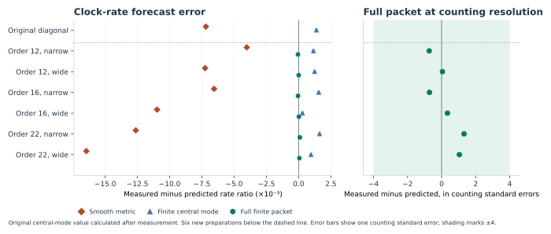

# What accounts for the 0.57744 diagonal clock reading?

**OPH · Pragma Research · 20 November 2026.** The smooth scalar approximation predicted **0.584628**. The finite contact law, evaluated at the central wavelength alone, gives **0.576056**. Propagating the prepared packet and predicting which arrivals its local detector would accept gives **0.577423**. The observer recorded **0.577436 ± 0.000066**. The initial discrepancy was 1.23% of the smooth prediction. After accounting for the finite propagation and measurement, the residual is 0.19 counting standard errors. These three calculations of the original case include a retrospective diagnosis.

## What changes physically in the description

The smooth spacetime description assigns an elapsed-time ratio from a speed and a limiting signal speed. In the finite candidate each rail accumulates a phase determined by its wavelength and contact coupling. The moving hand reads the difference of those phases. At finite wavelengths the exact dispersion gives a slightly slower beat than the smooth approximation on the tested central modes. For the forward diagonal the continuum ratio using the theoretical central group speed and limiting c is **0.584384**. The exact central beat is **0.576056**. That difference already occurs for an ideal single Fourier mode; it requires neither count noise nor uncertain velocity. [Contact dispersion and finite-mode identity](report.md)

A real test packet in this simulation spans a range of wavelengths. It spreads, and the receiver at home accepts only a local part of it after a signed lap. Those weights affect both the stationary reference and the moving clock. On the original diagonal, summing over all observation sites would give **0.578551**, whereas a local home observation without a winding marker gives **0.577424**. The full signed-return instrument gives **0.577423**. The distinction between the local and whole-chart instruments matters much more here than adding the winding tag to the local measurement. These are source calculations of probabilities for different instruments. The actual observed ratio above comes from returned local records.

## Six new forecasts before opening the clock

Hold every interaction coefficient fixed. Change the central wavelength and the packet width on the same diagonal in a 512-period chart. Use fresh stationary clocks and geometry counts, then seal three predictions before the traveling phase observations exist. A separate equipped observer measured the central wavelengths by comparing a wave with a one-step translation, and both stationary rail gaps by interference with a coherent one-update bypass. Using those recorded quantities in the finite dispersion recovered the central-mode forecasts. This requires a calibrated wavelength and gap probe; speed alone does not supply that information.

| Central order | Momentum band | Smooth | Finite central mode | Finite packet at signed detector | Observed moving/rest ratio |
| ---: | --- | ---: | ---: | ---: | ---: |
| 12 | Narrow | 0.690839 | 0.685670 | 0.686870 | 0.686818 |
| 12 | Wide | 0.694160 | 0.685670 | 0.686902 | 0.686906 |
| 16 | Narrow | 0.584169 | 0.576056 | 0.577666 | 0.577615 |
| 16 | Wide | 0.587328 | 0.576056 | 0.576328 | 0.576351 |
| 22 | Narrow | 0.468536 | 0.454292 | 0.455816 | 0.455911 |
| 22 | Wide | 0.471711 | 0.454292 | 0.455188 | 0.455247 |



The central-mode correction improved all six outcomes. All six full-packet predictions were within **1.32 counting standard errors** of the observations (registered gate: four). Their root-mean-square rate errors were **0.01051** for the smooth prediction, **0.001218** for the central mode and **0.0000556** for the packet and local aperture. The narrower momentum band produced a reading closer to the central-mode prediction in only **one of three** matched comparisons. A universal offset proportional to packet width would miss the direction or magnitude of the measured effect. For example, at order 16 widening the momentum band changed the observed rate by −0.001263 ± 0.000099. The finite-packet calculation predicted −0.001338, while the central mode predicts zero. The signed return, survey-selected arrival appointment, and local sampling of resting and moving packets all enter the full calculation.

The rule and couplings were already known. This follow-up verifies that the observed residual of this *simulated* clock follows from the specified finite dynamics and detector. It therefore supports using the smooth metric at its declared accuracy and the finite law for more precise forecasts of this instrument. It supplies no universal correction to special relativity. The equally bound spectator clock still gives one, and ordinary separated constituents still cannot form the protected compact pair. [Alternative clocks and formation tests](report.md)

## Reproduce

From `simulation/experiments/observer_geometry/interaction_clock` in the research checkout at revision `641c808c`, run the independent reader on the checked-in flight counts. The full forecast uses a separate eigensystem and direct matrix powers to propagate the signed packet. The phase reader uses only locally delivered counts. The primary finite predictions were sealed at `d40ad2ef`; the central-mode forecasts from independently measured wavelength and gap records were sealed at `dd9aea89` before disclosure of any of these flight readings.

```sh
python -B correction_reader.py correction_evidence
python -B wavelength_probe.py verify wavelength_evidence
out=$(mktemp -d)
export OPENBLAS_NUM_THREADS=1 VECLIB_MAXIMUM_THREADS=1 OMP_NUM_THREADS=1
for stage in prospect reveal compare
do
    python -B correction_run.py "$stage" "$out/correction"
done
diff -qr correction_evidence "$out/correction"
python -B wavelength_probe.py forecast "$out/wavelength"
diff -qr wavelength_evidence "$out/wavelength"
```
