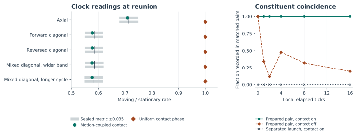

# Can an interaction-bound pair tell relativistic time?

**Observer Patch Holography · Pragma Research · 20 November 2026**

**Yes, for a prepared pair on one explicit two-body law, within the registered accuracy.** On the forward diagonal its moving clock advanced 0.57744 as far as its stationary duplicate. The sealed scalar-metric forecast was 0.58463. The same test on an equally tightly bound pair with a uniform internal oscillator gave 0.99998. All five journeys distinguished the two contact laws. A separate conventional contact-phase model retained several specially prepared pairs but missed the clock forecast wherever a reading was resolved. None of the tested input preparations generated a lasting clock from two initially separated walkers.

## The two clocks

Two distinguishable excitations make the same eight-slot moves as in the previous free-clock experiment. When two matching routing slots occupy the same local address, a contact operation can mix them into other **matched** pairs of slots. Both constituents then take the same outgoing step. Their relative distance stays zero while the center of the pair can travel around the chart. One constituent has two prepared internal alternatives, called rails. Interfering them at a local detector makes their relative phase a clock hand. The whole phase difference is generated on contact. The pair's center and its two constituents move under the local rule; an external controller does not tow the clock. The chart, preparations, clock counters, winding memory and collection services are supplied.

- **Motion-coupled clock.** The two rails have slightly different contact reflections. That difference affects both the transported wave and the phase read at the detector.
- **Spectator clock.** Both rails have the same contact reflection. A small additional relative phase advances every time the pair interacts. At rest it has the same zero-momentum frequency splitting as the first clock. Its internal phase counts the services along the journey.
- **Binding switch-off.** At every site the two excitations now take their independent free steps. We test the same sharp matched preparation against both active laws and this control. A separate trial starts with the constituents apart and moving toward one another.

The two microscopic couplings, π/16 and π/16 + π/2048, are design inputs. They were held fixed across all sizes, widths and directions, and set the energy and clock scales in the simulator. No measured particle mass or desired moving-clock ratio is an input. This is a constructive test of candidate laws; it does not select those couplings from ordinary repair or give the pair a particle identity.

## What the receiver measured

The lab first measured the motion of each pair's envelope on separately prepared trials and calibrated its own stationary clock of the same construction. The first 19 of 37 survey appointments set the speed and predicted reunion time. Signed echo components gave the distances in the earlier scalar chart. The one-body rule is identical for all these contact laws, so the forecast used the previously measured free-pulse speed of **0.499350**. At the locally recorded reunion the reader admitted a full signed turn, compared four rail-analyzer counts, and checked the phase against 33 intervening observer appointments. Separate dephased and equal-coupling preparations tested whether the reader could report a clock when its coherence or frequency difference was removed. The archived records include other winding sectors and missed detections. [Parent calibration](../relativistic-observer-records/report.md#a-clock-carried-by-the-traveling-wave)

| Itinerary | Motion-coupled forecast | Motion-coupled reading | Spectator forecast | Spectator reading |
| --- | ---: | ---: | ---: | ---: |
| Axial | 0.71408 | 0.70862 | 0.71426 | 1.00002 |
| Forward diagonal | 0.58463 | 0.57744 | 0.58448 | 0.99998 |
| Reversed diagonal, translated lab | 0.58457 | 0.57740 | 0.58461 | 0.99991 |
| Mixed diagonal, wider momentum band | 0.58589 | 0.57659 | 0.58600 | 0.99995 |
| Same mixed direction, twice the circumference | 0.58352 | 0.57674 | 0.58370 | 0.99997 |

On the forward diagonal the stationary coupled clock advanced **1.36693 radians** over the 1,787-home-tick trip. The traveler returned with **0.78931 radians**. Dividing the two measured advances gives its rate ratio. Each law received a separate speed measurement and forecast; no flight rate was used to set either. The registered ±0.035 band had to contain the entire interval of three counting standard errors on either side of the reading. All ten controls of each type lost the clock reading as required.



**The agreement is approximate.** Every motion-coupled reading fell below its point forecast, by 0.00546–0.00930. All five deviations exceeded counting uncertainty and the declared sensitivity from the held-out velocity and c ±0.001. The doubled circumference keeps the carrier momentum and the law fixed and narrows the packet bandwidth. It tests size dependence and does not establish a continuum limit.

## Why the clock laws separate

For the coupled pair, the finite gate gives the mobile phase through $\cos E_\phi(k)=a(k)\cos(\phi/2)$, where $a(k)$ is the mean of the four cosines of momentum in the routed and private directions. For small phases the leading relation is $E_\phi^2\simeq (|k|^2+\phi^2)/4$. The two nearby contact phases give different rest energies. In the leading dispersion their frequency difference decreases with motion by the relativistic factor. For the spectator the two evolutions on the bound subspace differ by one commuting scalar phase per service. Its rest-normalized clock rate is exactly one wherever the hand can be read. The detector fits neither equation.

Evaluating the **exact** coupled law at the central launch momenta after opening the records gives moving/rest splitting ratios **0.70720 axial** and **0.57606 diagonal**. The recorded packet ratios lie 0.00053–0.00142 above these plane-wave values. The finite law itself therefore predicts a departure from the smooth formula of the observed sign and scale. This calculation uses preparation momenta, so it is a source diagnostic. The table above gives the independent predictions from observer records.

There is a finite-law check on the sign. For a single Fourier mode with an infinitesimally split clock, write $r=2\partial_\phi E$, let $v=\nabla_k E$, and use the limiting speed $c=1/2$. Differentiating the finite dispersion gives

$$
1-|v|^2/c^2-r^2 =
\frac{\operatorname{Var}_i(\cos k_i)+\sin^2(\phi/2)\,\operatorname{mean}_i(\sin^2 k_i)}{\sin^2 E}\geq 0.
$$

Here the average is over the four routing directions. Thus the plane-wave clock on these nonzero finite momenta runs slower than the corresponding continuum formula. The identity uses the same mode's group velocity; a finite-width packet accepted on a winding tag still needs its own detector comparison.

For the motivating forward diagonal, an independent calculation using the full prepared packet and the receiver’s actual signed aperture gives **0.5774235**. The observed **0.5774359 ± 0.0000657** differs by 0.0000124 (0.19 counting standard errors). This is a retrospective check of the specified simulator. The follow-up sealed the same calculation before six new flights at other momenta and widths. All six full-packet predictions agreed within 1.32 counting standard errors. [Six-run correction report](correction.md)

## Binding, formation and collisions

The sharp matched pair remained together in all **262,144 trials at each measured epoch** for each active law, through 16 services. With contact switched off, only **89,932 of 262,144** remained matched after the first step (34.31%). The exact one-step probability is 11/32. In a separate exposure the initially separated excitations did meet. The coupled arm registered **82,663** ordinary first-step coincidences and **zero** captures into the protected pair.

That last result has an exact explanation. The matched coincident subspace maps onto itself under the local unitary and its inverse. Its orthogonal complement is invariant too. A pair launched with zero overlap with the protected subspace can **never** enter it under either compact-pair law. These laws demonstrate a clock sustained by an engineered binding interaction. They also demonstrate a structural obstacle to preparing that clock through ordinary scattering.

We tested a simpler candidate independently. An on-site scalar phase of $i$ acts whenever the two constituents coincide on an axial guide, with no rule requiring them to stay together. Three of four prepared two-level pairs met the finite retention and readout criteria. Their ratios were **0.87214, 0.52508 and 0.82583**, against **0.97574, 0.96782 and 0.97313**. The fourth lost sufficient localization and clock contrast. Two initially separated packet preparations passed through one another with a strong coincidence signal but no sustained capture under the registered criterion. These are finite axial transit tests of one scalar phase and specific levels.

A local two-particle interferometer gave an independent way to identify what happens at an encounter. Two coherent paths meet a second excitation different numbers of times, reunite at one detector, and produce a phase-sensitive count. A blind reader correctly identified **all four** scalar contact phases (0, +π/2, π, −π/2) in both repeats. Single-particle records are identical across the four alternatives. Separating the paths at the interaction and erasing their coherence gave the registered control outcomes. This identifies the law used to produce each test tape. It supplies no empirical preference among the four for nature.

## Consequences for the search

Binding and a stationary line are insufficient selection rules. Test a candidate's relation between its internal beat and its *measured* motion, then test how an inhabitant can prepare that clock. The next experiment is to permit two separated excitations to form a mobile pair while a third degree of freedom carries a distinguishable outgoing record. Enroll those initially separated preparations, measure both the departing record and persistent pair, and run the sealed clock test on the resulting cohort. Formation, binding and clock operation must all occur on that same executable. The current results leave particle identification and energy-threshold binding for the compact pair open. The earlier fast relay remains accessible to equipped observers. [One-law plan](../PLAN.md) · [Earlier signal race](../signal-race/report.md)

## Reproduce

Python with NumPy and SciPy runs all three studies from `simulation/experiments/observer_geometry/interaction_clock` in the research checkout at revision `641c808c`. Registration commits were `b9c65669` (two-body laws and encounter assay) and `119618e7` (clock instruments and finite guide). The encounter forecast was sealed at `f9ae26f5`. Both sets of material-clock forecasts were sealed at `c14421d1` before reveal. The independent reader verifies the primary counts and opaque collision classifications without importing the material evolution.

```sh
python -B verify.py evidence
python -B plain_contact.py verify plain_evidence
python -B encounter.py verify encounter_evidence
out=$(mktemp -d)
export OPENBLAS_NUM_THREADS=1 VECLIB_MAXIMUM_THREADS=1 OMP_NUM_THREADS=1
for stage in prospect reveal compare
do
    python -B run.py "$stage" "$out/primary"
done
diff -qr evidence "$out/primary"
for stage in prospect reveal verify
do
    python -B plain_contact.py "$stage" "$out/guide"
done
diff -qr plain_evidence "$out/guide"
for stage in forecast acquire classify score verify
do
    python -B encounter.py "$stage" "$out/fringes"
done
diff -qr encounter_evidence "$out/fringes"
```
