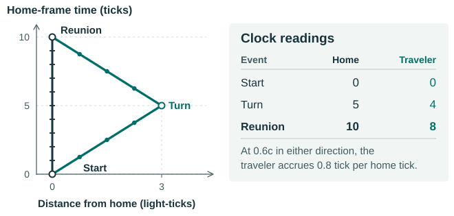
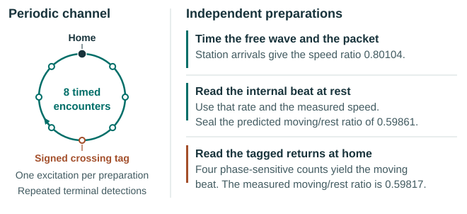
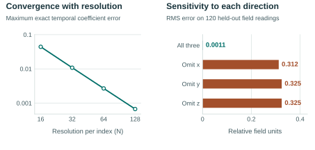

# Clocks and spacetime from observer records

**Bernhard Mueller · Pragma Research · 19 November 2026**

If two observers leave the same place, follow different paths and meet again, what will their clocks say? In our work on Observer Patch Holography (OPH), we tested an executable rule under which a freely traveling oscillation gives the relativistic answer at long wavelengths. The same local rule also gives a scalar field whose measured evolution has a provable flat 3+1-dimensional continuum limit.

This Pragma Research experiment asks what equipped observers can predict from their records. The experiment supplies a chart, coherent preparations and instruments. Whether independently formed clocks, all usable signals and interacting matter share this spacetime is a further, experimentally distinguishable question.

## What special relativity asks of a clock

A clock is a repeatable local change that an observer can count. Imagine counting the swings of a pendulum or cycles of an atomic transition. Calibrate two ideal clocks side by side. Each observer always experiences their own clock ticking normally. Special relativity tells them how to compare the counts when the clocks take different paths between the same events.

In flat spacetime, inertial observers can use the same laws of physics and measure the same vacuum light speed $c$. In the home observer's inertial coordinates, a traveler moving at speed $v$ for a short interval $dt$ accumulates proper time $d\tau=dt\sqrt{1-v^2/c^2}$. For changing speeds, add the contributions along the path. Departure and reunion give the clocks two shared events at which to compare readings directly. [Einstein, 1905, §§1–4][einstein]

**Figure 1. An illustrative trip.** Home counts five ticks on the outward leg and five on the return. At $0.6c$, the traveler counts $5\sqrt{1-0.6^2}=4$ per leg. The totals are **10 and 8**. The idealized turnaround takes negligible time. The two paths explain the difference. This is a teaching example. The freely moving packet in the experiment described below returns by circulating around a periodic route.

## How an inhabitant can test the prediction

Imagine receiving two envelopes at home. The first contains signal timings and the rate of a clock measured beside you before the trip. It should let you predict the returned clock reading. The second contains the actual reading. If the second helped to choose the speed or calibrate the first, opening it would teach you little. The experimental protocol keeps these measurements separate.

**Measure time and range.** Home stamps a pulse when sending it and when receiving the matching echo. For calibrated reciprocal propagation and prompt reflection, the midpoint of the two readings gives a radar time. Their half-difference times the calibrated signal speed gives a radar distance. A second station can stamp the same identifiable event and send home its actual receipt. Two calibration exchanges determine a constant offset and rate between clocks. A third tests that calibration.

**Measure a clock.** Two neighboring oscillations alternately reinforce and cancel. Their difference in phase acts like a clock hand. A rest preparation calibrates its ordinary rate. A returning preparation reveals how far that hand has moved. Repeated destructive detections can estimate the hand's angle even though an individual detection yields only one outcome.

**Identify the source of a number.** A simulated port, a seam and a register address are parts of the computation. A physical claim here concerns a relation among timestamps, tags or detector counts that an observer actually holds. The analyst may inspect the update to prove a prediction. The observer who tests it receives the agreed records. In particular, a hardware address gives neither a measured distance nor a particle identity.

A reference result, **320 home ticks and 305.261 traveler ticks**, came from an experiment with a supplied flat spacetime and ideal clocks. Changing its traveler rate by 8% produced a detectable discrepancy. Silencing its reflector removed the radar prediction. These controls demonstrate that the reader can discriminate agreement, disagreement and insufficient evidence. Evidence about a candidate repair law begins when the candidate generates the records.

## What the integer clock and the carried oscillator measured

In the Reverse Engineering Reality (RER) program's equipped golden record net, traveler B carried a sealed register. Home A and a distant station C recorded the same optical tags. C forwarded its record to A, which could reconstruct intermediate motion before reading B's clock. On 15 fresh journeys the stations predicted the **wait-only register** on all 15 and independently predicted 374 of 374 withheld ordinary echoes.

| A shorter journey | What the observers inferred or read |
| --- | --- |
| Home duration | 16 home ticks from departure to reunion. |
| Exact integer tags | On the assumed flat line, eight intervals at rest and eight at signal speed. They contribute 8 and 0 ticks to the proper-time model. |
| Opened wait-only register | 8 ticks. The rule explicitly advances this register on waits. |
| Coarse tags treated as rounded | A different monotone trajectory fits the same rounded receipts and gives 11.169 ticks. |

**A finer measurement separated the trajectories.** Three Fibonacci carrier refinements gave optical upper bounds of **10.740, 9.842 and 9.257 ticks** on the original stair-shaped trip, including timestamp rounding and baseline uncertainty. The inference assumes reciprocal propagation and monotone collinear legs between A and C. At the finest setting, an independently evolving exchange oscillator carried on the trip read **15.948 ticks**, with a simultaneous 99% interval of **14.855–17.116**. Even its lower bound cleared the optical upper bound.

The oscillator consisted of exchanging pairs of binary loads. Moving it handed the pairs to the next owner. Each pair underwent the same internal evolution on every service, including a handoff. A home oscillator given the same number of services therefore accumulated the same phase. Fourteen journeys had sufficient records for this comparison and all showed the discrepancy. Four control trips had insufficient ranging records and two had no reunion. The integer register and the exchange oscillator both behaved as their respective rules predict. Their disagreement identifies the physical question a freely moving clock must answer.

## A clock carried by the traveling wave

On a different candidate, each update reflects eight local amplitudes and routes each outgoing amplitude to its neighbor's opposite slot. A prepared packet occupies two neighboring oscillation modes of one internal cyclic register. Both propagate under this same update. Their relative phase is the clock hand. The update has no input for the packet speed or the relativistic slowdown factor.

**Figure 2. How the clock reading was withheld.** A gapless wave supplied a reference speed. Independent packet arrivals gave the traveler speed. A stationary doublet supplied the rest rate. The researchers sealed the prediction before opening the moving phase counts on separately prepared packets.

The packet circulated freely. Crossing a distant cut changed a two-bit signed tag. Recrossing in the opposite direction canceled that change. A home click carrying the enrolled tag certified nonzero winding modulo four. Eight timed apertures measured the packet envelope. The first four peaks predicted the last four, with a worst disagreement of 0.58% of flight time on the coherent held-out settings. This reconstructs the motion of a reproducible extended packet.

On the faster trial, **1.18650%** of simulated preparations registered at the tagged home station at the chosen time. **0.00115823%** reached the four apertures used to read phase. The code sampled the aggregate outcome counts of $2^{38}$ terminal preparations and retained the complementary outcomes. The phase is an ensemble reading. Randomizing the internal phase preserved a returning wave but erased the readable clock hand.

## How much the moving clock slowed

Each ratio below is the moving phase advance divided by the rest phase advance for the corresponding home duration. A separate zero-internal-momentum wave sets the reference speed in each speed ratio. The speed and rest data were sealed before the comparison with the moving counts.

| Packet preparation | Speed / reference speed | Relativistic prediction | Measured phase ratio |
| --- | ---: | ---: | ---: |
| Lower launch momentum | 0.60928 | 0.79295 | 0.79666 |
| Higher launch momentum | 0.80104 | 0.59861 | 0.59817 |
| Longer wavelength at high speed | 0.80295 | 0.59604 | 0.59603 |
| Reversed circulation | 0.80068 | 0.59909 | 0.59691 |
| Fresh intermediate momentum | 0.72753 | 0.68608 | 0.68599 |
| Short wavelength | 0.72606 | 0.68763 | 0.62217 |

All five long-wave cases met the preregistered absolute tolerance of **0.035**. The short-wave case missed by **0.06546**. The tolerance is a decision threshold. Counting errors and uncertainty in locating the broad return peak are separate. A higher-count repeat bounded the discrepancy below **0.0068** at three long-wave settings with simultaneous 99% coverage under the simulation's counting model. It also resolved a small finite departure in the faster setting.

**Why the wavelength matters.** In one direction the exact update gives $\cos E=(2+\cos k+\cos q)/4$. Here $E$ is the phase per update, $k$ is the launch wave number and $q$ labels the internal mode, both in finite-update units. For small $k,q$, $E\simeq\sqrt{k^2+q^2}/2$. The slope with respect to $k$ determines packet speed. The difference of the two internal frequencies determines the clock rate. The leading square root ties speed and rate together in the relativistic way. At shorter wavelengths the cosine terms alter those two readings differently.

For the original short-wave preparation, evaluating the exact central-mode beat **after** the measurement gives **0.62141**, close to the **0.62217** read at home. A fresh experiment then forecast **0.62896** for a new short-wave preparation and recorded **0.62904**. The finite law predicted the departure prospectively.

## How observers measured a three-dimensional field

A clock traveling along one route can test time dilation in one direction. To test three dimensions, the experimenters prepared waves with variation across several directions at once. The question was whether one field equation could predict what nine stations would record when these waves crossed and interfered. The update was the same original eight-slot reflection used for the traveling clock.

**Build a chart.** The apparatus supplies three oriented command dials and periodic boundary conditions. A local round trip calibrates the displacement for each dial in units of a reference lap. Three timestamp exchanges check each station's clock against home. Together they supply the coordinates and times used by the reader. Changing the third clock receipt invalidated the calibration and the reader abstained. The chart is a declared part of this experiment. The waves' response to all three directions still has to be measured.

**Read a field value.** At each station, a prepared wave interferes with a uniform reference at four detector phase settings. Each preparation yields a countable outcome. Differences of counts give the two components of a complex field amplitude relative to a locally measured reference. The resulting count packet is delivered back to home. The reader receives those counts, the clock and range receipts, and the declared preparation dials.

**Predict unseen readings.** Six stations at the initial time determine the amplitudes of the declared spatial patterns. An independent calibration uses three axial waves and a spatially uniform internal oscillation. The reserved field observations use **ten preparations, three other stations and four later times**, hence **120 complex values per resolution**. They include patterns varying obliquely to the chart axes and a coherent superposition. A model that only succeeds for three separate axial waves can fail here.

The simulated count budget compensates for the diminishing probability of finding a normalized wave at a selected local aperture as the system grows. At resolution 128 there are $2^{48}$ simulated preparations per detector setting, sampled as aggregate binomial counts. A separate direct evolution on a small four-index array checked the optimized calculation on 90,112 complex projections with maximum discrepancy $5.34\times10^{-15}$.

## What the continuum proof establishes

On a periodic chart of side one, hold a finite set of spatial patterns and one private Fourier order fixed while refining resolution. Let $h=1/N$, with $N$ the number of samples per direction. Let $K=(K_1,K_2,K_3)$ be the spatial angular wave numbers and $Q$ the private angular wave number, each component an integer multiple of $2\pi$. Holding $Q$ fixed selects a field sector.

For one mode, the exact equal-slot projection after $n$ updates is $\cos(nE)$. The original reflection and shift give

$$
\cos E=\tfrac14\big[\cos(hK_1)+\cos(hK_2)+\cos(hK_3)+\cos(hQ)\big].
$$

Expanding this identity gives $E/h=\tfrac12\sqrt{|K|^2+Q^2}+O(h^2)$ for each fixed nonzero mode. The zero mode stays constant. At chart times $t=nh$ in any bounded interval, the projected oscillation therefore approaches the continuum oscillation with an error of order $h^2$. Linearity gives the same convergence order for any fixed finite sum of these modes. The analytical proof concerns the expected field amplitude. Sampling contributes a separate error to measured amplitudes.

In the coordinates and time units calibrated by the instruments the limiting equation is

$$
\partial_t^2\phi=\tfrac14(\partial_x^2+\partial_y^2+\partial_z^2)\phi-\tfrac{Q^2}{4}\phi,
\qquad \phi(0)=f,\quad\partial_t\phi(0)=0 .
$$

This is the free relativistic **Klein–Gordon equation** with signal speed $c=1/2$ and rest angular frequency $|Q|/2$. Imagine specifying an initial ripple everywhere, releasing it with zero initial velocity, and predicting every detector's subsequent oscillation. The three spatial derivatives say how curvature of that ripple in each direction contributes to its evolution. A nonzero private order gives a spatially uniform preparation an oscillation of its own. It supplies a gap in the field sector. A physical particle mass would additionally require identifying a particle and calibrating units independently.

**Scope of the limit.** The local differential equation is Lorentz invariant with this speed. The spatial chart wraps into a three-torus, so the global identifications restrict spacetime symmetries. The proof keeps the observed wavelengths fixed while refining the finite dynamics. A short wave tied to the resolution can continue to exhibit the finite-law corrections seen by the moving clock.

## Three directions made a measurable difference

**Figure 3. Two different measures of agreement.** Left, the largest deterministic error in a registered single-mode time coefficient falls by roughly four when resolution doubles. Right, the finite records test the full theory and three alternatives that each omit a spatial derivative. The right-hand errors include counting noise and the uncertainty of fitting the initial field.

| Resolution $N$ | Largest exact coefficient error | RMS error on 120 reserved complex values |
| ---: | ---: | ---: |
| 16 | 0.044140 | 0.012193 |
| 32 | 0.010801 | 0.003135 |
| 64 | 0.002686 | 0.001375 |
| 128 | 0.000671 | 0.001105 |

At the finest resolution the three axial speed calibrations gave **0.500106, 0.500028 and 0.499845**. In the normalized field units, dropping the $x$, $y$ or $z$ derivative raised RMS error to **0.31232, 0.32459 or 0.32456**. Changing the equal-slot reflection phase to $i$ gave RMS **1.25488** against the original full-field forecast. These are comparisons against simulated observer counts.

A post-acquisition analysis also tested whether a differently oriented plane could explain the response. Six massless wave directions determined the six independent entries of a homogeneous symmetric spatial tensor in $\omega^2=K^\mathsf{T}GK$. On the admitted low-frequency branch the smallest eigenvalue had a simultaneous 99% lower bound of **0.19305**. A rank-two tensor would have a zero eigenvalue. This excludes every rank-two tensor in that model class on the measured dials. The strength of the bound depends on the homogeneous quadratic model and the simulated counting law.

## Where the RER geometry theorems enter

RER has several ways to give mathematical content to the word “space.” Each names a different object that an observer can, under its hypotheses, reconstruct.

**A local three-dimensional ruler.** In the twelve-port conservative carrier, the slow-response band has rank three. Accumulated local responses have a three-component displacement readback with an icosahedral frame. This explains why a three-direction measurement is worth looking for. To extend the ruler across observers requires agreement on shared events, directions and distances. The eight-slot reflected-routing experiment supplies its own chart and measures its field response. Equating that chart with the twelve-port ruler would require an independently tested map between them. [RER rank-three theorem and joined-screen qualification][rank]

**A clock from causal records.** RER's golden-family theorem specifies a three-fold product population, a shrinking read radius and the model duration for successive layers. Away from null separation the record order converges to flat 3+1D causal order. For fixed interior timelike diamonds, normalized event counts converge to spacetime volume. Volume scales as the fourth power of proper duration, so the fourth root of the ratio of two counts gives their limiting duration ratio. Here a diamond consists of events causally between an earlier and a later event. On a finite three-axis realization at $q=21$, a collecting observer actually received **6,482 writes and 2,904,889 ordered pairs**. A finite estimate of spacetime dimension from those counts was **3.612**. The dimension-four conclusion comes from the limiting theorem. [RER causal and count limit][golden]

**A continuum description of an admissible field menu.** RER also proves a smooth static 3+1D Lorentzian field description to prescribed accuracy for fixed finite admissible observations, given its radial interval, hyperbolic evolution and other hypotheses. The orientation-preserving conformal transformations of a spherical sky form the same group as the proper, time-orientation-preserving Lorentz transformations. Identifying which material clock an executable carries requires a separate measurement. The reflected-routing result adds a direct derivation from its local update, a convergence rate for a defined sector, and a held-out comparison against detector counts. [RER effective-field proposition and sky symmetry][effective]

These results constrain different parts of a future common-source construction. A measurement linking causal diamonds, wave propagation and a transported material clock on the **same** history would join three operational definitions of geometry.

## Which repair laws do these experiments select?

The selection target is a candidate whose observers independently obtain a common long-wave speed and whose material clocks measure the associated proper time. A law can fail that target for a particular clock or channel while continuing to describe other records accurately.

| Candidate construction | What the evidence licenses |
| --- | --- |
| Transport changes only an oscillator's owner. Its internal evolution is independent of motion and gets the same number of services as at home. | **Excluded as the tested proper-time clock** when the independently inferred journey duration differs from home time. The conclusion extends to this factorized family by the equal accumulated internal evolution. Changes to exposure, internal coupling or the instrument require a fresh test.  |
| The relativistic speed-only factor $\sqrt{1-v^2/c^2}$ applied at every wavelength of the reflected-routing packet. | **Excluded over the measured band.** Long- and short-wave packets had almost equal speeds but returned materially different clock ratios. Both their internal mode pair and spatial wave number changed.  |
| A homogeneous scalar response with only two independent spatial directions in the supplied chart. | **Excluded for the six measured directions**, under the low-frequency quadratic model and its counting assumptions. A more general encoding or inhomogeneous medium requires its own tests.  |
| Original reflection versus a small, symmetric local phase shift. | **Distinguished at matched speeds.** For three increasingly short-scale preparations, the original rule gave **0.6881, 0.6819, 0.6290**. Changing the equal-slot phase by 0.05 radian gave **0.7607, 0.7630, 0.7559**. All six finite-law forecasts came within 0.00231 of their own measurements. Slot symmetry and unitarity alone leave both possibilities.  |

**What is strongly indicated.** To reproduce these relativistic records a candidate needs an accessible signal with a linear long-wave dispersion, a rank-three spatial response in this chart and a material rate that follows the measured motion. A common low-energy relation $\omega^2=\Omega^2+c^2|K|^2$ for the clock doublet and its reference provides one sufficient mechanism. Within the tested phase deformation, a fixed small nonzero phase makes the designated gapless branch quadratic very near zero momentum. This gives a structural reason to prioritize the original reflection branch and to look for other mechanisms that protect the same observable behavior.

**What is underdetermined.** A number-conserving law can acquire an extra local phase only when two excitations meet. Every one-particle clock and field result would be identical for every value of that phase. A two-particle experiment is required to select among them. A missing echo or absent clock reading is also insufficient to exclude an entire classical, stochastic or coherent family. Selecting a law for nature ultimately requires independently identified physical observables. [Scope of the one-law search][plan]

## What “universal for the inhabitants” would mean

Imagine two laboratories built by observers in the same history. One uses the wave clock described here. The other uses a bound pair as a clock and a different pulse to exchange messages. They meet to fix units, separate, exchange unpredictable messages and reunite. If both can predict the other's transit times, elapsed times and directions with **one metric**, including trips withheld during calibration, the shared spacetime has acquired a meaning independent of the first apparatus.

There is already a concrete obstacle. In the present packet experiment the freely propagated reference travels at **0.499350 radar units per home tick**. The addressed service that carries a calibration nonce travels at **one radar unit per tick**. If inhabitants can use that service to send a freely chosen message, a message can outrun the scalar wave. The scalar cone then cannot be the causal limit of *all* their communications in this implementation. Its measured clock and field predictions still hold.

**Figure 4. One range standard, two transit speeds.** If a receiver can learn a sender's choice from the faster arrival, that receipt belongs in the inhabitants' causal geometry.

A useful next test is to let a local sender choose a previously unknown nonce after the start event. Let a distant observer identify it and return an authenticated receipt. Race every lawfully accessible channel against an independently timed wave along the same baseline, with deadlines and silent controls fixed in advance. Classify any external service supplied by the experimental apparatus explicitly. If it remains available to inhabitants, include it among their signals. A revised autonomous law that changes the channel must rerun the earlier benchmarks.

Three further measurements would broaden the universality test.

1. **Other clocks and observers.** Transport two independently realized clocks through the same events along axial and oblique routes. Use calibrations made locally, exchange observer roles, and predict both unopened reunion readings with one metric.
2. **A shared geometry for matter and signals.** Recover directions and distances from ordinary records with supplied chart labels hidden. Test whether a second field, persistent matter and interactions recover the same cone and agree on overlapping patches. Audit the private cyclic channel for additional usable coordinates or signals.
3. **A responding spacetime.** Vary one local source. Use one calibration to predict both a material frequency shift and a change in signal travel. Then test a time-dependent scale factor against independent frequency ratios and distances. The proved flat, static sector leaves gravitational response and cosmic expansion open. [One-law program and controls][plan]

## How to enumerate repair laws systematically

Enumerate **whole observer programs** in bounded families. A transition kernel alone cannot tell us who can send the fast nonce, who holds a returned clock, or what happens when memory fills. For each candidate freeze the alphabet, neighborhood, local transitions, scheduler, memory and reset rules, initial preparation distribution, physical access to instruments, and the observer's record reader. Pin the executable, test protocols, calibration and version together. Document each supplied resource. [Existing enumeration plan][plan]

**A first bounded search.** Keep the measured one-body reflection as a positive control. Enumerate short local updates in increasing depth. Start with finitely many declared phases, including identity and the tested symmetric perturbation. In an interacting branch, add number-conserving local encounter operations on a finite alphabet. Declare the numerical grid or exact representation, memory bound, radius, scheduler class and maximum history length before exhausting a tier. Add branches with different microscopic mechanisms so a single successful architecture does not define the search space.

**Remove equivalent candidates before simulation.** Canonicalize relabelings that preserve the law, owners, instruments and record distributions. Use exact arithmetic, or SAT/SMT over a finite encoding, for admissible transitions, conservation where required, ownership, reset behavior and schedule counterexamples. On the coherent branch, verify unitarity and derive the one-body dispersion where available. Archive a proof or a minimal counterexample for each pruning rule. A solver reporting exhaustion speaks for the specified grammar, bounds and histories.

**Choose an experiment where survivors disagree.** Keep one-particle-equivalent candidates together. To resolve an encounter-phase ambiguity, prepare two coherent alternatives in which the same two excitations meet a different number of times. Recombine them at a local detector. The relative phase shifts the interference fringe, provided the paths remain indistinguishable to the detector. A separated-particle control tests propagation alone. Forecast fringe positions before opening counts. This experiment can distinguish laws that unlimited one-particle statistics would leave tied.

For the one-body test there is a cheap numerical ranking criterion. Measure $R$, the returned-to-rest beat ratio, and $v$, the envelope speed, using different releases. Measure $c$ with a third signal. Candidates with $R^2+(v/c)^2$ approaching one under long-wave refinement deserve more exacting tests. A code that inserts this relation into its clock update has supplied the effect and cannot establish its emergence.

**Spend computation on discriminating measurements.** Order expensive runs by the expected difference in obtainable records relative to uncertainty and cost. An evolutionary or learned search can propose the next program. Keep a parallel lane of exact bounded enumeration with a coverage ledger. Store passes, contradictions, missing receipts, statistical ambiguity and timeouts separately. Rerun held-out sizes, seeds, schedules, clock constructions and interventions on survivors. Transfer a result to another family member only with an equivalence proof or an error bound tight enough to preserve the decision. [Family scope and counterexamples][family]

## The rest of the one-law program

| Order | Test on one frozen candidate | What earns progression |
| ---: | --- | --- |
| 1 | Establish a flat patch and audit **every usable signal channel**. Send unpredictable nonces, exchange timings, reconstruct distance from records, and predict withheld baselines and oblique directions. | Different observers recover compatible ranges. Competing dimensions, fast couriers, clock drift and missing returns have distinguishable outcomes. |
| 2 | Add an independently constructed moving clock and a second freely propagating signal. Vary directions, packet width, wavelength and observer roles. | One calibrated metric predicts sealed travel times and both reunion readings within registered uncertainties over a declared scale range. |
| 3 | Test encounter rules and a live medium. Run the two-particle interference test. Begin with a declared ordinary preparation and search for persistent structures, clocks and material references that form, survive and can be detected locally. Test temperature against a later independent observable. | Measured interaction and persistence survive changes of preparation, size and lawful schedule. Separate spontaneous formation from deliberate preparation. |
| 4 | Test an evolving universe. Compare repeated radar ranges with independent emitted and received frequency records. Test static, clock-drift, relative-motion and changing-propagation explanations on unseen epochs. | One inferred scale history predicts both observations. A cosmological theorem applies when the simulated source meets its stated hypotheses. |
| 5 | Reproduce **at least two further complete observables on the identical executable**, with the same units and access rules. Run inexpensive regressions of both from the start. | Each complete row survives the geometry and material tests on the same pinned manifest. Document supplied inputs, held-out predictions and failures. |

The shared color-source experiments are useful reference programs for partial winding and binding. They use prepared bodies and ring profiles on another source. They supply comparison tests for a successor. A successor earns that evidence through its own execution. The present measurements establish clock and field behavior on named preparations. Particle identities and a physical mass scale are separate questions. [One-law search plan][plan]

**Immediate decision.** Give two inhabitants a path to exchange an unpredictable message and a second clock to carry. Seal the scalar metric's predictions using the first signal and clock. Then open the second clock and the channel-race records. A reproducible faster message or a discrepant independently calibrated clock identifies the specific law or access rule that must change. Agreement on held-out routes would give a single spacetime description two genuinely new kinds of records to predict.

## Evidence and reproduction

Bernhard Mueller and Pragma Research developed the OPH work presented here. The experiments and their records are archived at research revision **bbbd949**. The RER theorem citations use the experiments' sealed revision **f52fa4da**. On 19 November 2026 the RER default head was **08b53f0a** and the cited flagship file was identical at the two revisions. This is a research report on simulated observer records.

| To inspect | Primary material |
| --- | --- |
| Special relativity | [Einstein's clock synchronization and moving clocks][einstein] |
| RER geometry theorems | [Rank-three ruler][rank] · [Golden causal order and count limit][golden] · [Effective field description][effective] |
| Law search | [One-law plan][plan] · [Family transfer rules][family] · [Journal](https://github.com/FloatingPragma/observer-patch-holography/blob/main/docs/research/laws/JOURNAL.md) |

**Short replay.** From the research checkout at revision **bbbd949**, change into the field experiment directory below. Python 3.13.7 and NumPy 2.5.4 regenerated the archived counts byte for byte and reproduced both analyses on the report machine. With NumPy 2.3.5, both analyses of the archive also reproduced exactly, but fresh acquisition differed by one count in one setting of the changed-phase control. The reader keeps the original receipts. The packet archive gives its own acquisition, prediction and reveal commands.

~~~sh
cd simulation/experiments/observer_geometry/transported_oscillator/continuum
python -B acquire.py
python -B read.py
python -B tensor.py
~~~

The simulations use finite waves and finite counts. The clock comparisons concern a prepared, coherently returning ensemble, with a broad arrival peak. The continuum theorem concerns a family of fixed-band expectations under refinement. Special relativity supplies the benchmark. All numerical observations reported here come from the named executable models. A quantitative match to an identified particle or to our Universe's expansion would require an additional independent physical calibration and comparison.

[einstein]: https://www.fourmilab.ch/etexts/einstein/specrel/www/
[rank]: https://github.com/FloatingPragma/observer-patch-holography/blob/f52fa4dab609845b20a80b43ea6bd9cc11a19f56/flagship/from_observer_consensus_to_standard_physics.tex#L1185-L1235
[golden]: https://github.com/FloatingPragma/observer-patch-holography/blob/f52fa4dab609845b20a80b43ea6bd9cc11a19f56/flagship/from_observer_consensus_to_standard_physics.tex#L2103-L2142
[effective]: https://github.com/FloatingPragma/observer-patch-holography/blob/f52fa4dab609845b20a80b43ea6bd9cc11a19f56/flagship/from_observer_consensus_to_standard_physics.tex#L1984-L2031
[plan]: https://github.com/FloatingPragma/observer-patch-holography/blob/main/docs/research/laws/PLAN.md
[family]: https://github.com/FloatingPragma/observer-patch-holography/blob/main/docs/research/laws/PLAN.md#how-far-a-result-transfers-within-a-family
