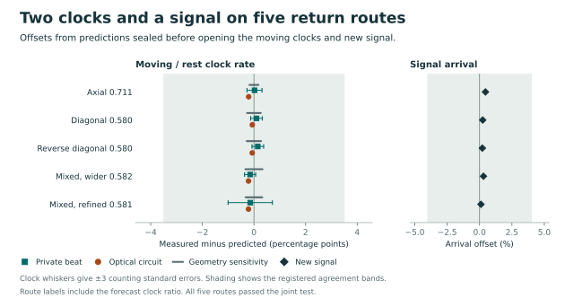

# Two clocks on the same OPH journey

**Pragma Research · Observer Patch Holography · 20 November 2026**

**One calibration predicted both clock readings on all five registered journeys.** A private-mode beat and a pulse circulating around a transverse spatial ring gave different ways to tell time. On the forward diagonal, the forecast was that each moving clock would advance **0.58025** as far as its stationary twin. The beat clock read **0.58123**, and the optical clock read **0.57961**. A separately launched pulse returned in **1453.57 home ticks**, against a sealed forecast of **1450.04**. The test used a smooth scalar metric previously measured on this OPH candidate.

## What traveled and what was read

The private clock superposes two adjacent orders of an internal cycle. The receiver reads the phase of their beat from four local counters. The optical clock sends a localized patch of lightlike excitation around the third spatial direction of the previously calibrated chart. Its hand is the bright patch on a ring of detectors. An observer reads the fraction of a turn from where the patch falls and uses intermediate populations to count whole turns. This instrument has no private beat or external phase reference. In both constructions the same eight-slot local update moves the excitation. No update multiplies the clock rate by a relativistic factor.

When the optical clock is prepared at rest in x and y, its pulse still circles in z. When that clock also moves in x and y, the pulse must advance around the ring while making longitudinal progress. For example, over 1,780 forward-diagonal home ticks it traveled **1.00121 turns** on the moving dial and **1.72739 turns** on the stationary dial. Dividing these two independent observations gives **0.57961**. Both endpoint fractions came from detections at the physical home column defined by the enrolled laboratory.

The two clocks were carried on matched, separately prepared specimens. They shared the departure laboratory, signed excursion, reunion laboratory and terminal appointment. They have finite widths and slightly different envelope speeds. Their speed differences were **0.00035–0.00091** radar units per home tick. Each specimen carried a coherent counter for signed crossings of a reference seam in x. It started at zero. At the final read the receiver required the sign and winding for one full lap; every observed captured endpoint count had the enrolled tag in these runs. Most launch trials missed the local aperture and appear among the complementary outcomes. The optical clock spans a transverse ring and an equipped collector receives the detector records after the event.

## Forecasts and results

Velocity came from independent records of the first clock's spatial envelope. The first 19 appointments fixed the velocity and reunion time; 18 additional appointments tested the extrapolation. For each axis the lab recovered signed ranges and calibrated clock stamps by prior reciprocal exchanges. The diagonal norm uses the orthogonal chart tested in the earlier field study. The code then used the archived speed **0.499350** and each clock's own rest advance to predict its moving advance. The clock readers see detector bins and clocks. The gate's eigenphases, register indices used in evolution and global state only enter preparation, detector probability calculations and implementation checks.  · [Earlier chart](../relativistic-observer-records/report.md#how-observers-measured-a-three-dimensional-field)

| Route and preparation | Reunion, home ticks | Sealed rate ratio | Beat clock ratio | Optical clock ratio | New signal, forecast → observed home ticks |
| --- | ---: | ---: | ---: | ---: | ---: |
| Axial | 1459 | 0.71128 | 0.71150 | 0.70923 | 1025.33 → 1030.01 |
| Forward diagonal | 1780 | 0.58025 | 0.58123 | 0.57961 | 1450.04 → 1453.57 |
| Reversed diagonal, translated laboratory | 1780 | 0.58026 | 0.58174 | 0.57959 | 1450.04 → 1453.18 |
| Mixed-sign diagonal, wider momentum band | 1783 | 0.58178 | 0.58029 | 0.57967 | 1450.04 → 1454.44 |
| Same mixed-sign preparation, twice the spatial resolution | 3562 | 0.58060 | 0.57915 | 0.57848 | 2900.08 → 2903.28 |



The registered band was **±0.035** in moving/rest ratio. For all ten readings, the full interval of three counting standard errors on either side fell inside the band. Both clocks lost their readings in all five phase-randomized controls. The independent signal was a freshly prepared gapless x,y pulse in the same field family. Its arrival differed from forecast by **0.11–0.46%** across the five panels. Full local counts, misses, clock calibrations and the population's departure and return checks are archived. Sampling used large virtual banks of independent terminal preparations, including up to 2^55 trials per Ramsey appointment.

**Finite deviations are visible.** The optical readings all fell below the point forecast, by **0.00065–0.00212**. These differences exceed optical counting uncertainty. Four optical points fall within the declared sensitivity range obtained from the held-out first-clock trajectory and variation of the reference speed by ±0.001. On the axial run the sensitivity interval starts at 0.70955 and the optical clock read 0.70923. Finite pulse width and imperfectly matched velocities can affect the result. This experiment did not isolate their contributions.

A post-hoc check gives one clue about those residuals. On the axial route the independent trajectory survey measured the optical envelope at 0.351907 and the beat-clock envelope at 0.350995 radar units per home tick. Inserting the optical speed into the unchanged metric gives 0.709475. The optical residual shrinks from −0.002056 to −0.000247. The analogous residuals across all five preparations have magnitudes between 0.00025 and 0.00087. The registered comparisons above use the original, sealed first-clock speeds throughout.

## Two additional checks

These follow-ups were specified after the five primary outcomes were known. Each protocol was frozen before drawing its own data.

**Did the private clock hide a whole turn?** Independently prepared local four-aperture readers sampled the phase at every integer clock appointment on the fitted route as well as at rest. Across 20,738 appointments the ten histories contained zero additional turns. The largest difference from the original signed-return phase was 0.00936 radians. All ten comparisons remained within the supplementary 0.05-radian tolerance after including three counting standard errors. The local direction, concentration and count gates all survived.

**Does the result survive a literal exchange of observers?** Two stationary laboratories on the diagonal exchanged three calibration messages. A then launched fresh clocks toward B, and B repeated the experiment toward A. In each direction the receiving lab read the two clocks at the half-trip appointment, 890 calibrated ticks after launch, then returned its dated decision. There were zero detected counts at the distant receiver in the departure control. Both dephased clocks lost their readings in both directions. The laboratories have different calibrated counter rates. This tests exchange of emitter and receiver roles within their stationary chart. A comparison between relatively boosted observers calls for another experiment.

| Launch and receiver | Forecast | Received beat ratio | Received optical ratio |
| --- | ---: | ---: | ---: |
| A to B | 0.58025 | 0.58353 | 0.58102 |
| B to A | 0.58026 | 0.58339 | 0.58107 |

## What the result establishes

This extends the earlier axial clock result to an optical readout, oblique paths, reversed propagation and two spatial scales within the prepared free-field sector. The two readouts have a known dynamical connection. The gate is symmetric under exchange of a spatial momentum and the private momentum. The spatial pulse speed probes the slope of its dispersion in z, while the private beat probes a small finite difference in the exchanged coordinate. A common long-wave prediction is therefore intelligible. The two instruments provide an experimental check of that prediction through quite different records. Interaction-bound clocks or a second field species would test a stronger form of universality. [Earlier oscillator](../relativistic-observer-records/report.md#a-clock-carried-by-the-traveling-wave) · [Clock and field report](../relativistic-observer-records/report.md)

**The addressed-message result still applies.** An observer permitted to trigger the signed relay can send a chosen message ahead of this scalar cone. The clock comparison uses such apparatus to collect records after their terminal stamps. A candidate that aims to give *all* inhabitants one causal geometry must account for which devices they can build and trigger. The next material test is to use a clock sustained by an interaction, recover its rest line locally, and predict its unopened reading on these same journeys. [Signal race](../signal-race/report.md) · [One-law research plan](../PLAN.md)

## Replay

Run from `simulation/experiments/observer_geometry/second_clock` in the research checkout at revision `77a10a3b`, with Python and NumPy. The registration was committed at `b63ce57a`, the instruments at `dcfdc34a`, and the sealed forecasts at `36ddf177` before either moving clock was acquired.

```sh
python -B verify.py --self-check
python -B verify.py
replay_dir=$(mktemp -d)
export OPENBLAS_NUM_THREADS=1 VECLIB_MAXIMUM_THREADS=1 OMP_NUM_THREADS=1
python -B run.py prospect "$replay_dir"
python -B run.py reveal "$replay_dir"
python -B run.py compare "$replay_dir"
for file in calibration.json.gz forecast.json forecast.sha256 opened.json.gz results.json
do
    cmp "artifacts/$file" "$replay_dir/$file"
done
```

A separate reader reconstructed **30 rest, moving and randomized clock records and 15 route surveys** from the archive. It checked the forecast seal, signed returns, uncertainty calculation and all five decisions.

The dense phase and peer studies have their own replays.

```sh
python -B beat_branch.py artifacts "$replay_dir/beat_branch.json.gz"
cmp artifacts/beat_branch.json.gz "$replay_dir/beat_branch.json.gz"
python -B peer_exchange.py prospect "$replay_dir/peer"
python -B peer_exchange.py reveal "$replay_dir/peer"
python -B peer_exchange.py verify "$replay_dir/peer"
diff -qr peer_artifacts "$replay_dir/peer"
```
