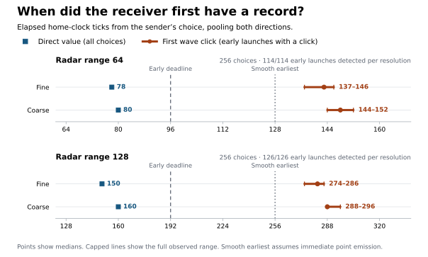

# Can an observer send a new message ahead of the scalar wave?

**Observer Patch Holography · Pragma Research · 20 November 2026**

**Yes, if the observer can invoke the addressed service.** At both tested ranges, in both directions, an equipped receiver recovered every fresh bit before a signal traveling at the smooth scalar speed could arrive. Even a fixed marker carried every bit when the sender controlled its launch time. The compact free wave itself communicated every bit by the later deadline. Its early readings contained zero clicks.

## What the observer saw

At radar range 64, consider a sender who chooses a bit when its local clock reaches the agreed epoch. Its equipment takes 11 home-clock ticks to distribute that choice to the edge of the source. The remote observer can read the addressed byte at tick 78 on the fine instrument, or tick 80 on the coarse one. At tick 96 it commits its early decision. A smooth scalar signal traveling at the limiting speed of one-half would first cover that range at tick 128, even if it could leave immediately at the choice. The first positive free-wave reading in these trials came at tick 137. Ticks here are obtained by comparing clocks, and range comes from an echo.

| Radar range | Receiver | Addressed bit readable | Early decision | Earliest smooth signal from choice | First free-wave click on a bit-1 trial, range across trials | Late decision |
| ---: | --- | ---: | ---: | ---: | ---: | ---: |
| 64 | Fine | 78 | 96 | 128 | 137–146 | 256 |
| 64 | Coarse | 80 | 96 | 128 | 144–152 | 256 |
| 128 | Fine | 150 | 192 | 256 | 274–286 | 512 |
| 128 | Coarse | 160 | 192 | 256 | 288–296 | 512 |



Each signed range had its own 128 choices. The same 512 choices were replayed at both resolutions and across arms. Of those choices, 240 were ones and 272 were zeros. For the timing code, an on-time pulse means one and silence through the deadline means zero. With silence on every trial the receiver gets 272 bits right and balanced accuracy is exactly 50%, because it never recognizes a one. This gives a check on what counts as communication. Each eight-bit word uses eight successive choice epochs.

| Inter-lab service | Bits correct early, per resolution | Balanced accuracy early | Bits correct late, per resolution | Intact words early / late, out of 64 |
| --- | ---: | ---: | ---: | ---: |
| Addressed byte | 512/512 | 100% | 512/512 | 64 / 64 |
| Addressed fixed marker with sender-controlled timing | 512/512 | 100% | 512/512 | 64 / 64 |
| Compact free wave | 272/512 | 50% | 512/512 | 0 / 64 |
| Fixed marker with a broken return path | 512/512 | 100% | 512/512 | 64 / 64 |
| Silent source, disabled command, broken forward path, or silent wave (each) | 272/512 | 50% | 272/512 | 0 / 0 |

## Why the time comparison is meaningful

The earlier traveling-clock study measured a freely propagating reference envelope at **0.499350 radar units per home tick**. The phase-one gate gives an axial long-wave limiting speed of **0.5**. We used the faster value and allowed instantaneous launch when setting the smooth benchmark. Defining range by the addressed echo makes its numerical transit speed one by convention. The measurable question is whether a previously unknown choice is already readable while the separately calibrated scalar prediction still places the destination outside its cone.  · [Clock and field report](../relativistic-observer-records/report.md)

The receiver fits its clock to three pre-choice reciprocal exchanges, using their midpoints in the stationary setup. A separate check needs only the sender's clock. An addressed byte elicited a reply containing the distant observer's stamped receipt in **139 ticks** from choice at range 64 and **275 ticks** at range 128. Even granting zero preparation and instantaneous turnaround, the smooth round-trip times are **256 and 512 ticks**. The reply contains the original receipt. The remote reader separately pays its collection and binning delay. Breaking the return leg preserved every remote receipt and prevented every home confirmation.

The historical radar probe generated its acknowledgment when its route came home. For this race the existing station-to-collector byte-transfer operation carries a sender-chosen value or fixed marker across local contacts. The receiver reads the delivered bytes, stamps and seals the value locally, and returns that receipt. The sender cannot create the remote receipt through the readout. This construction supplies trusted endpoints, a controllable emitter and permission to dispatch. A receipt checksum checks content integrity within that apparatus.

## What the free wave establishes

The eight-slot reflection has a strict finite front of one longitudinal hop per update. For a compact source, a path that moves forward at every step can produce a real precursor ahead of the smooth cone. Once the first hop has occurred, each further consecutive forward hop multiplies that path's probability by 1/16. In the enrolled source the first-front single-release probabilities at the two ranges were approximately **1.87 × 10⁻⁷⁹** and **9.02 × 10⁻¹⁵⁸**. The mobile band's group speed is at most one-half. These properties describe distinct measurements.

The receiver gets 64 separately prepared terminal releases per appointment. The coarse panels also double the emitter width, detector depth, clock bin and baseline together across the two scales. At the early deadline, the fine short-range detector has already had **6,016** shots per bit. For the enrolled bit-1 pulse the probability of even one early click there is **1.40 × 10⁻³⁷**. Independently, integer path arithmetic bounds it by **5.88 × 10⁻³⁵** for *any* normalized single-excitation preparation supported behind that emission edge, uniform in the three other finite indices, under the same release time, detector schedule and shot budget. Each other panel has a tighter bound. The experiment uses ideal detectors, independent terminal preparations, and an empty background. A single pulse monitored repeatedly, different encodings, or an unlimited number of launches would require their own analysis.

## What this changes for the law search

- **Equipped phase-one candidate.** A universal scalar causal cone is ruled out for these inhabitants. One accessible channel and one baseline would suffice for a counterexample. The long-wave scalar-field and traveling-clock results continue to apply to the instruments on which they were derived. [Earlier experiment](../relativistic-observer-records/report.md)
- **Field-only candidate.** After granting pre-race calibration and restricting new inter-lab messages to compact free-wave launches, the finite detector resolved the choices late at both ranges. Coarse clocks and coarse apertures still resolved the faster channel whenever the sender retained access. Universality therefore requires a physical account of which operations an inhabitant can construct, including timing and reuse of calibration, control and collection services.
- **Next discriminating test.** Specify ownership of every post-start send, trigger and return operation in a bounded autonomous candidate. Give a sender a fresh local bit and try to encode it through each available interface, including the timing of an otherwise fixed operation. Rerun the wave and clock benchmarks on any revision. This race selects on communication access. Matter and gravity require their own records. [One-law search plan](../PLAN.md)

## Reproduce the result

From `simulation/experiments/observer_geometry/signal_race` in the research checkout at revision `c6b4d3cc`, the independent reader uses Python's standard library. The full acquisition also uses NumPy (the archived run used 2.5.4). The saved choices and detector seeds let a replayer reproduce the archived run. Without the replay flag the issuer and detector draw fresh independent seeds after setup. The receiver is given only a clock calibration, the public appointments and its local event tape. Zero-count wave appointments are implicit in the public census. The state-vector calculation supplies probabilities to the simulated detectors. The independent reader never receives that state.

```sh
python -B verify.py --self-check
python -B verify.py
replay_dir=$(mktemp -d)
python -B acquire.py "$replay_dir" --replay-from artifacts
python -B seal.py "$replay_dir/records.json.gz" "$replay_dir"
python -B score.py "$replay_dir"
diff -qr artifacts "$replay_dir"
```

The protocol was committed at `cce4a94a`, the acquisition and reader at `577c02ab`, and the receiver records and decision seal at `91ab1f1f` before scoring against the issuer tape. A second implementation reproduced **16,384 early and late decisions from 8,192 inboxes**. A clean run from the archived seeds reproduced the acquisition, compressed records, sealed decisions and scores byte for byte.
