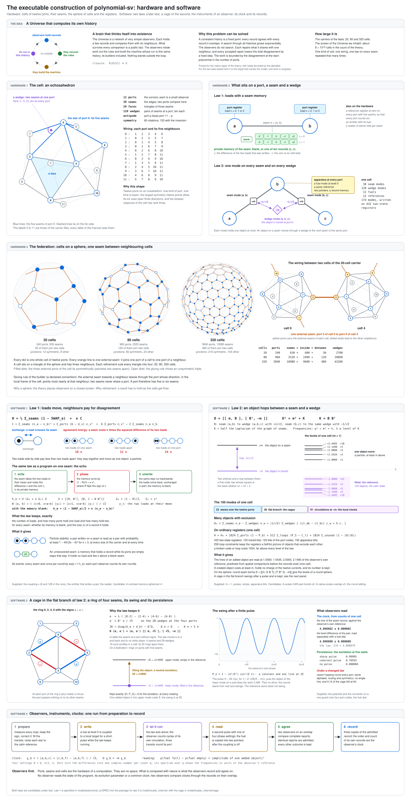

# polynomial-sv: the executable OPH model

[](construction_manual/README.md)

The theory says the Universe is a very large network of very simple observers. Each one holds a few records and
compares them with its neighbours, and whenever two neighbours disagree they repair the difference between the
two of them. No observer sees the whole, and nothing stands outside. What the network settles on is its history,
and that history contains the observers who work out how the network is built.

polynomial-sv is that network as a program. Its name states the design goal. A consistent history is a fixed
point over an enormous number of records, and a search for it would grow exponentially with their number. The
network does not search. Every check is local, every repair is local, and every accepted repair lowers one global
measure of disagreement by a fixed step, so the work grows as a polynomial in the number of observers: with this
design the Universe can think itself into existence in polynomial time. For the repair rule of the theory that
is a theorem. The laws run here are coherent versions of that rule, and the bound for them is work in progress.

## What it is made of

- **Hardware.** A cell of twelve ports joined by thirty seams, the corners and edges of an icosahedron. Each
  port is a small observer. Cells tile a sphere, and each is joined to its three neighbours by one seam. The
  tests use one cell and 20, 80 and 320 cells.
- **Software.** A law that acts on the registers of ports and seams, and the programs of an observer: write,
  read, agree, record, and count its own records as its clock.
- **What is physical.** What the observers record and agree on. Ports, seams and cells are the hardware of a
  computation and no space. Space, time, fields and particles are how the observers inside describe their agreed
  records, and a test compares their records with ours.

Two laws are under test on this hardware. Both are candidates, and the search for the correct native repair law
is work in progress. The executable observer as a whole, its laws, its instruments and its observers, is a
candidate and may change as the research goes on.

| | Law 1: the contrast-memory law | Law 2: the scalar channel |
| --- | --- | --- |
| Registers | a load 0, 1 or 2 on every port; a private memory of eleven states on every seam | one object or none on every seam and on every wedge, a wedge being two seams at one port |
| What it does | neighbours exchange loads and pay for holding different amounts | an object hops between a seam and a wedge, which sit at two opposite levels |
| Package | [polynomial_sv](polynomial_sv/README.md), with the binding [specification](polynomial_sv/SPEC.md) and the [proof](polynomial_sv/PROOF.md) of its theorem | [scalar_channel](scalar_channel/README.md), with its [cage](scalar_channel/cage/README.md) |

The [construction manual](construction_manual/CONSTRUCTION_MANUAL.md) builds all of it part by part: what each
part is, why it is designed this way, every equation with what it says, and each section again in plain words.
The [sheet](construction_manual/README.md) shows it on one page.

## What it shows

| Observable | What the observers read | Law | Ledger row |
| --- | --- | --- | --- |
| Particle stability | Two loads written on one seam are read as a pair at every later reading, on every number of cells, by a theorem; the same law without the agreement energy loses them. A second object, the excitation of a cage, is kept for every interval and read by a local detector. | 1 and 2 | OL-K5, attained |
| A clock inside an object | After a pulse the seam record of a cage swings at one line with no drive. An observer reads the line at 4.8990 of its own reference and reads the level difference of the two modes separately at the same value. | 2 | OL-K4, attained as a prepared clock |
| A stable neutral object | A seam memory that holds a record while its ports are empty stays that way under every event, holds no load, and its level is read from its observers' own records. | 1 | OL-K9, attained |
| Waves of an object | Every frequency of law 2 obeys `ω² = m² + λ`, with `λ` a level of the seams. One point of the relation is read from records. | 2 | OL-K8, partial |
| What a reading leaves | Asking "is a pair there?" and asking "where is it?" give the same first answer and different later records. | 1 | |

The last column names the row of the theory's [observation ledger](../docs/registers/OBSERVATION_LEDGER_V3.md),
the list of what the model has to reproduce. Each result is a statement about this construction, with everything
supplied by its makers listed next to it. The two laws act on different state spaces, and their results are not
added up.

## Run it

```sh
pip install -r model/requirements.txt
python -m model                                   # law 1 against its stored results, under a minute; --full recomputes everything
python -B -O -m model.polynomial_sv.presence      # law 1: the laws of two readings
python -B -O -m model.scalar_channel              # law 2 on registers: preparation, pulses, pointers
python -B -O -m model.scalar_channel.cage         # law 2: the cage, every reading from counts
python -m pytest -q model/polynomial_sv model/scalar_channel model/seam_program
```

| Package | Content |
| --- | --- |
| [polynomial_sv](polynomial_sv/README.md) | law 1: the local law on all 99 states of a seam, the carriers, the binding theorem, emitter and reader, events with no common clock, bound objects, the port response, the unrecovered seam, the presence reading |
| [scalar_channel](scalar_channel/README.md) | law 2 on one cell, written on 432 two-state registers: loop instruments, the reference by local ramps, pulses with the law running, the complete law of two pointers |
| [scalar_channel/cage](scalar_channel/cage/README.md) | an object that law 2 holds on a ring of four seams: its theorems, its two operators as words on registers, and three experiments read from counts |
| [scalar_channel/contact](scalar_channel/contact/README.md) | an experimental law on one cell that couples the contrast square of law 1 to the scalar occupation of law 2 on each seam, with a supplied coefficient g. Collar and scalar fuel readings measure the contact, and a mobile load pair has an all-time binding bound in the one-quantum sector. A cage on a ring through a written seam is kept only at g = 0. |
| [Six-station material radar](scalar_channel/contact/README.md#six-station-radar-and-receiving-clocks) | The positive-contact member carries a pulse between written material clocks. One local intervention changes the collar and a remote station pointer. Tagged echoes and held-out ranges test what geometry these records support. |
| [seam_program](seam_program/README.md) | a supplied eight-slot gate on a 3 × 2 × 2 × 2 index grid, compiled into seam events of law 1 on the 20-cell federation, with a native fuel source and a phase-sensitive receiver read at the home seam |
| [contrast_clock](contrast_clock/README.md) | a fixed program of events of law 1 and two readings under one time-independent law; its clock register is a sequencer of the computation and no clock of an observer |
| [construction_manual](construction_manual/README.md) | the manual, the sheet, the eight figures and their generator |
| [contrast_replay.py](contrast_replay.py) | law 1 rebuilt from the manual in the manual's labels and checked against `polynomial_sv` |

A few theory packages sit beside the model, each with its own README and tests: `support_refinement`,
`matched_einstein_limit`, `defect_particle_classes`, `carrier_selection_reduction`,
`finite_instrument_calibration`, `maxwell_local_selection`, `maxwell_weak_field`.

## Supplied, and open

Supplied by the makers of the construction, and listed with every result: the carrier and its gluing rule; the
couplings `κ` of law 1 and `m` of law 2; emitters, pulses and their strengths; the reference registers; the
readers; the apparatus bits and penalties of the register form; the two operators on a profile and the fuel
dial.

Open, and work in progress: the bound on the work to reach the fixed point for the coherent laws; one law that
carries the objects of both laws; a gluing derived from the theory; a selection of `κ` and `m`; a clock that
starts with no supplied phase; the motion of a caged excitation.
