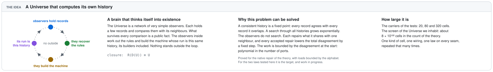
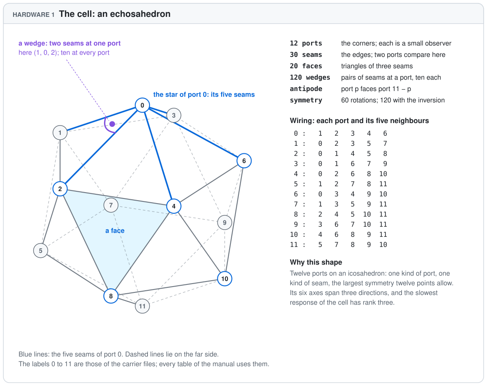
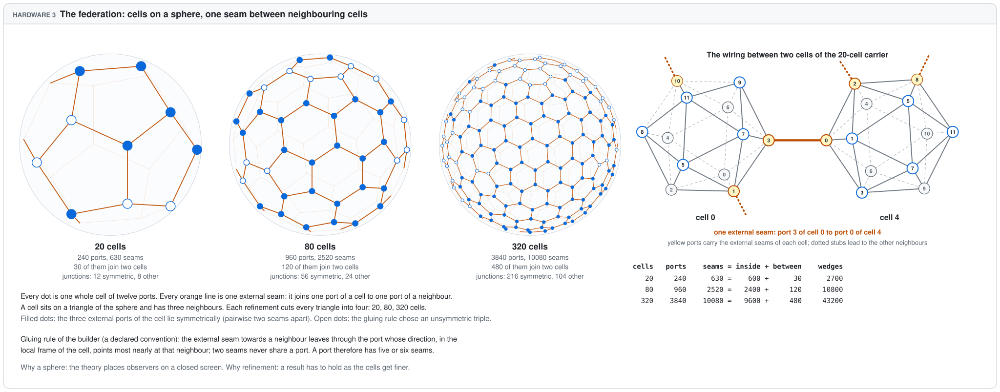
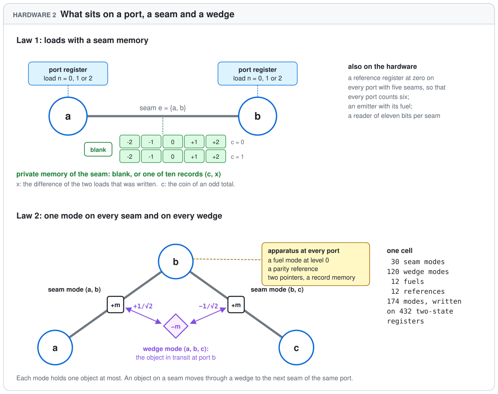
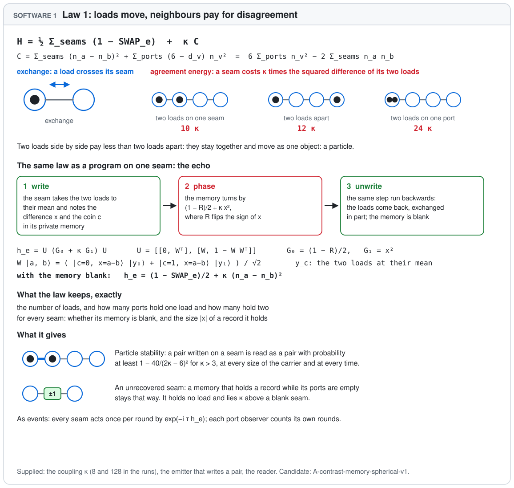
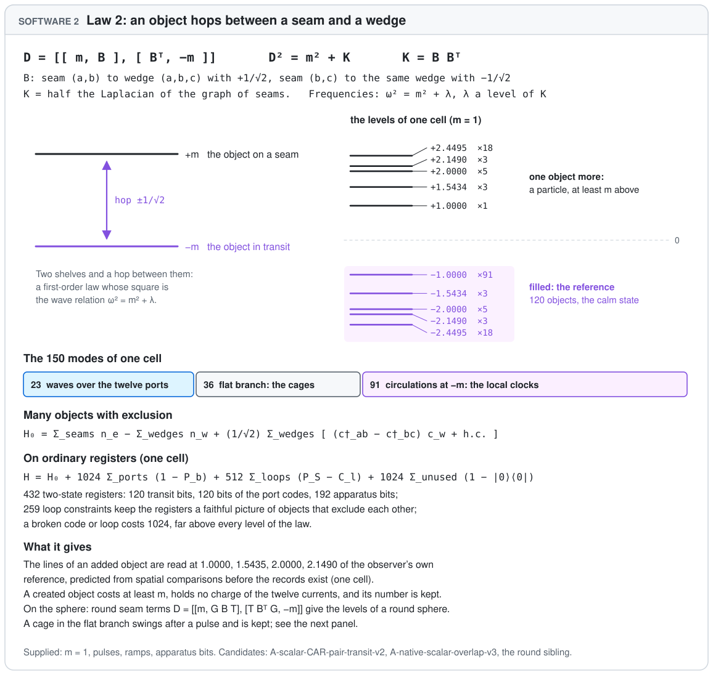
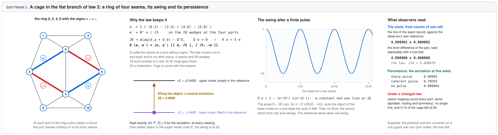
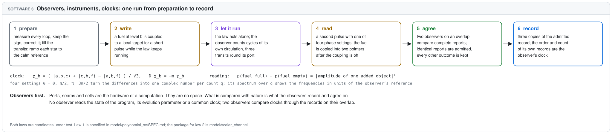

# Construction manual: the executable observer of A-contrast-memory-spherical-v1

How the construction of [A-contrast-memory-spherical-v1](../README.md) is built, part by part: what each part is, how to build it,
why it is designed this way, and what each equation says. Technical statements are exact and name their file.
Paragraphs marked **In plain words** give the same content with no formula.

A-contrast-memory-spherical-v1 is the executable model of the theory: one hardware, and the laws under test on it. Law 1, the
contrast-memory law, is executed by the package [contrast_memory_spherical_v1](../contrast_memory_spherical_v1/README.md), whose
[specification](../contrast_memory_spherical_v1/SPEC.md) is the binding text for it. Law 2, the scalar channel, is executed by
the package [scalar_channel](../scalar_channel/README.md), and the cage of section 5.9 by its subpackage
[cage](../scalar_channel/cage/README.md). Both laws are candidates under test, and the executable observer described
here is a candidate that may change. The search for the correct native
repair law is work in progress, and no law here is presented as that law. The two laws act on different state
spaces, and their results are not combined into one claim.
[Section 8](#8-observables-supplied-parts-and-open-work) lists the observables with their rows in the theory's
[observation ledger](../../docs/registers/OBSERVATION_LEDGER_V3.md), and
[section 11](#11-what-this-repository-executes) says which parts of the manual the packages of this repository
execute.

The whole construction on one sheet: [executable_spec.svg](executable_spec.svg) ([README](README.md) for the sheet
panel by panel).

**Contents**

0. [The idea](#0-the-idea)
1. [Parts list](#1-parts-list)
2. [Hardware](#2-hardware): [the cell](#21-the-cell), [wedges](#22-wedges), [the federation](#23-the-federation), [registers](#24-registers)
3. [Observers, records and clocks](#3-observers-records-and-clocks)
4. [Law 1: loads with a seam memory](#4-law-1-loads-with-a-seam-memory)
5. [Law 2: the scalar channel](#5-law-2-the-scalar-channel)
6. [Instruments](#6-instruments)
7. [Operating procedures](#7-operating-procedures)
8. [Observables, supplied parts and open work](#8-observables-supplied-parts-and-open-work)
9. [Symbols](#9-symbols)
10. [Sources](#10-sources)
11. [What this repository executes](#11-what-this-repository-executes)

---

## 0. The idea



### 0.1 A Universe that computes its own history

The theory behind this construction, Observer Patch Holography, starts from one hypothesis. The Universe is a
timeless, self-referential structure. Its observers recover the specification of their own world from completed
records, and they build hardware whose execution realizes that same history, its builders and their hardware
included. The structure reads itself into existence. With `U` the complete history, `D(U)` the account of its
architecture that records inside it allow, and `R` a realization of that account built inside it:

```math
R(D(U)) \cong U
```

The sign means agreement in everything that can be observed and intervened on. No host, no outside time and no
global clock are supplied. A loop has no first step, so the hardware below needs no derivation from something
earlier: it is what the observers inside reverse-engineer and build, and it is justified when it runs and
reproduces what they measure.

The hardware is a very large network of very simple observers. Each holds a few records and compares them with
its neighbours. In that sense the Universe is a brain: a network whose activity is the settling of disagreements
between neighbours. What it thinks is its own history, and the history it settles on contains the observers who
work out how the network is built.

### 0.2 Why this problem can be solved

A history is consistent when every record agrees with every record it overlaps. That is a fixed-point problem
over an enormous number of records. Solved by search, it is hopeless: the number of candidate histories grows
exponentially with the number of records, and general problems of this kind are among the hardest known.

The construction does not search. It uses three facts about overlapping observers.

1. **Every check is local.** An observer compares records with one neighbour, on the seam they share. No step
   looks at the whole.
2. **Every repair is local.** A disagreement on a seam is repaired on that seam, by the two observers on it.
3. **Every accepted repair makes progress.** It lowers one global measure of disagreement by a fixed step.

With these three, the work is bounded by the amount of disagreement at the start. For loads bounded by the
alphabet that amount grows as a polynomial in the number of ports. For the native repair of the theory this is a
theorem of the carrier paper: an accepted
repair moves one unit of load across a seam whose two loads differ by two or more,

```math
(q_i, q_j) \to (q_i - 1,\ q_j + 1) \quad \text{for } q_i - q_j \ge 2, \qquad V(q) = \sum_p q_p^2 ,
```

and each such step lowers `V` by `2 (q_i - q_j - 1)`, at least 2. A settling path therefore has at most
`(V_start - V_min) / 2` accepted repairs, in every order of the seams. The consensus paper of the theory adds
that, under stated termination and consistency conditions, local repairs reach one shared public result
whatever their order.

The laws of this manual are coherent versions of such a repair: they also carry phases, and they are run as
quantum laws. The descent theorem is a statement about the classical moves. For the two laws a bound on the work
to reach the fixed point is the target that gives the model its name. It is work in progress, and no polynomial
bound for a family of constraint problems is among the results here.

### 0.3 How large it is

The tests run on one cell and on federations of 20, 80 and 320 cells. The theory counts about `8 × 10^122` cells of equal area on
the screen of the Universe we inhabit (carrier paper, paragraph "Screen cells and capacity"; a display on the
measured side, with the capacity `3.31 × 10^122`). The paper states that a carrier cell is identified with a
screen cell only through a separate theorem. One kind of cell, one wiring and one law on every seam, repeated
that many times, is the proposal.

### 0.4 Hardware, software, and what is physical

- **Hardware**: ports, seams, cells, the sphere of cells, and the registers on them ([section 2](#2-hardware)).
- **Software**: the law that acts on the registers, and the programs of an observer: prepare, write, read,
  agree, record ([sections 3 to 7](#3-observers-records-and-clocks)).
- **Physical**: what the observers record and agree on. Ports, seams and cells are the hardware of a
  computation, and they are no space. Space, time, fields and particles are how the observers inside describe the
  records they agree on. A test compares what the observers of the model record with what we record. It never
  compares the state of the program with the world.

> **In plain words.** Imagine a huge crowd in which everybody can only whisper with the people standing next to
> them. Nobody sees the crowd from above. Each person keeps a small notebook and, whenever two neighbours find
> that their notes differ, they fix the difference between the two of them. If every such fix removes a little
> disagreement and never adds any, the crowd settles into one consistent story without anyone ever searching
> for it. The theory says the Universe is such a crowd, that the consistent story is its history, and that the
> story includes people who figure out how the crowd works. This manual describes the smallest unit of the
> crowd, how the units are wired together, and the two rules for fixing notes that are under test.

---

## 1. Parts list

| Part | Per cell | At 20 / 80 / 320 cells | Role |
| --- | ---: | ---: | --- |
| port | 12 | 240 / 960 / 3,840 | a small observer; holds a register |
| seam inside a cell | 30 | 600 / 2,400 / 9,600 | where two ports of a cell compare |
| seam between cells | 3 ends | 30 / 120 / 480 | joins one port of a cell to one port of a neighbour |
| face | 20 | | three seams in a triangle |
| wedge | 120 | 2,700 / 10,800 / 43,200 | two seams at one port; the place of an object in transit |
| port register, law 1 | 12 | 240 / 960 / 3,840 | a load 0, 1 or 2 |
| seam memory, law 1 | 30 | 630 / 2,520 / 10,080 | eleven states: blank and ten records |
| seam mode, law 2 | 30 | 630 / 2,520 / 10,080 | one object or none, level `+m` |
| wedge mode, law 2 | 120 | 2,700 / 10,800 / 43,200 | one object or none, level `-m` |
| fuel and parity reference, law 2 | 12 + 12 | | the local source and sink of an observer |
| two-state registers, law 2 on registers | 432 | | 120 transit bits, 120 code bits, 192 apparatus bits |

Software parts: the law (section 4 or 5), an emitter or a pulse to write, a reader with two pointers, an
agreement gate, a record memory, and each observer's own clock (sections 3 and 6). The cage of section 5.9 is
written and read with a potential and a converter on a profile of four seams (section 6.6); it uses no part
beyond the 432 registers.

---

## 2. Hardware

### 2.1 The cell



**Build.** Take twelve ports and label them 0 to 11. Join them by the thirty seams below. The result is the
corner-and-edge graph of an icosahedron, called an echosahedron in the theory.

| Port | Its five neighbours | | Port | Its five neighbours |
| ---: | --- | --- | ---: | --- |
| 0 | 1 2 3 4 6 | | 6 | 0 3 4 9 10 |
| 1 | 0 2 3 5 7 | | 7 | 1 3 5 9 11 |
| 2 | 0 1 4 5 8 | | 8 | 2 4 5 10 11 |
| 3 | 0 1 6 7 9 | | 9 | 3 6 7 10 11 |
| 4 | 0 2 6 8 10 | | 10 | 4 6 8 9 11 |
| 5 | 1 2 7 8 11 | | 11 | 5 7 8 9 10 |

In this standalone cell the port opposite to `p` is `11 - p`. Twenty triples of mutually joined ports are the
faces. [inputs/CELL.npz](inputs/CELL.npz) holds the seams and the wedges in this numbering. The federation files
and the package contrast_memory_spherical_v1 number the ports of a cell in another order. One map that keeps every seam sends the
standalone ports 0 to 11 to the local ports `0,1,5,7,11,9,10,8,4,6,2,3` of a federation cell, so the port opposite
to local port 0 there is local port 3. An observer is addressed through the incidence of the carrier being run.
The map is checked on all 420 cells of the three federations ([test_contrast_replay.py](../test_contrast_replay.py)).

**Why this shape.** The reasons are those of the theory's carrier paper.

- *One kind of port and one kind of seam.* Every port has five seams and every seam looks like every other: 60
  rotations (120 with the inversion) move any port to any port. No port is special, so no place in the cell is
  preferred.
- *Six axes that span three directions.* The twelve ports pair up into six opposite pairs. Write `u_p` for the
  direction of port `p`. The matrix of their inner products takes four values,

  ```math
  G_{pq} = u_p \cdot u_q \in \{1,\ 1/\sqrt5,\ -1/\sqrt5,\ -1\} \quad \text{at seam distance } 0, 1, 2, 3, \qquad G^2 = 4G, \quad \operatorname{rank} G = 3 .
  ```

  *What the equation says:* twelve ports carry exactly three independent directions. Three is the rank of `G`.
- *The slowest response is three-dimensional.* The port Laplacian `L = 5 - A` (five minus the neighbour matrix)
  has the levels

  ```math
  \operatorname{spec} L = \{\,0,\ (5-\sqrt5)^{\times 3},\ 6^{\times 5},\ (5+\sqrt5)^{\times 3}\,\} .
  ```

  *What the equation says:* a disturbance spread evenly over the cell does not relax at all (level 0). Under a
  repair that moves loads along all seams at equal rates, the disturbances that relax slowest form a band of
  three, and that band is the range of `G`. This is the finite root of "three dimensions" in the theory. The
  levels are machine-checked in the theory's Lean library.
- *As round as twelve points allow.* A wave law built from the thirty seam directions is the same in every
  direction through angular rank five; a first direction-dependent term appears at rank six.

The carrier paper states plainly that carrier, schedule and memory law are design choices. They are justified
by the loop of section 0, and by tests.

> **In plain words.** The cell is a ball with twelve corners. Each corner is a tiny observer that talks to its
> five nearest corners. The shape is chosen so that no corner is special, and so that the twelve corners
> between them know exactly three independent directions: up-down, left-right, front-back.

### 2.2 Wedges

**Build.** At every port, list all pairs of its seams. A pair is a wedge, written `(a, b, c)`: the seams `a-b` and
`b-c` meeting at port `b`, with `a < c`. A port with five seams has ten wedges; a cell has 120.

**Why.** An object that sits on a seam needs a way to reach another seam. Two seams touch only at a port, so
the place "between two seams" is a wedge. Law 2 gives every wedge a mode of its own: an object in transit at port
`b`, on its way from seam `a-b` to seam `b-c`. All ten pairs are used, the corners of faces and the pairs that
span no face alike, because no pair of seams at a port is special.

### 2.3 The federation



**Build.**

1. Take the icosahedron and cut every triangle into four, pushing the new corners out to the sphere. Repeat `L`
   times: `20 · 4^L` triangles. This is the geodesic tower.
2. Put one complete cell on every triangle.
3. Two cells are neighbours when their triangles share an edge. Every cell has three neighbours.
4. Join every pair of neighbouring cells by one external seam, from one port of each. No port takes two external
   seams.
5. Choose the ports by the gluing rule of the builder: the seam towards a neighbour leaves through the port
   whose direction, in the local frame of the cell, has the largest inner product with the direction of that
   neighbour; collisions are repaired by an exact assignment.

| Level | Cells | Ports | Seams | inside | between | Wedges | Ports with six seams |
| ---: | ---: | ---: | ---: | ---: | ---: | ---: | ---: |
| 0 | 20 | 240 | 630 | 600 | 30 | 2,700 | 60 |
| 1 | 80 | 960 | 2,520 | 2,400 | 120 | 10,800 | 240 |
| 2 | 320 | 3,840 | 10,080 | 9,600 | 480 | 43,200 | 960 |

Files: `../contrast_memory_spherical_v1/carriers/FEDERATION_LEVEL{0,1,2}.npz`.

**Why.**

- *A closed surface.* The theory places observers on a closed screen. A sphere has no edge, so no cell is a
  boundary cell.
- *Refinement.* A result that means something has to hold as the cells get finer. Cutting triangles into four
  gives a family of carriers with the same local structure at every size.
- *One seam per pair of neighbours.* The weakest joining that connects the cells. A port keeps five or six
  seams, so the local law stays local at every size.

**Two known properties of this wiring.**

- *The junctions.* The gluing rule is a declared convention, and the theory lists a derived gluing as an open
  item. It gives 216 of 320 cells three external ports that lie pairwise two seams apart, a symmetric junction,
  and 104 cells ports at distances 1, 2 and 3.
- *The shape at large.* With the same term on every seam, every cell acts as the same flat triangle. The limit of
  refinement is then the icosahedron with flat faces, with the curvature of the sphere gathered in twelve points.
  A round sphere needs seam terms that vary across the carrier ([section 5.8](#58-on-the-sphere)).

> **In plain words.** Take many of the twelve-cornered balls and tile a big sphere with them, like the patches of
> a football. Each ball is wired to its three neighbouring balls by a single wire. To make the sphere finer,
> replace every patch by four smaller ones. The picture shows 20, 80 and 320 balls; the real thing would have
> more balls than there are atoms in the visible Universe, by many orders of magnitude.

### 2.4 Registers



A register is the piece of memory at a place. The two laws use different registers on the same carrier.

**Law 1.**

| Place | Register | Why |
| --- | --- | --- |
| port | a load `n` in {0, 1, 2} | the thing that is recorded and moved; three values, so that two units on one port are a state the law has to deal with |
| seam | a private memory with eleven states: blank, or a record `(c, x)` with coin `c` in {0, 1} and contrast `x` in {-2, ..., 2} | makes the seam event reversible: what the event would forget is written here first ([section 4.3](#43-a-reversible-version-the-write)) |
| port with five seams | one reference register held at zero | every port counts as if it had six seams, so that no port is cheaper than another ([section 4.5](#45-the-degree-term)) |

**Law 2.**

| Place | Register | Why |
| --- | --- | --- |
| seam | a mode that holds one object or none | an object at rest on a seam |
| wedge | a mode that holds one object or none | the same object in transit at a port |
| port | a fuel mode at level 0 | the observer's local source and sink: it writes an object into the cell and takes one out |
| port | a parity reference | keeps the total number of objects even for both preparations of the fuel, so that one algebra covers both |
| port | two pointers and a record memory | the copies that two observers compare, and the records they keep |

On one cell, law 2 on ordinary registers uses 432 two-state registers ([section 5.6](#56-on-ordinary-registers)).

---

## 3. Observers, records and clocks

**Who observes.** An observer is a port with its star: its five or six seams, the wedges between them, and its
local apparatus. It sees its own registers and what arrives over its seams. It never sees the whole graph, the
state of the program or the parameter that the program evolves with. The instruments of
[section 6.6](#66-instruments-on-a-profile) belong to a patch of four neighbouring ports with their stars.

**What a record is.** An outcome that the observer has copied into its record memory. A record is public when two
observers on an overlap hold identical complete reports of it. Every outcome of an instrument is kept: "no",
"disagree" and "not available" are outcomes like "yes". Which records are kept is part of an instrument: two
readings that give the same answer and keep different records leave different states behind
([section 4.9](#49-writing-and-reading)).

**What a clock is.** The order and the count of the records an observer holds. For frequencies, an observer
counts completed cycles of a local reference of its own ([section 6.4](#64-the-clock)). Two observers compare
clocks through the records on their overlap: two shared records fix the relation between two clocks, and a third
checks it. No global clock exists, and no test takes one as an input.

**Why this way.** A Universe with no outside has nobody who could read its state from outside. Whatever is a
fact has to be a fact for some observer inside, in that observer's own units. Fields, particles, space and a
common time are descriptions that observers agree to use.

> **In plain words.** Nobody in this world has a wristwatch synchronised with everybody else's. Each observer
> counts its own heartbeats and timestamps its own notes with them. When two observers meet, they compare notes
> and work out how their heartbeats relate. A "fact" is a note that two neighbours hold in the same form.

---

## 4. Law 1: loads with a seam memory



Candidate `A-contrast-memory-spherical-v1`, the law of the [executable model](../contrast_memory_spherical_v1/README.md). The binding
specification is [../contrast_memory_spherical_v1/SPEC.md](../contrast_memory_spherical_v1/SPEC.md), and the theorem with its proof is in
[../contrast_memory_spherical_v1/PROOF.md](../contrast_memory_spherical_v1/PROOF.md).

### 4.1 State

A load 0, 1 or 2 on every port and a memory of eleven states on every seam. In the tests of the pair the
memories start blank, and the law keeps them blank at the end of every event. The test of the unrecovered seam
starts with a record on one seam ([section 4.7](#47-what-the-law-keeps)).

### 4.2 The seam rule that the law is built from

The theory's native repair acts on one seam. It takes the two loads `(a, b)` to their mean. An even total has
one mean; an odd total has two, and a fair coin decides which port gets the extra unit:

```math
(a, b) \to y_c = \bigl(\lfloor s/2 \rfloor + c\,p,\ \lfloor s/2 \rfloor + (1 - c)\,p\bigr), \qquad s = a + b,\quad p = s \bmod 2,\quad c \in \{0, 1\} .
```

**Why this rule.** The carrier paper shows that four requirements leave no other rule: keep the total of the
seam; end where `a^2 + b^2` is smallest; break a tie by a random choice that does not look at the loads; treat
the two ports alike.

**Intuition.** Two neighbours who hold different amounts split the difference. If the amounts cannot be split
evenly, a coin decides who holds the odd unit.

### 4.3 A reversible version: the write

The rule forgets two things: the difference `x = a - b` it removed and the coin `c` it tossed. A law that
forgets cannot run backwards and carries no phase. Law 1 therefore writes both into the private memory of the
seam before it changes the loads:

```math
W\,|a, b\rangle = \frac{1}{\sqrt2}\sum_{c = 0}^{1} |c,\ x = a - b\rangle \otimes |y_c\rangle .
```

*What the equation says:* the loads go to their mean, in both versions of the coin at once, and the memory
holds which difference was removed and which coin was used. Nothing is lost, so `W` keeps lengths:
`W^T W = 1`.

The complete write on loads and memory, 9 by 11 = 99 states, is

```math
U = \begin{pmatrix} 0 & W^T \\ W & 1 - W W^T \end{pmatrix}, \qquad U = U^T, \quad U^2 = 1 .
```

The first block is "memory blank", the second "memory holds a record". *What the equation says:* `U` writes
when the memory is blank and unwrites when the memory holds exactly what a write would have put there. Applying
it twice does nothing. A record that fits no write is left alone; this is the `1 - W W^T`.

**Why a private memory.** The memory belongs to the seam and is read by nobody. An observer's committed public
record is never erased by this law. Only the seam's own scratch work is undone.

### 4.4 The echo

Between the write and the unwrite, the memory is turned by a generator that acts on records alone:

```math
G_\kappa = \frac{1 - R}{2} + \kappa\,x^2, \qquad R\,|c, x\rangle = |c, -x\rangle, \qquad h_e = U\,G_\kappa\,U .
```

With the memory blank, the three steps together are exactly

```math
h_e = \frac{1 - \mathrm{SWAP}_e}{2} + \kappa\,(n_a - n_b)^2 .
```

**Intuition for each piece.**

- *`(1 - R)/2`.* Flipping the sign of the recorded difference, and then undoing the write, returns the two loads
  exchanged. So a phase on "the difference with its sign flipped" becomes the exchange of the two loads. A load
  hops across its seam.
- *`κ x²`.* A phase proportional to the square of the recorded difference becomes an energy that the seam
  charges for disagreement between its two ports. Agreement costs nothing; a difference of one costs `κ`, a
  difference of two costs `4κ`.
- *Write, turn, unwrite.* The seam looks at its two loads, lets the look act, and takes the look back. What is
  left on the loads is a law with phases, and the memory is blank again. This is the echo.

**The identity that makes it exact.** The generator maps what a write produces into what a write produces:

```math
W^T\,G_\kappa\,(1 - W W^T) = 0 .
```

It holds in integer arithmetic for both pieces of `G`. Two consequences: a blank memory stays blank, and a memory
that holds a record stays unrecovered ([section 4.7](#47-what-the-law-keeps)).

### 4.5 The degree term

A port inside a cell has five seams, a port with an external seam has six. With seam terms alone, a load on a
port with five seams would pay for five disagreements and a load on a port with six for six. The law adds what
is missing, as if every port had six seams:

```math
C = \sum_{e = \{a,b\}} (n_a - n_b)^2 + \sum_v (6 - d_v)\,n_v^2 = 6\sum_v n_v^2 - 2\sum_e n_a n_b .
```

*What the equation says:* every load pays 6 for standing alone, and every seam with a load on both ends gives 2
back. The hardware for it is the reference register at zero on every port with five seams.

### 4.6 The whole law

```math
H_\kappa = \frac12\sum_e \bigl(1 - \mathrm{SWAP}_e\bigr) + \kappa\,C .
```

| Two loads | Cost `C` |
| --- | ---: |
| on the two ends of one seam | 10 |
| apart | 12 |
| on one port | 24 |

**Why a pair holds together.** Two loads on one seam pay 10 `κ`, two loads apart 12 `κ`. Moving apart costs
`2κ`, and the exchange can supply at most a fixed amount. For `κ > 3` the pairs on seams form a band of their
own in the sector of two loads, separated from every other state of that sector by a gap of at least `2κ - 6`.

**Theorem** (`κ > 3`, every federation of complete cells with a matching of external seams, every start on a
seam, every time):

```math
\Pr(\text{no pair on a seam};\ t) \le \frac{40}{(2\kappa - 6)^2} .
```

*What the equation says:* the chance of finding the two loads apart is at most (coupling out of the band, at
most `sqrt(10)`) over (gap) squared, times four. It does not depend on the number of cells. The pair moves: it is
read on other seams. It is one object.

### 4.7 What the law keeps

- The number of loads, and the numbers of ports that hold one load and two loads. The exchange permutes loads
  and creates none.
- For every seam, whether its memory is blank. This is the identity of section 4.4.
- For every seam with a record, the size `|x|` of the recorded contrast: `x^2` commutes with the projector on
  what a write produces and with the generator, and so with the law of the seam. The write itself changes the
  memory and does not commute with `x^2`.

So every seam carries a label with four values that never changes: blank, or a record of size 0, 1 or 2. With the
ports of the seam empty, a record of size 1 lies at the level `κ` or `κ + 1` above a blank seam, a record of size 2
at `4κ` or `4κ + 1`, and a record of size 0 at 0. A seam that holds a record of size 1 with empty ports is the
unrecovered seam: it holds no load, it lies `κ` above the blank seam, and no event of the law recovers it. The
dark-sector paper of the theory names it as a feature of the kind it takes for its source, a recovery defect on
an overlap: a record on the seam that the loads of its ports do not determine. Its physical reading is work in
progress.

On the records the law of a seam is zero on what a write produces and equal to the generator elsewhere. A record
that the loads of its ports back costs nothing, and a record of contrast `x` that they do not back costs `κ x^2`.
*Why it matters:* the level `κ` of the unrecovered seam is its level with empty ports. A load on a port of that
seam lies lower than a load elsewhere, by about `κ` where the record does not fit it and by about `2κ` where it
does, and it binds to the seam. On one cell at `κ = 8` a load elsewhere starts at 56.38; two levels lie at 41.94,
where the record fits, and six between 49.81 and 50.94, where it does not
([collar.py](../contrast_memory_spherical_v1/collar.py)).

### 4.8 As events

The sum over seams with a continuous parameter is the limit. As a program each seam acts by one gate,

```math
\text{one event of seam } e: \quad \exp(-i\,\tau\,h_e), \qquad \text{one round: every seam once} .
```

Each port observer serves its seams once per round and counts its own rounds. No common clock is used. With
every seam acting once per round, in any order and with unequal rates of observers, the pair is kept. With seams
that act independently at random, the pair is lost at the tested event angles. The regular order of a seam's own
events is what the binding rests on ([events.py](../contrast_memory_spherical_v1/events.py)). The theorem of section 4.6 is
proved for the sum with a continuous parameter; the statements on events are finite tests.

The gate has two forms in the packages. Since `(n_a - n_b)^2 = n_a^2 + n_b^2 - 2 n_a n_b`, and the port part
`n_a^2 + n_b^2` of all seams adds up with the degree term to a constant on loads that the law permutes, the same
law is the sum of the seam terms `(1 - SWAP_e)/2 - 2κ n_a n_b`. The event programs of
[events.py](../contrast_memory_spherical_v1/events.py) use the gate of that seam term, which needs no reference registers. The
fixed program of [contrast_clock](../contrast_clock/README.md) uses `exp(-i τ h_e)` itself, with one gate of the
reference register for every port. In a finite program the two forms are different programs of one law.

### 4.9 Writing and reading

- **Emitter.** A fuel with two units at one seam, exchanged with "one load on each end" by a coupling `g` for the
  time `π / (2g)`, with the law running throughout. The fuel sits at `10κ + (d_a + d_b - 2)/2`, the level of the
  pair it writes, so that the exchange is resonant. The written state differs from the ideal pair by at most
  `sqrt(d_a + d_b - 2) / (2g)`.
- **Reader.** The two port observers of a seam each copy "my port holds one load, and so does the other end"
  into a pointer and compare. Identical reports are written as one record of three bits. The complete set of
  outcomes is one record per seam and "no pair".
- **Presence.** A second reading asks one question of the whole cell: did some seam report a pair? A tree of
  reversible OR gates over the thirty seam readers copies that one answer into a public register and then runs
  backwards, so that every seam word returns to blank. With `P_e` the projector on the pair on seam `e` and
  `P = Σ_e P_e`, a positive answer acts on a state `X` of the loads as

  ```math
  X \to P\,X\,P \quad \text{(presence)}, \qquad X \to \sum_e P_e\,X\,P_e \quad \text{(reader with seam records)} .
  ```

  *What the equations say:* both readings find a pair with the same probability. The presence reading leaves
  the pair spread over the seams as it was. The reader with seam records places it on one seam. They are
  different instruments, and the records of a later reading tell them apart
  ([section 7.6](#76-two-readings-of-a-pair-law-1)).

### 4.10 What it gives, and what is supplied

- Particle stability: a pair written on a seam is read as a pair on some seam with probability at least one
  minus the bound of the theorem at every reading, and the law without the agreement energy loses it
  ([stability.py](../contrast_memory_spherical_v1/stability.py)).
- The unrecovered seam: its label is kept, it holds no load, its level and the coupling are read from its
  observers' own records, and a load that reaches one of its ports binds to it
  ([collar.py](../contrast_memory_spherical_v1/collar.py)). That it holds no load follows from the alphabet, and its
  preparation is supplied.
- What a reading leaves: the presence reading and the reader with seam records give the same first statistics
  and different later records. On one cell at `κ = 8` the two public histories differ by 0.4405 in total
  variation when the readings are taken as instant, and by more than 0.0817 on one named event with every pulse
  and numerical error counted ([presence.py](../contrast_memory_spherical_v1/presence.py)).
- Supplied: the coupling `κ` (8 and 128 in the runs), the emitter, the reader, the reference registers, the
  tree of the presence reading.

> **In plain words.** Loads are tokens. Neighbours pass tokens back and forth, and every pair of neighbours pays
> a fee for holding different numbers of tokens. Two tokens sitting next to each other pay a smaller fee than
> two tokens far apart, so they travel together like one thing: a particle. Each pair of neighbours also shares
> a scratch pad. Before they act, they jot down how much they differ; afterwards they erase the note. If a note
> is ever left on a pad with no tokens around, nothing in the rules can erase it. It weighs something, it holds
> no token, and it stays. The theory's dark-sector paper takes a defect of this kind as its candidate for dark
> matter.

---

## 5. Law 2: the scalar channel



Candidates: `A-scalar-CAR-pair-transit-v2`; its form on ordinary registers, `A-native-scalar-overlap-v3`, which
the package [scalar_channel](../scalar_channel/README.md) executes on one cell; the sibling with round seam
terms, `A-scalar-CAR-pair-transit-round-v1` ([section 5.8](#58-on-the-sphere)); and `A-native-caged-exciton-v1`,
the same free law with two more operators in the observer's menu, which the subpackage
[cage](../scalar_channel/cage/README.md) executes ([section 5.9](#59-the-flat-branch-and-its-cages)).

### 5.1 State

One mode on every seam and one on every wedge. A mode holds one object or none. On one cell: 30 + 120 = 150
modes.

### 5.2 The hop

An object on seam `a-b` can go into transit at port `b` and come out on seam `b-c`. The hop matrix `B` from wedges
to seams has two entries per wedge:

```math
B_{(a,b),\,(a,b,c)} = +\frac{1}{\sqrt2}, \qquad B_{(b,c),\,(a,b,c)} = -\frac{1}{\sqrt2} .
```

**Why opposite signs.** A wedge is a difference of its two seams. Two things follow.

- An object spread evenly over all seams does not hop at all: `B^T 1 = 0`. Its level is exactly `m`, on every
  connected carrier. This is the rest level that an observer reads as its reference.
- Three transits round a port cancel: for neighbours `a < c < f` of port `b`,

  ```math
  \chi_b = \frac{|a,b,c\rangle + |c,b,f\rangle - |a,b,f\rangle}{\sqrt3}, \qquad B\,\chi_b = 0 .
  ```

  This little whirl sits at exactly `-m` and is built from one port's own wedges. It is the observer's clock
  ([section 6.4](#64-the-clock)).

**Why `1/√2`.** With it, the seam operator is half the Laplacian of the graph of seams:

```math
K = B B^T = \tfrac12\,L(\text{graph of seams}) .
```

*What the equation says:* `K` measures how much the amplitude of an object differs between seams that touch. A
smooth object has a small `K`; a ragged one a large `K`.

### 5.3 Two levels

An object on a seam sits at `+m`, an object in transit at `-m`:

```math
D = \begin{pmatrix} m & B \\ B^T & -m \end{pmatrix}, \qquad D^2 = \begin{pmatrix} m^2 + B B^T & 0 \\ 0 & m^2 + B^T B \end{pmatrix}, \qquad \omega^2 = m^2 + \lambda .
```

Here `λ` is a level of `K` and `ω` a frequency of the object.

**Why opposite levels.** In the square, the mixed terms are `m B - B m`, and they cancel because the two levels
are opposite. What is left is a sum: rest level squared plus spatial level. With equal levels the frequencies
would be `m ± sqrt(λ)`, a different law.

**Intuition.** Two shelves at `+m` and `-m` and a hop between them. An object that does not hop keeps the
frequency `m`. Hopping adds to the square of the frequency, never to the frequency itself. This is the form of
the relation between energy, momentum and rest energy of a relativistic particle, and it comes from a law that
is local and of first order: each step moves the object by one hop. The reading of a spatial level as a measured
momentum, and a field limit, are separate steps.

### 5.4 The levels of one cell

`K` has the levels 0 (once), 1.382 (three times), 3 (five times), 3.618 (three times) and 5 (eighteen times). The
frequencies for `m = 1` are 1, 1.5434, 2, 2.1490 and 2.4495.

The first four are half the levels of the port Laplacian. With `Q` the port-by-seam incidence and `L` the port
Laplacian,

```math
J = Q^T (10 - L)^{-1/2}, \qquad J^T J = 1, \qquad K J = J\,\frac{L}{2} .
```

*What the equation says:* a function on ports, carried to the seams by `J`, is moved by `K` exactly as `L/2`
moves it on the ports. So `λ` is half a level of `L`: the spatial side of the relation is the port Laplacian
of section 2.1, known before any frequency is read.

The 150 modes of a cell split into 23 that carry waves over the twelve ports, 36 flat modes of seam detail, and
91 circulations at `-m`. The 36 are the eighteen seam profiles at the level 5 with their images on the wedges,
at `+sqrt(6)` and `-sqrt(6)` ([section 5.9](#59-the-flat-branch-and-its-cages)).

### 5.5 Many objects and the reference

Objects exclude each other: a mode holds one at most. For `m = 1`,

```math
H_0 = \sum_e n_e - \sum_w n_w + \frac{1}{\sqrt2}\sum_{w = (a,b,c)} \Bigl[\bigl(c^\dagger_{ab} - c^\dagger_{bc}\bigr)\,c_w + \text{h.c.}\Bigr] .
```

All 120 levels below zero are filled. This state is the reference. Measured from it,

```math
H_0 - E_0 = \sum_{\epsilon > 0} \epsilon\,n_\epsilon + \sum_{\epsilon < 0} |\epsilon|\,(1 - n_\epsilon) \ \ge 0 .
```

**Why fill the lower branch.** The levels of `D` come in pairs `±ω`, and the whirls sit at `-m`, below an empty
cell. An empty cell is no state of rest. With every negative level filled, nothing can fall any lower, and
every change costs at least `m`: one object more is a particle, one object fewer is a hole.

**Intuition.** A calm sea. A particle is one drop above the surface. The surface itself does not tremble, so a
particle above it has no jitter of its own; a single object written on an empty cell does, and that jitter is an
artifact of the empty background. A pulse that lifts an object of the sea part of the way into an upper mode
does make a record swing, at the difference of the two levels ([section 5.9](#59-the-flat-branch-and-its-cages)).

### 5.6 On ordinary registers

Objects that exclude each other are not registers. `A-native-scalar-overlap-v3` writes the 150 modes, with one
fuel and one parity reference per port, on 432 two-state registers.

**Build.**

1. *One register per link.* Draw a link between two modes whenever the law or an instrument lets an object pass
   between them: every wedge with its two seams (240 links), every fuel with its five seams, its ten wedges and
   its reference (16 per port, 192 links). 432 links, one two-state register each.
2. *Numbers and hops as words.* "Mode `i` is occupied" and "an object passes along link `ij`" become products of
   `Z` and `X` on the registers around `i` and `j`:

   ```math
   \tilde B_i = \prod_{e \ni i} Z_e, \qquad \tilde A_{ij} = \epsilon_{ij}\,X_{ij}\prod_{e <_i (ij)} Z_e \prod_{f <_j (ij)} Z_f, \qquad c_i^\dagger c_j + c_j^\dagger c_i = \tfrac{i}{2}\,A_{ij}\,(B_i - B_j) .
   ```

   *What the equations say:* a hop touches only the registers at its two ends. The law stays local.
3. *Loop constraints.* A trip round a closed loop of links must return the object unchanged. The 240 triangles
   fuel, seam, wedge and the 20 faces of the cell give 260 conditions, of which 259 are independent. They select,
   among all words of 432 bits, the ones that are pictures of objects with an even total number: one of the two
   parity blocks of the 174 modes.
4. *Where the registers live.* 120 are the transit bits of the earlier alphabet. 120 are bits in the owner
   registers of the ports: at each port, ten registers of seven states, used in their collective singlet code,
   on which every one of the twelve collective currents of the theory's gauge paper acts as zero. 192 are added
   apparatus bits.
5. *Penalties.*

   ```math
   H = H_0 + 1024\sum_b (1 - P_b) + 512\sum_l \bigl(P_{S(l)} - C_l\bigr) + 1024\sum_u \bigl(1 - |0\rangle\langle 0|\bigr)_u .
   ```

   `P_b` checks the code of port `b`, `C_l` is a loop, `u` runs over registers that the law does not use.

**Why the penalties.** Without them the picture can cheat: reversing the sign of one hop puts the registers in
a wrong loop sector whose lowest level lies below the reference, by 0.0116 to 0.0144 for every one of the 240
signs. The reference would then be no state of rest. A broken code or loop costs 1024, against at most 320 for
everything the law can do, so the wrong sectors lie at least 384 above. The bound is for one cell.

**Why the singlet code.** It makes the objects of this channel neutral under all twelve currents by
construction, and a charge reader distinguishes them from a charged register outside the code. The twelve
currents therefore have no faithful action on this code.

### 5.7 Preparation

1. *Loops.* Start with every register at zero. Measure 259 independent loops, the fundamental cycles of a
   spanning tree, one after another. Each sign comes out at random; a negative sign is corrected by one `Z` on a
   link that belongs to that loop alone. Every sign is kept as a record, and none is selected away.
2. *Fill the transits.* 120 pair operations put one object on every wedge.
3. *Ramp.* One star at a time, switch on the hops of that port in 256 steps with the profile

   ```math
   f(s) = 3s^2 - 2s^3, \qquad s = \frac{j + 1/2}{256},
   ```

   each step of duration 1/16. *Why this profile:* it starts and ends flat, so the cell follows the change
   smoothly. The result is 0.0058 from the reference in operator norm. The exact levels of the law serve to
   measure this distance and never to prepare the state.

### 5.8 On the sphere

On a federation the one-object law is the same construction on all seams and wedges, with fifteen wedges at a
port with six seams.

- *The shape.* With equal seam terms the limit of refinement is the icosahedron with flat faces: the lowest
  levels follow those of a sphere on average, and their multiplets stay split at every refinement. The sibling
  with round seam terms changes the terms and nothing else:

  ```math
  D = \begin{pmatrix} m & G\,B\,T \\ T\,B^T G & -m \end{pmatrix} .
  ```

  `G` gives every seam of a cell the factor `A^{-1/2}`, with `A` the area of the cell's triangle on the unit
  sphere. `T` gives the wedges of every external seam an amplitude fixed by one condition: the cells, seen as a
  network, form the Laplacian of the round sphere. *What it does:* cells near the twelve special points count
  for less area, as they do on a round ball. The terms are supplied from the unit sphere.
- *The scales.* With `m` at one exchange unit, the reference is correlated over a fraction of a cell spacing,
  and waves over many cells are slow. Waves over many cells that are not slow need a smaller `m`.

### 5.9 The flat branch and its cages



Candidate `A-native-caged-exciton-v1`, executed by the subpackage [cage](../scalar_channel/cage/README.md); the
statements of this section are proved in its [PROOF.md](../scalar_channel/cage/PROOF.md). The free law is
unchanged. This section describes an object that the law holds in its flat branch, the level of section 5.4
that occurs eighteen times.

**Build.**

1. Pick four ports `a, b, c, d` of one cell that form a ring: `a-b`, `b-c`, `c-d` and `d-a` are seams. The
   package uses the ring `0, 2, 4, 6`.
2. Give the four seams the signs `+ - + -` in the order of the ring and the weight one half. This is the profile
   `e`:

   ```math
   e = \tfrac12\,\bigl(\,|ab\rangle - |bc\rangle + |cd\rangle - |da\rangle\,\bigr) .
   ```

3. Take its image on the wedges, `e' = B^T e / sqrt(5)`. It lives on the 28 wedges at the four ports that contain
   a seam of the ring.

**Why the law keeps it.** Two facts about incidences, both exact in integers. With `d_a` the number of seams at
port `a` and `Q` the port-by-seam incidence without signs,

```math
2\,K = \operatorname{diag}(d_a + d_b) - Q^T Q, \qquad Q\,e = 0 .
```

*What the equations say.* The first: two seams that share a port are joined by one wedge, with opposite signs,
and a seam lies in `d_a + d_b - 2` wedges. The second: at every port of the ring a seam with `+` meets a seam
with `-`, so the sum over the seams of a port is zero. With five seams at each of the four ports this gives
`K e = 5 e`. The profile is one of the eighteen at the level 5, and the law moves it to `e'` and back and to no
other place:

```math
D\,(e,\ e') = (e,\ e')\,h, \qquad h = \begin{pmatrix} m & \sigma \\ \sigma & -m \end{pmatrix}, \qquad \sigma = \sqrt5, \qquad E = \sqrt{m^2 + \sigma^2} = \sqrt6 .
```

**Why four seams.** A profile with `Q e = 0` needs two seams at every port it touches. Three such seams form a
face, and round a face the signs cannot alternate. Four seams are the smallest support, the 30 rings of four
ports are the only profiles on four seams, and their rank is 18: they span the flat branch.

**The species.** Every profile with `Q e = 0` has the same two levels `+E` and `-E`. The rule names the species
before any frequency is read. `2K` is the Laplacian of the graph of seams (section 5.2), and its flat level `2k`
exists on every carrier with `k` seams at each port, as many times as there are more seams than ports.

**The object.** In the reference the lower mode of the pair holds an object and the upper mode is empty. Moving
that object up is a neutral excitation:

```math
X^\dagger = a_+^\dagger a_-, \qquad [H_0, X^\dagger] = 2E\,X^\dagger, \qquad P_X = n_+\,(1 - n_-), \qquad [H_0, P_X] = 0 .
```

*What the equations say:* the excitation costs `2E = 4.899` and leaves the number of objects as it is, and the
probability of finding it is constant under the law for every start. The second statement holds for any two
modes of a law in which objects only exclude each other. What this law adds is the place: the two modes sit on
32 modes at four ports and on nothing else.

**The swing.** A state that holds the reference and the excitation with a definite phase between them has a
seam number that swings. For the object placed on `e`,

```math
P_e(t) = 1 - \frac{\sigma^2}{E^2}\,\sin^2(E\,t) ,
```

a constant and one line at `2E`, the difference of the two levels. It starts from rest: at `t = 0` the rate is
zero and the acceleration is `-2σ^2`. The reference by itself does not swing, and neither does a sharp
excitation. The phase and the work come from the pulse that writes the state
([section 6.6](#66-instruments-on-a-profile)).

**On a federation.** A cage needs five seams at each of its four ports. Of the eighteen profiles of a cell 6 or 7
keep the exact level, those on seams between ports with five seams, and each cell has between three and seven
of the smallest cages. A ring through a port with an external seam leaks.

**Where it sits among the levels.** In the relation of section 5.3 the cage has the largest spatial level of the
cell, `λ = 5`. One added object in its upper mode costs `E`, and the line of the swing is at `2E`. The level is
flat: a cage has no group speed, and what is written on it stays there.

> **In plain words.** Mark four lines that form a ring on the ball with plus, minus, plus, minus. Each corner of
> the ring sees one plus and one minus and passes nothing on to its other lines. A marble on the ring can slosh
> between the ring and the four corners and can go nowhere else: the signs make a cage. A push sets it sloshing,
> and it keeps one fixed pitch for as long as anyone looks. The sloshing is a clock, and the fact that the
> marble never leaves the ring is its persistence.

### 5.10 What it gives, and what is supplied

- The lines of an added object: on one cell the frequencies of the law are 1.0000, 1.5435, 2.0000 and 2.1490
  times `m` ([section 5.4](#54-the-levels-of-one-cell)), and the instrument of section 6 reads them from an
  observer's records in units of its own reference. The law declares its kinetic form: the relation between a
  frequency and a level is the identity `D^2 = m^2 + K` of two opposite levels.
- A created object costs at least `m` above the reference, every one of the twelve currents acts on it as zero,
  and its number is kept.
- The clock: the lowest line of an added object is the observer's reference frequency. On a cage, after a
  finite pulse, the seam record swings with no drive at one line; an observer reads it at 4.8990 of its own
  reference and reads the level difference of the pair separately at the same value; under a changed law the
  line is absent. The pulse supplies the phase and the work, and the equality of the two readings is the
  frequency condition of two levels.
- Particle stability, on a second object beside the pair of law 1: the excitation of a cage is kept for every
  interval by the identity above, a local detector with four analyzers reads it above 0.99 at five waits, and a
  changed law with the same alphabet, routing and symmetry loses it. The object does not move, and the law
  holds no term between two objects.
- Supplied: `m`, the pulses, the ramps, the apparatus bits, programmable local control, the round terms, the two
  operators on a profile with their guard, the fuel dial.

> **In plain words.** Think of a marble that can rest on a line between two corners, or be "in the corner" on its
> way from one line to the next. Resting costs a fixed amount, being in a corner returns the same amount.
> The marble's pitch, how fast it hums, depends on those two shelves and on how unevenly it is spread out, in
> the form in which Einstein's relation ties energy to rest energy and momentum. All the low hums are taken:
> that full, silent state is the reference. A particle is one extra marble humming above it.

---

## 6. Instruments



### 6.1 Fuel and pulse

The fuel is one mode at level 0, between the two branches of the law. To write or read, it is coupled to a local
target `s`, a fixed combination of the observer's own seams or wedges, while the law keeps running:

```math
H_{\text{pulse}} = H + g\,\bigl(f^\dagger c(s) + c(s)^\dagger f\bigr), \qquad \text{duration} = \frac{\text{area}}{g} .
```

Area `π/2` moves the content of the fuel into the target (creation, capture). Area `π/4` moves half of it
(spectroscopy). The strength is 64 in exchange units, finite, and the law is never switched off, so the transfer
is close to these values and not equal to them. For a target mode at the level `m` the transferred weight is

```math
P(t) = \frac{g^2}{g^2 + (m/2)^2}\,\sin^2\!\Bigl(t\,\sqrt{g^2 + (m/2)^2}\Bigr),
```

which gives 0.99994 and 0.49999 for the two areas at `m = 1` and `g = 64`. The local comparisons that calibrate
space use a much stronger pulse, `2^28`.

**Why a fuel at zero.** It is a neutral place to put an object in or take one out. Because it sits between the
branches, the pulse decides what is written, and the law decides how it evolves.

### 6.2 The reading

Run the same program twice, with the fuel prepared full and with the fuel prepared empty. For a law of
non-interacting objects with exclusion,

```math
p(\text{fuel full at the end} \mid \text{full}) - p(\text{fuel full at the end} \mid \text{empty}) = |U_{ff}|^2 ,
```

with `U_ff` the amplitude for one added object to leave the fuel and return to it, through both pulses and the
interval between them.

**Why the difference.** Everything the background does is the same in both runs and drops out. What stays is
the response of one added object, whatever the background is. The observer needs no knowledge of the reference.

A probability has no phase. The second pulse is therefore applied with four settings of the fuel's phase,
`θ = 0, π/2, π, 3π/2`, and

```math
z(q) = \frac{\Delta p_0 - \Delta p_\pi - i\,(\Delta p_{\pi/2} - \Delta p_{3\pi/2})}{4}
```

is one complex number for every count `q` of the observer's cycles. Its spectrum over `q` shows the frequencies
of the added object, in units of the observer's reference.

### 6.3 Pointers and agreement

After the coupling is off, the occupation of the fuel is copied into two pointers:

```math
H_{\text{copy}} = \frac{\pi}{2\tau}\,n_f \otimes \bigl[(1 - X_A) + (1 - X_B)\bigr] .
```

**Why this does not disturb.** With the coupling off, the fuel's occupation commutes with the law. Copying it
removes the coherence of the fuel between full and empty and changes nothing else, and the cell keeps running
during the copy.

The two pointers belong to the two observers that meet at the overlap. Each files a report of two bits, valid
and value. Identical valid reports are admitted as one record, an agreed "no" included. A mismatch or a missing
report stays a failed attempt. An admitted record is kept in three copies and repaired by majority.

### 6.4 The clock

The observer's reference is the whirl `χ_b` of its own port, at the level `-m` exactly. Its phase advances by `m`
times the duration of one cycle of the observer's protocol, and the observer reads that advance from its own
fuel records. Different observers use different cycle lengths, for example 0.25, 0.375 and 0.125. An observer
states every frequency in units of its own reference.

### 6.5 Memory

Per observer: 4,096 public records and 8,192 private attempts of 1,024 bytes, public records in three copies. A
full memory stops new admissions and does not stop the law.

### 6.6 Instruments on a profile

The cage of [section 5.9](#59-the-flat-branch-and-its-cages) is written and read through its seam profile `e`.
Two operators join the menu. The law runs during both.

- **A potential on the profile.** The number of the profile, `n(e) = c(e)^† c(e)`, is switched on with a
  strength `v` for a time `T`:

  ```math
  H_{\text{prep}} = H + v\,n(e) .
  ```

  | Purpose | `v` | `T` | Result on the ideal reference |
  | --- | --- | --- | --- |
  | a state that swings | `-2E` | `π / (2 sqrt(2E (E - m)))` | the object of the lower mode sits on `e` |
  | a sharp excitation | `-2E^2 / m` | `π m / (2 σ E)` | the object sits in the upper mode |

  *Why these numbers:* on the two modes of the cage the pulse is a half turn about an axis. The strength puts
  the axis halfway between the start and the target, and the time makes the turn a half turn. The pulse does
  work, 3.456 for the first row of the table, and it sets the phase of the swing.
- **A converter on the profile.** The pulse of section 6.1 with `e` as its target, `c(e)^† f + f^† c(e)`. With
  the strength 64 and the area `π/2` it moves the content of `e` into the fuel: the capture. With the strength
  0.1 and a fuel whose level is set by a dial `ε`, the fuel empties when `ε` meets a level of the cage. From the
  fuel's record over the dial an observer reads the coupling `σ` and with it the two levels `+E` and `-E`.
- **On registers.** `n(e) = Q_e / 8` is a sum of 17 words on the 432 registers with `Q_e^2 = 8 Q_e`, and the
  converter is a sum of 8 words. Both commute with all 260 loops. They touch the registers of four ports, and
  one guard, the product of the code checks of those four ports, stands in front of the whole operator.
- **The clock in the same trial.** A half pulse between the observer's whirl and its fuel, the wait, a phase
  setting, a second half pulse and a first reading `c` of the fuel give the observer's phase. The fuel is used as
  it was found, with no reset, for the capture of `e`, and a second reading `z` gives the seam record. All four
  pairs `(c, z)` are kept.
- **What the observer takes as given.** The phase of its reference advances by between 1/16 and 1/4 per
  completed step, since counts cannot show a missed full turn. Separate calibration trials use the same service
  as the measurement. The rest level `m` and the strength of the converter are known in units of the reference
  when the dial is read.

---

## 7. Operating procedures

### 7.1 A pair on a seam (law 1)

1. All memories blank, all loads zero.
2. Emitter on one seam: fuel of two units, coupling `g`, time `π / (2g)`, the law running.
3. Free evolution: the sum of the seam terms, or rounds of seam events.
4. Reading: the port observers of every seam report "both ends loaded"; one agreed record per seam, or "no pair".
5. Control: the same with `κ = 0`.

### 7.2 An unrecovered seam (law 1)

1. One seam holds a record of size 1 in its memory; its ports are empty; every other memory is blank.
2. Free evolution, with or without loads elsewhere.
3. Readings: the class of the seam's memory; the load records of all ports; the level, read with a fuel at
   level 0 and four phase settings from two records of the same seam.
4. Control: a law whose generator does not keep what a write produces.
5. With a load on the carrier: the load records with the unrecovered seam against the same run with the seam
   blank. They differ once the load has reached the seam.

### 7.3 The lines of an added object (law 2)

1. Prepare the reference (section 5.7).
2. Calibrate space: local comparisons of neighbouring seams and wedges give the hop matrix, with no frequency
   involved.
3. Read the clock: the observer's own circulation gives its cycle length.
4. Freeze the predicted frequencies `sqrt(m^2 + λ)`.
5. Write with a pulse of area `π/4` on the observer's local target, let the law run for `q` cycles, read with the
   four settings, for both preparations of the fuel.
6. Compare records and predictions; run the controls: no spatial term, another coupling, another observer's
   clock, one reversed sign in the target.

### 7.4 The swing of a cage (law 2)

1. Prepare the reference (section 5.7).
2. Pulse of the potential `-2E n(e)` for the time `π / (2 sqrt(2E (E - m)))`, the law running.
3. Half pulse between the whirl and the fuel; wait `q` steps, of equal or of unequal length; phase setting `θ`;
   second half pulse; copy and record `c`.
4. Capture `e` into the fuel as found; copy and record `z`.
5. For every `q`: the phase of the reference from the four settings of `c`, and the seam record as the mean of
   `z` over the four settings. Fit one line to the seam record against that phase.
6. In separate trials: the fuel dial at two waits, with the fuel prepared full and prepared empty. Fit the
   coupling `σ`. The level difference is `2 sqrt(m^2 + σ^2)`.
7. Controls: no pulse; the two modes of the cage stopped during the wait while the reference runs; a sharp
   excitation; the changed law with seam hopping round every port.

### 7.5 A cage kept (law 2)

1. Prepare the reference; one step for the setting.
2. One of three preparations: the pulse of 7.4, the sharp pulse `-(2E^2/m) n(e)` for `π m / (2 σ E)`, or none.
3. Wait 0, 8, 32, 128 or 512 steps.
4. One of four analyzers: nothing; `-2 n(e)` for `π / (2σ)`, which exchanges `e` and `e'`; the same for half the
   time; a free quarter period `π / (4E)`.
5. Capture `e` into an empty fuel, copy into two pointers, record.
6. From the four counts of a preparation and a wait: the occupation matrix of the two modes, and from it the
   probabilities of the four sectors, empty, reference, excitation and two objects.
7. Controls: the changed law during preparation, wait, analyzer and capture; the converter switched off.

### 7.6 Two readings of a pair (law 1)

1. Emitter on one seam, as in 7.1.
2. Free evolution for four units of the exchange.
3. A first reading, one of two: the presence reading, which keeps the answer "a pair on some seam" and no seam;
   or the reader with seam records.
4. Free evolution for four units.
5. A final reading with seam records.
6. Compare the laws of the two public histories, with the seam of the first reading hidden in both.
7. Controls: the law without the agreement energy; the contrast with the reversed sign; a first seam whose
   reports mismatch or are not available; every predicate flipped in agreement.

---

## 8. Observables, supplied parts and open work

| Observable | Law | Statement | Executed in | Ledger row |
| --- | --- | --- | --- | --- |
| particle stability | 1 and 2 | law 1: a pair written on a seam is read as a pair on some seam at every reading, with a theorem for every size and time; the law without the agreement energy loses it; law 2: the excitation of a cage is kept for every interval, a local detector reads it at five waits, and a changed law loses it | [contrast_memory_spherical_v1](../contrast_memory_spherical_v1/README.md), [cage](../scalar_channel/cage/README.md) | OL-K5, attained on both laws, with two different objects |
| the clock of an object | 2 | the seam record of a cage swings at one line after a finite pulse, read at 4.8990 of the observer's reference, with the level difference of the pair read separately at the same value; a changed law has no such line | [cage](../scalar_channel/cage/README.md) | OL-K4, attained as a prepared clock |
| the unrecovered seam | 1 | a seam with a record keeps its label under every event; it holds no load; its level and the coupling are read from its observers' own records; a load on one of its ports binds to it | [contrast_memory_spherical_v1/collar.py](../contrast_memory_spherical_v1/collar.py) | OL-K9, attained on law 1 |
| the lines of an added object | 2 | the frequencies `sqrt(m^2 + λ)`, an identity of the law; one point, the level of a cage, is read from records | [cage](../scalar_channel/cage/README.md) for the cage, section 11 for the other lines | OL-K8, partial |
| what a reading leaves | 1 | reading that a pair is present and reading where it is give the same first statistics and different later records | [contrast_memory_spherical_v1/presence.py](../contrast_memory_spherical_v1/presence.py) | |
| preparation and readout of an added object | 2 | loop instruments, the reference by local ramps, pulses with the law running, the complete law of two pointers, two changed laws | [scalar_channel](../scalar_channel/README.md) | |
| the screen at large | 2 | the support with equal and with round seam terms | section 11 | |

The last column names the row of the theory's [observation ledger](../../docs/registers/OBSERVATION_LEDGER_V3.md)
and its status there. A status is a statement about this construction with everything supplied listed: the two
laws are candidates under test.

**Supplied** (put into the construction by its makers, and listed with every claim): the carrier and its gluing
rule; the couplings `κ` and `m`; emitters, pulses and their strengths; the reference registers; the apparatus
bits and the penalties; programmable local control; the round seam terms; the two operators on a profile with
their guard, and the fuel dial; the tree of the presence reading.

**Open** (work in progress): the bound on the work to reach the fixed point; one law that carries the objects
of both laws; a gluing derived from the theory; the shape of the screen from the state of the law; a selection
of `κ` and `m`; a swing that starts with no supplied phase; the motion of a caged excitation.

---

## 9. Symbols

| Symbol | Meaning |
| --- | --- |
| port, seam, face, wedge | corner, edge and triangle of a cell; a pair of seams at a port |
| `n_v` | the load on port `v`: 0, 1 or 2 |
| `x`, `c` | the recorded difference of two loads; the coin of an odd total |
| `W`, `U` | the write of a seam; the write as a reversible step on loads and memory |
| `R`, `G` | the flip of the sign of `x`; the generator on the memory |
| `κ` | the coupling of the agreement energy |
| `C` | the cost of disagreement, summed over seams, with the degree term |
| `m` | the rest level of law 2 |
| `B`, `K` | the hop matrix from wedges to seams; `K = B B^T` |
| `D` | the law of one object, `[[m, B], [B^T, -m]]` |
| `λ`, `ω` | a level of `K`; a frequency, `ω^2 = m^2 + λ` |
| `L`, `Q`, `J` | the port Laplacian; the port-by-seam incidence; the map from ports to seams |
| `χ_b` | the circulation of three transits at port `b`; the observer's clock |
| `f`, `g`, `s` | the fuel mode; the strength of a pulse; the local target |
| `q`, `θ` | the count of an observer's cycles; a phase setting |
| `P_b`, `C_l` | the check of a port's code; a loop constraint |
| `e`, `e'` | the profile with alternating signs on a ring of four seams; its image on the wedges |
| `σ`, `E` | the coupling of `e` and `e'`, `sqrt(5)` for the hop `1/sqrt(2)`; the level of a cage, `sqrt(m^2 + σ^2)` |
| `a_+`, `a_-`, `X^†`, `P_X` | the two modes of a cage; its neutral excitation; the projector on that excitation |
| `v`, `ε` | the strength of a potential on a profile; the level of the fuel under the dial |
| `c`, `z` (section 6.6) | the first and the second reading of the fuel in one trial |

## 10. Sources

| Statement | File |
| --- | --- |
| the cell, its seams and wedges | [inputs/CELL.npz](inputs/CELL.npz) |
| the federations | `../contrast_memory_spherical_v1/carriers/FEDERATION_LEVEL{0,1,2}.npz` |
| law 1, its emitter, reader and events | [../contrast_memory_spherical_v1/SPEC.md](../contrast_memory_spherical_v1/SPEC.md) |
| the theorem of law 1 | [../contrast_memory_spherical_v1/PROOF.md](../contrast_memory_spherical_v1/PROOF.md) |
| the unrecovered seam | [../contrast_memory_spherical_v1/collar.py](../contrast_memory_spherical_v1/collar.py) |
| the presence reading and the laws of two readings | [../contrast_memory_spherical_v1/presence.py](../contrast_memory_spherical_v1/presence.py), section 8 of [../contrast_memory_spherical_v1/PROOF.md](../contrast_memory_spherical_v1/PROOF.md) |
| law 2 on registers, its preparation and instruments | [../scalar_channel/PROOF.md](../scalar_channel/PROOF.md) |
| the cage, the instruments on a profile, their records | [../scalar_channel/cage/PROOF.md](../scalar_channel/cage/PROOF.md), [results.json](../scalar_channel/cage/results.json) |
| the carrier's design reasons, the repair rule, the screen size | the theory's carrier paper, `paper/screen_microphysics_and_observer_synchronization.tex` |
| the closure hypothesis | [docs/BASIS.md](../../docs/BASIS.md) |
| the figures | [make_diagram.py](make_diagram.py) |

## 11. What this repository executes

The manual describes the construction. Four packages execute parts of it, and each states its own domain.

- [contrast_memory_spherical_v1](../contrast_memory_spherical_v1/README.md) executes law 1: the local law on all 99 states of a seam, the
  carriers, the emitter, the reader, the hypotheses of the theorem, the events, the unrecovered seam with the
  levels of a load beside it, and the presence reading with the laws of two readings.
  [contrast_replay.py](../contrast_replay.py) rebuilds law 1 from this manual in the labelling of section 2.1 and
  checks it against that package through an explicit map of the ports.
- [scalar_channel](../scalar_channel/README.md) executes law 2 on one cell: the encoding on 432 registers; the
  loop measurements, routed between neighbouring ports through one scratch bit per port; the fill of the
  transits; the ramps, with 16 steps per star by default and the 256 steps of section 5.7 in its extended run;
  and pulses of area `π/4` with the law running, at the counts 0, 4 and 8 of a supplied cycle of 1/8. It keeps
  the complete law of two pointer bits at the active port for both preparations of the fuel, four phase
  settings, four targets and two changed laws.
- [cage](../scalar_channel/cage/README.md) executes the cage of section 5.9: the incidence identities, the rings
  and the pair in integers, on one cell and on the federations of 20, 80 and 320 cells; the potential and the
  converter on a profile as words on the 432 registers; and the experiments of sections 6.6, 7.4 and 7.5 on one
  cell, with every reading computed from counts: the observer's own reference, the line of the seam record
  under steps of equal and of unequal length, the fuel dial, and the detector with four analyzers, each with
  its controls and with the changed law.
- [contrast_clock](../contrast_clock/README.md) executes a fixed program of the events of law 1 and two
  readings on one cell under one time-independent law. Its clock register is a sequencer of the computation
  and no clock of an observer: each port observer counts the events of its own seams, as in section 4.8.

No package of this repository executes these parts of the manual: the reading of the lines of an added object
from its records and the calibration of space by local comparisons (sections 6.2 and 7.3); the reports of two
separated observers with admission, three copies and repair by majority (section 6.3); the memory budget of
section 6.5; the guard of section 6.6 as an operator on registers; and the round seam terms and every run of
law 2 on a federation (section 5.8). On a federation the cage is checked through the law of one object.
