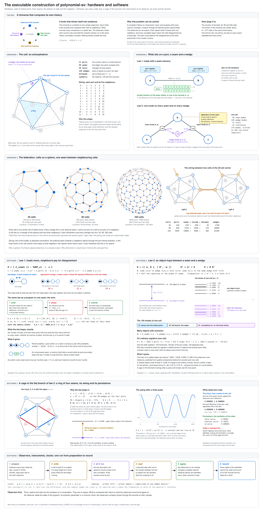
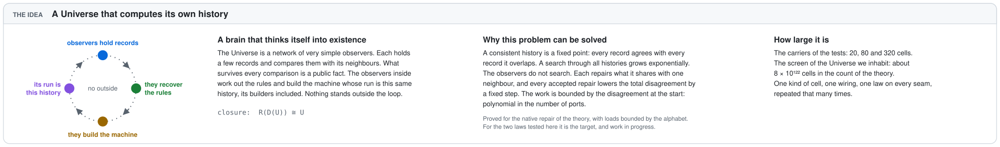
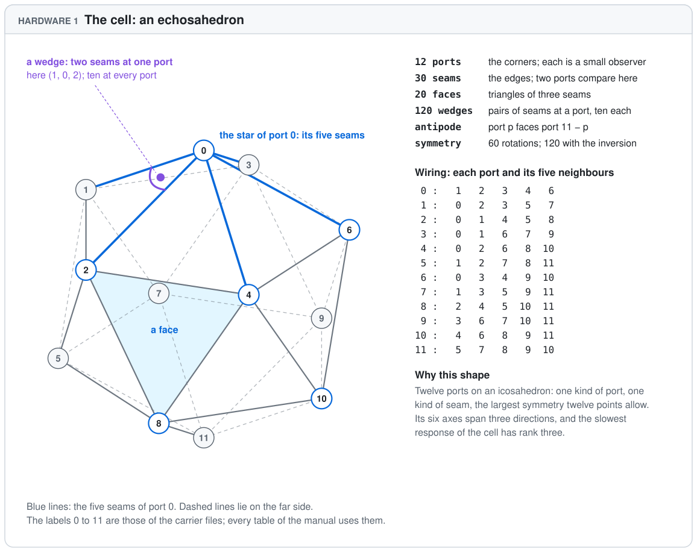
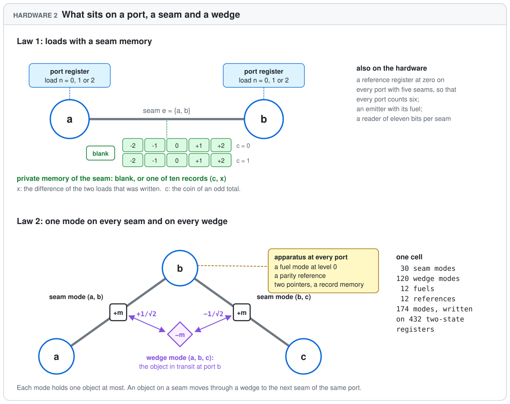
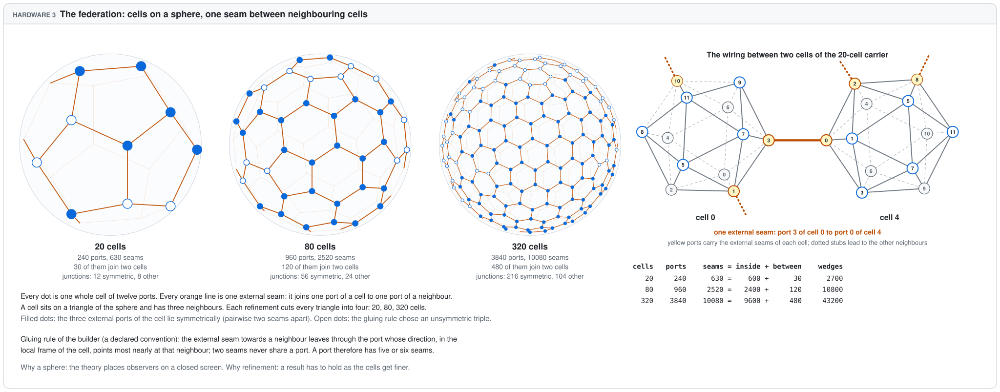
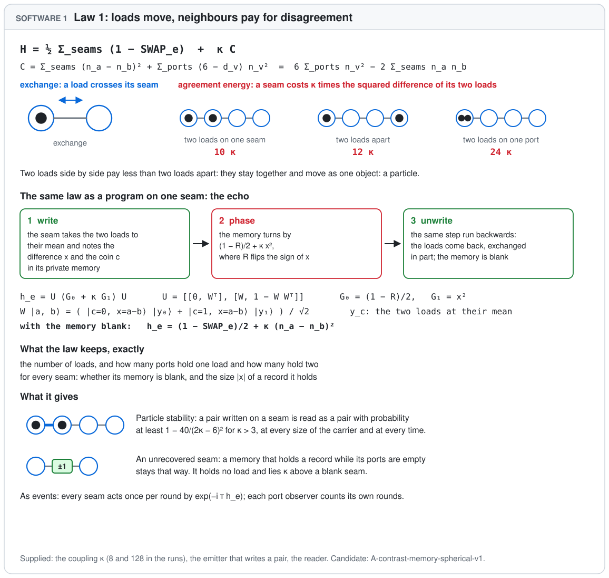
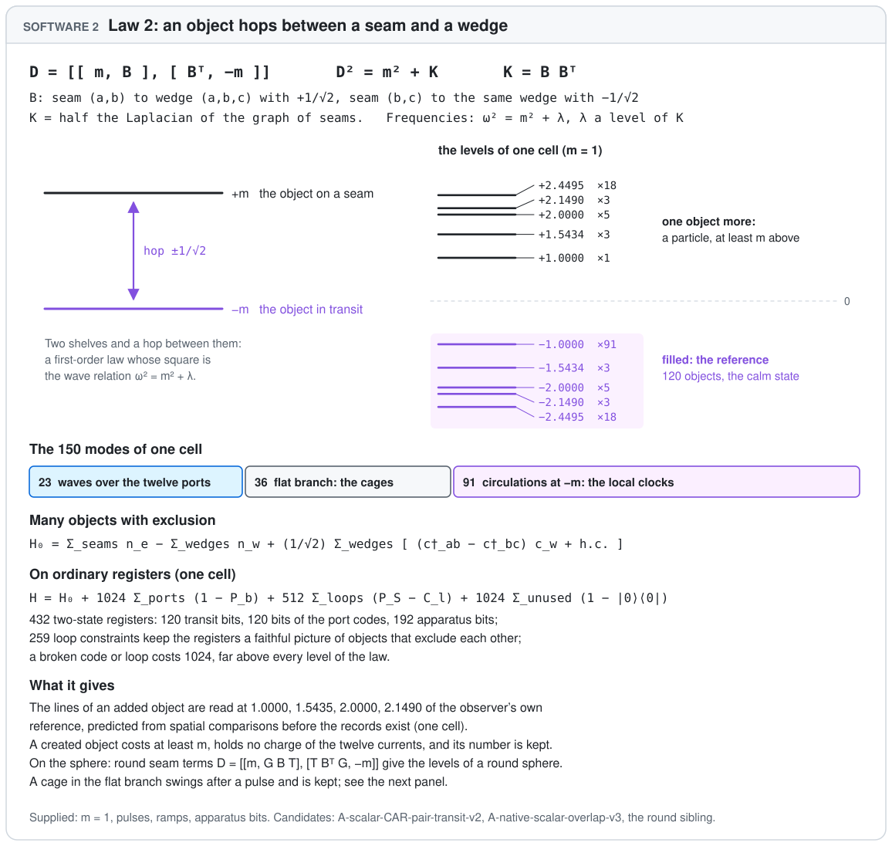

# The executable construction: hardware and software

The construction on one sheet and panel by panel. Hardware is the carrier with its registers. Software is the
law that acts on it, with the instruments, the clock and the records of an observer.

Two laws are described. Law 1, the contrast-memory law, is the law of the executable model
[polynomial-sv](../polynomial_sv/README.md), whose [specification](../polynomial_sv/SPEC.md) is the binding text
for that model. Law 2, the scalar channel, is an experimental construction that the package
[scalar_channel](../scalar_channel/README.md) executes on one cell. Both laws are candidates under test, and the
search for the correct native repair law is work in progress. The two laws have different state spaces, and their
results are not combined into one claim.

[](executable_spec.svg)

**Full size.** Click the sheet, or open [executable_spec.svg](executable_spec.svg) in a browser tab and zoom. From
a local checkout, [viewer.html](viewer.html) shows the sheet full screen with zoom and pan.

| File | Contents |
| --- | --- |
| [CONSTRUCTION_MANUAL.md](CONSTRUCTION_MANUAL.md) | the construction manual: every part, how to build it, why it is designed this way, every equation with what it says, and each section again in plain words |
| [executable_spec.svg](executable_spec.svg) | the whole sheet, 2400 by 4012 |
| [fig_idea.svg](fig_idea.svg), [fig_cell.svg](fig_cell.svg), [fig_registers.svg](fig_registers.svg), [fig_federation.svg](fig_federation.svg), [fig_law1.svg](fig_law1.svg), [fig_law2.svg](fig_law2.svg), [fig_run.svg](fig_run.svg) | the seven panels as separate figures |
| [viewer.html](viewer.html) | a full-screen viewer for a local checkout |
| [make_diagram.py](make_diagram.py) | draws every figure from the carrier files |
| [inputs/CELL.npz](inputs/CELL.npz) | one cell with its seams and wedges, in the labelling of the manual |

The figures show the design. The packages named in
[section 11 of the manual](CONSTRUCTION_MANUAL.md#11-what-this-repository-executes) hold what is executed, with
their receipts.

## The idea: a Universe that computes its own history



- **The loop.** The theory's closure hypothesis: the Universe is a timeless, self-referential structure. Its
  observers recover the specification of their own world from completed records and build hardware whose
  execution realizes that same history, its builders and their hardware included. With `U` the complete history,
  `D(U)` the account of its architecture recoverable inside it and `R` a realization of that account built
  inside it, the condition is `R(D(U)) ≅ U`. No host, no outside time and no global clock are supplied.
- **A brain that thinks.** The hardware is a network of very simple observers. Each holds a few records and
  compares them with its neighbours. Thinking is the settling of their disagreements, and what survives every
  comparison is a public fact.
- **Why the problem can be solved.** A consistent history is a fixed point: every record agrees with every record
  it overlaps. A search through all candidate histories grows exponentially with the number of records. The
  observers do not search. Each repairs what it shares with one neighbour, and an accepted repair lowers a global
  measure of disagreement by a fixed step, so the number of repairs is bounded by the disagreement at the start.
  For the native repair of the theory this is a theorem: an accepted repair moves one unit across a seam whose
  loads differ by two or more and lowers the sum of squared loads by at least 2. For the two laws described here
  a bound on the work is the target, and it is work in progress.
- **The size.** The tests run on one cell and on 20, 80 and 320 cells. The theory counts about `8 × 10^122` cells
  of equal area on the screen of the Universe we inhabit, a display on the measured side; the identification of
  a carrier cell with a screen cell is a separate theorem of the theory.

## Hardware 1: the cell



- An echosahedron: twelve ports at the corners of an icosahedron, thirty seams along its edges, twenty faces.
  Every port has five seams. The port opposite to port `p` is port `11 - p`.
- The thirty seams, in the labels of the manual: `0-1 0-2 0-3 0-4 0-6 1-2 1-3 1-5 1-7 2-4 2-5 2-8 3-6 3-7
  3-9 4-6 4-8 4-10 5-7 5-8 5-11 6-9 6-10 7-9 7-11 8-10 8-11 9-10 9-11 10-11`. The model polynomial-sv labels the
  ports of the same cell in another order; [contrast_replay.py](../contrast_replay.py) holds the map.
- A wedge is a pair of seams at one port, written `(a, b, c)` for the seams `a-b` and `b-c` with `a < c`. A port has
  ten wedges and a cell has 120.
- The symmetry group has 60 rotations, 120 elements with the inversion.
- Exact numbers of the cell: the port Laplacian `L = 5 - A` has the levels 0, `5 - sqrt5` three times, 6 five
  times, `5 + sqrt5` three times. The Gram matrix of the port directions has the entries 1, `1/sqrt5`, `-1/sqrt5`,
  -1 at seam distances 0 to 3, with `G^2 = 4G` and rank three.

## Hardware 2: the registers



| Place | Law 1 | Law 2 |
| --- | --- | --- |
| port | a load 0, 1 or 2; on a port with five seams one reference register at zero | a fuel mode at level 0, a parity reference, two pointers, a record memory |
| seam | a private memory of eleven states: blank, and ten records `(c, x)` with `c` in {0, 1} and `x` in {-2, ..., 2} | one mode that holds one object or none, at level `+m` |
| wedge | | one mode that holds one object or none, at level `-m` |

On one cell law 2 has 30 seam modes, 120 wedge modes, 12 fuels and 12 references: 174 modes of one algebra, written
on 432 two-state registers (120 transit bits, 120 bits in the codes of the ports, 192 apparatus bits).

## Hardware 3: the federation



| Cells | Ports | Seams | inside cells | between cells | Wedges | Ports with six seams |
| ---: | ---: | ---: | ---: | ---: | ---: | ---: |
| 20 | 240 | 630 | 600 | 30 | 2,700 | 60 |
| 80 | 960 | 2,520 | 2,400 | 120 | 10,800 | 240 |
| 320 | 3,840 | 10,080 | 9,600 | 480 | 43,200 | 960 |

- The cells sit on the triangles of the geodesic tower: the icosahedron, with every triangle cut into four at each
  refinement. A cell has three neighbours.
- Neighbouring cells share one external seam, from one port of each. Two external seams never share a port, so
  a port has five or six seams.
- The gluing rule is a declared convention of the builder: the seam towards a neighbour leaves through the port
  whose direction, in the local frame of the cell, has the largest inner product with the direction of that
  neighbour; collisions are repaired by an exact assignment. At 320 cells it gives 216 cells whose three external
  ports lie pairwise two seams apart, and 104 with ports at distances 1, 2 and 3.
- Files: [../polynomial_sv/carriers/](../polynomial_sv/carriers/) `FEDERATION_LEVEL0.npz`, `LEVEL1.npz`,
  `LEVEL2.npz`.

## Software 1: law 1, loads with a seam memory



Candidate `A-contrast-memory-spherical-v1`, the law of [polynomial-sv](../polynomial_sv/README.md).

    H = (1/2) sum_e (1 - SWAP_e) + kappa C
    C = sum_e (n_a - n_b)^2 + sum_v (6 - d_v) n_v^2 = 6 sum_v n_v^2 - 2 sum_e n_a n_b

- **One seam as a program.** On the two loads and the memory of a seam, 99 states: `h_e = U (G0 + kappa G1) U`
  with `U = [[0, W^T], [W, 1 - W W^T]]`, `W |a, b> = (|0, a - b> |y_0> + |1, a - b> |y_1>) / sqrt2`,
  `y_c = (floor(s/2) + c p, floor(s/2) + (1 - c) p)` for `s = a + b` and `p = s mod 2`, `G0 = (1 - R)/2` with
  `R |c, x> = |c, -x>`, and `G1 = x^2`. With the memory blank this is `(1 - SWAP_e)/2 + kappa (n_a - n_b)^2`.
- **Costs.** Two loads on one seam 10 `kappa`, two loads apart 12 `kappa`, two loads on one port 24 `kappa`.
- **Theorem.** For `kappa > 3`, from every start on a seam and at every time, the probability of "no pair on a
  seam" is at most `40 / (2 kappa - 6)^2`, on every federation of complete cells
  ([proof](../polynomial_sv/PROOF.md)).
- **Kept exactly.** The number of loads and the numbers of ports with one and with two loads; for every seam,
  whether its memory is blank and the size `|x|` of a record it holds.
- **As events.** Every seam acts once per round by `exp(-i tau h_e)`, and each port observer counts its own
  rounds.
- **Supplied.** The coupling `kappa`, the emitter with its fuel, the reader.

## Software 2: law 2, the scalar channel with a filled reference



Candidates `A-scalar-CAR-pair-transit-v2`, its form on ordinary registers `A-native-scalar-overlap-v3`, which
[scalar_channel](../scalar_channel/README.md) executes on one cell, and the sibling with round seam terms.

    D = [[m, B], [B^T, -m]]        D^2 = m^2 + diag(B B^T, B^T B)        K = B B^T
    B[(a,b), (a,b,c)] = +1/sqrt2        B[(b,c), (a,b,c)] = -1/sqrt2
    H_0 = sum_e n_e - sum_w n_w + (1/sqrt2) sum_w [(c*_ab - c*_bc) c_w + h.c.]        (m = 1)

- **Levels of one cell.** `K` has the levels 0, 1.382 three times, 3 five times, 3.618 three times and 5 eighteen
  times. The frequencies are 1, 1.5434, 2, 2.1490, 2.4495 and their negatives, with 91 wedge modes at `-1`.
- **Reference.** All 120 levels below zero are filled. A particle is one object more and lies at least `m` above.
- **The 150 modes.** 23 carry waves over the twelve ports (`K J = J L / 2` with the port Laplacian `L`), 36 are flat
  detail of the seams, 91 are circulations at `-m`.
- **On registers.** `H = H_0 + 1024 sum_b (1 - P_b) + 512 sum_l (P_S(l) - C_l) + 1024 sum_u (1 - |0><0|)_u`, with 259
  independent loop constraints among the 240 triangles of a star and the 20 faces. They select the objects with
  an even total number.
- **On the sphere.** Round seam terms: `D = [[m, G B T], [T B^T G, -m]]`, with a factor per seam from the area of
  its cell and an amplitude on the wedges of every external seam.
- **Supplied.** `m`, the pulses, the ramps, the apparatus bits, the round terms.

## Software 3: observers, instruments, clocks


1. **Prepare.** Every loop is measured, its sign kept and corrected; the transits are filled; twelve star ramps of
   256 steps with the profile `3 s^2 - 2 s^3` bring the cell to its reference.
2. **Write.** A fuel at level 0 is coupled to a local target with strength 64 for a pulse of area `pi/2` or `pi/4`
   while the law keeps running.
3. **Run.** The law acts alone. The observer counts cycles of its own circulation
   `chi_b = (|a,b,c> + |c,b,f> - |a,b,f>) / sqrt3`, which sits at the level `-m` exactly.
4. **Read.** A second pulse with one of four phase settings; with the coupling off, the fuel is copied into two
   pointers.
5. **Agree.** Identical complete reports of two observers are admitted. Every other outcome is kept as an outcome.
6. **Record.** Three copies of the admitted record; the order and the count of its own records are the observer's
   clock.

The reading: the probability of "fuel full" with the fuel prepared full, minus the same with the fuel prepared
empty, is the squared amplitude of one added object, whatever the background is. Four settings give one complex
number per count, and its spectrum over the counts shows the frequencies in units of the observer's own reference.

**Observers first.** Ports, seams and cells are the hardware of a computation, and they are no space. What is
compared with nature is what the observers record and agree on. No observer reads the state of the program, its
evolution parameter or a common clock.

## Regenerate

```sh
python model/construction_manual/make_diagram.py     # writes the sheet and the seven figures
```

The script needs NumPy and NetworkX from `model/requirements.txt` and reads the cell from `inputs/` and the
federations from `../polynomial_sv/carriers/`.
