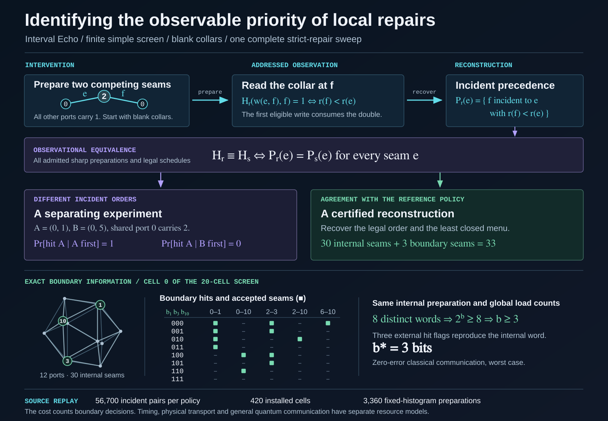

# Observable priority in Interval Echo

Which part of a scheduler can an observer infer from the repairs it accepts? On a fixed finite screen, two strict repair services give the same addressed hit on every sharp preparation exactly when they give the same priority to each pair of seams sharing a port. A disagreement comes with an experiment that tells the services apart. Agreement with the installed reference lets a cell reproduce its internal hit record from exactly three boundary bits.

<a href="figures/observable-priority.svg"><picture><source media="(max-width: 760px)" srcset="figures/observable-priority-narrow.svg"></picture></a>

*The squares mark accepted seams in the first cell of the 20-cell board. Only five of its 30 internal seams appear in these eight records. The three highlighted ports are where the boundary decisions enter the cell.*

## What an observer measures

The [protected repair service](../interval_echo_consensus/ASYNCHRONOUS.md) supplies the priority guard and the sharp write. A collar records whether a repair occurred at its seam. Start with blank collars. Give the common port of two incident seams a load of two, leave their other endpoints vacant, and set every other load to one. The first eligible repair consumes the double. Reading either named collar determines the relative priority of the two seams, even when each reading comes from a different complete legal visit order.

The observer repeats this preparation for each incident pair and reconstructs the predecessors of each seam from the hits alone. The resulting relation admits a legal visit order. Two consecutive visits to seams with no common port may exchange places without changing any addressed outcome. For any two admitted candidates, the first differing incident comparison specifies the preparation and collar to read. On the 20-cell board, the native and reversed policies disagree at seams (0, 1) and (0, 5). Reading (0, 1) after the same preparation gives probability one under the native policy and zero under reversal.

## Why the cell needs three bits

For a candidate in the reference class, closure under the recovered predecessors gives a cell's 30 internal seams and three boundary seams. Given the internal preparation, the three boundary hit flags suffice to reproduce the full internal hit word. For the converse, eight external preparations give eight distinct internal words while preserving the cell's internal preparation and the global load counts. An exact decoder must distinguish all eight. This gives the same worst-case lower bound for a fixed-width message and for an adaptive binary question tree. The unit is classical boundary information for one specified cell and one complete protected sweep.

| Federation level | Cells | Seams | Incident pairs per candidate | Cell preparations |
| --- | ---: | ---: | ---: | ---: |
| 0 | 20 | 630 | 2,700 | 160 |
| 1 | 80 | 2,520 | 10,800 | 640 |
| 2 | 320 | 10,080 | 43,200 | 2,560 |

The decision procedure needs a fixed common screen, the same sharp repair, strict incident comparisons and source-realized addressed readings. The per-cell communication cost conditions on a supplied local preparation. Timing, transport, coherent messages and the cost of preparing that input require separate resource models.

## Proof and executable experiment

| Claim | Lean declaration | Executable evidence |
| --- | --- | --- |
| Incident comparisons characterize all addressed hits | [`observational_iff_incident`](../../../Lean/ObserverPatchHolography/ObservablePriority/ObservablePriority.lean) | [Transcript reconstruction](observed.py) and [authentication](priority.py) |
| A differing comparison has sharp probability zero versus one | [`separator_some_wordMass`](../../../Lean/ObserverPatchHolography/ObservablePriority/PriorityQuantum.lean) | [Three-port preparation and tensor read](equipment.py) |
| An installed cell yields a decoding certificate or a separating experiment | [`classify_or_separate`](../../../Lean/ObserverPatchHolography/ObservablePriority/InstalledDiscovery.lean) | [Certificate generation and checking](closure.py) |
| Three bits suffice and are necessary, including adaptive binary questions | [`exactly_three_full` and `exactly_three_tree_full`](../../../Lean/ObserverPatchHolography/ObservablePriority/CellBits.lean) | [Eight preparations and signed cell replay](cells.py) |

From the repository root, install the dependencies in `model/requirements.txt`. The first comparison returns the separating preparation and the two measured outcomes. The second returns the decoding certificate for cell zero. The full replay checks each indexed cell word and the signed material records against the [reference digests](expected.json).

```sh
python -B -O -m model.experiments.observable_priority compare --level 0 --cell 0 --left native --right reverse
python -B -O -m model.experiments.observable_priority compare --level 0 --cell 0 --left native --right relabeled
python -B -O -m model.experiments.observable_priority replay
python -m pytest -q model/experiments/observable_priority
(cd Lean && lake build ObserverPatchHolography.ObservablePriority.InstalledDiscovery ObserverPatchHolography.ObservablePriority.PriorityQuantum)
```

To reconstruct from saved observations, run `observe --level 0 --candidate native --output hits.json` followed by `recover --level 0 --hits hits.json` with the same module entry point. Recovery checks the structure of the transcript. Passing `--left-hits hits.json` to `compare` also checks the readings against the named installation. A candidate can be specified by a JSON integer rank array in carrier seam order.

The [scientific source](https://github.com/FloatingPragma/observer-patch-holography/commit/6c3c142d3280b9a90f3b072fa5cc0be7581d226e) and the [integration source](https://github.com/FloatingPragma/observer-patch-holography/commit/93a41d4785a53085ff04788dcd7f9c962ddeecdb) reproduce the same records. Of 23 bound inputs, only the candidate's parameter, premise and joint-description fields changed. The source matcher accepts the two recorded byte profiles.
