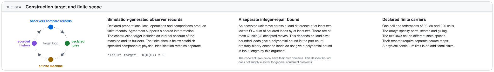
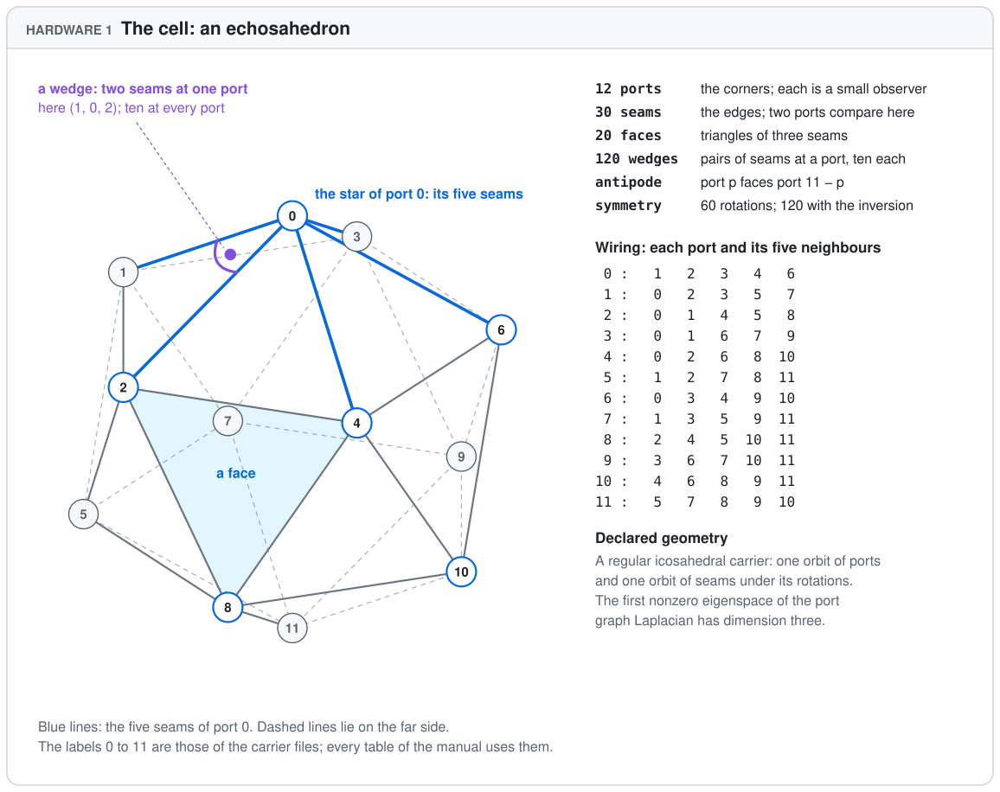
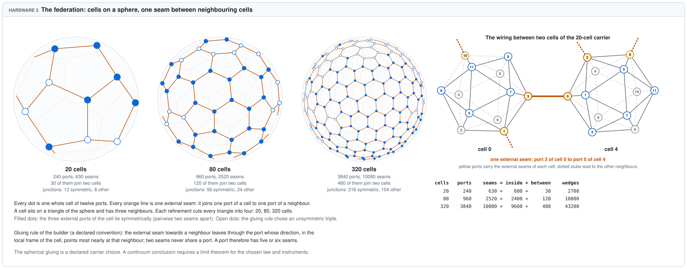
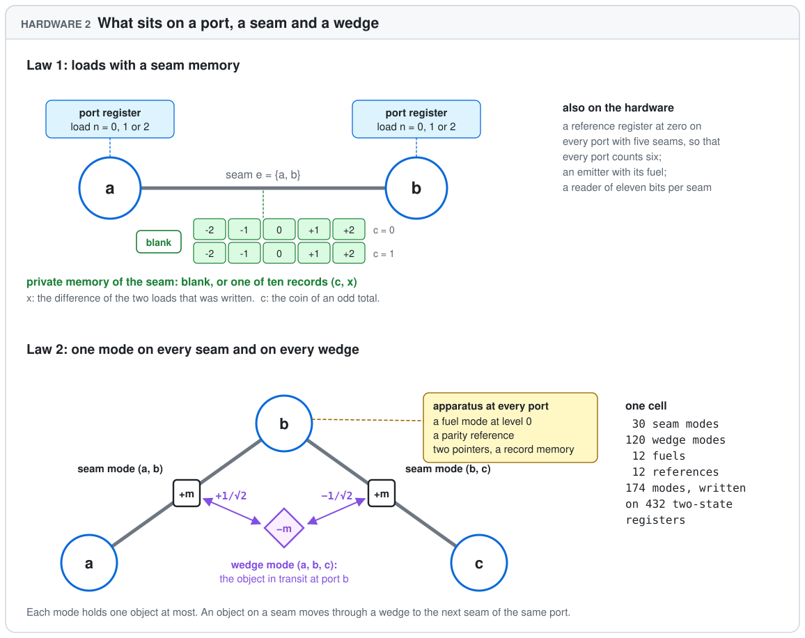
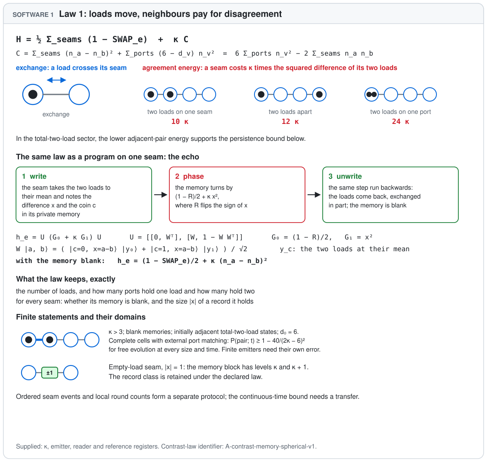
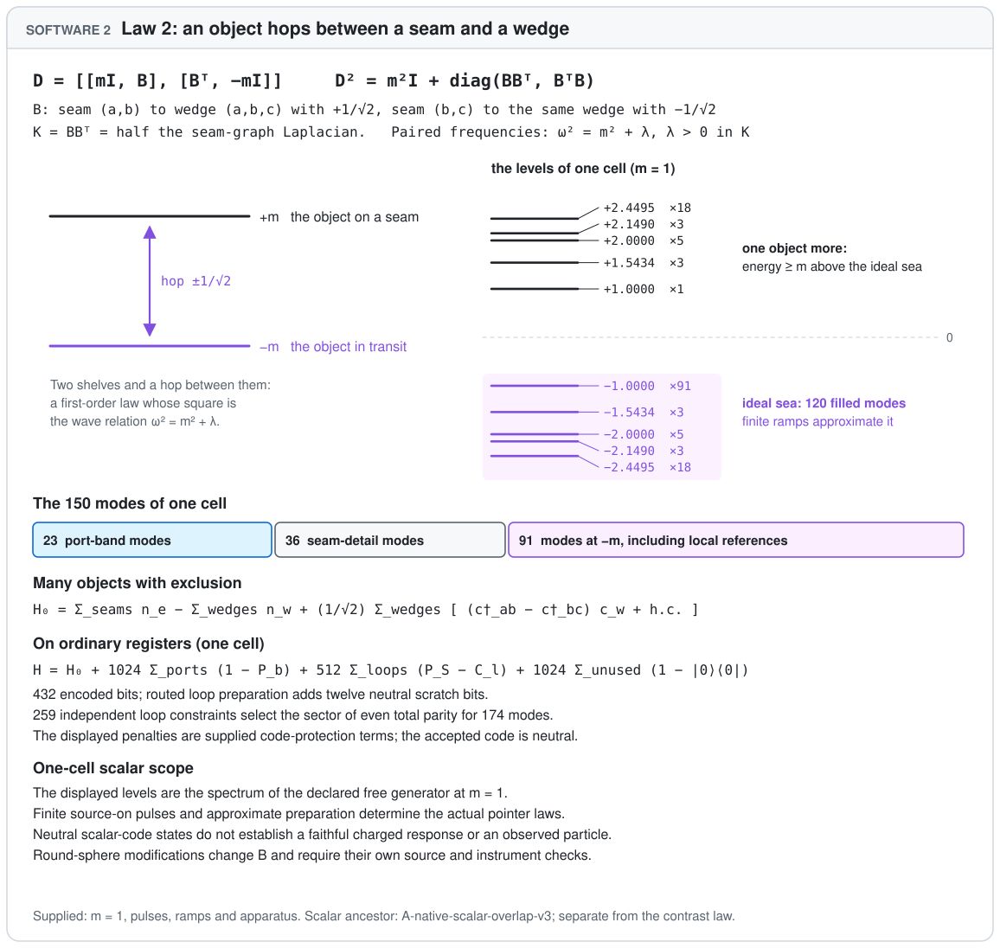
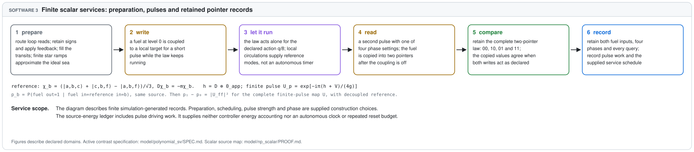

# Construction manual: the native observer base

The native base has two alternative laws on one declared hardware family. The
contrast-memory branch is the primary executable; the scalar branch has a
separate experimental replay. Their consequences are not combined into one physical model.
[The active specification](../polynomial_sv/SPEC.md) and [source contract](../np_scalar/PROOF.md)
fix their domains. The calibrated CCF-LT-2 evidence has its own source domain.

This manual and its figures are adapted from the source revision in
[PROVENANCE.json](PROVENANCE.json). Numerical results attributed to source
experiments retain that revision's domain. Source paths below identify that
provenance; they are not prerequisites for the self-contained OPH replay.
[The compiler proof](../np_scalar/PROOF.md) and
[executable obligations](../np_scalar/OBLIGATIONS.json) distinguish replayed
results, implemented local services and physical identification requirements.
No OpenWave award is asserted by adopting this base.

The whole construction on one sheet: [executable_spec.svg](executable_spec.svg) ([README](README.md) for the sheet
panel by panel).

**Contents**

0. [The idea](#0-the-idea)
1. [Parts list](#1-parts-list)
2. [Hardware](#2-hardware): [the cell](#21-the-cell), [wedges](#22-wedges), [the federation](#23-the-federation), [registers](#24-registers)
3. [Observers, records and clocks](#3-observers-records-and-clocks)
4. [Law 1: loads with a seam memory](#4-law-1-loads-with-a-seam-memory)
5. [Law 2: the scalar channel](#5-law-2-the-scalar-channel)
6. [Instruments](#6-instruments)
7. [Operating procedures](#7-operating-procedures)
8. [Results, supplied choices and obligations](#8-results-supplied-choices-and-obligations)
9. [Symbols](#9-symbols)
10. [Sources](#10-sources)

---

## 0. The idea



### 0.1 The closure target

The theory behind this construction, Observer Patch Holography, starts from one hypothesis. The Universe is a
timeless, self-referential structure. Its observers recover the specification of their own world from completed
records, and they build hardware whose execution realizes that same history, its builders and their hardware
included. The structure reads itself into existence. With `U` the complete history, `D(U)` the account of its
architecture that records inside it allow, and `R` a realization of that account built inside it:

```math
R(D(U)) \cong U
```

The sign means agreement in everything that can be observed and intervened on. This is a construction target.
The finite implementation supplies initialization, local control and action durations. Establishing
the stated closure for that implementation requires an internal realization of those services and the same
observer consequences; the component calculations below do not establish it.

The hardware is a very large network of very simple observers. Each holds a few records and compares them with
its neighbours. In that sense the Universe is a brain: a network whose activity is the settling of disagreements
between neighbours. What it thinks is its own history, and the history it settles on contains the observers who
work out how the network is built.

### 0.2 The classical repair bound

A history is consistent when every record agrees with every record it overlaps. That is a fixed-point problem
over an enormous number of records. Solved by search, it is hopeless: the number of candidate histories grows
exponentially with the number of records, and general problems of this kind are among the hardest known.

The classical balancing process uses three properties of its specified moves.

1. **Every check is local.** An observer compares records with one neighbour, on the seam they share. No step
   looks at the whole.
2. **Every repair is local.** A disagreement on a seam is repaired on that seam, by the two observers on it.
3. **Every accepted repair makes progress.** It lowers one global measure of disagreement by a fixed step.

With these three, the work is bounded by the amount of disagreement at the start, which depends on the input loads as well as the number of ports. A bound
polynomial in their binary encoding length does not follow from this potential. For the native repair of the theory this is a theorem of the carrier paper: an accepted
repair moves one unit of load across a seam whose two loads differ by two or more,

```math
(q_i, q_j) \to (q_i - 1,\ q_j + 1) \quad \text{for } q_i - q_j \ge 2, \qquad V(q) = \sum_p q_p^2 ,
```

and each such step lowers `V` by `2 (q_i - q_j - 1)`, at least 2. A settling path therefore has at most
`(V_start - V_min) / 2` accepted repairs, in every order of the seams. The consensus paper of the theory adds
that, under stated termination and consistency conditions, local repairs reach one shared public result
whatever their order.

These classical moves and the two quantum laws below are distinct processes. Their generators and apparatus
are declared separately. The descent theorem supplies no convergence or complexity result for either
unitary law, or a polynomial bound for general constraint problems.

### 0.3 How large it is

The imported arrays describe federations of 20, 80 and 320 cells. The scalar replay uses one cell;
the contrast package declares its own carrier levels and tests. The theory counts about `8 × 10^122` cells of equal area on
the screen of the Universe we inhabit (carrier paper, paragraph "Screen cells and capacity"; a display on the
measured side, with the capacity `3.31 × 10^122`). The paper states that a carrier cell is identified with a
screen cell only through a separate theorem. One kind of cell, one wiring and one law on every seam, repeated
that many times, is the proposal.

### 0.4 Hardware, software, and what is physical

- **Hardware**: ports, seams, cells, the sphere of cells, and the registers on them ([section 2](#2-hardware)).
- **Software**: the law that acts on the registers, and the programs of an observer: prepare, write, read,
  agree, record ([sections 3 to 7](#3-observers-records-and-clocks)).
- **Physical**: what the observers record and agree on. Ports, seams and cells are the hardware of a
  computation, and they are no space. Space, time, fields and particles are how the observers inside describe the
  records they agree on. A test compares what the observers of the model record with what we record. It never
  compares the state of the program with the world.

> **In plain words.** Imagine a huge crowd in which everybody can only whisper with the people standing next to
> them. Nobody sees the crowd from above. Each person keeps a small notebook and, whenever two neighbours find
> that their notes differ, they fix the difference between the two of them. If every such fix removes a little
> disagreement and never adds any, the crowd settles into one consistent story without anyone ever searching
> for it. The theory says the Universe is such a crowd, that the consistent story is its history, and that the
> story includes people who figure out how the crowd works. This manual describes the smallest unit of the
> crowd, how the units are wired together, and the two rules for fixing notes that are under test.

---

## 1. Parts list

| Part | Per cell | At 20 / 80 / 320 cells | Role |
| --- | ---: | ---: | --- |
| port | 12 | 240 / 960 / 3,840 | a small observer; holds a register |
| seam inside a cell | 30 | 600 / 2,400 / 9,600 | where two ports of a cell compare |
| seam between cells | 3 ends | 30 / 120 / 480 | joins one port of a cell to one port of a neighbour |
| face | 20 | | three seams in a triangle |
| wedge | 120 | 2,700 / 10,800 / 43,200 | two seams at one port; the place of an object in transit |
| port register, law 1 | 12 | 240 / 960 / 3,840 | a load 0, 1 or 2 |
| seam memory, law 1 | 30 | 630 / 2,520 / 10,080 | eleven states: blank and ten records |
| seam mode, law 2 | 30 | 630 / 2,520 / 10,080 | one object or none, level `+m` |
| wedge mode, law 2 | 120 | 2,700 / 10,800 / 43,200 | one object or none, level `-m` |
| fuel and parity reference, law 2 | 12 + 12 | | the local source and sink of an observer |
| two-state registers, law 2 on registers | 432 | | 120 transit bits, 120 code bits, 192 apparatus bits |
| additional routing scratch bits, scalar replay | 12 | | one neutral scratch bit per center |
| additional terminal pointer bits, scalar replay | 2 | | both at the active fuel center |

The scalar replay allocates 446 coherent logical bits including scratch and pointers. Its owner-code
registers have the larger raw dimensions specified by the star isometries. Software parts include the law,
finite preparation and pulse programs, a local two-pointer readout and a retained classical record list.
The controller and count-to-action conversion are supplied services (sections 3 and 6).

---

## 2. Hardware

### 2.1 The cell



**Build.** Take twelve ports and label them 0 to 11. Join them by the thirty seams below. The result is the
corner-and-edge graph of an icosahedron, called an echosahedron in the theory.

| Port | Its five neighbours | | Port | Its five neighbours |
| ---: | --- | --- | ---: | --- |
| 0 | 1 2 3 4 6 | | 6 | 0 3 4 9 10 |
| 1 | 0 2 3 5 7 | | 7 | 1 3 5 9 11 |
| 2 | 0 1 4 5 8 | | 8 | 2 4 5 10 11 |
| 3 | 0 1 6 7 9 | | 9 | 3 6 7 10 11 |
| 4 | 0 2 6 8 10 | | 10 | 4 6 8 9 11 |
| 5 | 1 2 7 8 11 | | 11 | 5 7 8 9 10 |

The port opposite to `p` is `11 - p`. Twenty triples of mutually joined ports are the faces. The file
`../pair_transit/delivered/source/CELL.npz` holds the seams and the wedges in the order every script uses.

**Why this shape.** The reasons are those of the theory's carrier paper.

- *One kind of port and one kind of seam.* Every port has five seams and every seam looks like every other: 60
  rotations (120 with the inversion) move any port to any port. No port is special, so no place in the cell is
  preferred.
- *Six axes that span three directions.* The twelve ports pair up into six opposite pairs. Write `u_p` for the
  direction of port `p`. The matrix of their inner products takes four values,

  ```math
  G_{pq} = u_p \cdot u_q \in \{1,\ 1/\sqrt5,\ -1/\sqrt5,\ -1\} \quad \text{at seam distance } 0, 1, 2, 3, \qquad G^2 = 4G, \quad \operatorname{rank} G = 3 .
  ```

  *What the equation says:* twelve ports carry exactly three independent directions. Three is the rank of `G`.
- *The slowest response is three-dimensional.* The port Laplacian `L = 5 - A` (five minus the neighbour matrix)
  has the levels

  ```math
  \operatorname{spec} L = \{\,0,\ (5-\sqrt5)^{\times 3},\ 6^{\times 5},\ (5+\sqrt5)^{\times 3}\,\} .
  ```

  *What the equation says:* a disturbance spread evenly over the cell does not relax at all (level 0). Under a
  repair that moves loads along all seams at equal rates, the disturbances that relax slowest form a band of
  three, and that band is the range of `G`. This is the finite root of "three dimensions" in the theory. The
  levels are machine-checked in the theory's Lean library.
- *As round as twelve points allow.* A wave law built from the thirty seam directions is the same in every
  direction through angular rank five; a first direction-dependent term appears at rank six.

The carrier paper states plainly that carrier, schedule and memory law are design choices. They are justified
by the loop of section 0, and by tests.

> **In plain words.** The cell is a ball with twelve corners. Each corner is a tiny observer that talks to its
> five nearest corners. The shape is chosen so that no corner is special, and so that the twelve corners
> between them know exactly three independent directions: up-down, left-right, front-back.

### 2.2 Wedges

**Build.** At every port, list all pairs of its seams. A pair is a wedge, written `(a, b, c)`: the seams `a-b` and
`b-c` meeting at port `b`, with `a < c`. A port with five seams has ten wedges; a cell has 120.

**Why.** An object that sits on a seam needs a way to reach another seam. Two seams touch only at a port, so
the place "between two seams" is a wedge. Law 2 gives every wedge a mode of its own: an object in transit at port
`b`, on its way from seam `a-b` to seam `b-c`. All ten pairs are used, the corners of faces and the pairs that
span no face alike, because no pair of seams at a port is special.

### 2.3 The federation



**Build.**

1. Take the icosahedron and cut every triangle into four, pushing the new corners out to the sphere. Repeat `L`
   times: `20 · 4^L` triangles. This is the geodesic tower.
2. Put one complete cell on every triangle.
3. Two cells are neighbours when their triangles share an edge. Every cell has three neighbours.
4. Join every pair of neighbouring cells by one external seam, from one port of each. No port takes two external
   seams.
5. Choose the ports by the gluing rule of the builder: the seam towards a neighbour leaves through the port
   whose direction, in the local frame of the cell, has the largest inner product with the direction of that
   neighbour; collisions are repaired by an exact assignment.

| Level | Cells | Ports | Seams | inside | between | Wedges | Ports with six seams |
| ---: | ---: | ---: | ---: | ---: | ---: | ---: | ---: |
| 0 | 20 | 240 | 630 | 600 | 30 | 2,700 | 60 |
| 1 | 80 | 960 | 2,520 | 2,400 | 120 | 10,800 | 240 |
| 2 | 320 | 3,840 | 10,080 | 9,600 | 480 | 43,200 | 960 |

Files: `../sphere/carriers/FEDERATION_LEVEL{0,1,2}.npz`. Level 0 equals the pinned graph of the official
candidate, seam for seam.

**Why.**

- *A closed surface.* The theory places observers on a closed screen. A sphere has no edge, so no cell is a
  boundary cell.
- *Refinement.* A result that means something has to hold as the cells get finer. Cutting triangles into four
  gives a family of carriers with the same local structure at every size.
- *One seam per pair of neighbours.* The weakest joining that connects the cells. A port keeps five or six
  seams, so the local law stays local at every size.

**Two known properties of this wiring.**

- *The junctions.* The gluing rule is a declared convention, and the theory lists a derived gluing as an open
  item. It gives 216 of 320 cells three external ports that lie pairwise two seams apart, a symmetric junction,
  and 104 cells ports at distances 1, 2 and 3.
- *The source's refinement comparison.* Equal seam terms give the same local combinatorial triangle at each
  cell. The source reports persistent low-band splitting and compares it with a piecewise flat icosahedron.
  Its round-sphere sibling changes seam terms ([section 5.8](#58-on-the-sphere)). Neither numerical comparison
  supplies the scalar replay with a physical continuum limit.

> **In plain words.** Take many of the twelve-cornered balls and tile a big sphere with them, like the patches of
> a football. Each ball is wired to its three neighbouring balls by a single wire. To make the sphere finer,
> replace every patch by four smaller ones. The picture shows 20, 80 and 320 balls; the real thing would have
> more balls than there are atoms in the visible Universe, by many orders of magnitude.

### 2.4 Registers



A register is the piece of memory at a place. The two laws use different registers on the same carrier.

**Law 1.**

| Place | Register | Why |
| --- | --- | --- |
| port | a load `n` in {0, 1, 2} | the thing that is recorded and moved; three values, so that two units on one port are a state the law has to deal with |
| seam | a private memory with eleven states: blank, or a record `(c, x)` with coin `c` in {0, 1} and contrast `x` in {-2, ..., 2} | makes the seam event reversible: what the event would forget is written here first ([section 4.3](#43-a-reversible-version-the-write)) |
| port with five seams | one reference register held at zero | every port counts as if it had six seams, so that no port is cheaper than another ([section 4.5](#45-the-degree-term)) |

**Law 2.**

| Place | Register | Why |
| --- | --- | --- |
| seam | a mode that holds one object or none | an object at rest on a seam |
| wedge | a mode that holds one object or none | the same object in transit at a port |
| port | a fuel mode at level 0 | the observer's local source and sink: it writes an object into the cell and takes one out |
| port | a parity reference | keeps the total number of objects even for both preparations of the fuel, so that one algebra covers both |
| active fuel port | two neutral pointers | local copies of the terminal fuel occupation, with all four outcomes retained |

On one cell, law 2 on ordinary registers uses 432 two-state registers ([section 5.6](#56-on-ordinary-registers)).

---

## 3. Observers, records and clocks

**Who observes.** The declared apparatus belongs to a port and its star: the incident seams, wedges and local
registers. The scalar preparation routes scratch states between centers and reads them locally.
Its terminal fuel readout writes two neutral pointer bits at one fuel center. The simulator uses the full
finite state representation to calculate those local records; the observer output is the record law.

**What a record is.** A retained outcome of the declared instrument. Routed preparation keeps its syndrome,
diagnostic and transport-failure records. The terminal readout keeps all four two-bit outcomes, including
zero-probability disagreements on the blank-pointer preparation. The two terminal copies are local; this
readout does not transport a report to a second spatially separated observer.

**Counts and timing.** The scalar replay supplies free action `q/8` for `q` in `{0,4,8}`, together with pulse
durations and phase settings. A local circulation is an exact reference eigenmode ([section 6.4](#64-the-clock));
it is not an executed timer that selects these actions. Autonomous timing and comparison of independently
running observer clocks remain separate construction obligations.

**Why this way.** A Universe with no outside has nobody who could read its state from outside. Whatever is a
fact has to be a fact for some observer inside, in that observer's own units. Fields, particles, space and a
common time are descriptions that observers agree to use.

> **In plain words.** The finite program reads local apparatus and keeps the outcomes. Its schedule is supplied.
> Turning a reference oscillation into a clock that controls and timestamps those operations requires another
> implemented service.

---

## 4. Law 1: loads with a seam memory



Candidate `A-contrast-memory-spherical-v1`. Specification as delivered:
`../sphere/delivered/EXECUTABLE_SPEC.md`. Review: ../sphere/README.md (source path `../sphere/README.md`).

### 4.1 State

A load 0, 1 or 2 on every port and a memory of eleven states on every seam. Pair preparations use blank
memories, which the echo preserves. The unrecovered-seam experiment instead starts with a recorded contrast.

### 4.2 The seam rule that the law is built from

The theory's native repair acts on one seam. It takes the two loads `(a, b)` to their mean. An even total has
one mean; an odd total has two, and a fair coin decides which port gets the extra unit:

```math
(a, b) \to y_c = \bigl(\lfloor s/2 \rfloor + c\,p,\ \lfloor s/2 \rfloor + (1 - c)\,p\bigr), \qquad s = a + b,\quad p = s \bmod 2,\quad c \in \{0, 1\} .
```

**Why this rule.** The carrier paper shows that four requirements leave no other rule: keep the total of the
seam; end where `a^2 + b^2` is smallest; break a tie by a random choice that does not look at the loads; treat
the two ports alike.

**Intuition.** Two neighbours who hold different amounts split the difference. If the amounts cannot be split
evenly, a coin decides who holds the odd unit.

### 4.3 A reversible version: the write

The rule forgets two things: the difference `x = a - b` it removed and the coin `c` it tossed. A law that
forgets cannot run backwards and carries no phase. Law 1 therefore writes both into the private memory of the
seam before it changes the loads:

```math
W\,|a, b\rangle = \frac{1}{\sqrt2}\sum_{c = 0}^{1} |c,\ x = a - b\rangle \otimes |y_c\rangle .
```

*What the equation says:* the loads go to their mean, in both versions of the coin at once, and the memory
holds which difference was removed and which coin was used. Nothing is lost, so `W` keeps lengths:
`W^T W = 1`.

The complete write on loads and memory, 9 by 11 = 99 states, is

```math
U = \begin{pmatrix} 0 & W^T \\ W & 1 - W W^T \end{pmatrix}, \qquad U = U^T, \quad U^2 = 1 .
```

The first block is "memory blank", the second "memory holds a record". *What the equation says:* `U` writes
when the memory is blank and unwrites when the memory holds exactly what a write would have put there. Applying
it twice does nothing. A record that fits no write is left alone; this is the `1 - W W^T`.

**Why a private memory.** The memory belongs to the seam and is read by nobody. An observer's committed public
record is never erased by this law. Only the seam's own scratch work is undone.

### 4.4 The echo

Between the write and the unwrite, the memory is turned by a generator that acts on records alone:

```math
G_\kappa = \frac{1 - R}{2} + \kappa\,x^2, \qquad R\,|c, x\rangle = |c, -x\rangle, \qquad h_e = U\,G_\kappa\,U .
```

With the memory blank, the three steps together are exactly

```math
h_e = \frac{1 - \mathrm{SWAP}_e}{2} + \kappa\,(n_a - n_b)^2 .
```

**Intuition for each piece.**

- *`(1 - R)/2`.* Flipping the sign of the recorded difference, and then undoing the write, returns the two loads
  exchanged. So a phase on "the difference with its sign flipped" becomes the exchange of the two loads. A load
  hops across its seam.
- *`κ x²`.* A phase proportional to the square of the recorded difference becomes an energy that the seam
  charges for disagreement between its two ports. Agreement costs nothing; a difference of one costs `κ`, a
  difference of two costs `4κ`.
- *Write, turn, unwrite.* The seam looks at its two loads, lets the look act, and takes the look back. What is
  left on the loads is a law with phases, and the memory is blank again. This is the echo.

**The identity that makes it exact.** The generator maps what a write produces into what a write produces:

```math
W^T\,G_\kappa\,(1 - W W^T) = 0 .
```

It holds in integer arithmetic for both pieces of `G`. Two consequences: a blank memory stays blank, and a memory
that holds a record stays unrecovered ([section 4.7](#47-what-the-law-keeps)).

### 4.5 The degree term

A port inside a cell has five seams, a port with an external seam has six. With seam terms alone, a load on a
port with five seams would pay for five disagreements and a load on a port with six for six. The law adds what
is missing, as if every port had six seams:

```math
C = \sum_{e = \{a,b\}} (n_a - n_b)^2 + \sum_v (6 - d_v)\,n_v^2 = 6\sum_v n_v^2 - 2\sum_e n_a n_b .
```

*What the equation says:* every load pays 6 for standing alone, and every seam with a load on both ends gives 2
back. The hardware for it is the reference register at zero on every port with five seams.

### 4.6 The whole law

```math
H_\kappa = \frac12\sum_e \bigl(1 - \mathrm{SWAP}_e\bigr) + \kappa\,C .
```

| Two loads | Cost `C` |
| --- | ---: |
| on the two ends of one seam | 10 |
| apart | 12 |
| on one port | 24 |

**Why a pair holds together.** Two loads on one seam pay 10 `κ`, two loads apart 12 `κ`. Moving apart costs
`2κ`, and the exchange can supply at most a fixed amount. For `κ > 3` the pairs on seams form a band in the conserved total-two-load sector,
separated from its complementary configurations by a gap of at least `2κ - 6`.

**Theorem** (every federation of complete cells with a matching of external seams, every start on a seam, every
time):

```math
\Pr(\text{no pair on a seam};\ t) \le \frac{40}{(2\kappa - 6)^2} .
```

*What the equation says:* the chance of finding the two loads apart is at most (coupling out of the band, at
most `sqrt(10)`) over (gap) squared, times four. It does not depend on the number of cells. The pair moves: it is
read on other seams. It is one object.

### 4.7 What the law keeps

- The number of loads, and the numbers of ports that hold one load and two loads. The exchange permutes loads
  and creates none.
- For every seam, whether its memory is blank. This is the identity of section 4.4.
- For every seam with a record, the size `|x|` of the recorded contrast: its record-size projections commute
  with the complete echo generator `h_e`. The write `U` itself changes the memory's record size and does not
  commute with the memory operator `x^2`.

So every seam carries a label with four values that never changes: blank, or a record of size 0, 1 or 2. With the
ports of the seam empty, a record of size 1 lies at the level `κ` or `κ + 1` above a blank seam, a record of size 2
at `4κ` or `4κ + 1`, and a record of size 0 at 0. The source studies the size-one class as a candidate recovery
defect on an overlap. It holds a retained seam record that the endpoint loads do not determine. Its two local
memory levels are model energies; they do not establish gravitational response or identify dark matter.

### 4.8 As events

The sum over seams with a continuous parameter is the limit. As a program each seam acts by one gate,

```math
\text{one event of seam } e: \quad \exp(-i\,\tau\,h_e), \qquad \text{one round: every seam once} .
```

Each port observer's count indexes its incident events. The source's finite event tests compare regular rounds,
unequal supplied rates and independent random event schedules at specified angles. These are separate
protocols from continuous evolution. The all-time bound in section 4.6 does not transfer to arbitrary event
orders or angles without a proof. The primary contrast package retains its declared event tests (source
sibling `A-contrast-memory-rounds-v1`, source path `../rows/row_04_particle_stability/README.md`).

### 4.9 Writing and reading

These are the upstream pair-emitter and endpoint-reader procedures. The independent `np_repair` diagnostic
uses an ideal adjacent pair and a complete load-configuration measurement; the primary contrast package
declares its own emitter and reader implementations.

- **Emitter.** A fuel with two units at one seam, exchanged with "one load on each end" by a coupling `g` for the
  time `π / (2g)`, with the law running throughout. The fuel sits at `10κ + (d_a + d_b - 2)/2`, the level of the
  pair it writes, so that the exchange is resonant. The written state differs from the ideal pair by at most
  `sqrt(d_a + d_b - 2) / (2g)`.
- **Reader.** The two port observers of a seam each copy "my port holds one load, and so does the other end"
  into a pointer and compare. Identical reports are written as one record of three bits. The complete set of
  outcomes is one record per seam and "no pair".

### 4.10 What it gives, and what is supplied

- Row 4 (source path `../rows/row_04_particle_stability/README.md`): the pair persists in free evolution, with the theorem
  above; the law without the agreement energy loses it. Marked finite pair-persistence result.
- Row 19 (source path `../rows/row_19_dark_matter_candidate/README.md`): the source reports an unrecovered seam
  whose level and coupling are read from its apparatus records. Physical identification is unproved.
- Supplied: the coupling `κ` (8 and 128 in the runs), the emitter, the reader, the reference registers.

> **In plain words.** Loads are tokens. Neighbours pass tokens back and forth, and every pair of neighbours pays
> a fee for holding different numbers of tokens. Two tokens sitting next to each other pay a smaller fee than
> two tokens far apart; the theorem bounds the chance that an initially adjacent pair separates. Each pair of neighbours also shares
> a scratch pad. Before they act, they jot down how much they differ; afterwards they erase the note. If a note
> is ever left on a pad with no tokens around, the record class is retained. That invariant and its local
> energy levels alone do not determine how the defect would gravitate.

---

## 5. Law 2: the scalar channel



Candidates: `A-scalar-CAR-pair-transit-v2` (audit (source path `../overlap_dynamics/README.md`)), its form on ordinary
registers `A-native-scalar-overlap-v3` (audit (source path `../native_scalar/README.md`)), and the sibling with round seam
terms `A-scalar-CAR-pair-transit-round-v1` (row 21 (source path `../rows/row_21_lorentz_covariance/README.md`)).

### 5.1 State

One mode on every seam and one on every wedge. A mode holds one object or none. On one cell: 30 + 120 = 150
modes.

### 5.2 The hop

An object on seam `a-b` can go into transit at port `b` and come out on seam `b-c`. The hop matrix `B` from wedges
to seams has two entries per wedge:

```math
B_{(a,b),\,(a,b,c)} = +\frac{1}{\sqrt2}, \qquad B_{(b,c),\,(a,b,c)} = -\frac{1}{\sqrt2} .
```

**Why opposite signs.** A wedge is a difference of its two seams. Two things follow.

- An object spread evenly over all seams does not hop at all: `B^T 1 = 0`. Its level is exactly `m`, on every
  connected carrier. This is a reference energy of the declared scalar law.
- Three transits round a port cancel: for neighbours `a < c < f` of port `b`,

  ```math
  \chi_b = \frac{|a,b,c\rangle + |c,b,f\rangle - |a,b,f\rangle}{\sqrt3}, \qquad B\,\chi_b = 0 .
  ```

  This mode sits at exactly `-m` and is built from one port's own wedges. It supplies a local reference mode;
  an autonomous clock requires a further instrument and control construction ([section 6.4](#64-the-clock)).

**Why `1/√2`.** With it, the seam operator is half the Laplacian of the graph of seams:

```math
K = B B^T = \tfrac12\,L(\text{graph of seams}) .
```

*What the equation says:* `K` measures how much the amplitude of an object differs between seams that touch. A
smooth object has a small `K`; a ragged one a large `K`.

### 5.3 Two levels

An object on a seam sits at `+m`, an object in transit at `-m`:

```math
D = \begin{pmatrix} m & B \\ B^T & -m \end{pmatrix}, \qquad D^2 = \begin{pmatrix} m^2 + B B^T & 0 \\ 0 & m^2 + B^T B \end{pmatrix}, \qquad \omega^2 = m^2 + \lambda .
```

Here `λ` is a level of `K` and `ω` a frequency of the object.

**Why opposite levels.** In the square, the mixed terms are `m B - B m`, and they cancel because the two levels
are opposite. What is left is a sum: rest level squared plus spatial level. With equal levels the frequencies
would be `m ± sqrt(λ)`, a different law.

**Intuition.** Two shelves at `+m` and `-m` and a hop between them. An object that does not hop keeps the
frequency `m`. Hopping adds to the square of the frequency, never to the frequency itself. This finite spectral
identity has the form of a relativistic dispersion relation. Identifying its spatial levels with measured
momentum and proving a relativistic field limit require additional results.

### 5.4 The levels of one cell

`K` has the levels 0 (once), 1.382 (three times), 3 (five times), 3.618 (three times) and 5 (eighteen times). The
frequencies for `m = 1` are 1, 1.5434, 2, 2.1490 and 2.4495.

The first four correspond to half the levels of the twelve ports. With `Q` the port-by-seam incidence and `L` the port
Laplacian,

```math
J = Q^T (10 - L)^{-1/2}, \qquad J^T J = 1, \qquad K J = J\,\frac{L}{2} .
```

*What the equation says:* a function on ports, carried to the seams by `J`, is moved by `K` exactly as `L/2`
moves it on the ports. So `λ` is half a level of `L`: the spatial side of the relation is the port Laplacian
of section 2.1, known before any frequency is read.

The 150 modes of a cell split into 23 that carry waves over the twelve ports, 36 flat modes of seam detail, and
91 circulations at `-m`.

### 5.5 Many objects and the reference

Objects exclude each other: a mode holds one at most. For `m = 1`,

```math
H_0 = \sum_e n_e - \sum_w n_w + \frac{1}{\sqrt2}\sum_{w = (a,b,c)} \Bigl[\bigl(c^\dagger_{ab} - c^\dagger_{bc}\bigr)\,c_w + \text{h.c.}\Bigr] .
```

The ideal reference fills all 120 levels below zero. The finite ramp approximates this state with the audited
error in section 5.7. Measured from the ideal reference,

```math
H_0 - E_0 = \sum_{\epsilon > 0} \epsilon\,n_\epsilon + \sum_{\epsilon < 0} |\epsilon|\,(1 - n_\epsilon) \ \ge 0 .
```

**Why fill the lower branch.** The levels of `D` come in pairs `±ω`, and the whirls sit at `-m`, below an empty
cell. An empty cell is no state of rest. With every negative level filled, nothing can fall any lower, and
every change costs at least `m`: one object more is a particle, one object fewer is a hole.

**Intuition.** A calm sea. A particle is one drop above the surface. The surface itself does not tremble, so a
particle above it has no jitter of its own; a single object written on an empty cell does, and that jitter is an
artifact of the empty background.

### 5.6 On ordinary registers

Objects that exclude each other are not registers. `A-native-scalar-overlap-v3` writes the 150 modes, with one
fuel and one parity reference per port, on 432 two-state registers.

**Build.**

1. *One register per link.* Draw a link between two modes whenever the law or an instrument lets an object pass
   between them: every wedge with its two seams (240 links), every fuel with its five seams, its ten wedges and
   its reference (16 per port, 192 links). 432 links, one two-state register each.
2. *Numbers and hops as words.* "Mode `i` is occupied" and "an object passes along link `ij`" become products of
   `Z` and `X` on the registers around `i` and `j`:

   ```math
   \tilde B_i = \prod_{e \ni i} Z_e, \qquad \tilde A_{ij} = \epsilon_{ij}\,X_{ij}\prod_{e <_i (ij)} Z_e \prod_{f <_j (ij)} Z_f, \qquad c_i^\dagger c_j + c_j^\dagger c_i = \tfrac{i}{2}\,A_{ij}\,(B_i - B_j) .
   ```

   *What the equations say:* a hop touches only the registers at its two ends. The law stays local.
3. *Loop constraints.* A trip round a closed loop of links must return the object unchanged. The 240 triangles fuel, seam, wedge and 20 faces give 260 local conditions
   of rank 259. They select the encoding of the sector with even total parity among 174 modes. This is one
   parity block, not the complete Fock space.
4. *Where the registers live.* 120 are the transit bits of the declared alphabet. 120 are bits in the owner
   registers of the ports: at each port, ten registers of seven states, used in their collective singlet code,
   which every one of the twelve collective owner currents annihilates. This does not establish a faithful twelve-current response on that scalar code. 192 are added apparatus
   bits.
5. *Penalties.*

   ```math
   H = H_0 + 1024\sum_b (1 - P_b) + 512\sum_l \bigl(P_{S(l)} - C_l\bigr) + 1024\sum_u \bigl(1 - |0\rangle\langle 0|\bigr)_u .
   ```

   `P_b` checks the code of port `b`, `C_l` is a loop, `u` runs over registers that the law does not use.

**Finite-cell penalty bound.** Without them the picture can cheat: reversing the sign of one hop puts the registers in
a wrong loop sector whose lowest level lies below the reference, by 0.0116 to 0.0144 for every one of the 240
signs. The reference would then be no state of rest. A broken code or loop costs 1024, against at most 320 for
everything the law can do, so the wrong sectors lie at least 384 above. The bound is for one cell.

**Why the singlet code.** It makes the objects of this channel neutral under all twelve currents by
construction, and a charge reader distinguishes them from a charged register outside the code.

### 5.7 Preparation

1. *Loops.* Start with every register at zero. Measure the 259 spanning-tree fundamental cycles one after another. Each sign comes out at
   random; a negative sign is corrected by one `Z` on a link that belongs to that loop alone. Every sign is kept
   as a record, and none is selected away.
2. *Fill the transits.* 120 pair operations put one object on every wedge.
3. *Ramp.* One star at a time, switch on the hops of that port in `N` steps with the profile

   ```math
   f(s) = 3s^2 - 2s^3, \qquad s = \frac{j + 1/2}{N},
   ```

   each step of duration `16/N`. The extended replay uses `N = 256` and reproduces a covariance distance
   below 0.0058 in operator norm from the ideal sea. The default `N = 16` is a distinct finite preparation
   with its own reported error. The profile starts and ends flat; exact negative-energy eigenvectors are
   used to evaluate the error, never to initialize either preparation.

### 5.8 On the sphere

On a federation the one-object law is the same construction on all seams and wedges, with fifteen wedges at a
port with six seams.

- *The source comparison.* At the source's inspected refinements, equal seam terms give low multiplets with
  reported splitting of about 13 and 10 percent. The source compares these with the piecewise flat icosahedron.
  Its round-seam sibling changes the generator to

  ```math
  D = \begin{pmatrix} m & G\,B\,T \\ T\,B^T G & -m \end{pmatrix} .
  ```

  `G` gives every seam of a cell the factor `A^{-1/2}`, with `A` the area of the cell's triangle on the unit
  sphere. `T` supplies external-wedge weights for the source's chosen discretization of the round-sphere
  Laplacian. The terms come from the unit-sphere geometry. This is a different supplied generator; no continuum
  or instrument transfer to it is established by the one-cell replay.
- *The source's scale comparison.* At `m = 1` the source reports a reference correlation range of 0.15 cell
  spacings. Its explored mass range 0.03 to 0.1 gives longer-range waves; those parameters are not physical
  mass measurements or the one-cell instrument preparation.

### 5.9 What it gives, and what is supplied

- Row 30 (source path `../rows/row_30_klein_gordon/README.md`): the source reports one-cell spectroscopy lines at 1.0000,
  1.5435, 2.0000 and 2.1490 of the observer's own reference, predicted from spatial comparisons before the
  records exist. Those source experiments have their own preparation and query domain. The three-query
  scalar replay computes complete pointer laws, not that spectral extraction or a physical row award.
- Row 19 (source path `../rows/row_19_dark_matter_candidate/README.md`): a created object costs at least `m`, holds no charge
  of the twelve currents, and its number is kept. Open.
- Row 3 (source path `../rows/row_03_de_broglie_clock/README.md`): the lowest line is the observer's reference frequency.
  Open.
- Supplied: `m`, the pulses, the ramps, the apparatus bits, programmable local control, the round terms.

> **In plain words.** Think of a marble that can rest on a line between two corners, or be "in the corner" on its
> way from one line to the next. Resting costs a fixed amount, being in a corner returns the same amount.
> The marble's pitch, how fast it hums, depends on those two shelves and on how unevenly it is spread out.
> Its finite spectrum has a square-root relation. Filling every negative level defines the ideal reference
> state, and one extra marble is an excitation above it. A physical particle interpretation needs an observer
> measurement map and a field limit.

---

## 6. Instruments



### 6.1 Fuel and pulse

The fuel is one mode at level 0, between the two branches of the law. To write or read, it is coupled to a local
target `s`, a fixed combination of the observer's own seams or wedges, while the law keeps running:

```math
H_{\text{pulse}} = H + g\,\bigl(f^\dagger c(s) + c(s)^\dagger f\bigr), \qquad \text{duration} = \frac{\text{area}}{g} .
```

For an isolated resonant converter, areas `π/2` and `π/4` give full and half transfer. With the source on,
those transfer probabilities acquire finite-pulse corrections. The replay uses strength `g = 64`
and duration `π/(4g)` and calculates the complete unitary with the source present. For a single target
eigenmode of energy `m` coupled to zero-energy fuel, the transfer probability is exactly

```math
P(t) = \frac{g^2}{g^2+(m/2)^2}\sin^2\!\left(t\sqrt{g^2+(m/2)^2}\right).
```

At `m = 1`, `g = 64`, the `π/2` and `π/4` areas give about `0.9999389663` and `0.4999934509`, respectively.
The source's spatial-calibration experiments use a different, much stronger pulse, `2^28`; those experiments
are not part of the finite instrument replay.

The source-energy ledger retains each stage's energy before and after. Pulse work is the work of externally
switching the converter on and off and equals the source-energy change. Free evolution conserves source
energy. Fuel phases and terminal pointers commute with the source and do zero source work. This ledger
does not model controller energy, preparation-ramp work or autonomous energy conservation.

**Why a fuel at zero.** It is a neutral place to put an object in or take one out. Because it sits between the
branches, the pulse decides what is written, and the law decides how it evolves.

### 6.2 The reading

Run the same program twice, with the fuel prepared full and with the fuel prepared empty. For a law of
non-interacting objects with exclusion,

```math
p(\text{fuel full at the end} \mid \text{full}) - p(\text{fuel full at the end} \mid \text{empty}) = |U_{ff}|^2 ,
```

Here `U` is the complete one-body pulse/free/phase/pulse map, with the same source preparation in both runs.
Fuel and parity reference are prepared together in `00` or `11`, and the reference is decoupled, so its added
occupation contributes no fuel amplitude. `U_ff` includes the finite source-on pulses and all return paths;
it is not the ideal free-source propagation amplitude.

**Why the difference.** Everything the background does is the same in both runs and drops out. What stays is
the response of one added object, whatever the background is. The observer needs no knowledge of the reference.

A probability has no phase. The second pulse is therefore applied with four settings of the fuel's phase,
`θ = 0, π/2, π, 3π/2`, and

```math
z(q) = \frac{\Delta p_0 - \Delta p_\pi - i\,(\Delta p_{\pi/2} - \Delta p_{3\pi/2})}{4}
```

is a phase-combination statistic for each supplied query `q`. Extracting frequencies from a sufficiently
large query set requires its own sampling and finite-pulse analysis. The queries `{0,4,8}` retain
the four phase-resolved pointer laws and do not implement that spectral reconstruction.

### 6.3 Pointers and agreement

After the coupling is off, the occupation of the fuel is copied into two pointers:

```math
H_{\text{copy}} = \frac{\pi}{2\tau}\,n_f \otimes \bigl[(1 - X_A) + (1 - X_B)\bigr] .
```

**Commuting source evolution.** With the coupling off, the fuel's occupation commutes with the law. The
nonselective instrument can remove fuel coherences and their correlations with the cell. Its action commutes
with free source evolution. The scalar replay applies the controlled writes as a supplied unitary with no
declared pointer duration; the displayed Hamiltonian is a finite-duration realization for a chosen `τ`.

In the scalar replay both neutral pointer bits are at the active fuel center. They retain the
complete law `[1-p, 0, 0, p]` in order `00, 10, 01, 11` on the declared blank input. The supplied controlled
writes copy an orthogonal occupation record, not an arbitrary quantum state. Transport to another observer,
validity/value reports, triple storage and majority repair belong to the upstream apparatus proposal;
they are not executed by this terminal two-bit instrument.

### 6.4 The clock

The local reference mode `χ_b` has eigenvalue `-m`, so it acquires phase `m t` under the declared free law.
Reading that phase requires comparison with fuel or another reference. The upstream spectroscopy experiments
use protocol actions 0.25, 0.375 and 0.125. The scalar replay supplies action `q/8` and has no timer
whose recorded state selects that interval. It does not execute clock synchronization or an autonomous
count-to-action service.

### 6.5 Memory

The scalar preparation retains 259 loop signs, 3,108 scratch-diagnostic signs, and its gate,
transport and failure records. The instrument replay retains 24 histories for each target/law combination,
including both fuel inputs, all four phases and all three queries. Its finite archive is neither reset nor
reused. The upstream proposal's 4,096 public slots, 8,192 private attempt slots and triple-copy repair are
not implemented allocation or overflow mechanisms in this replay. Continuing operation and bounded archive
replacement require an explicit common construction and its work accounting.

---

## 7. Operating procedures

The procedures below identify upstream experiment domains. The scalar replay executes the finite
preparation and instrument domain of sections 5.7 and 6; the primary contrast package has its own emitter,
reader and event procedures. The independent `np_repair` cross-check starts from an ideal adjacent pair and
does not execute the emitter or the upstream spectroscopy pipeline.

### 7.1 A pair on a seam (law 1, row 4)

1. All memories blank, all loads zero.
2. Emitter on one seam: fuel of two units, coupling `g`, time `π / (2g)`, the law running.
3. Free evolution: the sum of the seam terms, or rounds of seam events.
4. Reading: the port observers of every seam report "both ends loaded"; one agreed record per seam, or "no pair".
5. Control: the same with `κ = 0`.

### 7.2 An unrecovered seam (law 1, row 19)

1. One seam holds a record of size 1 in its memory; its ports are empty; every other memory is blank.
2. Free evolution, with or without loads elsewhere.
3. Readings: the class of the seam's memory; the load records of all ports; the level, read with a fuel at
   level 0 and four phase settings from two records of the same seam.
4. Control: a law whose generator does not keep what a write produces.

### 7.3 The lines of an added object (law 2, row 30)

This is the upstream spectroscopy procedure. It has a larger query domain than the scalar instrument replay
and assumes the calibration services below.

1. Prepare the source experiment's finite reference by its declared ramp.
2. Calibrate space: local comparisons of neighbouring seams and wedges give the hop matrix, with no frequency
   involved.
3. Compare the local circulation phase with fuel records to express frequencies in reference units. The
   protocol cycle action is supplied; the circulation alone does not choose or count that action.
4. Freeze the predicted frequencies `sqrt(m^2 + λ)`.
5. Write with a pulse of area `π/4` on the observer's local target, evolve for the declared action associated
   with query `q`, and read with four phase settings and both fuel preparations. Retain finite-pulse corrections.
6. Compare records and predictions; use the source experiment's controls: no spatial term, another coupling,
   another supplied cycle action and one reversed sign in the target. The scalar replay has its own declared
   controls and complete outcome laws; it does not reproduce this spectroscopy procedure.

---

## 8. Results, supplied choices and obligations

| Row | Law | Reported upstream experiment | State |
| --- | --- | --- | --- |
| 4, particle stability (source path `../rows/row_04_particle_stability/README.md`) | 1 | total-two-load pair bound for every declared federation and time at `κ > 3`; the `κ = 0` control loses it | finite pair-persistence result |
| 19, dark matter candidate (source path `../rows/row_19_dark_matter_candidate/README.md`) | 1 and 2 | the unrecovered seam with its level as a reading; an excitation of the scalar channel with complete creation and capture records | open |
| 30, wave equation (source path `../rows/row_30_klein_gordon/README.md`) | 2 | four lines of an added object at two supplied cycle actions on one cell, predicted before the records | open |
| 3, clock (source path `../rows/row_03_de_broglie_clock/README.md`) | 2 | the lowest line is the observer's reference | open |
| 21, Lorentz covariance (source path `../rows/row_21_lorentz_covariance/README.md`) | 2 | the support of the screen: levels of a sphere with round terms; a wave crosses at the predicted time | open |

**Supplied** (put into the construction by its makers, and listed with every claim): the carrier and its gluing
rule; the couplings `κ` and `m`; emitters, pulses and their strengths; the reference registers; the apparatus
bits and the penalties; programmable local control; the round seam terms.

**Physical and computational obligations:** the bound on the work to reach the fixed point; one law that carries the objects
of all rows; a gluing derived from the theory; the shape of the screen from the state of the law; the
theorem-level premises behind rows 3 and 21. The theorems of the theory that bear on each row are listed in
../THEOREMS_ON_FILE.md (source path `../THEOREMS_ON_FILE.md`).

---

## 9. Symbols

| Symbol | Meaning |
| --- | --- |
| port, seam, face, wedge | corner, edge and triangle of a cell; a pair of seams at a port |
| `n_v` | the load on port `v`: 0, 1 or 2 |
| `x`, `c` | the recorded difference of two loads; the coin of an odd total |
| `W`, `U` | the write of a seam; the write as a reversible step on loads and memory |
| `R`, `G` | the flip of the sign of `x`; the generator on the memory |
| `κ` | the coupling of the agreement energy |
| `C` | the cost of disagreement, summed over seams, with the degree term |
| `m` | the rest level of law 2 |
| `B`, `K` | the hop matrix from wedges to seams; `K = B B^T` |
| `D` | the law of one object, `[[m, B], [B^T, -m]]` |
| `λ`, `ω` | a level of `K`; a frequency, `ω^2 = m^2 + λ` |
| `L`, `Q`, `J` | the port Laplacian; the port-by-seam incidence; the map from ports to seams |
| `χ_b` | a three-transit local reference eigenmode at port `b` |
| `f`, `g`, `s` | the fuel mode; the strength of a pulse; the local target |
| `q`, `θ` | supplied protocol count; a fuel phase setting |
| `P_b`, `C_l` | the check of a port's code; a loop constraint |

## 10. Sources

| Statement | File |
| --- | --- |
| the cell, its seams and wedges | `../pair_transit/delivered/source/CELL.npz` |
| the federations | `../sphere/carriers/FEDERATION_LEVEL{0,1,2}.npz` |
| law 1, its theorem, emitter and reader | `../sphere/delivered/EXECUTABLE_SPEC.md`, ../sphere/README.md (source path `../sphere/README.md`) |
| law 1 as events | ../rows/row_04_particle_stability/README.md (source path `../rows/row_04_particle_stability/README.md`) |
| the unrecovered seam | ../rows/row_19_dark_matter_candidate/README.md (source path `../rows/row_19_dark_matter_candidate/README.md`) |
| law 2 on one object, the reference | ../overlap_dynamics/README.md (source path `../overlap_dynamics/README.md`) |
| law 2 on registers, instruments, clocks, memory | ../native_scalar/README.md (source path `../native_scalar/README.md`) and its `delivered/` folder |
| the round seam terms, the scales | ../rows/row_21_lorentz_covariance/README.md (source path `../rows/row_21_lorentz_covariance/README.md`) |
| the carrier's design reasons, the repair rule, the screen size | the theory's carrier paper, `paper/screen_microphysics_and_observer_synchronization.tex` at `374b2390` |
| the closure hypothesis | the theory's `docs/BASIS.md` at `374b2390` |
| the figures | [make_diagram.py](make_diagram.py) |
