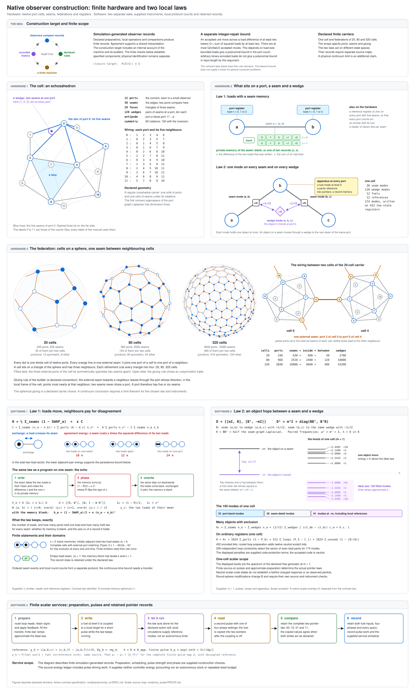

# Native observer construction

The base consists of twelve-port cells, their registers, a federation rule
and two alternative local laws. The [construction manual](CONSTRUCTION_MANUAL.md)
specifies the hardware and each law, distinguishing source spectroscopy and archive proposals from executed
local services. The [active model specification](../polynomial_sv/SPEC.md)
states which calculations and instruments the OPH replay implements.

[](executable_spec.svg)

The scalar law uses seam and wedge modes, local fuel and reference modes,
and an ordinary-register code. The contrast-memory law acts on bounded
loads and retained seam records. These laws have different state spaces;
their successful tests cannot be combined into a single physical claim.

The [scalar package](../np_scalar/README.md) reconstructs the carrier,
checks the star code and fixed-parity algebra, executes routed preparation,
and retains complete finite instrument outcomes. The independent contrast
replay is `python -m model.np_repair`. The contrast replay is an independent cross-check of the primary
[polynomial-sv](../polynomial_sv/README.md) implementation, with an explicit
port relabelling and energy-reference map.

The figures summarize the declared design and its supplied services.
They are not experimental receipts. In particular, a local protocol count
is distinct from an autonomous physical clock, and an integer input or
decoder is distinct from a dynamically derived physical property.

The [provenance register](PROVENANCE.json) gives source revisions and upstream-byte hashes and declared local adaptations.
The regenerated SVGs have scoped local captions; their upstream hashes identify
the imported ancestors, not the adapted figure bytes. The cell array in
`inputs/` and deduplicated federations in `../polynomial_sv/carriers/` make figure generation
independent of any sibling checkout:

```sh
python model/np_export/make_diagram.py
```

Use the dependencies in `model/requirements.txt`. The seven individual
`fig_*.svg` panels and [zoomable viewer](viewer.html) are local assets.
The input arrays describe one cell and federations of 20, 80 and 320 cells.
Their presence does not assert a physical refinement theorem.
