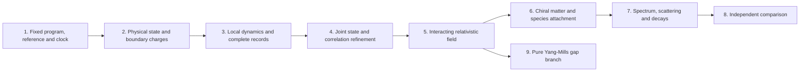

# One dependency graph for the field and particle spectrum

The [conditional chiral gauge-Higgs candidate](CANDIDATE.md) gives a concrete
target whose action spectrum can be calculated under explicit assumptions.
It reuses the [conditional representation and mass theorem](../conditional_standard_model/PROOF.md).
Its calibrated tree and running coefficients are inputs to a comparison,
not independent predictions of the selected finite source. The candidate
keeps its vacuum, interacting continuum, detector dictionary, radiative
matching and neutrino completion as declared premises.

The physical target is one source-derived interacting relativistic field
in three spatial dimensions and time, with a complete observable spectrum
and its production, scattering and decay laws. The graph below joins the
field-construction and native-particle requirements without repeating the
source, preparation or clock. [dependencies.json](dependencies.json) records
the acceptance conditions, exact evidence domains and the mapping from the
component requirement lists.

An arrow states an acceptance dependency. Conditional calculations of a
later node can proceed with its premises supplied; they do not certify
those premises. Every edge carries the same program, state, reference,
clock and observation domain, or an explicit comparison map. A pure-gauge
instance uses the same requirements 1-5. It does not inherit evidence for
the coupled matter source merely by sharing those node names.

## Finite construction and physical proof have different domains

| Node | Exact result or acceptance condition | Status on the selected primary family |
| --- | --- | --- |
| 1. Fixed program | The [common contract](../particle_common_contract/PROOF.md) fixes the open Wilson action, all sixty modes per cell, product link cutoff, Gauss boundary condition, polynomial preparation, conjugate reference and `exp(-itH)`. It authenticates the finite inputs and separates architecture from empirical calibration. | Finite specification constructed. No uniqueness theorem for the architecture is required. |
| 2. Physical preparation | The [physical Gauss preparation](../particle_gauss_ground_state/PROOF.md) and [boundary-state theorem](../particle_physical_boundary_state/PROOF.md) construct the actual selected state, deterministic preparation and complete boundary-charge measurement. Eleven Wilson-loop/blank witnesses have strictly positive weight; all charge outcomes are retained. | Finite construction established. Full spatial execution and compatibility between refinement levels are separate claims. |
| 3. Local records | The [primary locality consumer](../particle_primary_locality/PROOF.md) proves the complete boundary-detector comparison against an actual remote plaquette phase, with the full canonical reference retained. Product compression preserves local supports and norms; the conservative cone is uniform in the declared scaling. | Finite selected-source locality constructed. The bound preserves exact zero-time non-signalling and includes every charge outcome. It supplies neither convergence of physical records nor the complete particle-detector repertoire. |
| 4. Joint refinement | Construct compatible local states, multitime correlations and complete recorded experiments along one declared volume, spacing, link-cutoff and cooling trajectory. Fix renormalization maps and input ancestry; retain finite-energy observable weight. | The simultaneous primary limit is unproved. The fixed-volume link-cutoff theorem and fixed-regulator volume theorem cannot be composed without uniform estimates. |
| 5. Relativistic interacting field | Reconstruct the same positive-energy, nontrivial vacuum theory in three spatial dimensions and time; prove Lorentz covariance, locality and regularity. Establish a nonfree response in a fixed generating-field/current dictionary, rather than connected correlations produced by nonlinear composites of free fields. Attach translations and physical observables to its records; a Euclidean route identifies its reconstructed clock. | The matched gauge/matter quadratic cone is finite evidence. It does not prove Lorentz covariance or a continuum interaction. |
| 6. Chiral matter and species | Identify physical currents, spin, statistics, family content and anomaly conditions; control mirrors and extra modes; admit the Higgs and neutrino sectors on the same construction. A claimed defect must have a proved creation, protection and field attachment. | Conditional finite representation and action results are available. Their physical chiral continuum, vacuum and source attachment are unproved. |
| 7. Full observable spectrum | Determine stable branches, resonances and charged infrared thresholds with retained residues; calculate masses, mixing, production, inclusive scattering and decays in matching schemes. Include all claimed species, extra modes and required composites, with controlled asymptotic and detector errors. | Action-level coefficients and separate finite spectral controls are available. A full physical spectrum on the primary family is unproved. |
| 8. Independent comparison | Fix physical units and a frozen observable dictionary; compare joint records in the same schemes, initial conditions and resolution, with propagated errors. Preserve fitted-input ancestry and distinguish independent tests from calibration. | Calibrated candidate comparisons have their declared scope. Empirical particle assignments require the preceding physical attachments. |
| 9. Pure Yang-Mills branch | Admit a pure compact-simple source or prove a reducing/decoupling map, instantiate 1-5 for that source, establish Yang-Mills short-distance behavior, and prove dense local Euclidean decay with finite-energy noncollapse in its reconstructed clock. | The [spectral criterion](../particle_yang_mills_gap_contract/PROOF.md) is proved conditionally. Its pure-gauge source, continuum correlation estimates and positive physical gap are not supplied by the primary finite construction. |

The full theory containing a massless photon has no positive global vacuum
gap. Node 7 therefore uses the appropriate sector threshold, resonance or
infrared definition. Node 9 is a separate pure-gauge question and is not a
prerequisite for every particle comparison. A proof for one compact simple
group does not meet a claim quantified over every such group.

## What the conditional candidate assumes

The candidate's extension carrier and chiral measure enter node 6. Its
common vacuum/reference/clock and renormalized correlations enter nodes
4-5. Its nonzero connected interaction enters node 5; its current, spin
and detector dictionary enters nodes 3, 5 and 6. Radiative, resonance and
infrared matching enter nodes 7-8. The neutrino completion and its running
span nodes 6-8. Its pure-gauge source and gap assumptions belong only to
node 9. These are assumptions within one explicit conditional scenario,
not receipts proving them on the sixty-mode Wilson family.

The [mass-action theorem](../conditional_standard_model/PROOF.md) provides
three-family invariant Higgs tensors and their conditional mass formulas.
It neither adds those fields to the primary program by a name change nor
selects its couplings from observed masses. A declared extension is allowed;
transferring its results back to the primary source requires the actual
state, operation and clock comparison. The scalar/family extension, mirror
control and neutrino operator must be explicit before calling the target a
complete observed spectrum. The minimal massless neutrino action alone
does not reproduce oscillations.

## Reusing the continuum and gap results

The [centered bounded-contact continuum](../continuum_free_limit/README.md)
is a free massless eight-valley Weyl vacuum. The
[uncentered Weyl/contact net](../continuum_field_net/README.md) gives a
different positive-energy continuum hierarchy without a surviving
interaction or Lorentz theorem. The
[joint spin family](../spin_joint_field_limit/PROOF.md) has its own state
and scaled clock, with positive response at arbitrarily small energies.
Supplied massive one-body Dirac bands, fixed-spacing interacting grounds
and finite directional charged thresholds have their own domains. These
results constrain or support conditional steps; none supplies a missing
primary physical premise by combining their spectra.

The Yang-Mills continuum conditions share this graph. Renormalized local
convergence belongs to node 4; reflection positivity, covariance, locality,
regularity and the reconstructed time group belong to node 5. The
[local-correlation theorem](../particle_yang_mills_gap_contract/PROOF.md)
adds node 9's decay estimate on a dense family of centered local vectors.
The regulator limit is taken at fixed time before the long-time spectral
bound. Convergence at time zero and at times decreasing to zero, together
with a variance floor and bounded energy, supplies finite-energy
noncollapse. Equality of repair and physical spectra is unnecessary for
this criterion. A claim equating the repair gap to the physical gap needs
the additional intertwining premises of the
[Yang-Mills paper](../../extra/yang_mills_gap_clay_problem.tex).

The [selected-source positive-energy consumer](POSITIVE_ENERGY.md) reuses
the finite downward-record theorem on the actual cooling sequence. For
uniformly bounded physical source probes, negative-transfer weight below
`-delta` is at most `||A_n||² 2^(-n-4)/delta`. Fixed-time stationary
correlation convergence, including continuity at zero, therefore implies
nonnegative limiting spectral support. A common strongly continuous
limiting dynamics and dense cyclic probe family extend the statement to
its GNS energy generator. No spectral-gap assumption is needed. This is
a conditional consequence of node 4, without proving its convergence or
finite-energy noncollapse, node 5's Lorentz/interacting requirements, or
stationarity of the finite idle-reference purification.

Fixed triangular time filtering strengthens the response statement:
uniformly norm-bounded probes have uniformly bounded filtered spectral
first moments and hence a continuous compact-time response subsequence.
Cooling gives nonnegative limiting support. This does not ensure a
nonzero response, a common local field algebra or implementation of the
filtered apparatus. It is a partial construction within node 4.

No second observer-preparation checklist is introduced for that branch.
Its source must instantiate the same nodes 1-5 or be connected by a proved
map. A Lie-algebra factor of the coupled matter representation does not
define an invariant pure-gauge sector; fixing a link coordinate to the
identity is not a normalizable Haar state. The polynomial state's energy
excess is not a spectral-gap lower bound, and stationarity alone supplies
no vacuum Euclidean decay estimate.

Geometric gravity has a separate
[same-state Einstein consumer](../matched_einstein_limit/PROOF.md) for
proper stress, geometry, modular/area response and small-ball errors. It
is outside this field-and-spectrum target. Maintaining consistent papers,
ledgers and public claims is a delivery requirement, not an additional
physical dependency.
