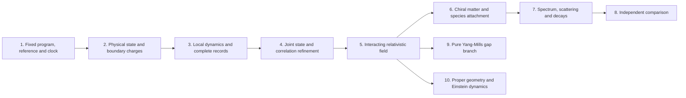

# One dependency graph for fields, particles and gravity

The [conditional chiral gauge-Higgs candidate](CANDIDATE.md) gives a concrete
target whose action spectrum can be calculated under explicit assumptions.
It reuses the [conditional representation and mass theorem](../conditional_standard_model/PROOF.md).
Its calibrated tree and running coefficients are inputs to a comparison,
not independent predictions of the selected finite source. The candidate
keeps its vacuum, interacting continuum, detector dictionary, radiative
matching and neutrino completion as declared premises.

The physical target is one source-derived interacting relativistic field
in three spatial dimensions and time, with a complete observable spectrum
and its production, scattering and decay laws, with same-source geometric
gravity. The graph below joins the
field-construction and native-particle requirements without repeating the
source, preparation or clock. [dependencies.json](dependencies.json) records
the acceptance conditions, exact evidence domains and the mapping from the
component requirement lists.

An arrow states an acceptance dependency. Conditional calculations of a
later node can proceed with its premises supplied; they do not certify
those premises. Every edge carries the same program, state, reference,
clock and observation domain, or an explicit comparison map. A pure-gauge
instance uses the same requirements 1-5. It does not inherit evidence for
the coupled matter source merely by sharing those node names.

## Finite construction and physical proof have different domains

| Node | Exact result or acceptance condition | Status on the selected primary family |
| --- | --- | --- |
| 1. Fixed program | The [common contract](../particle_common_contract/PROOF.md) fixes the open Wilson action, all sixty modes per cell, product link cutoff, Gauss boundary condition, polynomial preparation, conjugate reference and `exp(-itH)`. It authenticates the finite inputs and separates architecture from empirical calibration. | Finite specification constructed. No uniqueness theorem for the architecture is required. |
| 2. Physical preparation | The [physical Gauss preparation](../particle_gauss_ground_state/PROOF.md) and [boundary-state theorem](../particle_physical_boundary_state/PROOF.md) construct the actual selected state, deterministic preparation and complete boundary-charge measurement. Eleven Wilson-loop/blank witnesses have strictly positive weight; all charge outcomes are retained. | Finite construction established. Full spatial execution and compatibility between refinement levels are separate claims. |
| 3. Local records | The [complete filtered apparatus](../particle_filtered_probe/PROOF.md) supplies distinct LCU/Ramsey and square-root effect instruments with error bounds. The [primary locality consumer](../particle_primary_locality/PROOF.md) proves the complete boundary-detector comparison against an actual remote plaquette phase, with the full canonical reference retained. Product compression preserves local supports and norms; the conservative cone is uniform in the declared scaling. | Finite selected-source locality constructed. The bound preserves exact zero-time non-signalling and includes every charge outcome. Fixed finite effect histories converge on the common subsequence below; growing reference outputs and the full particle-detector repertoire are separate requirements. |
| 4. Joint refinement | Construct compatible local states, multitime correlations and complete recorded experiments along one declared volume, spacing, link-cutoff and cooling trajectory. Fix renormalization maps and input ancestry; retain finite-energy observable weight. | A [common bounded observable algebra](../particle_primary_field_algebra/PROOF.md), stationary subsequential state, positive-energy GNS and fixed finite pointer-history limits are constructed. Noncollapse, charge tightness, effective errors and a full field dictionary remain unproved; fixed-regulator results are not silently composed. |
| 5. Relativistic interacting field | Reconstruct the same positive-energy, nontrivial vacuum theory in three spatial dimensions and time; prove Lorentz covariance, locality and regularity. Establish a nonfree response in a fixed generating-field/current dictionary, rather than connected correlations produced by nonlinear composites of free fields. Attach translations and physical observables to its records; a Euclidean route identifies its reconstructed clock. | The [regular spatial algebra](../particle_primary_spatial_algebra/PROOF.md) has continuous translations commuting with time and controlled bulk transfer from the actual finite state. Spatial invariance of that state, canonical momentum, Lorentz covariance and a surviving interaction remain unproved. |
| 6. Chiral matter and species | Identify physical currents, spin, statistics, family content and anomaly conditions; control mirrors and extra modes; admit the Higgs and neutrino sectors on the same construction. A claimed defect must have a proved creation, protection and field attachment. | Conditional finite representation and action results are available. Their physical chiral continuum, vacuum and source attachment are unproved. |
| 7. Full observable spectrum | Determine stable branches, resonances and charged infrared thresholds with retained residues; calculate masses, mixing, production, inclusive scattering and decays in matching schemes. Include all claimed species, extra modes and required composites, with controlled asymptotic and detector errors. | The [source energy transport theorem](../particle_primary_mass_readout/PROOF.md) connects original transition weights to final ground-relative excitation and supplies conditional rest intervals. Actual momentum-resolved shells, species and a full physical spectrum remain unproved. |
| 8. Independent comparison | Fix physical units and a frozen observable dictionary; compare joint records in the same schemes, initial conditions and resolution, with propagated errors. Preserve fitted-input ancestry and distinguish independent tests from calibration. | Declared SI/GeV comparison conversion is available immediately. Candidate fits retain their calibration ancestry; actual particle masses need the preceding physical attachments. |
| 9. Pure Yang-Mills branch | Admit a pure compact-simple source or prove a reducing/decoupling map, instantiate 1-5 for that source, establish Yang-Mills short-distance behavior, and prove dense local Euclidean decay with finite-energy noncollapse in its reconstructed clock. | The [spectral criterion](../particle_yang_mills_gap_contract/PROOF.md) is proved conditionally. Its pure-gauge source, continuum correlation estimates and positive physical gap are not supplied by the primary finite construction. |
| 10. Geometric gravity | Attach the selected local energy currents and regional responses to physical stress, proper geometry, the geometric modular kernel and fixed-volume area law. Meet the matched small-ball error estimates on the same state and clock. | The [primary energy and regional response](../particle_primary_stress/PROOF.md) supplies finite prerequisites. Proper geometry and the hypotheses of the [Einstein reconstruction](../matched_einstein_limit/PROOF.md) require physical proofs. |

The full theory containing a massless photon has no positive global vacuum
gap. Node 7 therefore uses the appropriate sector threshold, resonance or
infrared definition. Node 9 is a separate pure-gauge question and is not a
prerequisite for every particle comparison. A proof for one compact simple
group does not meet a claim quantified over every such group.

## What the conditional candidate assumes

The candidate's extension carrier and chiral measure enter node 6. Its
common vacuum/reference/clock and renormalized correlations enter nodes
4-5. Its nonzero connected interaction enters node 5; its current, spin
and detector dictionary enters nodes 3, 5 and 6. Radiative, resonance and
infrared matching enter nodes 7-8. The neutrino completion and its running
span nodes 6-8. Its pure-gauge source and gap assumptions belong only to
node 9. These are assumptions within one explicit conditional scenario,
not receipts proving them on the sixty-mode Wilson family.

The [mass-action theorem](../conditional_standard_model/PROOF.md) provides
three-family invariant Higgs tensors and their conditional mass formulas.
It neither adds those fields to the primary program by a name change nor
selects its couplings from observed masses. A declared extension is allowed;
transferring its results back to the primary source requires the actual
state, operation and clock comparison. The scalar/family extension, mirror
control and neutrino operator must be explicit before calling the target a
complete observed spectrum. The minimal massless neutrino action alone
does not reproduce oscillations.

## Reusing the continuum and gap results

The [centered bounded-contact continuum](../continuum_free_limit/README.md)
is a free massless eight-valley Weyl vacuum. The
[uncentered Weyl/contact net](../continuum_field_net/README.md) gives a
different positive-energy continuum hierarchy without a surviving
interaction or Lorentz theorem. The
[joint spin family](../spin_joint_field_limit/PROOF.md) has its own state
and scaled clock, with positive response at arbitrarily small energies.
Supplied massive one-body Dirac bands, fixed-spacing interacting grounds
and finite directional charged thresholds have their own domains. These
results constrain or support conditional steps; none supplies a missing
primary physical premise by combining their spectra.

The Yang-Mills continuum conditions share this graph. Renormalized local
convergence belongs to node 4; reflection positivity, covariance, locality,
regularity and the reconstructed time group belong to node 5. The
[local-correlation theorem](../particle_yang_mills_gap_contract/PROOF.md)
adds node 9's decay estimate on a dense family of centered local vectors.
The regulator limit is taken at fixed time before the long-time spectral
bound. Convergence at time zero and at times decreasing to zero, together
with a variance floor and bounded energy, supplies finite-energy
noncollapse. Equality of repair and physical spectra is unnecessary for
this criterion. A claim equating the repair gap to the physical gap needs
the additional intertwining premises of the
[Yang-Mills paper](../../extra/yang_mills_gap_clay_problem.tex).

The [selected-source positive-energy consumer](POSITIVE_ENERGY.md) reuses
the finite downward-record theorem on the actual cooling sequence. For
uniformly bounded physical source probes, negative-transfer weight below
`-delta` is at most `||A_n||² 2^(-n-4)/delta`. Fixed-time stationary
correlation convergence, including continuity at zero, therefore implies
nonnegative limiting spectral support. A common strongly continuous
limiting dynamics and dense cyclic probe family extend the statement to
its GNS energy generator. No spectral-gap assumption is needed. This is
a conditional consequence of node 4, without proving its convergence or
finite-energy noncollapse, node 5's Lorentz/interacting requirements, or
stationarity of the finite idle-reference purification.

The [common filtered algebra](../particle_primary_field_algebra/PROOF.md)
uses one countable menu of actual centered charge projections and Wilson
plaquettes. The bounded sequence algebra modulo norm-null sequences has
one stationary subsequential state for all finite words. Its continuous
source-time group has a canonical nonnegative GNS energy generator. The
actual source locality estimate gives filtered spatial commutation, with
the temporal support of both filters retained. Complete fixed finite effect
histories and their finite pointer densities converge on that same
subsequence. This is stronger than separate two-point response limits.
It supplies neither a growing-reference limit nor a nontrivial physical
field, an effective subsequence, spatial translations or Lorentz symmetry.

The [filtered apparatus](../particle_filtered_probe/PROOF.md) specifies
complete finite records using the declared coherent source interface.
A successful LCU Kraus operator B has effect B*B; the square-root instrument
for an effect E is a separate construction. Neither discards failed flags.
The [positive-window bound](../particle_positive_window/PROOF.md) converts
an original-weight contrast F(0)-Re F(t), its error and the source-derived
moment bounds into a lower bound on weight in a fixed interval [delta,R].
A primary contrast that stays above the fixed-band allowances is the
shortest next test of a surviving excitation. The
[actual plaquette witness](../particle_primary_survival/PROOF.md) supplies
positive finite contrast and original band weight, including a specified
finite filter. Its times shrink, its band spreads towards zero and infinity,
and its lower weight vanishes. This is a genuine finite-source result,
without uniform noncollapse, a mass pole, species or surviving interaction.

No second observer-preparation checklist is introduced for that branch.
Its source must instantiate the same nodes 1-5 or be connected by a proved
map. A Lie-algebra factor of the coupled matter representation does not
define an invariant pure-gauge sector; fixing a link coordinate to the
identity is not a normalizable Haar state. The polynomial state's energy
excess is not a spectral-gap lower bound, and stationarity alone supplies
no vacuum Euclidean decay estimate.

Geometric gravity is node 10. Its
[same-state Einstein consumer](../matched_einstein_limit/PROOF.md) requires
proper stress, geometry, modular/area response and small-ball errors.
It shares the physical source and field reconstruction requirements,
without being a prerequisite for every particle comparison. Maintaining
consistent papers, ledgers and public claims is a delivery requirement,
not an additional physical dependency.

The [primary current construction](../particle_primary_stress/PROOF.md)
partitions the unchanged Wilson action into local cell energies and proves
exact antisymmetric current continuity, complete current readouts and a
regional marginal entropy first law. Energy sampling uses separately
prepared copies; sequential apparatus has its own disturbance and work.
The retained coin-plus-region entropy differs from the regional marginal
entropy. Neither is silently identified with geometric generalized entropy.
See the [reuse map](REUSE.md) for the finite theorems and comparison
constructions used at each step.

## Mass-first interpretation of the graph

The active target is an actual source-derived mass output, with permitted
declared SI conversion. Nodes9 and10 are separate deferred branches.
For the current primary family the unresolved shared physical questions
are a fixed-band excitation with uniform original weight, operational
momentum on the selected representation, and a same-branch
relativistic spectral relation. Spin/current/statistics and interaction
matching then determine whether that branch is a named particle.
Spatial invariance is sufficient for canonical vacuum-fixing GNS momentum;
a different implementation requires its own same-representation proof.

The finite-survival proof also rules out one shortcut on this preparation:
the empty and completely filled Fock sectors are exact pure-gauge reducing
sectors, but their combined selected weight is at most
`7/(627*2^(8n+7))`. A conditional spectrum obtained by normalizing those
sectors is not a surviving original-weight primary particle spectrum.

For every bounded physical probe the mass-readout theorem couples transfer
energy to final ground-relative energy with cost at most `C² epsilon_n`.
Its finite excitation band is therefore meaningful without numerically
computing the primary ground energy. A rest mass additionally requires
momentum/vacuum and spectral-shell attachment. Specifying SI units does
not supply that absent spectral information; deriving a cesium atom is
not a prerequisite for using a declared comparison unit.

The [capacity consumer](../particle_primary_capacity/PROOF.md) gives
`4 V ln2 <= ln rank(P_G) <= ln D_ambient`. At degree one the ambient
capacity is exactly `V*(60ln2+3ln119)`. Other link degrees retain explicit
bounds. The source has `H_n=Hhat_n/a_n`; a numerical mass-capacity law
requires the actual dimensionless spectrum and one tracked unit policy.
The near-ground preparation is a particle-spectroscopy setup, not a
calculation of early-universe temperatures or particle abundances.

The [complete spatial Fourier instrument](../particle_primary_momentum/PROOF.md)
uses the same physical source probes, source state and retained reference.
Its finite aperture carries a calculable edge term; its Fourier labels
are not automatically the spectral values of a conserved momentum.
The [channel calculation](../particle_primary_channel_labels/PROOF.md)
proves five conserved native occupation labels, subject to the physical
relation `sum_q q N_q=0`. It constructs a cubic A1 average with positive
finite original response. Neither a cubic scalar nor an internal charge
pattern identifies a relativistic particle.

The [spectral-scale calculation](../particle_primary_spectral_scale/PROOF.md)
splits the actual action into its decoupled onsite/electric part and
the actual hopping/magnetic perturbation. The physical decoupled gap is
exactly six in dimensionless units, with exact local second-order energy
and first-order state coefficients. Their global state norm grows with
volume; the elementary gap estimate does not reach the actual interacting
endpoint. Controlling that endpoint is a concrete spectral calculation.
If a uniform positive dimensionless gap were proved there, the selected
cooling law would suppress every bounded-probe fixed physical band below
the rescaled gap. That is a conditional obstruction, not a proved failure
of the primary action.

A finite-capacity mass comparison may instead use one admitted physical
branch with errors over a declared measurement range. It does not require
an exact infinite-volume continuum theorem. The claim of a nontrivial
continuum family requires the additional uniform spectral and refinement
estimates in nodes4-5. Both routes keep the original weights, source,
state, reference, clock and unit ancestry.

Actual endpoint control is supplied by the
[local electric Schur bound](../particle_primary_endpoint_bounds/PROOF.md)
and [eleven-packet Ritz enclosure](../particle_primary_variational_readout/PROOF.md).
The [occupation-sensitive bound](../particle_primary_occupation_bound/PROOF.md)
gives member zero the full physical ground enclosure
`[-727.498195,-723.7678199]` in source units. Its retained onsite penalty
also bounds the selected mean beta-defect count by5. The
[exact local moment calculation](../particle_primary_residual_refinement/PROOF.md)
bounds the unchanged trial's full-space residual by5.231016. These
statements preserve every occupation and do not isolate an eigenbranch.

The [actual local neutral response](../particle_primary_response_moments/PROOF.md)
combines that selected-state defect bound with a local frequency-six
commutator. Averaged original probe success is at least11/16. The
original transfer band `[2,10]` has weight at least1/2; selected cooling
gives final excitation `[2,21/2]` with weight at least3/8, before clock
errors. The probe is gauge neutral and even. These are energy-band
bounds on member zero, without a particle name, momentum origin or rest
mass. The next physical inputs are branch resolution, dispersion and
channel attachment. That common retained fraction fails the next member's admission; the
block-sensitive refinement estimate supplies a separate scalable response.

The [joint finite instrument](../particle_primary_joint_spectroscopy/PROOF.md)
has `2 M J²` complete energy/address records and explicit alias, Fejer-tail,
clock, preparation and reference allowances. Its source-bound ground
adapter recomputes both spectral bounds at the same member as the aperture;
it does not combine member-zero energies with member-two wavevectors.
The actual positive broad band and its precision plan are proved.
The measured response ridge, particle-momentum interpretation and a
controlled rest-energy branch are unproved. The two energy registers
are additional resources beyond the compact Ramsey apparatus.

The [complete cubic/parity pair apparatus](../particle_primary_pair_channels/PROOF.md)
resolves all ten isotypic channels and all 32 Walsh/component records on
member zero with positive original spectral-band weight. Its exact polynomial
population bound uses the selected preparation. The
[scalable collective response](../particle_primary_refinement_response/PROOF.md)
has original weight at least3/100 in `[1/(100 beta_n),1446/a_n]` on every
finite member, with selected defect density below97/10. The final-excitation
floor is1/50 after cooling and before clock errors. These bands move toward
zero and infinity; fixed physical energy survival, dispersion, particle
identity and a rest mass are unproved. Neither operator cubic parity nor
an aperture wavevector substitutes for those attachments.

The [polynomial modular-work theorem](../particle_primary_gravity_premises/PROOF.md)
bounds source-marginal relative entropy for physical source unitaries
between `beta(1-delta) W` and `beta W`. For Gauss-preserving tensor-local
unitaries, regional restriction bounds the supported marginal response
by the same source work. The member-zero beta
flip supplies work greater than18 source units. A direct periodic-coframe
substitution on the open primary changes its flat action by a physical
boundary operator of norm `45 L²/a`. The finite Einstein theorem retains
its proper metric, diamond kernel, area and common limiting-error premises.
Gravity is separate from the first finite mass comparison.
