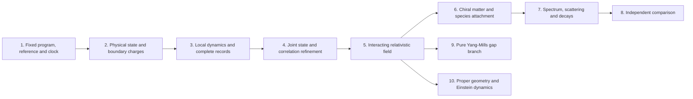

# One dependency graph for fields, particles and gravity

The [conditional chiral gauge-Higgs candidate](CANDIDATE.md) gives a concrete
target whose action spectrum can be calculated under explicit assumptions.
It reuses the [conditional representation and mass theorem](../conditional_standard_model/PROOF.md).
Its calibrated tree and running coefficients are inputs to a comparison,
not independent predictions of the selected finite source. The candidate
keeps its vacuum, interacting continuum, detector dictionary, radiative
matching and neutrino completion as declared premises.

The physical target is one source-derived interacting relativistic field
in three spatial dimensions and time, with a complete observable spectrum
and its production, scattering and decay laws, with same-source geometric
gravity. The graph below joins the
field-construction and native-particle requirements without repeating the
source, preparation or clock. [dependencies.json](dependencies.json) records
the acceptance conditions, exact evidence domains and the mapping from the
component requirement lists.

An arrow states an acceptance dependency. Conditional calculations of a
later node can proceed with its premises supplied; they do not certify
those premises. Every edge carries the same program, state, reference,
clock and observation domain, or an explicit comparison map. A pure-gauge
instance uses the same requirements 1-5. It does not inherit evidence for
the coupled matter source merely by sharing those node names.

## Finite construction and physical proof have different domains

| Node | Exact result or acceptance condition | Status on the selected primary family |
| --- | --- | --- |
| 1. Fixed program | The [common contract](../particle_common_contract/PROOF.md) fixes the open Wilson action, all sixty modes per cell, product link cutoff, Gauss boundary condition, polynomial preparation, conjugate reference and `exp(-itH)`. It authenticates the finite inputs and separates architecture from empirical calibration. | Finite specification constructed. No uniqueness theorem for the architecture is required. |
| 2. Physical preparation | The [physical Gauss preparation](../particle_gauss_ground_state/PROOF.md) and [boundary-state theorem](../particle_physical_boundary_state/PROOF.md) construct the actual selected state, deterministic preparation and complete boundary-charge measurement. Eleven Wilson-loop/blank witnesses have strictly positive weight; all charge outcomes are retained. | Finite construction established. Full spatial execution and compatibility between refinement levels are separate claims. |
| 3. Local records | The [complete filtered apparatus](../particle_filtered_probe/PROOF.md) supplies distinct LCU/Ramsey and square-root effect instruments with error bounds. The [primary locality consumer](../particle_primary_locality/PROOF.md) proves the complete boundary-detector comparison against an actual remote plaquette phase, with the full canonical reference retained. Product compression preserves local supports and norms; the conservative cone is uniform in the declared scaling. | Finite selected-source locality constructed. The bound preserves exact zero-time non-signalling and includes every charge outcome. Fixed finite effect histories converge on the common subsequence below; growing reference outputs and the full particle-detector repertoire are separate requirements. |
| 4. Joint refinement | Construct compatible local states, multitime correlations and complete recorded experiments along one declared volume, spacing, link-cutoff and cooling trajectory. Fix renormalization maps and input ancestry; retain finite-energy observable weight. | A [common bounded observable algebra](../particle_primary_field_algebra/PROOF.md) and [mixed phase/filtered history construction](../particle_primary_current_tail/PROOF.md) supply one stationary subsequential state, continuous positive-energy GNS time and fixed finite pointer-history limits. The [critical-profile calculation](../particle_primary_critical_refinement/PROOF.md) gives a positive Dirichlet work form with explicit lattice, phase and clock errors; it does not prove nonelastic probability survival. Charge tightness, effective correlation errors and a full field dictionary require proof. |
| 5. Relativistic interacting field | Reconstruct the same positive-energy, nontrivial vacuum theory in three spatial dimensions and time; prove Lorentz covariance, locality and regularity. Establish a nonfree response in a fixed generating-field/current dictionary, rather than connected correlations produced by nonlinear composites of free fields. Attach translations and physical observables to its records; a Euclidean route identifies its reconstructed clock. | The [regular spatial algebra](../particle_primary_spatial_algebra/PROOF.md) has continuous translations commuting with time and controlled bulk transfer from the actual finite state. The [retained-origin domain](../particle_primary_origin_momentum/PROOF.md) supplies a translation-invariant relative state with strongly commuting canonical H>=0 and P. The [complete Fourier transfer](../particle_primary_momentum_transfer/PROOF.md) attaches regular-probe records to canonical joint spectral kernels. The [original branch analyzer](../particle_primary_original_branch/PROOF.md) has populated finite spatial/energy rows in both G1 and H on member zero. The [even density calculation](../particle_primary_original_shell_moments/PROOF.md) computes exact spatial first-moment contrast; it is distinct from the odd kernels. A surviving canonical joint response, Lorentz covariance and interaction require proof; fixed-origin invariance is not asserted. |
| 6. Chiral matter and species | Identify physical currents, spin, statistics, family content and anomaly conditions; control mirrors and extra modes; admit the Higgs and neutrino sectors on the same construction. A claimed defect must have a proved creation, protection and field attachment. | The [complete local composite kernels](../particle_primary_composite_spin/PROOF.md) have exact finite-cube spin labels, native-current commutators, graded exchange and source conjugation. Both odd `G1 + H` components propagate at the first nonzero cubic moment. The [selected spinor instrument](../particle_primary_selected_spin_response/PROOF.md) gives original G1/H energy records with exact native-number increments; the [original branch apparatus](../particle_primary_original_branch/PROOF.md) populates both multiplets at every Walsh row and adds conserved total-cube and native-number records. Explicit original total-cube branches have capacity-deteriorating positive weights; their labels contain distinct source energies. Lorentz spin, asymptotic particle statistics, physical chirality and Standard Model species attachment require proof. |
| 7. Full observable spectrum | Determine stable branches, resonances and charged infrared thresholds with retained residues; calculate masses, mixing, production, inclusive scattering and decays in matching schemes. Include all claimed species, extra modes and required composites, with controlled asymptotic and detector errors. | Full positive member-zero sector thresholds, complete prepared windows and [exact composite transport](../particle_primary_composite_transport/PROOF.md) are proved. The [complete odd filter](../particle_primary_odd_low_energy/PROOF.md) reports original weight above `3/5` in `[11/4,61/4]`. The [full odd resolvent](../particle_primary_odd_resolvent/PROOF.md) and prepared band above `1/26` use a distinct declared weak-trion preparation. Source faithfulness also transfers its implemented final-energy event to a positive original floor. Neither removes the selected odd probe's inverse-spacing tail. The [cube reduction](../particle_primary_coherent_odd_response/KERNEL_PROOF.md) leaves four original component-summed spectral measures per multiplet to calculate. Their energy-shape contrast and a resolved branch, operational momentum and controlled dispersion are required before a physical mass is assigned. |
| 8. Independent comparison | Fix physical units and a frozen observable dictionary; compare joint records in the same schemes, initial conditions and resolution, with propagated errors. Preserve fitted-input ancestry and distinguish independent tests from calibration. | Declared SI/GeV comparison conversion is available immediately. Candidate fits retain their calibration ancestry; actual particle masses need the preceding physical attachments. |
| 9. Pure Yang-Mills branch | Admit a pure compact-simple source or prove a reducing/decoupling map, instantiate 1-5 for that source, establish Yang-Mills short-distance behavior, and prove dense local Euclidean decay with finite-energy noncollapse in its reconstructed clock. | The [spectral criterion](../particle_yang_mills_gap_contract/PROOF.md) is proved conditionally. Its pure-gauge source, continuum correlation estimates and positive physical gap are not supplied by the primary finite construction. |
| 10. Geometric gravity | Attach the selected local energy currents and regional responses to physical stress, proper geometry, the geometric modular kernel and fixed-volume area law. Meet the matched small-ball error estimates on the same state and clock. | The [cube-covariant energy convention](../particle_primary_covariant_stress/PROOF.md) preserves H, gives an explicit boundary improvement and instantiates finite energy-Ward sums with complete covariant instruments. The [induced regional cut](../particle_primary_geometric_cut/PROOF.md) supplies supported marginals; its [actual information identity](../particle_primary_boundary_information/PROOF.md) distinguishes regional-algebra information, representation entropy and global center coherence, with strictly positive work for the center record. Proper geometry, Lorentz stress, modular/area matching and the errors required by the [Einstein reconstruction](../matched_einstein_limit/PROOF.md) need physical proofs. |

The [source boundary-information identity](../particle_primary_boundary_information/PROOF.md)
keeps the induced cut, its central sectors and their global coherences.
For source marginals it proves
`I_ambient=I_alg+2 S_edge+C_center`, where
`C_center=D(rho||pinch(rho))`. The actual magnetic action forces
`C_center>=10(c beta_low/(210a))^2>0`; the complete center record costs
source work at least `20 c beta_low/(210a)^2>0`. The exact polynomial
slope also gives
`beta_low W<=C_center+D(pinch(rho)||rho)<=beta W`.
The regional-algebra information has the finite floor
`I_alg>=10 N c log(2)`, with the actual `c=2^(-N)`.
These floors deteriorate with capacity. The reference-inclusive pure-state
quantity is different, and none of these entropies is identified with
proper area, a geometric modular kernel or an Einstein coefficient.

The full theory containing a massless photon has no positive global vacuum
gap. Node 7 therefore uses the appropriate sector threshold, resonance or
infrared definition. Node 9 is a separate pure-gauge question and is not a
prerequisite for every particle comparison. A proof for one compact simple
group does not meet a claim quantified over every such group.

## What the conditional candidate assumes

The candidate's extension carrier and chiral measure enter node 6. Its
common vacuum/reference/clock and renormalized correlations enter nodes
4-5. Its nonzero connected interaction enters node 5; its current, spin
and detector dictionary enters nodes 3, 5 and 6. Radiative, resonance and
infrared matching enter nodes 7-8. The neutrino completion and its running
span nodes 6-8. Its pure-gauge source and gap assumptions belong only to
node 9. These are assumptions within one explicit conditional scenario,
not receipts proving them on the sixty-mode Wilson family.

The [mass-action theorem](../conditional_standard_model/PROOF.md) provides
three-family invariant Higgs tensors and their conditional mass formulas.
It neither adds those fields to the primary program by a name change nor
selects its couplings from observed masses. A declared extension is allowed;
transferring its results back to the primary source requires the actual
state, operation and clock comparison. The scalar/family extension, mirror
control and neutrino operator must be explicit before calling the target a
complete observed spectrum. The minimal massless neutrino action alone
does not reproduce oscillations.

## Reusing the continuum and gap results

The [centered bounded-contact continuum](../continuum_free_limit/README.md)
is a free massless eight-valley Weyl vacuum. The
[uncentered Weyl/contact net](../continuum_field_net/README.md) gives a
different positive-energy continuum hierarchy without a surviving
interaction or Lorentz theorem. The
[joint spin family](../spin_joint_field_limit/PROOF.md) has its own state
and scaled clock, with positive response at arbitrarily small energies.
Supplied massive one-body Dirac bands, fixed-spacing interacting grounds
and finite directional charged thresholds have their own domains. These
results constrain or support conditional steps; none supplies a missing
primary physical premise by combining their spectra.

The Yang-Mills continuum conditions share this graph. Renormalized local
convergence belongs to node 4; reflection positivity, covariance, locality,
regularity and the reconstructed time group belong to node 5. The
[local-correlation theorem](../particle_yang_mills_gap_contract/PROOF.md)
adds node 9's decay estimate on a dense family of centered local vectors.
The regulator limit is taken at fixed time before the long-time spectral
bound. Convergence at time zero and at times decreasing to zero, together
with a variance floor and bounded energy, supplies finite-energy
noncollapse. Equality of repair and physical spectra is unnecessary for
this criterion. A claim equating the repair gap to the physical gap needs
the additional intertwining premises of the
[Yang-Mills paper](../../extra/yang_mills_gap_clay_problem.tex).

The [selected-source positive-energy consumer](POSITIVE_ENERGY.md) reuses
the finite downward-record theorem on the actual cooling sequence. For
uniformly bounded physical source probes, negative-transfer weight below
`-delta` is at most `||A_n||² 2^(-n-4)/delta`. Fixed-time stationary
correlation convergence, including continuity at zero, therefore implies
nonnegative limiting spectral support. A common strongly continuous
limiting dynamics and dense cyclic probe family extend the statement to
its GNS energy generator. No spectral-gap assumption is needed. This is
a conditional consequence of node 4, without proving its convergence or
finite-energy noncollapse, node 5's Lorentz/interacting requirements, or
stationarity of the finite idle-reference purification.

The [common filtered algebra](../particle_primary_field_algebra/PROOF.md)
uses one countable menu of actual centered charge projections and Wilson
plaquettes. The bounded sequence algebra modulo norm-null sequences has
one stationary subsequential state for all finite words. Its continuous
source-time group has a canonical nonnegative GNS energy generator. The
actual source locality estimate gives filtered spatial commutation, with
the temporal support of both filters retained. Complete fixed finite effect
histories and their finite pointer densities converge on that same
subsequence. This is stronger than separate two-point response limits.
The [mixed-history extension](../particle_primary_current_tail/PROOF.md)
adjoins the actual local phase operations. Their uniform energy-form bound,
together with the fixed-filter commutator estimate, controls every fixed
mixed word and its real-time continuity. One subsequence therefore carries
both probe families and complete finite histories with nonnegative GNS
energy. This supplies no growing-reference trace-norm limit, nonelastic
field, effective subsequence rate or Lorentz symmetry. Spatial momentum
for these unfiltered phase fields requires its own attachment.

The [filtered apparatus](../particle_filtered_probe/PROOF.md) specifies
complete finite records using the declared coherent source interface.
A successful LCU Kraus operator B has effect B*B; the square-root instrument
for an effect E is a separate construction. Neither discards failed flags.
The [positive-window bound](../particle_positive_window/PROOF.md) converts
an original-weight contrast F(0)-Re F(t), its error and the source-derived
moment bounds into a lower bound on weight in a fixed interval [delta,R].
A primary contrast that stays above the fixed-band allowances is the
shortest next test of a surviving excitation. The
[actual plaquette witness](../particle_primary_survival/PROOF.md) supplies
positive finite contrast and original band weight, including a specified
finite filter. Its times shrink, its band spreads towards zero and infinity,
and its lower weight vanishes. This is a genuine finite-source result,
without uniform noncollapse, a mass pole, species or surviving interaction.

No second observer-preparation checklist is introduced for that branch.
Its source must instantiate the same nodes 1-5 or be connected by a proved
map. A Lie-algebra factor of the coupled matter representation does not
define an invariant pure-gauge sector; fixing a link coordinate to the
identity is not a normalizable Haar state. The polynomial state's energy
excess is not a spectral-gap lower bound, and stationarity alone supplies
no vacuum Euclidean decay estimate.

Geometric gravity is node 10. Its
[same-state Einstein consumer](../matched_einstein_limit/PROOF.md) requires
proper stress, geometry, modular/area response and small-ball errors.
It shares the physical source and field reconstruction requirements,
without being a prerequisite for every particle comparison. Maintaining
consistent papers, ledgers and public claims is a delivery requirement,
not an additional physical dependency.

The [primary current construction](../particle_primary_stress/PROOF.md)
partitions the unchanged Wilson action into local cell energies and proves
exact antisymmetric current continuity, complete current readouts and a
regional marginal entropy first law. Energy sampling uses separately
prepared copies; sequential apparatus has its own disturbance and work.
The retained coin-plus-region entropy differs from the regional marginal
entropy. Neither is silently identified with geometric generalized entropy.
See the [reuse map](REUSE.md) for the finite theorems and comparison
constructions used at each step.

## Mass-first interpretation of the graph

The active target is an actual source-derived mass output, with permitted
declared SI conversion. Nodes9 and10 are separate deferred branches.
For the current primary family the unresolved shared physical questions
are a populated resolved finite branch with operational momentum and a
controlled same-branch relativistic spectral relation. A continuum claim
also needs a fixed physical band with uniform original weight.
Spin/current/statistics and interaction
matching then determine whether that branch is a named particle.
The retained-origin construction supplies canonical vacuum-fixing GNS momentum
on its explicit relative-observation algebra. The fixed-origin source state
is unchanged and is not proved spatially invariant. The complete regular-probe Fourier construction supplies its detector-kernel
transfer. A populated same-probe momentum branch, effective state-limit
errors where needed, and controlled dispersion require further proof.

The finite-survival proof also rules out one shortcut on this preparation:
the empty and completely filled Fock sectors are exact pure-gauge reducing
sectors, but their combined selected weight is at most
`7/(627*2^(8n+7))`. A conditional spectrum obtained by normalizing those
sectors is not a surviving original-weight primary particle spectrum.

For every bounded physical probe the mass-readout theorem couples transfer
energy to final ground-relative energy with cost at most `C² epsilon_n`.
Its finite excitation band is therefore meaningful without numerically
computing the primary ground energy. A rest mass additionally requires
momentum/vacuum and spectral-shell attachment. Specifying SI units does
not supply that absent spectral information; deriving a cesium atom is
not a prerequisite for using a declared comparison unit.

The [capacity consumer](../particle_primary_capacity/PROOF.md) gives
`4 V ln2 <= ln rank(P_G) <= ln D_ambient`. At degree one the ambient
capacity is exactly `V*(60ln2+3ln119)`. Other link degrees retain explicit
bounds. The source has `H_n=Hhat_n/a_n`; a numerical mass-capacity law
requires the actual dimensionless spectrum and one tracked unit policy.
The near-ground preparation is a particle-spectroscopy setup, not a
calculation of early-universe temperatures or particle abundances.

The [complete spatial Fourier instrument](../particle_primary_momentum/PROOF.md)
uses the same physical source probes, source state and retained reference.
Its finite aperture carries a calculable edge term; its Fourier labels
are not automatically the spectral values of a conserved momentum.
The [channel calculation](../particle_primary_channel_labels/PROOF.md)
proves five conserved native occupation labels, subject to the physical
relation `sum_q q N_q=0`. It constructs a cubic A1 average with positive
finite original response. Neither a cubic scalar nor an internal charge
pattern identifies a relativistic particle.

The [spectral-scale calculation](../particle_primary_spectral_scale/PROOF.md)
splits the actual action into its decoupled onsite/electric part and
the actual hopping/magnetic perturbation. The physical decoupled gap is
exactly six in dimensionless units, with exact local second-order energy
and first-order state coefficients. Their global state norm grows with
volume; the elementary gap estimate does not reach the actual interacting
endpoint. Controlling that endpoint is a concrete spectral calculation.
If a uniform positive dimensionless gap were proved there, the selected
cooling law would suppress every bounded-probe fixed physical band below
the rescaled gap. That is a conditional obstruction, not a proved failure
of the primary action.

A finite-capacity mass comparison may instead use one admitted physical
branch with errors over a declared measurement range. It does not require
an exact infinite-volume continuum theorem. The claim of a nontrivial
continuum family requires the additional uniform spectral and refinement
estimates in nodes4-5. Both routes keep the original weights, source,
state, reference, clock and unit ancestry.

Actual endpoint control is supplied by the
[local electric Schur bound](../particle_primary_endpoint_bounds/PROOF.md)
and [eleven-packet Ritz enclosure](../particle_primary_variational_readout/PROOF.md).
The [occupation-sensitive bound](../particle_primary_occupation_bound/PROOF.md)
gives member zero the full physical ground enclosure
`[-727.498195,-723.7678199]` in source units. Its retained onsite penalty
also bounds the selected mean beta-defect count by5. The
[exact local moment calculation](../particle_primary_residual_refinement/PROOF.md)
bounds the unchanged trial's full-space residual by5.231016. These
statements preserve every occupation and do not isolate an eigenbranch.

The [actual local neutral response](../particle_primary_response_moments/PROOF.md)
combines that selected-state defect bound with a local frequency-six
commutator. Averaged original probe success is at least11/16. The
original transfer band `[2,10]` has weight at least1/2; selected cooling
gives final excitation `[2,21/2]` with weight at least3/8, before clock
errors. The probe is gauge neutral and even. These are energy-band
bounds on member zero, without a particle name, momentum origin or rest
mass. The next physical inputs are branch resolution, dispersion and
channel attachment. That common retained fraction fails the next member's admission; the
block-sensitive refinement estimate supplies a separate scalable response.

The [joint finite instrument](../particle_primary_joint_spectroscopy/PROOF.md)
has `2 M J²` complete energy/address records and explicit alias, Fejer-tail,
clock, preparation and reference allowances. Its source-bound ground
adapter recomputes both spectral bounds at the same member as the aperture;
it does not combine member-zero energies with member-two wavevectors.
The actual positive broad band and its precision plan are proved.
The measured response ridge, particle-momentum interpretation and a
controlled rest-energy branch are unproved. The two energy registers
are additional resources beyond the compact Ramsey apparatus.

The [complete cubic/parity pair apparatus](../particle_primary_pair_channels/PROOF.md)
resolves all ten isotypic channels and all 32 Walsh/component records on
member zero with positive original spectral-band weight. Its exact polynomial
population bound uses the selected preparation. The
[scalable collective response](../particle_primary_refinement_response/PROOF.md)
with the [exact collective CAR moment](../particle_primary_energy_tightness/PROOF.md)
has original weight at least3/100 in `[1/(100 beta_n),46/a_n]` on every
finite member, with selected defect density below97/10. The final-excitation
floor is1/50 after cooling and before clock errors. These bands move toward
zero and infinity; fixed physical energy survival, dispersion, particle
identity and a rest mass are unproved. Neither operator cubic parity nor
an aperture wavevector substitutes for those attachments.

The [polynomial modular-work theorem](../particle_primary_gravity_premises/PROOF.md)
bounds source-marginal relative entropy for physical source unitaries
between `beta(1-delta) W` and `beta W`. For Gauss-preserving tensor-local
unitaries, regional restriction bounds the supported marginal response
by the same source work. The member-zero beta
flip supplies work greater than18 source units. A direct periodic-coframe
substitution on the open primary changes its flat action by a physical
boundary operator of norm `45 L²/a`. The
[boundary-completed coupling](../particle_primary_open_coframe/PROOF.md)
fixes that mismatch, with exact flat action and six complete spatial-strain
mean instruments. This is a declared coupling, not recovered proper geometry.
The finite Einstein theorem retains
its proper metric, diamond kernel, area and common limiting-error premises.
Gravity is separate from the first finite mass comparison.

The [physical occupation-sector calculation](../particle_primary_sector_threshold/PROOF.md)
uses `D_r>=|Delta N_r|` in a fixed reducing sector, alongside exact
full-occupation electric bounds. In native charge order `(-4,-3,1,2,6)`,
the pairs `±(0,2,0,0,1)` and `±(1,0,0,2,0)` are CAR odd, with
sector-bottom excitation intervals `[1.54674,12.71314]` and
`[0.56642,12.72435]`. The even pair `±(0,0,0,3,-1)` has
`[3.56682,15.71559]`. These member-zero bounds cover entire physical
sectors; they are not a global gap or measured rest masses. Two physical
memories allow complete preparation with the original state/reference
retained and the opposite increment kept as compensation. A parity-corrected
graded exchange is required for the odd targets. Their complete energy
windows retain probability at least 255/512, with explicit memory and work.

The [full local spin calculation](../particle_primary_composite_spin/PROOF.md)
resolves both beta-spin rows: each odd kernel has six states and exact
binary-cube labels `G1 + H`, while the even kernel has eight states
`T1 + E + T2`. Native-current commutators and graded exchange at distinct
sites are explicit. Uniform orbital preparation makes these full-source
cube components with the same sector floors and complete energy bounds.
Their labels are not Lorentz little-group representations or particle names.

The [composite transport calculation](../particle_primary_composite_transport/PROOF.md)
uses the actual primary interaction coefficient one. Neighbor matrix
elements of H and H² vanish; the full six-by-six H³ transfer is exactly
`-3 I6/4`. Admission of both endpoint first actions proves this identity
through the actual link cutoff. A full-source Taylor remainder yields
positive prepared short-time transition probabilities. Coherent Walsh
preparations have different third energy moments and hence different
complete energy laws. Neither an invariant eight-state Hamiltonian nor a
conserved momentum is inferred. Exact native-denominator weak-interaction
coefficients have no certified continuation to coefficient one.

The [spin-resolved original-state apparatus](../particle_primary_selected_spin_response/PROOF.md)
uses all six weak-pair/singlet creation polynomials on the unchanged
selected density. Its complete seven-outcome instrument at each address
retains the compensating memory, failure and reference. At member zero,
reported original weights exceed `121/512` for G1 and `61/128` for H in
`[11/4,61/4]`. Five coherent native-number meters record the same
`Delta=(0,2,0,0,1)` without measuring the unknown initial numbers.
These are probe representations, not total-spin labels of the mixed
output. Cube symmetry fixes equal component weights after the address
average.

The [original-state branch apparatus](../particle_primary_original_branch/PROOF.md)
uses the exact selected polynomial slope to bracket creation and adjoint
reverse probabilities by `exp(-beta omega)` and
`exp(-beta_low omega)`, with `beta=22272` and `beta_low>22271` at
member zero. No Gibbs state is substituted. In `[1/4,71/4]`, each
chosen flat spatial phase has reported creation weight above `1/3`,
including G1 above `5/48` and H above `11/48`. The complete Walsh
probe retains 96 successes and eight failures before clocks and meters;
every spatial row has original weight above `1/24`, with G1 above
`5/384` and H above `11/384`. Adjoint annihilation and source-conjugate
hole creation are distinct experiments.

Complete native-number and total-cube projectors refine these energy
records without changing their classical energy marginal. They retain
all initial and final labels, with number increment `(0,2,0,0,1)`.
The uniform row permits 28 G1g and 44 Hg total-cube transitions. Specific
original branches from `(n0,A1g)` to `(n0+Delta,G1g)` and
`(n0+Delta,Hg)` have reported final-energy weights above `85c/4096`
and `85c/2048`, respectively, where `c=2^(-582407133)` at member zero.
These are source-marginal positive-effect bounds using an anchor witness,
without replacing the preparation or its reference. They do not assert
an initial-to-final energy-transfer interval. The same conserved labels
contain orthogonal source vectors with means `-711` and `-699`, proving
spectral diameter at least 12. Labels alone therefore do not select a
mass. Actual inversion parity is retained; it is not Lorentz spin. For every
normalized coherent component, the actual anchor residual gives original
normalized transfer variance at least `9c/4`; each full measure therefore
contains at least two frequencies. This tiny finite bound gives no line
positions or clock-resolved separation and permits an isolated pole with
additional spectral weight.

The [complete odd filter](../particle_primary_odd_low_energy/PROOF.md)
uses the original four Slater probes with a triangular duration `a/6`
and analyzer frequency `9/a`. A finite coherent selector and the same
source clocks retain original reported blank weight above `3/5` in
`[11/4,61/4]` at member zero and at least `1/80` in
`[1/(4a),71/(4a)]` throughout the family. The analyzer frequency does
not shift the source energy zero. Summing all retained selector outputs
recovers the raw probe's energy law exactly. A useful successful filtered
field is permitted, but its own low-energy weight requires a lower bound.
The proved spin-resolved and source-centered bands scale as `1/a`.

The [full odd-sector resolvent](../particle_primary_odd_resolvent/PROOF.md)
is bounded at the actual interaction coefficient one on member zero.
For the prepared local weak trion, the complete complement within its
reducing occupation sector gives two-sided self-energy and resolvent
enclosures below the rigorous sector floor `L=-722.22108`. Exact moments also give prepared spectral weight
above `1/26` in `[L,-714]`, and one complete source clock retains above
`1/27` in `[L-1/64,-714+1/64]`. These are absolute source energies with
the unchanged zero. The preparation moves the original state/reference
into retained memory. The actual source-marginal faithfulness floor
`rho>=c P_G` also transfers its implemented positive final-clock event:
the original fixed local odd probe has weight above `c/27`, or above
`c/864` for one retained row in the member-zero `4V` probe menu.
This event measures final energy without initial energy recording. It
neither transfers the prepared probability wholesale nor identifies an
original transfer-energy law. The authenticated member-zero floor is
`c=2^(-582407133)`. Its positivity supplies neither a practical event rate
nor a uniform continuum residue. Neither this interval
nor the resolvent bounds isolate a particle branch. The same parent fourth
moment improves the specified one-spin-row weak-composite transport guarantee to
`Pr(transfer)>=t^6/256` for `0<|t|<=2.77366e-6`.

The [selected odd residual](../particle_primary_selected_odd_response/PROOF.md)
places more than `1/50` original weight at energies of order `1/a` and
forces the positive-frequency first moment and unnormalized output
excitation mean above `1/(100a)`. A coexisting low-energy component is
permitted. The complete filter calculation bounds the raw odd fixed-band
limsup by `1/9`; its ideal zero-centered duration-one blank has weight
below `1/4` at every member. Neither upper bound proves a surviving residue. Static
number-phase conjugation only changes each retained local odd row by a
scalar phase. Even time-separated critical density-Weyl dressings of
depth `o(a^-1/2)` cannot make the complete odd output energy tight.

The [original density-shell calculation](../particle_primary_original_shell_moments/PROOF.md)
computes an exact off-diagonal energy moment on this selected state in the
separate even sector `n_x=N_x-30`. At member zero,
`M^(1)=(tau/2)(3I-Adj_cube)`, with
`tau=-Tr(rho H_hop)/12>0.2373`. The complete sixteen-record density
analyzer has Walsh first moments `s tau/7200`, for `s=0,1,2,3` with
multiplicities `1,3,3,1`. Actual finite clocks retain strictly ordered
nonzero original means. The constant row is elastic and has positive
weight; the other rows have positive-frequency weight, so their normalized
energy shapes differ from the constant row. This evaluates even density
moments, not the four odd G1/H measures. The latter's normalized spectral
shapes and a common resolved branch require their own calculation.

The same calculation resolves each native internal density: its bond
coefficient obeys `tau_r>=2 d_r c beta_low>0`, with the actual faithful
source floor `c`; this proves native inelastic density response, not
creation of a named fermion. All total-density successes have combined
original probability below `0.0208`. Conditioning on those retained
successes is explicit and gives signed transfer mean above `0.019`, or
above `0.015` with the finite clocks. These conditional means are not
spectral lines or rest masses.

The [exact cube-kernel reduction](../particle_primary_coherent_odd_response/KERNEL_PROOF.md)
reduces each component-summed G1/H response to four real spectral measures,
indexed by cell-pair Hamming distance. Off-diagonal measures may be signed.
Their four Walsh combinations have multiplicities `1,3,3,1`; this is a
spectral Gram decomposition, without an H-eigenstate or momentum assignment.
The next calculation is those measures on the original selected density.
Their actual values, normalized energy-shape differences and a common
branch or threshold are not fixed by symmetry or by prepared-vector
transport. Intensity contrast alone is insufficient for dispersion.
Operational momentum and controlled dispersion are the physical mass
connections. A continuum claim also requires fixed-energy original weight bounded away from zero under
refinement; the finite faithfulness floor and filtered upper bounds do
not supply that estimate.

The [critical-profile work calculation](../particle_primary_critical_refinement/PROOF.md)
keeps the actual source and proves a three-dimensional gradient limit for
complete signed local phase experiments. Its selected hopping coefficient
has the sharper bound `h_n>=h_*+3a^2/7-3a^4/28-a^8/128`, where
`h_*=-g-3/7>0.0424` and `g` is the authenticated tiled-trial energy gain.
For fixed rectangular physical tents of half-widths `b_i` and rational
amplitude `s`, `W_n/h_n` tends to
`(pi^2 s^2/6) integral |grad f_b|^2`, with explicit rational
`O(a^2)` lattice and `O(a^4)` phase errors. The complete source clocks
record these means with `O(a^2)` error. Work ratios cancel `h_n`
exactly. Starting from the unit-width, amplitude-one cube, doubling
amplitude, all widths, or one width gives limiting ratios 4, 2, or 3/2.
These are actual spatial work comparisons.
Energy-weighted ultraviolet escape can coexist with a purely elastic
probability limit, so this Dirichlet work form does not prove an action,
fixed-energy particle residue or relativistic dispersion. A fixed-anchor
relative-perturbation decomposition has bounded remainder norm at least
`sqrt(15)` per Wilson bond; no endpoint gap-stability threshold is supplied.

The [covariant stress input](../particle_primary_covariant_stress/PROOF.md)
redistributes complete source terms by an exact boundary divergence,
retaining H and its clock. Local currents, complete instruments and
scalar-control work are cube covariant. Charge conjugation preserves
them and makes the first regional entropy response vanish for admissible
odd tangents. Proper geometry, Lorentz stress and common modular/area
refinement estimates remain distinct from these finite identities.

The [induced regional cut](../particle_primary_geometric_cut/PROOF.md)
uses regional matter and wholly internal links, with crossing links in
the complement. Its actual marginal, boundary sectors and modular flow
are cube covariant. The representation entropy satisfies
`0<=S_edge<=ell b_R log(6)`, where `b_R` counts crossing links; this is
not a total entropy or finite area-coefficient theorem. A contained
regional energy differs from the covariant allocation by an explicit
boundary operator. Its modular generator is not identified with that
energy. Proper geometry and the matched Einstein estimates are separate
physical premises.

The [exact conjugation](../particle_primary_charge_conjugation/PROOF.md)
preserves the full CAR/link source, Gauss support, cutoff and Hamiltonian
at every finite member. It matches opposite-sector spectra, multiplicities,
original populations and conjugate complete energy records. Proper binary
cube rotations commute with it; odd conjugate inversion eigenvalues differ
by a sign. The theorem supplies no Lorentz spin, CPT claim or physical
antiparticle name. Its preparation/clock domain is the same primary source;
its all-capacity symmetry does not extend the member-zero threshold bounds
to other capacities without their own estimates. Because conjugation sends
`N_x-30` to its negative, the two individual local-phase signs have equal
original source-energy laws at each origin on the selected state. The
balanced-sign bounds apply to either single sign with the same origin
average; independent sign flips during arbitrary conditional histories
are outside this consequence.

The [scanned spatial analyzer](../particle_primary_populated_momentum/PROOF.md)
uses an actual Wilson phase dependence to populate a joint energy/spatial
label event. Eight scalar rows of one 64-outcome instrument have original
union weight above 0.06646 and reported weight above 1/16. Their original
final-excitation union exceeds 15/256 under one shared energy cut. Cube
and inversion covariance are proved, while these finite labels are not
canonical momentum or a measured dispersion relation. Same-channel
attachment of the prepared sectors and these neutral-probe records is
not inferred from common source labels.

The [concentrated member-zero pair response](../particle_primary_branch_resolution/PROOF.md)
has original weight at least3/20 in [4,8], fixed-time real correlation below
-3/8 at time1/2, and complete recorded weight at least9/64 in
[63/16,129/16]. The [physical A1u construction](../particle_primary_spectral_resolution/PROOF.md)
uses the full omitted-space residual below 4.947619 to certify some actual
A1u excitation in [1.06662597,14.69223697]. An explicit Householder and
graded exchange prepare that trial while retaining the original state and
reference correlations in identical physical memory. One complete energy
clock reports a window above the ground upper with probability above 1/4.
The ready memory, state change and source work are explicit; no autonomous
controller is inferred. This attaches a finite prepared-state measurement
to an excited spectral window without claiming an isolated level or
transferring that probability to the original mixed-state coherent probe.

The [coherent checkerboard calculation](../particle_primary_staggered_response/PROOF.md)
uses a Wilson commutator cancellation on the unchanged selected state.
Its original A2g-operator response has weight above 17/1280 in [3,9], with
complete reported weight above 539/40960 in [95/32,289/32]. The label is
neither continuum spin nor a proved physical momentum. The
[charged-transfer construction](../particle_primary_charged_readout/PROOF.md)
adds alias-free native increment records to the charged pair's same
49-outcome energy history without measuring its initial charges. Original
charged-pair success weight above 3/10 in [39/4,135/4] and reported weight
above 1/4 in [77/8,271/8] are preserved. This even pair has no assigned
physical spin, electromagnetic charge or particle name.
The [coherent Fourier transfer](../particle_primary_momentum_transfer/PROOF.md)
connects finite regular-probe records to joint H/P sinc-squared kernels
on the same relative state. Its operator and apparatus errors are explicit;
a nonzero joint residue and state-subsequence convergence rate are not
supplied.

For refinement, the exact physical anchor identity in the
[energy-window proof](../particle_primary_energy_tightness/PROOF.md)
shows that the bare local probe's operator-norm residual grows as1/a.
A smaller norm constant cannot supply fixed-energy survival. The useful
next spectral input is nonzero original weight in a fixed positive-energy
window, together with its same-channel momentum and dispersion. The
[bounded local Weyl response](../particle_primary_local_fluctuation/PROOF.md)
closes uniform probability tightness for an actual unfiltered local
apparatus: total mass is one, the absolute first moment is at most 14179/32,
and the injected-energy mean is above 0.06149. Its limit may nevertheless
be entirely elastic. The mixed-history energy theorem supplies its common
continuous time and complete fixed finite histories with the filtered
probes; it does not force nonelastic survival. Uniform integrability or a
direct positive-window bound must exclude an elastic limit before a
continuum particle interpretation. The selected weighted current covariance,
rather than an absolute operator-norm estimate, is one sufficient route:
the actual anchor's origin-averaged squared commutator norm is at least 160/a.

The same selected preparation has hopping density
`-a <H_hop>/V >0.0345`. The exact density double commutator gives a
positive original cosine/sine first moment, with all three probe outcomes
retained. At physical wavevector pi, its volume normalization instead
implies `mu((delta,infinity)) <= (a/(6V)+epsilon)/delta ->0`. This
particular density apparatus cannot supply fixed positive-energy survival;
its failure does not transfer to all dressed or local source observables.

Within the retained onsite/electric Schur family, two exact rational
cases bound every complementary penalty floor below -724. The current
authenticated ground upper is greater than -724. Optimizing those
fractions cannot certify isolation against that upper; a different
resolvent estimate or a materially sharper trial upper has its own test.

The [complete-history strength bound](../particle_primary_weighted_survival/PROOF.md)
restricts the normalized-density route on the actual source. With total
phase-call strength S, final mean excitation is at most
`(sqrt(epsilon)+3a²S/4)²`, so `a²S ->0` excludes fixed positive-energy
events even in complete coherent filtered histories. An original event
floor p at energy eta requires
`S>=4(sqrt(p eta)-sqrt(epsilon))_+/(3a²)`. The local Weyl phase has
`S=30/a²`, outside that restriction. Its nonelastic survival needs
the selected weighted tail, current-covariance or contrast estimate;
finite work and a common time representation do not replace it.
