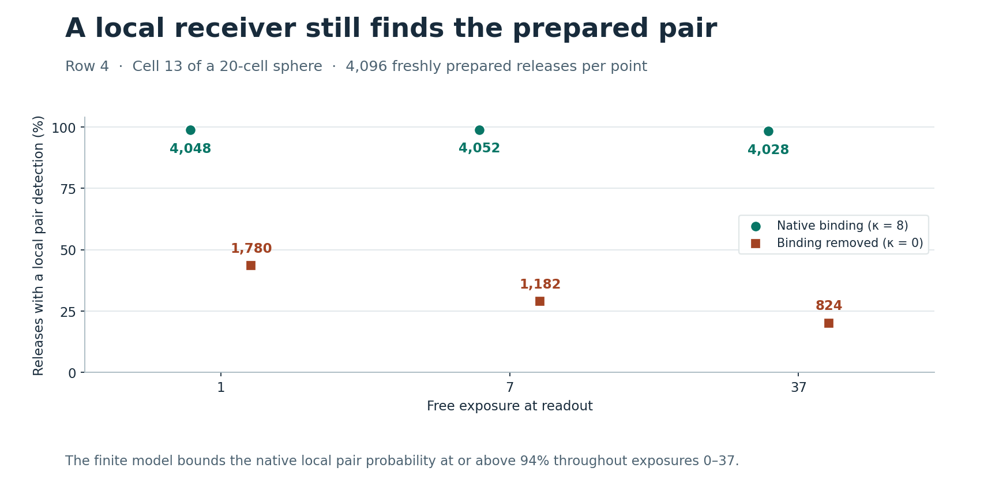

# Local detection of a freely evolving pair



The patch reads one of its 30 internal seam addresses or a quiet outcome at the end of each fresh release. The plotted percentages include every quiet trial. Under native dynamics the receiver reported the pair in 4,048, 4,052 and 4,028 of 4,096 trials at exposures 1, 7 and 37. Removing contrast yielded 1,780, 1,182 and 824 detections. The caption’s 94% bound comes from a separate finite-model calculation that covers every exposure from 0 through 37. Charge, spin and species remain unassigned. [Evidence package and reproduction commands](../row-04/README.md)

The interactive support scene shows the spherical mesh and a sample overlap graph. The repair scene lets a reader step through a mean repair on a single 12-port cell. These are teaching views. The figure above comes directly from the particle-stability experiment. [Spherical support](https://simulation.floatingpragma.io/patches?scene=support) · [Local repair](https://simulation.floatingpragma.io/patches?scene=repair)

To regenerate the figure from the review directory, run the command below with NumPy and Matplotlib installed. The archived figure used Matplotlib 3.10.8. The optional `--row04` argument accepts an archive or its extracted directory, and `--output` selects an output directory. [Plotting script](row-04-plot.py)

```sh
python3 visuals/row-04-plot.py
```
